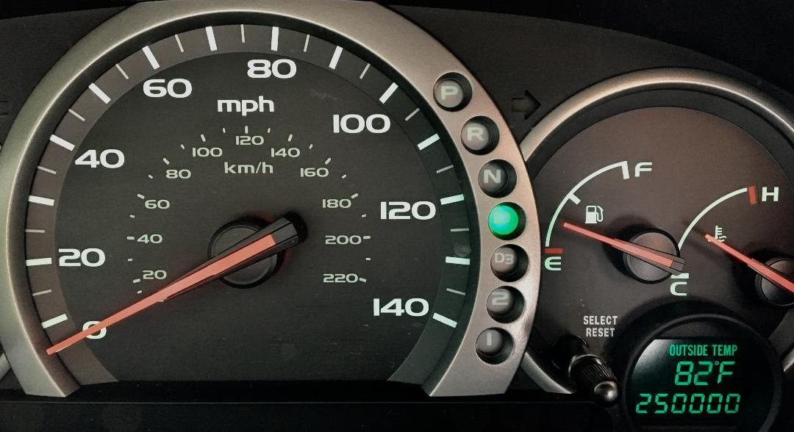

[AI-GENERATED CONTENT AWAITING HUMAN REVIEW]

# Fuel, coolant, battery and air

This page explains the systems behind the dashboard's fuel, coolant, battery and
air-pressure readings.

Which vehicles have this
Car
Truck
Tractor

An engine needs more than fuel and air to keep going. It must be kept at the right temperature,
and electricity must reach the spark plugs, the lamps and the computers, and a truck's brakes need
compressed air. Besides the parts that move a vehicle, several systems keep it running. What does
each one do, and what do its dashboard readings tell the driver?

<figure>

<figcaption>The fuel (left) and coolant temperature (right) gauges. Photo: OKJaguar, CC BY-SA 4.0, <a href="https://commons.wikimedia.org/wiki/File:Honda_Pilot_dashboard.jpg">Wikimedia Commons</a>.</figcaption>
</figure>

## Fuel

### How much is burned

Fuel holds a known amount of energy per litre, but an engine turns only part of it into work (the
rest mostly becomes heat, which leaves through the exhaust and the coolant). How much fuel is burned
therefore depends on the power that the engine gives:

- **Idling** burns a little, just to beat the engine's own friction.
- **Coasting in gear** can burn nothing, because the fuel is cut. The wheels turn the engine, so it
  needs no fuel to keep turning, and it slows the vehicle a little (engine braking).
- **A high gear** burns less than a low one at the same speed, because the engine turns more
  slowly and loses less to friction.

For example, a car that burns 8 litres in an hour of motorway driving, with a 50-litre tank, can
drive about six hours before the tank is empty. Doubling the speed asks for more than double the
fuel per hour, because the air resists the vehicle much more at high speed (see
[Resistance](resistance.md)).

### The tank

A sender in the tank measures how much fuel is left, for the gauge. A warning lamp comes on when
the level is low.

## Coolant

An engine turns most of its fuel's energy into heat. The coolant carries part of that heat away to
the radiator, where the air takes it. A cold engine warms up to its working temperature (about
90 °C), where a thermostat (a valve that opens when the coolant is hot) and a fan keep it. The
engine is kept near this temperature because a cold engine wears faster and wastes fuel, while a
too hot one can be damaged. The temperature rises when the engine works hard, and a warning comes
on if it gets too hot.

The heat comes from burning fuel, so it depends on how much fuel the engine burns rather than on
the pedal (for example, a governed truck that burns little
fuel stays cool, even with the pedal down).

## Battery and alternator

With the engine off, a car's battery rests at about 12.6 V. With the engine running, the
[alternator](glossary.md#alternator) (a small generator driven by the engine) charges it at about
14.2 V. A regulator holds this voltage, whatever the engine is doing. The charging voltage is
higher than the resting one for the same reason that it takes more pressure to fill a tyre than the
tyre already holds: the current only flows into the battery when it is pushed in.

While the engine runs, the alternator powers the vehicle, and the battery only evens out the
difference. A common misconception is that a running car lives on its battery. The battery's main
job is to start the engine and to power things while the engine is off.

The electrical load can make the voltage drop a little. Some consumers count much more than others.
Electrical power is the voltage times the current, so a 55 W halogen headlamp, at about 14 V, draws
nearly 4 A, against about 0.4 A for a 5 W tail lamp (these figures are for example only).

## A truck's air

The brakes of a truck work on compressed air, kept in tanks (usually two circuits, so that a fault
in one leaves the other). The engine's compressor fills them, and each press of the brake pedal
draws some air out. Coupling a trailer also takes air, to fill the trailer's own tank.

A warning comes on when the pressure is low. If it keeps falling, the
[spring brakes](brakes.md#air-and-spring-brakes) apply, because it is the air that holds them off.

## Engine load

Trucks and tractors report their [engine load](glossary.md#engine-load): the torque the engine is
giving, as a percentage of the most it can give at any speed. A plough, a PTO, a hill, a headwind, etc. all raise
it, because each one asks the engine for more torque to keep the vehicle going. It is not zero at
idle, because some fuel is needed to beat friction. It is not the position of the pedal either: a
governed engine can give less than its full torque even with the pedal fully down.

## Warning lamps

Warning lamps tell the driver about faults that the gauges do not show. Examples are the
check-engine lamp, the battery lamp, and the red (stop) and amber (warning) lamps of trucks. They
are switched on by the vehicle's electronic units, often through messages on the CAN bus. In
general, red means to stop now, and amber means to have the fault looked at soon.

## What Carlito simulates

The parameters the simulator uses for this, and where each is set, are listed in
[How the simulation works](simulation.md#fuel-coolant-battery-and-air):

- **Simulation-wide**:
  - [Engine efficiency](simulation.md#engine-efficiency) (`FUEL_INDICATED_EFFICIENCY`)
  - [Tank size](simulation.md#tank-size) (`FUEL_TANK_FULL_LOAD_S`)
  - [Coolant](simulation.md#coolant) (`COOLANT_AMBIENT`, `COOLANT_OPERATING`, `COOLANT_HOT`,
    `COOLANT_RATE`)
  - [Battery](simulation.md#battery) (`BATTERY_RESTING`, `BATTERY_CHARGING`,
    `BATTERY_LAMP_DROOP`)
  - [Air](simulation.md#air) (`AIR_PRESS_PRIMARY`, `AIR_PRESS_SECONDARY`)
- **Per vehicle**:
  - [Fuel](simulation.md#fuel) (`fuel_type`)

Simplification list

- **Simple models.** Unlike the movement of the vehicle, these readings come from short rules that
  behave sensibly. The flow of the coolant and the chemistry of the battery are not simulated.
  <!-- CLAUDE.md standing rule 3; VehicleTelemetry header -->
- **A small tank.** The burn is realistic, but each tank is scaled to last a little over eight
  minutes at full power, so that the gauge visibly falls.
  <!-- VehicleTelemetry FUEL_TANK_FULL_LOAD_S 500 s -->
- **No running out of fuel**: an empty tank leaves the engine running.
- **No overheating damage**, no thermostat, no radiator fan. The coolant follows the engine's load
  between 20 °C and about 108 °C, so it never reaches its 110 °C warning by itself.
  <!-- VehicleTelemetry COOLANT_AMBIENT 20, COOLANT_HOT 108; contract coolant warn 110 -->
- **No flat battery**: the battery never runs down, and the starter is not modelled. Only the
  lamps load it.
- **No air leaks** on the trucks, apart from what the brakes use.
- **No fault detection.** The simulation never lights a fault lamp by itself: sloppyCAN sets them.
  <!-- contract checkEngine, battery (in), red_stop, amber_warn: "Mirrored VERBATIM ... sloppyCAN is the sole authority" -->

## What you see in sloppyCAN

| Signal | Direction | Unit | What it shows |
| --- | --- | --- | --- |
| `fuel` | out | % | The tank level, on a scaled-down tank. Warns below 15 %. |
| `fuel_rate` | out | L/h | The burn, read off the engine. |
| `coolant` | out | °C | The coolant model. Warns at 110 °C. |
| `battery` | out | V | The battery's voltage. |
| `engine_load` | out | % | Torque given over the most it can give (Truck and tractor). |
| `air_primary`, `air_secondary` | out | bar | The two air tanks. Warn below 5 bar (Truck). |
| `engine_hours` | out | h | The engine's running time (Truck and tractor). |
| `checkEngine`, `battery` | in | flag | The check-engine and battery warning lamps, set by sloppyCAN. |
| `red_stop`, `amber_warn` | in | flag | The fault lamps, set by sloppyCAN (Truck). |
<!-- contract/carlito_contract.json: fuel (warn 15), fuel_rate, coolant (warn 110), battery (out and in), engine_load, air_primary, air_secondary, engine_hours, checkEngine, red_stop, amber_warn -->

## Related

- [The engine](engine.md): where the fuel's energy goes.
- [Brakes](brakes.md): what the truck's air is for.
- [Glossary](glossary.md): every term on this page.
