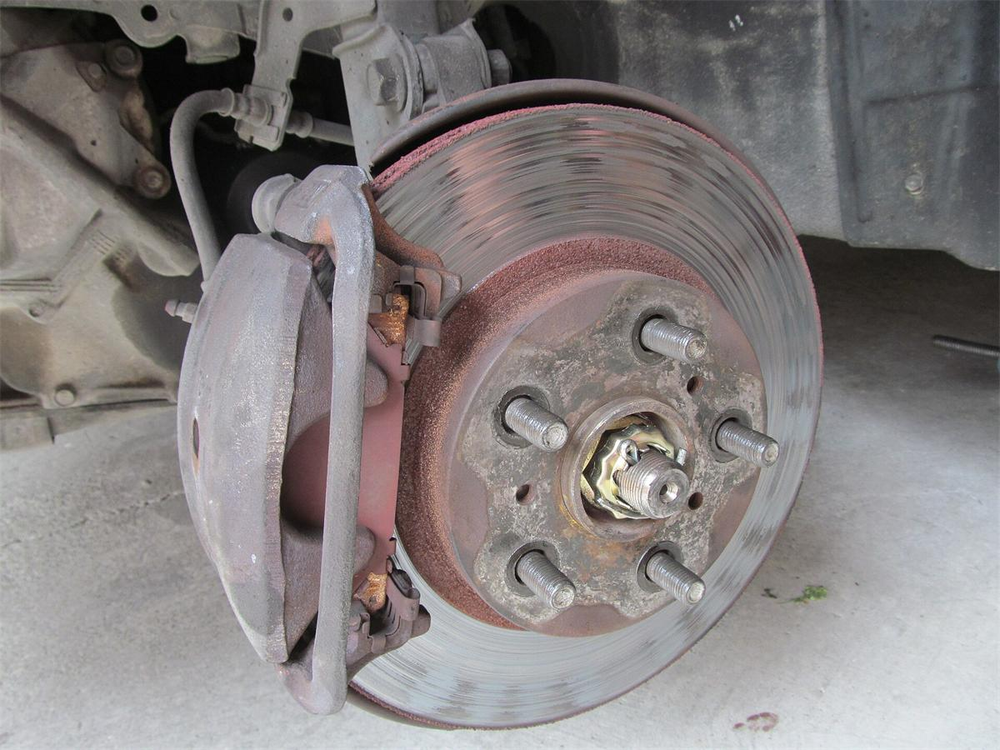
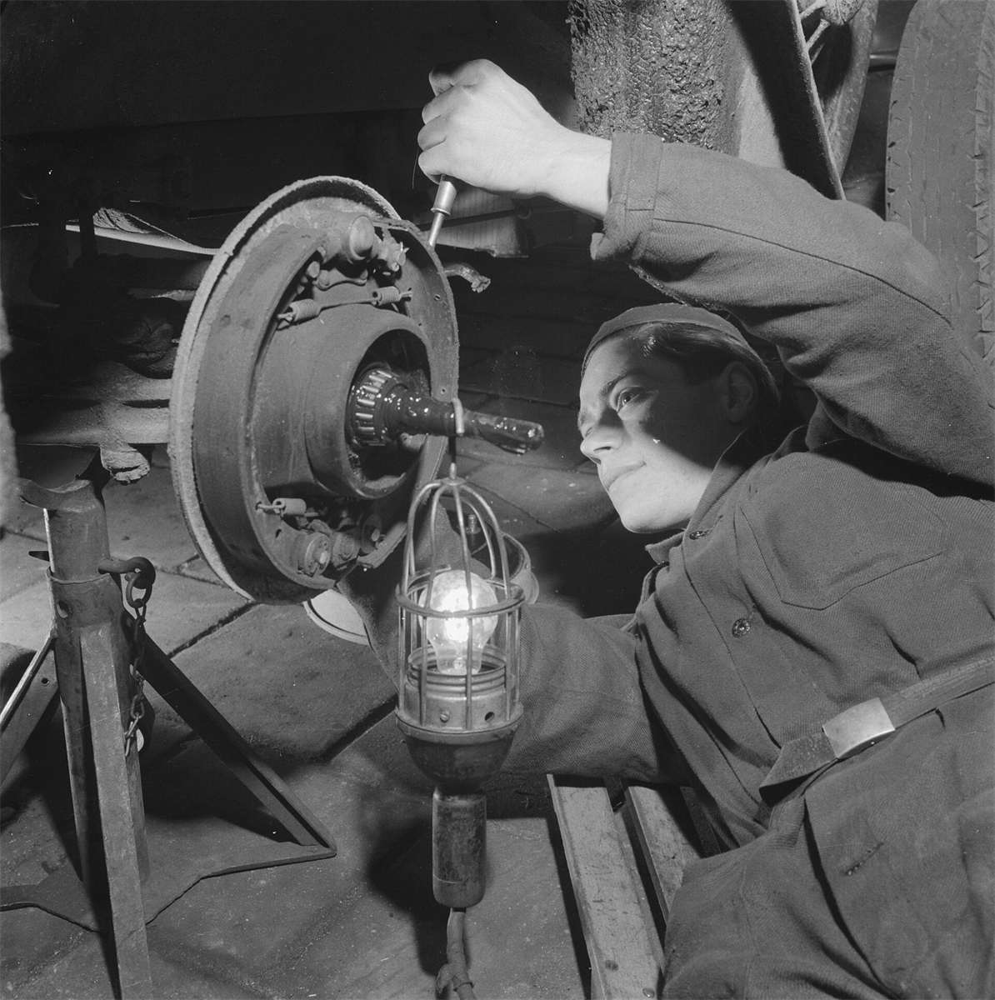
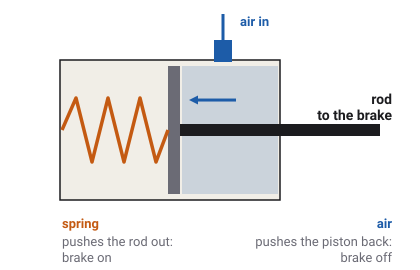

[AI-GENERATED CONTENT AWAITING HUMAN REVIEW]

# Brakes

This page explains how brakes turn speed into heat and fade when hot, the
handbrake, and a truck's retarder and air brakes.

Which vehicles have this
Car
Truck
Tractor

A car moving at motorway speed carries a great deal of energy of motion, and stopping it means
getting rid of all of that energy. Energy cannot simply disappear, so where does it go? A brake
turns it into heat, and the question for a brake is then how much heat it can take.

## Brakes turn movement into heat

<figure>

<figcaption>A disc brake with the wheel off. Photo: Riley from Christchurch, New Zealand, CC BY 2.0, <a href="https://commons.wikimedia.org/wiki/File:Alarm_bells!_(25681917701).jpg">Wikimedia Commons</a>.</figcaption>
</figure>

<figure>

<figcaption>A drum brake with the drum off. Photo: Theo van Haren Noman / Anefo, CC0, <a href="https://commons.wikimedia.org/wiki/File:Automontage_Fordgarage,_Bestanddeelnr_901-0686.jpg">Wikimedia Commons</a>.</figcaption>
</figure>

A car's brake squeezes pads against a disc that turns with the wheel. The rubbing (friction) slows
the wheel, and the tyre then slows the car. Every bit of the car's energy of motion ends up as heat
in the pads and the disc.

How much heat? The energy of motion is

energy of motion = ½ × mass × speed²

with the mass in kilograms and the speed in metres per second, which gives joules. For example, a
car of 1,000 kg at 100 km/h (about 28 m/s) carries ½ × 1,000 × 28 × 28, roughly 400,000 joules.
If all of that went into 10 kg of steel, the steel would warm by about 80 °C, within a few
seconds.

You might expect a car at twice the speed to ask twice as much of its brakes. It asks four times
as much, because the speed is squared: at 50 km/h the same car carries only about 100,000 joules,
a quarter of what it carries at 100 km/h. The same square sets the stopping distance: the tyres
can only push back with so much force, and each metre of braking at that force takes away the
same amount of energy, so four times the energy takes about four times the distance.

Other kinds of brake do the same job in different ways:

- **Drums**: shoes press on the inside of a drum. The drum is closed, so dirt and water stay out,
  but for the same reason the heat is trapped inside it. They are common on trucks.
- **Racing pads**: pads and discs made of materials that keep their grip when very hot, as brakes
  on a racing car get during hard braking from high speed.
- **Wet discs**: discs bathed in oil inside the axle, as on farm tractors. Sealed in oil, they stay
  clean in mud and wear very slowly, and the oil carries the heat away.

How hard a brake can squeeze is given as a torque (in newton-metres), like an engine's. Brakes are
normally strong enough to lock their wheels on a dry road, so the tyres set the limit and not the
brakes. So, against a common belief, a brake stronger than that does not stop a vehicle in a
shorter distance, because a tyre can push on the road with at most μ times its load (see
[the coefficient of friction](tyres.md#the-coefficient-of-friction)), and the brake cannot ask more
than that. Braking harder only locks the wheels, or makes ABS step in
([see the forces](forces.md#example-emergency-stop)).

This is why road vehicles rarely brake at much more than 1 [g](glossary.md#units): with a μ of
about 1, the tyres cannot pull the vehicle back by more than about its own weight. On ice, with a
μ of about 0.1 (for example), the limit is about a tenth of that, however good the brakes.

### Front and rear

When a car brakes, its weight moves onto the front wheels, as passengers lean forward in a bus
(see [Weight transfer](weight-transfer.md#why-weight-moves)). The front tyres are pressed harder,
so they can take more braking, and the rear ones, pressed less, can take less. The braking is
therefore shared unevenly between front and rear, with more at the front. That split is called the
[brake bias](glossary.md#brake-bias).

The split also decides what happens in a panic stop. If the front wheels lock first, the car loses
its steering but keeps going straight. If the rear wheels lock first, they lose their sideways
grip and the back swings round, which is much harder to catch (see
[Slip and the grip curve](slip.md#sharing-grip-between-braking-and-turning)). So makers set the bias to
favour the front. Because a loaded vehicle puts its weight in a different place from an empty one,
some vehicles change the split while driving, with valves or electronics.

### The pedal

Brakes are stronger than the tyres can use, so if the pedal shared out their strength evenly over
its travel, a light push would already lock the wheels. The pedal is instead designed so that a
light push gives gentle braking that is easy to control, whatever the strength of the brakes
behind it. So half the pedal does not mean half of the brakes' strength, and only a fully pressed
pedal asks for everything they have.

## The handbrake

The [handbrake](glossary.md#handbrake) usually works the rear wheels only, and a mechanical one is
not controlled by ABS. It is meant to park the vehicle, and the law requires it to hold the vehicle
on a slope.

When pulled while moving, it can lock the rear wheels. A locked tyre has almost no sideways grip,
so the back of the car swings round. Combined with a turn of the steering wheel, this makes a
handbrake turn.

The handbrake is a brake rather than a lock. A strong enough engine can drag the vehicle through
it, especially on a front-wheel-drive car: the engine drives the front wheels, and the handbrake
holds only the rear ones, so it is not working against the engine directly.

## One brake, two ways to apply it

On many cars, the handbrake has no brake of its own: the pedal and the lever reach the same rear
brakes by two routes. The pedal pushes brake fluid down a pipe, and the fluid pushes a piston that
presses the pads onto the disc. The lever pulls a steel cable, and the cable works a small
mechanism in the same caliper that pushes the same piston. A truck does the same with air and a
spring: the pedal lets air into the brake chamber, and the parking spring pushes the same rod to
the same shoes.

So the two share everything that rubs and heats. If the pedal has made the brake hot, the lever
finds it hot too.

Some cars are different: they park on a small drum brake inside the rear disc's hub, which has its
own lining that the foot brake does not heat.

## Heat and fade

<!-- BrakeThermal PAD, RACE, DRUM, WET curves -->

Every stop turns the vehicle's movement into heat in the brakes. The air then cools them down,
faster when the vehicle is moving fast, because more air flows past the brake each second (and the
hotter the brake is compared with the air, the faster it loses heat). A single stop from high
speed makes the brakes hot for a few seconds, but they cool again before the next one. The trouble
comes when stops follow each other, or when one lasts for minutes, because the heat arrives faster
than the air can take it away.

When a brake gets hot enough, its lining grips less and the brake
[fades](glossary.md#brake-fade): the same pedal gives less braking. The lining is a mixture of
materials, and when it gets very hot some of them start to break down, so it rubs less well. The
temperature where this begins depends on the hardware. Drums fade earlier than discs (a disc sits
in the open air, while a drum keeps its heat inside), and racing pads much later. Wet discs fade
when their oil gets hot.

Fade is not the same as wear. A faded brake has not worn out: it recovers once it has cooled down.
The danger is that the driver, feeling the car slow less, presses harder, and that makes the brake
hotter still.

A locked wheel does not heat its brake, because the brake is not turning, so nothing rubs. The
skidding tyre is doing the slowing then. Engine braking and retarders do not heat the brakes
either, because they slow the vehicle somewhere else.

This is why long descents are hard on brakes ([see the forces](forces.md#example-truck-downhill)).
A vehicle going down a hill at a steady speed gains energy from the height it loses, and if only the
brakes hold it back, all of that energy becomes heat in them, for minutes on end:

energy from the height lost = mass × g × height

with g about 10 (newtons per kilogram). For example, a loaded truck of 40,000 kg going down 500
metres of height gains 40,000 × 10 × 500 = 200,000,000 joules. A stop from 90 km/h (25 m/s) costs
the same truck ½ × 40,000 × 25 × 25 = 12,500,000 joules, so the descent asks as much of its brakes
as sixteen hard stops, one after the other. A driver going down a long hill therefore uses a low
gear, so that engine braking (see
[Friction and engine braking](engine.md#friction-and-engine-braking)) holds the speed, and keeps the
brakes for the moments when they are needed.

Other ways to lose speed without hot brakes

- **Runaway truck ramps.** On some long mountain roads, a steep gravel bed rises beside the road.
  A truck whose brakes have faded can steer onto it, and the loose gravel and the slope slow it
  down.
- **Exhaust brakes.** Some trucks close a valve in the exhaust pipe, so that the engine has to
  push against the trapped gas. This works like engine braking, only stronger.
- **Regenerative braking.** An electric car can run its motor as a generator when slowing down.
  Part of the energy of motion goes back into the battery instead of becoming heat.

The vehicles are the simulator's `sedan`, `race`, `garbage-truck` and `tractor-kenney`, with
their own brake split, the heat each brake holds and its kind of brake. All the energy of motion
goes into the brakes, shared between front and rear as the brake force is; in reality the air and
the tyres' rolling take a little of it. Nothing cools between the stops, so real brakes take more
stops to get this hot. Each brake is one lump of metal at one temperature, and the tractor's is
the oil its brakes sit in. Masses above each vehicle's own are for exploring.
<!-- widgets/brake-energy.js: brake_bias_front, brake_heat_capacity(_rear), brake_fade_curve(_rear) of each spec; BrakeThermal curves -->

### The handbrake on a hot brake

When it shares the rear brakes, the handbrake fades with them, so it is no help after a long
descent on the foot brake. A truck with hot drums may no longer hold on a steep slope with its
parking brake, and can creep until they cool. A gearbox's parking lock (where there is one) does
not fade, because it is a steel tooth and not a rubbing lining (see
[Holding still](holding.md#the-park-pawl)).

On a car, the brake fluid can also boil on a long descent. Fluid cannot be squashed, which is how
the pedal's push reaches the pads, but the bubbles of vapour that boiling makes can be squashed.
The pedal then goes soft and sinks, because part of the push is lost compressing bubbles. A cable
handbrake does not use the fluid, so it still works.

## The retarder

A [retarder](glossary.md#retarder) is an extra brake inside a truck's driveline. A common kind is
a paddle wheel turning in oil, which slows the drive shaft without touching the wheel brakes. The
oil resists the paddles, and the faster they turn, the more it resists. It can hold a truck back
down a long hill without making the brakes fade. Because its force falls with the shaft's speed, it
is weak at low speed, so it cannot bring a truck to a stop.

It only acts on the driven wheels. On a semi, it only brakes the tractor unit, and the heavy
trailer pushes on (see [Towing](towing.md#trailer-brakes)).

## Air and spring brakes

Big trucks brake with air pressure. Air suits trucks for two reasons: a compressed-air system can
give a lot of force, and a trailer can be joined to it with a simple hose. A compressor driven by
the engine fills tanks (usually one for each brake circuit), and the brake pedal lets that air into
the brakes. Each press draws some air out. Holding the pedal down costs nothing more, but pumping
it drains the tanks faster than the compressor refills them.

A truck's parking brakes are [spring brakes](glossary.md#spring-brake): strong springs that put
the brakes on, held off by air. This makes them fail-safe. Why? Because the brakes are on unless
air pushes the springs back, a pipe that breaks or a compressor that stops leaves the truck braked
and not free to roll. A warning comes on when the air is low, and if it keeps falling, the springs
apply the brakes and stop the truck.

## What Carlito simulates

The parameters the simulator uses for this, and where each is set, are listed in
[How the simulation works](simulation.md#brakes):

- **Simulation-wide**:
  - [Pedal shape](simulation.md#pedal-shape) (`BRAKE_HALF_PEDAL_G`)
  - [Fade curves](simulation.md#fade-curves)
- **Per vehicle**:
  - [Brake torque](simulation.md#brake-torque) (`brake_torque`)
  - [Front and rear split](simulation.md#front-and-rear-split) (`brake_bias_front`)
  - [Brakes on the front axle](simulation.md#brakes-on-the-front-axle)
    (`brake_engages_front_axle`)
  - [Handbrake](simulation.md#handbrake) (`handbrake_torque`)
  - [Brake heat](simulation.md#brake-heat) (`brake_heat_capacity`, `brake_cooling_g0`,
    `brake_cooling_g1`, `brake_emissivity`, `brake_radiating_area`, `brake_fade_curve`, and their
    `_rear` versions)
  - [Retarder](simulation.md#retarder) (`retarder_equipped`, `retarder_rating_nm`)

Simplification list

- **One lump of metal per brake.** The heat in is the braking torque times how fast the wheel
  turns; the air takes it away in proportion to how much hotter than the air the brake is, more
  the faster the vehicle moves, and a disc also radiates heat, which counts most when very hot.
  This is a simple model.
  <!-- RayWheel.heat_brake; BrakeThermal.loss_w: (g0 + g1 * speed) * (T - ambient) + emissivity * sigma * A_r * (T^4 - ambient^4); drums: emissivity 0 -->
- **One pedal shape.** On every vehicle, half the pedal asks for about half a g.
  <!-- WheelDrive.brake_application, BRAKE_HALF_PEDAL_G 0.5 -->
- **Fixed fade curves**, one for each kind of brake (the ones drawn above).
- **Parking figures are for cold brakes**, such as the slope the law requires.
- **No air pipes, valves or leaks**: two tanks that fill and empty, with the warning at 5 bar and
  the spring brakes at 3.
  <!-- contract air_primary warn 5.0; TruckTelemetry.AIR_SPRING_BRAKE_BAR 3 bar -->
- **No adjustable brake bias**, and no proportioning valve that changes the split with load.
- **No brake wear or failure** apart from the air running out on a truck.
- **No exhaust brake.** The trucks' auxiliary brake is the retarder.
- **No smoke or glowing discs**: brake heat shows only in the numbers.
- **No fluid fade.** There is no brake fluid, so no soft pedal, and the handbrake never outlasts
  the foot brake.
- **No separate handbrake shoes.** The handbrake always shares the foot brake's lining.
- **No shrinking disc.** A disc clamped while hot shrinks as it cools, which can loosen a parked
  caliper's grip. The simulation does not model it.

## What you see in sloppyCAN

| Signal | Direction | Unit | What it shows |
| --- | --- | --- | --- |
| `brake` | in | % | The foot brake. Half pedal is about half a g; full pedal is the whole hardware. |
| `handbrake` | in | flag | The parking brake: the rear wheels, or a truck's spring brakes. It fades with its brake. |
| `brake_temp` | out | °C | The hottest friction brake on the vehicle, from the heat model. Its warning, 260 °C, is late for a drum and early for a disc. |
| `retarder` | in | % | The retarder request (Truck). |
| `retarder_state` | out | % | The retarder's torque as actually applied, after it fades at low speed (Truck). |
| `air_primary`, `air_secondary` | out | bar | The two brake tanks. Warning at 5 bar; the spring brakes apply below 3 (Truck). |
| `brakeLamp` | in | flag | The stop lamps, set by sloppyCAN (Car, truck, tractor). |
| `status` | out | bitfield | Bit 5 is the handbrake. |
<!-- contract/carlito_contract.json: brake, handbrake, brake_temp (warn 260), retarder, retarder_state, air_primary / air_secondary (warn 5.0), brakeLamp, status bit 5 -->

## Scenarios

- [Emergency stop](forces.md#example-emergency-stop): the tyres set the limit.
- [Full truck braking down a hill](forces.md#example-truck-downhill): the brakes work all the way down.
- [Parked on a hill](forces.md#example-parked-on-a-hill): the brakes hold against the slope.

## Related

- [Glossary](glossary.md): every term on this page.
- [Slip and the grip curve](slip.md): why the tyre, not the brake, usually sets the stopping distance.
- [ABS, traction and stability control](driver-aids.md): the systems that work the brakes for the driver.
- [Holding still](holding.md): the handbrake, the park pawl and the other ways a vehicle stays put.
- [Towing](towing.md): how a trailer's brakes share the stop.
