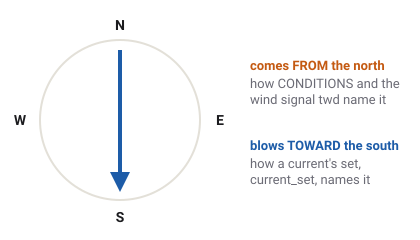

# Wind, current and conditions

A level can have its own wind and, on Level 6, a tide in the sea. The pause
menu's SANDBOX page can replace them for the session and switch between day and night. This
page explains what each one does, and what the game's weather leaves out.

Which vehicles have this
Car
Truck
Tractor
Plane
Boat
Drone
Train

## Wind

The game's wind is the same everywhere on a level: one steady flow from one direction, plus
gusts. The gusts are three gentle waves of wind laid over each other, the slowest rising and
falling over about seven seconds, the others faster and weaker. They never push the wind past a
set limit above its steady speed. The gusts follow a fixed pattern, so the same level gives the
same wind every time.
<!-- WindField: OCTAVES 3, BASE_PERIOD 7 s, each octave half the period and amplitude; "gust magnitude is bounded by gust_speed"; "gust() is pure (seed, time), so flights are reproducible" -->

Every vehicle but the train feels it. The cars, trucks and tractors take [drag](resistance.md)
and a side push from it. The boats take it on their hulls and sails. The plane and the drone fly
through the moving air, so a headwind slows them over the ground and a crosswind carries them
sideways.
<!-- WorldConditions.WIND_FAMILIES drone, plane, boat, car, truck, tractor; "The train ignores it" -->

Only two levels have wind of their own: **Level 6 - Skyport**, about 5 m/s with gusts up to 3 more,
and **Open Sea**, about 6 m/s with gusts up to 2 more. Everywhere else is calm unless SANDBOX
sets a wind.
<!-- level_6_wind.tres speed 5, gust_speed 3; open_sea_wind.tres speed 6, gust_speed 2 -->

The wind does not change with height, and hills and buildings do not shelter anything from it.

### Which way is the wind blowing?

Weather forecasts and sailors name a wind by where it comes **from**: a north wind blows from the
north towards the south. SANDBOX and the wind signals use that habit. A current is named the
other way, by the direction it flows **to**, its set, as sailors do.
<!-- WorldConditions header: "The UI enters direction as meteorological FROM degrees"; contract twd (FROM), current_set (TOWARD) -->

## The current

On **Level 6 - Skyport** the sea itself moves, like a tide. It flows one way, slows, stops, and
flows back, over a cycle of about four minutes, reaching about 1.5 m/s at its strongest. Only the
boats feel it: their hulls are dragged along with the water. [Floating and boats](floating.md)
explains what it does to them.
<!-- level_6_current.tres set_deg 110, drift 1.5, tide_period_s 240; CurrentField.rate_at: peak x sin(2 pi t / period); WorldConditions.CURRENT_FAMILIES ["boat"] -->

## SANDBOX ▸ WORLD

The pause menu's SANDBOX page has four WORLD settings, kept for the session and applied to every
level you load:

| Setting | Choices | What it does |
| --- | --- | --- |
| WIND | LEVEL, CALM, LIGHT, STRONG | LEVEL keeps the level's own. CALM removes it. LIGHT is a breeze of 4 m/s with gusts of 1.5 more. STRONG is 9 m/s with gusts of 4 more. Greyed out on the train. |
| WATER CURRENT | LEVEL, CALM, LIGHT, STRONG | The same choices for the sea: LIGHT is a current of 0.5 m/s, STRONG 1.5 m/s. It works only on the boats, so it is greyed out on every other vehicle. |
| FROM | the eight compass points | Where the LIGHT or STRONG wind and current come from. |
| TIME | day or night | The same as the **N** key. |
<!-- pause_menu.gd _build_conditions: WIND and WATER CURRENT buttons (PRESET_LABELS), each disabled where WorldConditions.WIND_FAMILIES / CURRENT_FAMILIES lacks the family; FROM; TIME. WorldConditions: WIND_LIGHT_SPEED 4, WIND_LIGHT_GUST 1.5, WIND_STRONG_SPEED 9, WIND_STRONG_GUST 4, CURRENT_LIGHT_DRIFT 0.5, CURRENT_STRONG_DRIFT 1.5, DIRECTION_STEP_DEG 45 -->

A chosen current is a steady stream for the whole session, not a tide that turns. The STRONG
wind is hard but still flyable: the drone can still make headway into it.
<!-- WorldConditions: CURRENT_PERIOD_S 0, "A player-picked current is one steady push for the session"; STRONG wind comment on the drone -->

## Day and night

Night darkens the level and lights the lamps' beams. It changes nothing in the physics: tyres,
engines and air behave the same. The vehicles' lights follow the lamp signal, so at night you
need sloppyCAN, or the **L** key, to turn them on.
<!-- GameState.night_changed; pause_menu.gd NIGHT_HELP "The N key does this too"; lights key L -->

## What the game leaves out

- **No rain, snow or fog falling.** Wet road and snow exist only as painted ground
  ([Ground and tyre types](surfaces.md)).
- **No temperature or air pressure changes**, except the drone's own height-based air readings.
- **No wind shadow** behind hills or buildings, and no wind change with height.
- **No real waves**, only drawn ones.

## What you see in sloppyCAN

| Signal | Direction | Unit | What it shows |
| --- | --- | --- | --- |
| `twd` | out | deg | The true wind's direction, where it comes from. Car, truck, tractor, boat. |
| `tws` | out | m/s | The true wind's speed. Car, truck, tractor, boat. |
| `awa`, `aws` | out | deg, m/s | Boat: the wind it feels, with its own movement added. |
| `current_set`, `current_drift` | out | deg, m/s | Boat: where the current flows to, and how fast. |
| `lights` | in | enum | The headlights: off, clearance, low or high. |
<!-- contract/carlito_contract.json: twd, tws (car, truck, tractor, boat), awa, aws, current_set, current_drift, lights -->

## Try it in the game

Try it in the game: a crosswind on the motorway

1. Pick the `semi` with the box trailer on **Flatland**. Pause, open SANDBOX and set WIND to
   STRONG, FROM to WEST.
2. Press **F3** if the debug overlay is hidden: its `wind` line shows the wind's
   speed and the direction it blows toward.
3. Drive north at 80 km/h. You have to hold a little steering into the wind to stay straight,
   and the gusts tug at the rig every few seconds.
4. Turn to drive west, into the wind: the same pedal now holds a lower speed.

## Related

- [Air and rolling resistance](resistance.md): how the wind reaches a wheeled vehicle.
- [Floating and boats](floating.md): wind and tide on the water.
- [Glossary](glossary.md): every term on this page.
