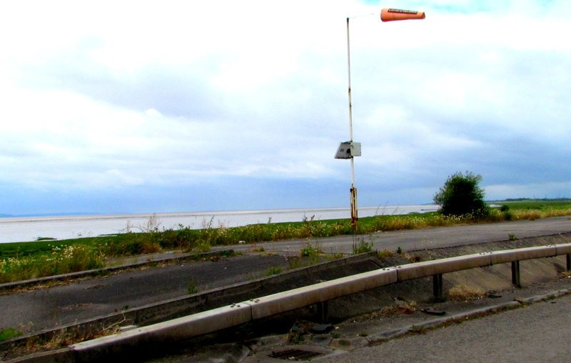
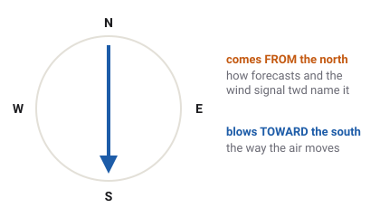

# Wind and conditions

This page explains how wind is described, and how the wind and the time of day
affect driving.

Which vehicles have this
Car
Truck
Tractor

## Wind

<figure>

<figcaption>A windsock beside a motorway. Photo: Jaggery, CC BY-SA 2.0, <a href="https://commons.wikimedia.org/wiki/File:Orange_windsock_at_the_edge_of_the_M4_motorway_near_Caldicot_-_geograph.org.uk_-_5810103.jpg">Wikimedia Commons</a>.</figcaption>
</figure>

A flag on a pole shows which way the wind blows and how hard. Why should a driver care about it?
Because a vehicle drives through the air, and the air is rarely still: the wind adds to what the
vehicle has to push through, or helps it, and it can push the vehicle off its line. Wind is
usually described by a steady speed and a direction, plus gusts (short rises in speed).

A vehicle feels the wind in two ways, and which one depends on the way the vehicle is pointing
compared with the wind. Along the vehicle, the wind adds to the [drag](resistance.md) or takes
away from it, because what counts for drag is the speed of the vehicle through the air. Across the
vehicle, it pushes sideways, so the driver has to steer slightly into it to go straight
([see the forces](forces.md#example-crosswind)).

Most of the time the wind is at an angle, and then it counts as both. For example, take a wind of
10 metres per second and a car driving at an angle of 45 degrees to it. Of that wind, a bit more
than 7 metres per second blows along the car's line and a bit more than 7 across it.
Turn the car until it points straight into the wind and all 10 become a headwind; turn it
square to the wind and all 10 become a crosswind.

Gusts are harder to handle than a steady wind, because the push keeps changing, and a driver who
has steered against a steady push is suddenly steering against too much or too little. The same
happens at the edge of a bridge or a gap between buildings, where a car leaves shelter and meets
the full wind in a second.

### Which way is the wind blowing?

Weather forecasts name a wind by where it comes **from**: a north wind blows from the north
towards the south. A car heading north into a north wind meets a headwind; heading south, with
the same wind, it has a tailwind. The wind signals follow the same convention.
<!-- contract twd (FROM) -->

## Rain, snow and fog

Wind is not the only part of the weather. Rain and snow change what the tyres can do (see
[Tyres and grip](tyres.md#grip-comes-from-friction) and [Ground and tyre types](surfaces.md)),
and rain, snow and fog change how far the driver can see. A driver who cannot see far has to
drive more slowly, so that the car can stop within the distance the driver can see.

## Day and night

Darkness does not change how tyres, engines or air behave, but it changes how far the driver can
see. This is what the headlights are for, and they have three settings:

- **Clearance lights** (also called parking or side lights) are weak, and they only let other
  drivers see the vehicle. They do not light the road.
- **Low beam** lights the road ahead, and is aimed downwards so that it does not dazzle the
  drivers coming the other way.
- **High beam** shines further, so the driver sees more, but it dazzles anyone ahead, so it is
  used on empty roads.

The same rule as in fog applies at night: the light only reaches so far, and the driver should be
able to stop within it.

## What Carlito simulates

The parameters the simulator uses for this, and where each is set, are listed in
[How the simulation works](simulation.md#wind-and-conditions):

- **Simulation-wide**:
  - [Gust pattern](simulation.md#gust-pattern) (`OCTAVES`, `BASE_PERIOD`)
- **Per level**:
  - [Wind](simulation.md#wind) (`speed`, `gust_speed`, `direction_deg`, `gust_seed`)

Simplification list

- **No rain, snow or fog falling.** Wet road and snow exist only as painted ground
  ([Ground and tyre types](surfaces.md)).
- **No temperature or air pressure changes.**
- **No wind shadow** behind hills or buildings, and no wind change with height: the wind is the
  same everywhere on a level.
- **Gusts on a fixed pattern.** They are three gentle waves of wind laid over each other, the
  slowest rising and falling over about seven seconds, the others faster and weaker, so the same
  level gives the same wind every time.
  <!-- WindField: OCTAVES 3, BASE_PERIOD 7 s, each octave half the period and amplitude; "gust() is pure (seed, time), so flights are reproducible" -->

## What you see in sloppyCAN

| Signal | Direction | Unit | What it shows |
| --- | --- | --- | --- |
| `twd` | out | deg | The true wind's direction, where it comes from. |
| `tws` | out | m/s | The true wind's speed. |
| `lights` | in | enum | The headlights: off, clearance, low or high. |
<!-- contract/carlito_contract.json: twd, tws, lights -->

## Scenarios

- [Crosswind at 100 km/h](forces.md#example-crosswind): a wind from the side.
- [Cruising into a headwind](forces.md#example-headwind): a wind from the front.

## Related

- [Air and rolling resistance](resistance.md): how the air pushes on a vehicle.
- [Glossary](glossary.md): every term on this page.
