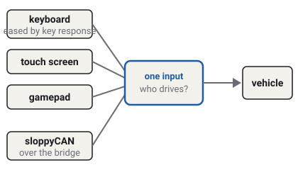

# Controls and who drives

A vehicle in the game can be driven from the keyboard, a touch screen, a gamepad
or sloppyCAN. Whatever the source, the vehicle sees one set of controls. This page explains how
the game merges them, how it makes on-off keys feel like a steering wheel and pedals, and who
is in charge when sloppyCAN is connected.

Which vehicles have this
Car
Truck
Tractor
Plane
Boat
Drone
Train

## One input for every vehicle

Sixty times a second, the game gathers every control from every source and merges them into one
set: accelerator, brake, steering, handbrake, gear, key, lights, and each vehicle's own switches.
The vehicle reads only that one set. It never knows whether a person or sloppyCAN is driving.
<!-- InputRouter: "merges input sources into one normalized VehicleInput ... Vehicles never know which source is active"; CLAUDE.md standing rule 5 -->

The keyboard and the touch screen are merged first; a gamepad's sticks are then added on top. A
few rules hold whatever the source:

- **The brake never becomes throttle.** Each pedal is its own control.
- **No fuel without the key at Ignition.** With the key at Lock or On, the accelerator does
  nothing.
- **Both pedals at once.** Pressing the brake and accelerator together holds the vehicle; if it
  still moves faster than a walk, the accelerator is cut until one pedal is released, as an engine
  computer's brake-override does.
<!-- InputRouter header "brake > accel > handbrake"; arbitrate_local: "ignition gates throttle; brake never throttles"; BRAKE_OVERRIDE_SPEED 1 m/s -->

## Making keys feel like pedals

A key is either pressed or not. A steering wheel and a pedal move smoothly. So the game eases a
pressed key in, the way a hand turns a wheel or a foot presses a pedal:

- **Pedals** press in over a moment and lift off a little faster.
- **Steering** turns in steadily and comes back to centre faster than it went out. The faster the
  vehicle goes, the more slowly a held key turns the wheels, so a tap at motorway speed does not
  throw the car off the road. On the boat, the drone and the plane in the air, where steering does
  not turn road wheels, the key turns at the same rate whatever the speed.
<!-- KeyShaper; docs/systems.md Input pipeline: "steer ramps out ever more slowly with road speed while it turns road wheels (1 / v^2 above 10 m/s; BaseVehicle.key_steer_speed, 0 for a flying plane, drone and boat)" -->

The SETTINGS option KEY RESPONSE sets how much easing there is, in five steps: RAW (none, the key
as pressed), ARCADE (the default, a little), BALANCED, SMOOTH and REALISTIC (the full model). The
touch screen's stick, a gamepad and sloppyCAN already move smoothly, so they are never eased.
<!-- key_shaper.gd SOFTENING_LABELS RAW, ARCADE, BALANCED, SMOOTH, REALISTIC; DEFAULT_SOFTENING 0.15 (ARCADE) -->

[Steering and Ackermann](steering.md) explains what happens to the steering after this.

## Who drives: local or sloppyCAN

When sloppyCAN is connected and sending fresh driving controls (accelerator, brake, steering or
gear), it drives, and the keyboard, touch screen and gamepad are set aside for driving. When it is
connected but sends no driving controls, the local controls drive, and sloppyCAN still sets the
things it is sending, such as the lights.
<!-- InputRouter._physics_process: "A fresh bridge carrying a driving control drives outright. A fresh bridge carrying none ... hands the driving group to local input"; blend_local_driving -->

sloppyCAN works the gear byte directly ([Gearbox and shifting](gearbox.md#manual-gears-from-sloppycan)).
Signals that sloppyCAN does not send fall back to a safe resting value: lights off, hitch raised,
PTO off, flaps up, drone disarmed, doors shut.
<!-- docs/systems.md: "Absent bridge keys fall to rest state (lamps off, hitch raised, PTO off, 540, open diff, 2WD, SCV shut, flaps up, disarmed, doors shut, LEDs black, body Idle)" -->

### Challenges

Challenges teach CAN, so in a challenge only sloppyCAN may drive. The keyboard, touch screen and
gamepad are switched off for driving, and the game says so if you press a driving key or trigger.
If sloppyCAN is not connected, or stops sending, the vehicle parks: key at Lock, gear in P,
handbrake on.
<!-- InputRouter._bridge_only, KEYS_LOCKED_NOTICE_TEXT "LOCAL DRIVING OFF IN CHALLENGES - DRIVE OVER SLOPPYCAN" raised on DRIVING_ACTIONS (keys and the pad's axes), locked_idle; TouchControls.set_driving_locked -->

## Lamps and horn

The lights cycle with **L**: off, clearance lamps, low beam, high beam. The brake lamps follow the
foot brake. Once sloppyCAN is connected it is the only authority on the lamps: the game shows what
it sends, turn signals included, exactly as sent, and never blinks a lamp on its own timer. The
horn sounds on **H** or sloppyCAN's `horn`.
<!-- contract lights "sloppyCAN is the sole authority on lamp state", turnL "mirror verbatim, never add a local blink timer"; InputRouter: "Local rear STOP follows the foot brake; sloppyCAN owns it once the bridge is live"; keys L, H -->

## The keys

| Key | Does |
| --- | --- |
| **W** or **↑** | Accelerator; from a standstill in reverse, selects drive |
| **S** or **↓** | Brake; held at a standstill, selects reverse |
| **A**, **D** or **←**, **→** | Steer |
| **Space** | Handbrake, while held |
| **Shift** | Parking brake on or off (also R1 on the gamepad, HAND on the touch screen) |
| **Backspace** | Respawn |
| **G**, **V**, **E** | Garage; next vehicle body; next implement or trailer |
| **C** | Camera view |
| **L**, **H**, **N** | Lights; horn; day and night |
| **F2** | Dashboard size: COMPACT, FULL, OFF, then COMPACT again |
| **F3** | Show or hide the debug overlay (shown at the start) |
| **F4** | On-screen touch controls |
| **4**, **5** | Level select; challenges |
| **Esc** | Pause menu |
<!-- project.godot [input]: accel W / Up, brake_reverse S / Down, steer A D / Left Right, handbrake Space, parking_brake Shift, respawn Backspace, garage G, next_vehicle V, next_attachment E, camera_view C, headlights L, horn H, day_night N, toggle_dashboard F2, debug_overlay F3, toggle_touch F4, level_select 4, challenge_select 5, to_menu Escape; boot.gd _toggle_dashboard cycles Dashboard.DENSITY_KEYS COMPACT -> FULL -> OFF; debug_overlay.gd _ready visible = true, the F3 action toggles it -->

The dashboard starts COMPACT: the warning lamps, the speedometer and the rev counter. FULL adds
the bars (fuel, coolant, brake temperature, a truck's air and the rest) and a line of readings
(heading, odometer, position, fuel burn). The debug overlay, top right, shows only the frame rate
until SETTINGS ▸ EXTENDED DEBUG LABELS is ON; then it adds each wheel's surface, grip, slip and
angle, the body's pitch and roll, a trailer's angle and the wind.
<!-- dashboard.gd: "COMPACT (the default) keeps the tell-tale row and gauges; FULL adds the bars, readout, wind rose and echo sounder"; readout "HDG ODO lat, lon" plus READOUT_EXTRAS BURN; debug_overlay.gd _refresh: FPS only unless _extended, then _grip_line, _slip_line, _steer_line, _attitude_line, _articulation_line, _flow_line -->

Each vehicle adds its own keys, explained on its pages: the tractor's hitch, PTO, hand throttle,
hydraulics, diff lock and front drive; the plane's flaps and climb; the drone's arming, modes and
node failures; the boat's autopilot and sheet; the train's pantograph and doors. The pause menu's
CONTROLS page lists the controls of the vehicle you are driving for each device you have used
this visit: its keys, its gamepad buttons, its on-screen buttons. The gamepad's are drawn on a
pad, once as pressed and once with L1 held, so any make of pad reads the same; on a narrow window
they are a column of button names instead.

## The gamepad

Any gamepad works. The names here are a PlayStation pad's; on an Xbox pad Cross is A, Circle is
B, Square is X, Triangle is Y, L1 is LB, R2 / L2 are RT / LT, Create is View and Options is Menu.
The layout puts the controls where racing and farming games put them.

| Button | Does |
| --- | --- |
| **R2** / **L2** | Accelerator / brake; L2 held at a standstill selects reverse |
| **Left stick** | Steer. Forward and back: the plane's elevator (pull back, nose up), the drone's climb (push, climb) |
| **Right stick** | Look around the vehicle; the view stays where you leave it |
| **R3** | Recenter the camera |
| **D-pad ↑** / **↓** | Zoom in / out, while held |
| **Cross** (✕) | Handbrake, while held |
| **R1** | Parking brake on or off |
| **Circle** (○) | Camera view |
| **Triangle** (△) | Respawn |
| **Square** (□) | Lights |
| **L3** | Horn |
| **Options** | Pause menu, and back out of it |
| **Create** | Garage |
<!-- ActionRegistry ENTRIES `pad` slots and PadLayer.BUTTONS; project.godot joypad axes accel R2 (axis 5), brake_reverse L2 (axis 4), steer left stick X; pad_source.gd elevator = stick Y (back +), climb = -Y; level.gd _pad_view: right stick orbit, camera_zoom held; camera_recenter R3 -->

The vehicle's own controls sit on **L1**: hold it and press a face button. Each button keeps one
role across vehicles, so the main control is always L1 + Square. While L1 is held, the left of the
screen lists what it does on the vehicle you are driving; a button with nothing on L1 there does
its usual job. Until you first press L1, a line there says it holds more controls.

| Hold L1 and | Tractor | Truck | Drone | Plane | Boat | Train |
| --- | --- | --- | --- | --- | --- | --- |
| **Square** | hitch | tip the body | arm | flaps | autopilot | pantograph |
| **Circle** | PTO | PTO | flight mode | | sheet | doors |
| **Cross** | hydraulic remote | refuse body | cargo hook | | | |
| **R1** | PTO speed | | fail a node | | | |
| **D-pad ↑** / **↓** | hand throttle | | | | | |
| **D-pad ←** / **→** | diff lock / front drive | | | | | |
| **R3** | hand throttle to PTO speed | | | | | |

L1 + Triangle cycles the implement or trailer on any vehicle that tows one. A control appears only
on a machine that has it (a truck tips only with a tipper on). Level select and the challenges
are rows in the pause menu.
<!-- ActionRegistry pad slots l1+square/circle/cross/r1/dpad_*/r3/triangle, gated by families and capability (pad_action, pad_layer_rows); PadLegend, PadLegend.show_hint while the pad is in use until PadLayer.layer_used; pause_menu.gd LEVEL and CHALLENGES rows -->
<!-- ActionRegistry: every bound action, one row each, gated by family and capability; the CONTROLS sheet -->

## The settings and switches that change the physics

| Where | Setting | Kept |
| --- | --- | --- |
| SETTINGS | KEY RESPONSE, TRACTION CONTROL, STABILITY CONTROL, AUTO HOLD | saved |
| LAB | ANTI-LOCK BRAKES, DIFFERENTIALS, STEERING | this session; locked in a challenge |
| CONDITIONS | WIND, WATER CURRENT, FROM, TIME | this session |
| GARAGE | the gearbox (with sloppyCAN), the tyres | the gearbox this session, the tyres saved |
<!-- docs/systems.md: SETTINGS saved to user://; LAB, CONDITIONS and the gearbox choice session-held; tyre choice saved -->

Each is explained where it matters: [Ground and tyre types](surfaces.md) for tyres,
[ABS, traction and stability control](driver-aids.md) for the aids, [Holding still](holding.md)
for auto hold, [Differentials](differentials.md#the-lab-switch) and
[Steering](steering.md#parallel-steering-for-comparison) for the LAB switches,
[Wind, current and conditions](conditions.md) for CONDITIONS.

## What you see in sloppyCAN

| Signal | Direction | Unit | What it shows |
| --- | --- | --- | --- |
| `accel`, `brake` | in | % | The pedals. |
| `steer` | in | % | The steering, −100 left to +100 right. Not on the train. |
| `handbrake` | in | flag | The parking brake. |
| `key` | in | enum | Lock, On or Ignition. No fuel unless Ignition. |
| `gear` | in | enum | The gear byte. |
| `lights`, `turnL`, `turnR`, `brakeLamp` | in | enum, flag | The lamps, shown as sent. |
| `horn` | in | flag | Sounds on a rising edge. |
| `throttle` | out | % | The throttle as the game applied it, signed by direction. |
| `steer` | out | % | The steering as applied, after the steering rate. |
| `status` | out | bitfield | Bit 0 ignition, bit 5 handbrake, bit 6 headlights on. |
<!-- contract/carlito_contract.json: accel, brake, steer (in, not train), handbrake, key, gear, lights, turnL, turnR, brakeLamp, horn ("honk on rising edge"), throttle, steer (out), status bits 0, 5, 6 -->

## Try it in the game

Try it in the game: key response

1. Pick the `sedan` on **Flatland**. Open SETTINGS and set EXTENDED DEBUG LABELS to ON: the
   overlay's `steer` line shows each wheel's angle. (**F3** shows or hides the overlay.)
2. At 100 km/h, tap **A**. The wheels turn only a few degrees, slowly.
3. Open SETTINGS, set KEY RESPONSE to RAW, and tap **A** again at the same speed: the wheels turn
   further and faster, and the car darts.
4. Set it back to ARCADE.

## Related

- [Steering and Ackermann](steering.md): what the steering request does at the wheels.
- [Glossary](glossary.md): every term on this page.
