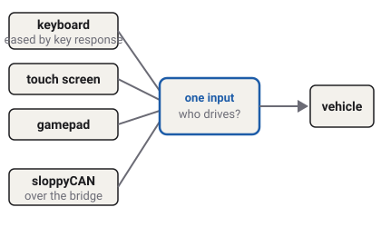

[AI-GENERATED CONTENT AWAITING HUMAN REVIEW]

# Controls and who drives

This page explains how the simulator merges local controls and sloppyCAN into one
set of controls, who drives, and what its settings change.

Which vehicles have this
Car
Truck
Tractor

## One input for every vehicle

Sixty times a second, the simulator gathers every control from every source and merges them into
one set (accelerator, brake, steering, handbrake, gear, key, lights, and each vehicle's own
switches). The vehicle reads only that one set. It never knows whether a person or sloppyCAN is
driving.
<!-- InputRouter: "merges input sources into one normalized VehicleInput ... Vehicles never know which source is active"; CLAUDE.md standing rule 5 -->

The keyboard and the touch screen are merged first, then a gamepad's sticks are added on top. A
few rules hold whatever the source:

- **The brake never becomes throttle.** Each pedal is its own control.
- **No fuel without the key at Ignition.** With the key at Lock or On, the accelerator does
  nothing.
- **Both pedals at once.** Pressing the brake and accelerator together holds the vehicle; if it
  still moves faster than a walk, the accelerator is cut until one pedal is released, as an engine
  computer's brake-override does.
<!-- InputRouter header "brake > accel > handbrake"; arbitrate_local: "ignition gates throttle; brake never throttles"; BRAKE_OVERRIDE_SPEED 1 m/s -->

The pause menu's CONTROLS page lists the controls of the vehicle you are driving, for each device.

## Making keys feel like pedals

A key is either pressed or not, while a steering wheel and a pedal move smoothly. So the simulator
eases a pressed key in, the way a hand turns a wheel or a foot presses a pedal:

- **Pedals** press in over a moment and lift off a little faster.
- **Steering** turns in steadily and comes back to centre faster than it went out. The faster the
  vehicle goes, the more slowly a held key turns the wheels, so that a tap at motorway speed does
  not throw the car off the road.
<!-- KeyShaper; docs/systems.md Input pipeline: "steer ramps out ever more slowly with road speed while it turns road wheels (1 / v^2 above 10 m/s; BaseVehicle.key_steer_speed)" -->

The SETTINGS option KEY RESPONSE sets how much easing there is, in five steps: RAW (none, the key
as pressed), ARCADE (the default, a little), BALANCED, SMOOTH and REALISTIC (the full model). The
touch screen's stick, a gamepad and sloppyCAN already move smoothly, so they are never eased.
<!-- key_shaper.gd SOFTENING_LABELS RAW, ARCADE, BALANCED, SMOOTH, REALISTIC; DEFAULT_SOFTENING 0.15 (ARCADE) -->

## Choosing a gear

The GARAGE has a GEARBOX setting: AUTOMATIC or MANUAL.

With local controls:

- **AUTOMATIC**: there is no gear lever. Pressing the accelerator from a standstill selects drive.
  Holding the brake at a standstill selects reverse: the brake control then drives the vehicle
  backwards, and the accelerator becomes the brake.
- **MANUAL**: each shift moves one step along R, N, 1, 2 and up to the top gear. The brake only
  brakes, and never selects reverse. The vehicle starts in N, or keeps its gear if MANUAL is picked
  while it moves. This only works while sloppyCAN is not connected: when it is connected without
  driving, the local controls drive as in AUTOMATIC.
<!-- InputRouter.arbitrate_local (brake_reverse at a standstill), shift_step (the ladder, no wrap), reset_vehicle_cycles, local_gear_seed; _local_tick: manual only without driving_only ("in fallback local input drives automatic") -->

When sloppyCAN drives, it sends the [gear byte](glossary.md#gear-byte):

- **AUTOMATIC**: the byte works like an automatic's lever. P parks, R reverses, and any drive gear
  means "drive", with the gearbox choosing the gear itself. A byte of 0 means no opinion: the
  vehicle drives forward when the accelerator is pressed.
- **MANUAL**: the byte is taken exactly. D3 means third gear and 0 means neutral, and the gearbox
  never changes gear by itself. The clutch is still worked for you. A gearbox with fewer gears
  treats a higher number as its top gear.
<!-- InputRouter.arbitrate_bridge (manual: the exact byte); Drivetrain GEAR_N 0x00, GEAR_R 0xFF, GEAR_P 0xFE, TOP_GEAR 24 -->

## Who drives: local or sloppyCAN

When sloppyCAN is connected and sending fresh driving controls (accelerator, brake, steering or
gear), it drives, and the keyboard, touch screen and gamepad are set aside for driving. When it is
connected but sends no driving controls, the local controls drive, and sloppyCAN still sets the
things it is sending, such as the lights.
<!-- InputRouter._physics_process: "A fresh bridge carrying a driving control drives outright. A fresh bridge carrying none ... hands the driving group to local input"; blend_local_driving -->

Signals that sloppyCAN does not send fall back to a safe resting value (lights off, hitch raised,
PTO off, etc.).
<!-- docs/systems.md: "Absent bridge keys fall to rest state (lamps off, hitch raised, PTO off, 540, open diff, 2WD, SCV shut, flaps up, disarmed, doors shut, LEDs black, body Idle)" -->

### Challenges

Challenges teach CAN, so in a challenge only sloppyCAN may drive. The keyboard, touch screen and
gamepad are switched off for driving, and the simulator says so if you try to use them. If
sloppyCAN is not connected, or stops sending, the vehicle parks: key at Lock, gear in P, handbrake
on.
<!-- InputRouter._bridge_only, KEYS_LOCKED_NOTICE_TEXT raised on DRIVING_ACTIONS, locked_idle; TouchControls.set_driving_locked -->

## Lamps and horn

The lights have four states: off, clearance lamps, low beam and high beam. The brake lamps follow
the foot brake. Once sloppyCAN is connected it is the only authority on the lamps: the simulator
shows what it sends, turn signals included, exactly as sent, and never blinks a lamp on its own
timer. The horn can be sounded locally or with sloppyCAN's `horn`.
<!-- contract lights "sloppyCAN is the sole authority on lamp state", turnL "mirror verbatim, never add a local blink timer"; InputRouter: "Local rear STOP follows the foot brake; sloppyCAN owns it once the bridge is live" -->

## The dashboard and the debug overlay

The dashboard has two sizes. COMPACT shows the warning lamps, the speedometer and the rev
counter. FULL adds the bars (fuel, coolant, brake temperature, a truck's air and the rest) and a
line of readings (heading, odometer, position, fuel burn). The dashboard picks FULL when it fits
on the screen, COMPACT when it would cover too much of it, as on a phone. The small **MORE** or
**LESS** in its bottom-left corner switches the size for the family you are driving (car, truck or
tractor) and remembers it; pressing it back to the size the screen would pick lets that family
follow the screen again.

On the dashboard, the ABS OFF lamp means that ABS was switched off in SANDBOX, VDC that a
trailer's roll control is acting, and TRLR ABS is the American trailer ABS warning set by
sloppyCAN. The AUTO HOLD lamp glows dim while auto hold is on, and bright while it is holding.
<!-- dashboard.gd LAMP labels; auto_hold "dim while switched on, lit while holding" -->

The debug overlay, top right, shows the frame rate and draw calls, each wheel's surface, grip,
slip and angle, the body's pitch and roll, a trailer's angle and the wind.
<!-- dashboard.gd: "COMPACT keeps the tell-tale row and gauges; FULL adds the bars, readout, wind rose and echo sounder"; AUTO_MAX_H; _make_size_tab "MORE"/"LESS"; debug_overlay.gd _refresh -->

## The chassis view

The chassis view is a small panel on the right, above the dashboard: a plan of the vehicle with
each tyre's load, grip and push, the differentials and the body's acceleration. What each mark means is on
[The chassis view](chassis-view.md).

## The settings and switches that change the physics

| Where | Setting | What it does | Kept |
| --- | --- | --- | --- |
| SETTINGS | KEY RESPONSE | How much key presses are eased. | saved |
| SANDBOX ▸ VEHICLE | TRACTION CONTROL | Off lets the cars' driven wheels spin. | saved |
| SANDBOX ▸ VEHICLE | STABILITY CONTROL | Off switches ESC off, and traction control with it. | saved |
| SANDBOX ▸ VEHICLE | AUTO HOLD | Holds the brakes whenever the vehicle stops in gear. Off at first. | saved |
| SANDBOX ▸ VEHICLE | ANTI-LOCK BRAKES | Off lets the wheels lock. It takes stability control, traction control, hill-start assist and auto hold with it. | this session; locked in a challenge |
| SANDBOX ▸ VEHICLE | DIFFERENTIALS | STOCK, OPEN or LOCKED on every driven axle. LOCKED also switches stability and traction control off. The tractors keep their own diff lock. | this session; locked in a challenge |
| SANDBOX ▸ VEHICLE | STEERING | PARALLEL turns both front wheels by the same angle, instead of Ackermann. | this session; locked in a challenge |
| SANDBOX ▸ WORLD | WIND | LEVEL keeps the level's own wind. CALM removes it. LIGHT is 4 m/s with gusts of 1.5 more, STRONG 9 m/s with gusts of 4 more. | this session |
| SANDBOX ▸ WORLD | FROM | The compass point that a LIGHT or STRONG wind comes from. | this session |
| SANDBOX ▸ WORLD | TIME | Day or night. It changes nothing in the physics. | this session |
| GARAGE | GEARBOX | AUTOMATIC or MANUAL. | this session |
| GARAGE | TYRES | The vehicle's tyre class. A challenge always uses the stock tyre. | saved |
<!-- pause_menu.gd TCS_HELP, ESC_HELP, ABS_HELP, AXLE_DIFF_HELP, AUTO_HOLD_HELP, _build_conditions; WorldConditions; docs/systems.md -->

While sloppyCAN is connected, TRACTION CONTROL, STABILITY CONTROL and AUTO HOLD are greyed out,
because sloppyCAN takes over those functions. ANTI-LOCK BRAKES, DIFFERENTIALS and STEERING still
apply while it drives.
<!-- InputRouter._apply_lab: "they act whoever drives" -->

## What you see in sloppyCAN

| Signal | Direction | Unit | What it shows |
| --- | --- | --- | --- |
| `accel`, `brake` | in | % | The pedals. |
| `steer` | in | % | The steering, −100 left to +100 right. |
| `handbrake` | in | flag | The parking brake. |
| `key` | in | enum | Lock, On or Ignition. No fuel unless Ignition. |
| `gear` | in | enum | The gear byte. |
| `lights`, `turnL`, `turnR`, `brakeLamp` | in | enum, flag | The lamps, shown as sent. |
| `horn` | in | flag | Sounds on a rising edge. |
| `throttle` | out | % | The throttle as applied, signed by direction. |
| `steer` | out | % | The steering as applied, after the steering rate. |
| `status` | out | bitfield | Bit 0 ignition, bit 5 handbrake, bit 6 headlights on. |
<!-- contract/carlito_contract.json: accel, brake, steer (in), handbrake, key, gear, lights, turnL, turnR, brakeLamp, horn ("honk on rising edge"), throttle, steer (out), status bits 0, 5, 6 -->

## Related

- [How the simulation works](simulation.md): what the physics does with these controls.
- [Glossary](glossary.md): every term on this page.
