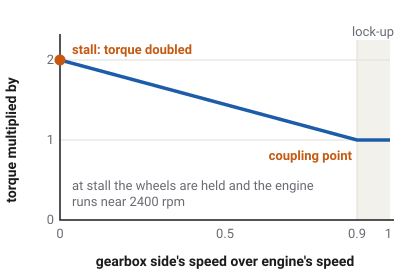

# Clutch and torque converter

An engine cannot run slower than idle, but a vehicle has to start from a
standstill. Something between the two must slip while the vehicle gets moving and then hold
tight. The game's vehicles use one of two such couplings: a friction clutch or a torque
converter.

Which vehicles have this
Car
Truck
Tractor
Plane
Boat
Drone
Train

## Why a coupling is needed

Think of riding a bicycle with a fixed gear and no freewheel: the pedals always turn with the
wheel. A car engine is like that pedal, except it cannot stop turning without stalling. So the
engine meets the wheels through a coupling that can slip. Slipping, it lets the engine run
faster than the wheels. Once their speeds match, it locks, and the engine and wheels turn
together through the gears.

In the game the coupling is part of the same calculation as the wheels. Sixty times a second,
the game works out the engine's speed, the wheels' speed and the torque the coupling passes
between them, all together.

## The friction clutch

A [clutch](glossary.md#clutch) is two plates pressed together by springs. Pressed hard, they
grip and turn as one. Eased apart, they rub and slip, passing less torque the more they are
apart.

The racing cars, the semis and the powershift tractor have a clutch. None of them has a clutch
pedal: a controller works the clutch, as in an automated gearbox.

- **Pulling away.** The controller lets the clutch slip until the engine settles at a launch
  speed and the vehicle comes up to it. A light pedal launches near idle, a full pedal higher up
  the rev range. The semis always launch just above idle, at about 900 rpm, as a heavy truck's
  automated clutch does.
  <!-- Drivetrain.launch_target_rpm: lerp(idle, stall_rpm, pedal) on a clutch; semi_spec.tres launch_rpm_over_idle 300 over a 600 idle -->
- **Locked.** Once the clutch carries what it is asked without slipping, it locks, and stays
  locked until the next gear change. A locked clutch can carry one and a half to two times the
  engine's best torque.
  <!-- VehicleSpec.clutch_reserve 1.5 on cars, 2.0 elsewhere -->
- **Opened.** The controller opens the clutch with the key off, in neutral or park, when the
  direction changes, when the pedal is up and the wheels have slowed below idle, and when ABS is
  working on a driven wheel. That is how the engine never stalls: the clutch lets go before the
  wheels can drag it below idle.
  <!-- docs/drivetrain.md Crank and coupling: the transmission controller (Drivetrain.coupling_step) -->
- **Engine braking.** A locked clutch stays shut when you lift off, so the engine brakes the
  vehicle through it.

## The torque converter

Most of the cars, the vans, the garbage truck and the fire truck have an automatic gearbox with a
[torque converter](glossary.md#torque-converter). It has no plates. It is a sealed case of oil
with two fans facing each other. The engine spins one, which throws oil at the other, and the
other turns the gearbox. Like two desk fans facing each other, the second turns only because
the first blows on it, so they can turn at different speeds without anything rubbing.

<!-- TorqueConverter.torque_ratio; converter_stall_ratio 2.0 on cars and vans, 1.98 on the Kenney trucks; COUPLING_POINT 0.9 -->

- **It multiplies torque.** When the gearbox side turns much slower than the engine side, a
  converter passes on more torque than the engine gives: about twice as much with the wheels held
  still. The multiplication fades as the two sides' speeds come together, and is gone at the
  coupling point, when the gearbox side turns at nine tenths of the engine's speed.
- **It has a stall speed.** Hold the car on the brakes and press the accelerator fully: the engine
  cannot spin the oil any faster than a certain speed against the held turbine. In the game that
  is about 2400 rpm on the cars and about 1250 on the trucks.
  <!-- docs/drivetrain.md Converter: Drivetrain.stall_rpm, STALL_RPM_FRAC 0.25 of idle to redline: 2375 rpm on the cars, 1250 on the Kenney trucks -->
- **It locks up.** Slipping oil wastes fuel, so at cruising speed a lock-up clutch inside the
  converter closes and joins the two sides solidly. The cars lock up from first gear onwards once
  the two sides are near the same speed; the trucks from second gear. The lock-up lets go when
  the brake pedal is pressed, under ABS, and when the pedal and the speed drop low.
  <!-- VehicleSpec.lockup_gear 1 on cars and heavy vans, 2 on the Allison-class trucks; Drivetrain.lockup_holds -->
- **It slips more when coasting.** When coasting, the converter passes less torque back to the
  engine than it passes forward, so a car with its lock-up open coasts more freely.
  <!-- TorqueConverter.OVERRUN_CAPACITY 0.5, an estimate -->

The `hatchback-sports` has a converter that does not multiply torque at all, a plain fluid
coupling. It stands in for the twin-clutch gearbox of the car it is modelled on, which creeps
on its clutch.
<!-- hatchback-sports converter_stall_ratio 1.0 (docs/drivetrain.md Converter, COMPROMISE) -->

### Creep

Because a converter always passes a little torque, even at idle, a car with an automatic gearbox
in drive moves forward slowly on its own when you release the brake. This is
[creep](glossary.md#creep). In the game every converter vehicle creeps at about walking pace on
the flat, as real automatics do. Creep is strong enough to hold most cars on a slope of about 5
to 8 %, and the garbage and fire trucks on about 8 %, with no pedal pressed.
<!-- docs/drivetrain.md Creep, the steepest-grade table: cars 5.3-8.6 %, vans 5.3-7.0 %, garbage-truck and firetruck 8.2-8.6 %; measured 4.8-6.5 km/h against 3.0-5.7 mph -->

Pressing the brake and accelerator fully together holds a vehicle still. If it still creeps
forward, the game cuts the throttle: a brake-throttle override.
<!-- contract brake: "Full brake with full accel holds it still, and the brake-throttle override cuts the throttle on one that still creeps." -->

## Shifting with a clutch

A gear change needs the coupling too. On a converter car, the gearbox's own internal clutches hand
the drive from one gear to the next; the converter does not open. On the clutch vehicles the
clutch slips through the change. [Gearbox and shifting](gearbox.md) explains how.

## What the game leaves out

- **No clutch pedal and no clutch wear.** Even with a manual gearbox, the game works the clutch.
- **No stalling, no slipping clutch from overheating.**
- **No double clutching or rev matching by the driver**: the gearbox does the rev matching on a
  downshift itself.

## What you see in sloppyCAN

No signal reports the clutch or converter directly. Their effect shows in:

| Signal | Direction | Unit | What it shows |
| --- | --- | --- | --- |
| `rpm` | out | rev/min | While the coupling slips, the engine runs faster than the wheels' gear would turn it. On a converter car held on the brakes at full pedal, it sits near the stall speed. |
| `engine_load` | out | % | Truck and tractor: at idle in gear, a converter's creep load shows as a few percent of load. |
| `speed` | out | m/s | Speed along the vehicle, in metres per second. With no pedal it rises slowly from 0 to a walking pace: creep. |
<!-- contract/carlito_contract.json rpm, engine_load, speed; docs/drivetrain.md Creep: "`engine_load` 7-11 %" -->

## Try it in the game

Try it in the game: creep and stall speed

1. Pick the `sedan` on **Flatland**, with the dashboard showing (**F2**). From a standstill, tap
   the accelerator once and let go: that puts it in drive. The car keeps creeping forward at
   walking pace with no pedal pressed.
2. Stop with the handbrake (**Space**) and keep holding it. Press the accelerator fully, then the
   brake fully as well, accelerator first: the brake key alone at a standstill selects reverse.
   The rev counter climbs to about 2400 rpm and stops: the converter's stall speed. The car does
   not move.
   <!-- InputRouter.arbitrate_local: brake_reverse with no accel near standstill requests R; brake_override latches only past BRAKE_OVERRIDE_SPEED 1 m/s, so a standstill press still revs -->
3. Now try the same with the `race` car. It has a clutch, not a converter: at rest with no pedal
   it does not creep at all.

## Related

- [The engine](engine.md): the crank on one side of the coupling.
- [Glossary](glossary.md): every term on this page.
