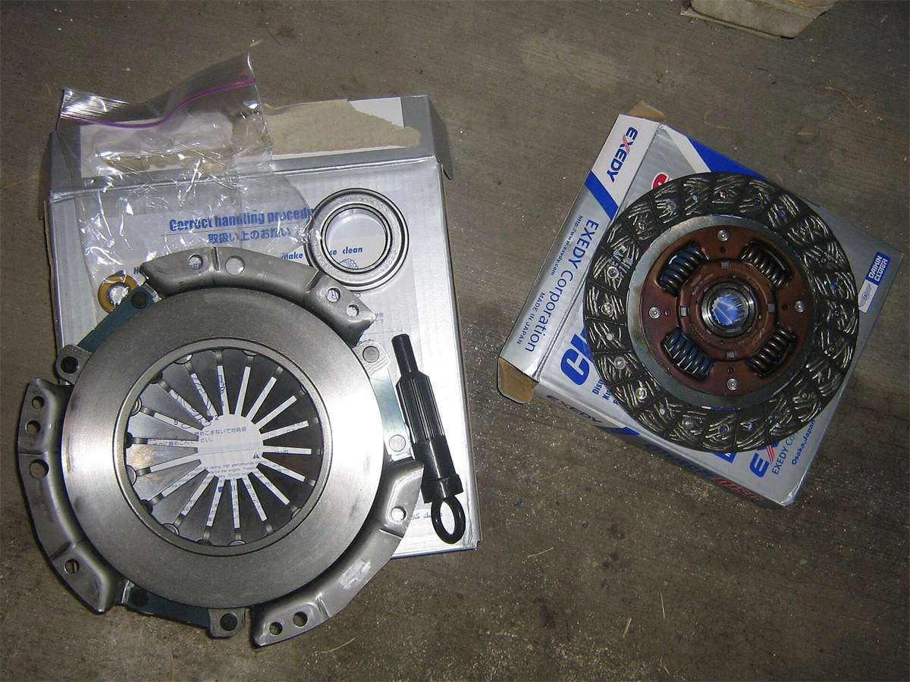
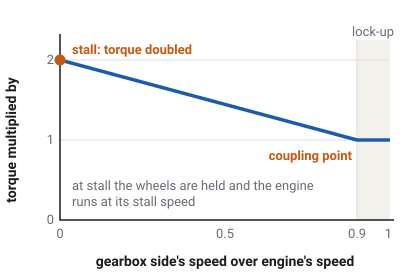

[AI-GENERATED CONTENT AWAITING HUMAN REVIEW]

# Clutch and torque converter

This page explains the friction clutch and the torque converter, which slip to
get a vehicle moving and then hold tight.

Which vehicles have this
Car
Truck
Tractor

At a red light the wheels stand still, but the engine has to keep turning. When the light turns
green, the wheels must start from nothing while the engine is already spinning at hundreds of
turns a minute. What sits between the two, and how does it join them without a jerk?

## Why a coupling is needed

What would happen if an engine were bolted straight to the wheels? When the wheels stopped, the
engine would stop too and [stall](glossary.md#stall), because it cannot hold still: it has to
keep turning to make its own push (see [Idle](engine.md#idle-and-the-key)). And to start again,
an engine turning at a thousand revolutions a minute would be joined at once to wheels that are
not moving, which would be a violent jerk.

On a bicycle with a fixed gear and no freewheel, the pedals always turn with the wheel. A car
engine is like those pedals, except that it cannot stop turning without stalling. So the engine is
connected to the wheels through a coupling that can slip. While it slips, the engine can run
faster than the wheels. Once their speeds match, it locks, and the engine and wheels turn together
through the gears.

## The friction clutch

<figure>

<figcaption>A clutch's pressure plate (left) and friction disc (right). Photo: dave_7 from Lethbridge, Canada, CC BY-SA 2.0, <a href="https://commons.wikimedia.org/wiki/File:Clutch_Kit_(553673775).jpg">Wikimedia Commons</a>.</figcaption>
</figure>

A [clutch](glossary.md#clutch) is two plates pressed together by springs. Pressed hard, they grip
and turn as one. When they are eased apart, they rub and slip, and pass less torque. How much
torque they pass depends on how hard they are pressed and on the friction between them, so plates
pressed only lightly pass only part of the engine's torque, and that is what lets the clutch slip
smoothly instead of jerking.

Slipping is not free. A slipping clutch passes the same torque on both sides (whatever one plate
pushes, the other is pushed), but the engine's side turns faster than the gearbox's side. So more
power goes in than comes out, and the difference becomes heat in the plates, as your hands get
warm when you rub them together fast. For example, a clutch passing 150 N·m while the engine
turns at 2,000 rpm and the gearbox at 1,000 rpm loses the power of that 1,000 rpm difference:
150 × 1,000 × 2π ÷ 60 = about 16,000 watts, more heat than five kettles boiling at once (see
[Torque and rpm](engine.md#torque-and-rpm) for the formula). A clutch that slips for a long time
gets hot, smells of burning and wears out, which is why drivers do not hold a car on a hill by
slipping the clutch.

In a manual vehicle, the driver works the clutch with a pedal. In an automated gearbox (common on
semi trucks), a controller works it.

- **Pulling away.** The clutch slips while the vehicle comes up to the engine's speed. A car
  pulls away at higher rpm when the driver wants a quick start, because the engine gives more
  push there. A heavy truck pulls away just above idle, because its diesel already twists hard
  at low rpm ([see the engine](engine.md#the-torque-curve)), and a slow, gentle slip saves the
  clutch from the heat of a heavy load.
- **Locked.** Once the clutch carries the torque without slipping, it stays locked until the next
  gear change. It is built to carry more than the engine's best torque (for example, one and a
  half times on a car and twice on a truck), so that it still holds when its lining has worn and
  when the spinning engine jolts it.
  <!-- VehicleSpec.clutch_reserve: 1.5 on the cars and vans, 2.0 elsewhere ("OE practice") -->
- **Opened.** The clutch is opened to stop, or to change gear. If it stays locked while the
  vehicle stops, the wheels drag the engine below idle and it stalls.
- **Engine braking.** A locked clutch lets the engine brake the vehicle when you lift off the
  accelerator ([engine braking](engine.md#friction-and-engine-braking)).

## The torque converter

Automatic gearboxes usually have a [torque converter](glossary.md#torque-converter) instead of a
clutch. It is a sealed case of oil with two fans facing each other. The engine spins one, the
pump, which throws oil at the other, the turbine, and the turbine turns the gearbox. Two desk fans
facing each other work the same way: the second turns only because the first blows on it. The two
can turn at different speeds without anything rubbing, so the converter does not wear out like a
clutch, and it never jerks.

Inside the case there is also a third part, a ring of curved vanes called the stator. The oil that
leaves the turbine would, left alone, flow back against the pump and push against it. The stator
turns that returning oil round so that it joins the engine's push instead of working against it.

- **It multiplies torque.** When the turbine turns much slower than the pump, a converter passes on
  more torque than the engine gives (about twice as much with the wheels held still, in the
  example below). This is the stator's work, and while pulling away it acts like an extra low gear.
  It fades as the two speeds come together, and is gone at the coupling point.
- **It has a stall speed.** When the car is held on the brakes with the accelerator fully pressed,
  the oil is thrown at a turbine that does not move. The faster the engine spins the pump, the
  harder the oil pushes back on it (as a spoon is harder to stir through a pot of honey the faster
  it goes), so the engine reaches a speed where the oil's push back balances its own torque and it
  cannot spin faster. This is called the [stall speed](glossary.md#stall-speed) (for example, about
  2,400 rpm on a saloon). It is not a stall in the engine's sense, and nothing is damaged, but all
  the engine's power then turns to heat in the oil, so the car must not be held like this for long.
  <!-- Drivetrain.stall_rpm: idle + 0.25 × (redline − idle) = 2375 rpm on the sedan; docs/drivetrain.md: "inside a car's typical 1800-2800" -->
- **It locks up.** Slipping oil wastes fuel: the two halves turn at different speeds, and the
  difference is lost as heat. For example, if the engine turns at 2,000 rpm and the turbine at
  1,900, about 5 % of the power is lost. So once the car is moving, a
  [lock-up clutch](glossary.md#lock-up-clutch) inside the converter closes and joins the two sides
  solidly. It opens again when the car slows to a stop.
- **It slips more when coasting.** A converter passes less torque back to the engine than it
  passes forward (the stator then simply spins freely), so a car coasts more freely when the
  lock-up is open.

Does the converter make energy, then, if more torque comes out than goes in? No. The turbine turns
slower than the pump, and power is torque times speed, so less power comes out than goes in. For
example, if a converter doubles the torque while its turbine turns at a third of the engine's
speed, the power that comes out is 2 × ⅓ = ⅔ of what went in, and the other third heats the oil.
Like a gear, it trades speed for twist, only with a loss.

<!-- TorqueConverter.torque_ratio; converter_stall_ratio 2.0 on cars and vans; COUPLING_POINT 0.9 -->

### Creep

At idle the engine still spins the pump, and a little oil still reaches the turbine, so a
converter passes a little torque even then. Because of that, an automatic car in drive moves
forward slowly on its own when you release the brake, as if someone were pushing it very gently.
This is called [creep](glossary.md#creep). It is about walking pace on flat ground, and it can be
enough to hold the car on a gentle slope with no pedal pressed. The same weak push is why the car
does not stall at a red light: with the brake on, the wheels are stopped, but the engine only has
to stir the oil lightly.

Pressing the brake and the accelerator fully together holds the vehicle still, because the brakes
are stronger than the converter at its stall speed. Many cars also cut the engine's power if both
pedals are pressed while moving (this is called a brake-throttle override).

## The coupling during a gear change

A gear change also involves the coupling. In an automatic, the gearbox's own internal clutches hand
the drive from one gear to the next, and the converter stays as it is. With a friction clutch, the
clutch opens or slips during the change, while the engine's speed is brought to the new gear's
(see [What happens during a change](gearbox.md#what-happens-during-a-change)).

## What Carlito simulates

The parameters the simulator uses for this, and where each is set, are listed in
[How the simulation works](simulation.md#clutch-and-torque-converter):

- **Simulation-wide**:
  - [Launch](simulation.md#launch)
- **Per vehicle**:
  - [Coupling](simulation.md#coupling) (`coupling`)
  - [Clutch reserve](simulation.md#clutch-reserve) (`clutch_reserve`)
  - [Launch speed](simulation.md#launch-speed) (`launch_rpm_over_idle`)
  - [Converter stall](simulation.md#converter-stall) (`converter_stall_ratio`)
  - [Lock-up gear](simulation.md#lock-up-gear) (`lockup_gear`)
  - [Launch engagement](simulation.md#launch-engagement) (`launch_engage_s`)

Simplification list

- **No clutch pedal and no clutch wear.** Even when shifting by hand, the simulation works the
  clutch.
- **No stalling, and no clutch slipping from overheating.** The controller opens the clutch
  before the wheels can drag the engine below idle.
  <!-- docs/drivetrain.md Crank and coupling: the transmission controller (Drivetrain.coupling_step) -->
- **No double clutching or rev matching by the driver.** The gearbox matches the engine's speed
  on a downshift itself.
- **One stall speed rule.** Every converter stalls a quarter of the way from idle to the redline.
  <!-- Drivetrain.STALL_RPM_FRAC 0.25 -->
- **A straight-line converter.** The torque multiplication falls in a straight line to the
  coupling point, as drawn above, and coasting passes half the torque driving does, an estimate.
  <!-- TorqueConverter.torque_ratio, COUPLING_POINT 0.9; OVERRUN_CAPACITY 0.5 "a labelled estimate" -->
- **No twin-clutch gearbox.** The `hatchback-sports` stands in for one with a converter that does
  not multiply torque, a plain fluid coupling, so it still creeps as the real car does on its
  clutch.
  <!-- hatchback-sports converter_stall_ratio 1.0 (docs/drivetrain.md Converter, COMPROMISE) -->

## What you see in sloppyCAN

No signal reports the clutch or converter directly. Their effect shows in these:

| Signal | Direction | Unit | What it shows |
| --- | --- | --- | --- |
| `rpm` | out | rev/min | While the coupling slips, the engine runs faster than the wheels' gear would turn it. On a converter car held on the brakes at full pedal, it sits near the stall speed. |
| `engine_load` | out | % | At idle in gear, a converter's creep load shows as a few percent of load (Truck and tractor). |
| `speed` | out | m/s | With no pedal it rises slowly from 0 to a walking pace: creep. |
<!-- contract/carlito_contract.json rpm, engine_load, speed; docs/drivetrain.md Creep: "`engine_load` 7-11 %" -->

## Related

- [The engine](engine.md): the crank on one side of the coupling.
- [Gearbox and shifting](gearbox.md): the gears on the other side.
- [Glossary](glossary.md): every term on this page.
