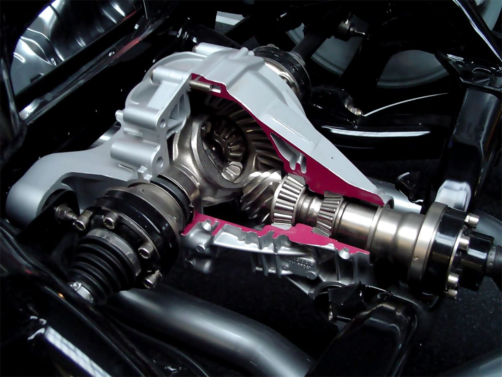
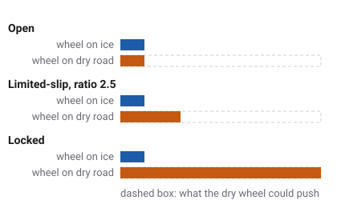

[AI-GENERATED CONTENT AWAITING HUMAN REVIEW]

# Differentials and four-wheel drive

This page explains how a differential lets two driven wheels turn at different
speeds, and what that costs in grip.

Which vehicles have this
Car
Truck
Tractor

The engine turns one shaft, and that shaft has to drive two wheels, one on each side. Yet in every
corner those two wheels have to turn at different speeds. How can one engine drive both at once,
and what is the price?

## Why wheels need to turn at different speeds

When two people walk round a corner arm in arm, the one on the outside has to take longer steps.
Wheels are the same. In a turn, every wheel runs round the same centre, and the outside wheel runs
round a bigger circle than the inside one, so it must turn faster. Its speed grows in step with
its circle:

outer wheel's speed ÷ inner wheel's speed = outer circle's radius ÷ inner circle's radius

For example, if in a tight turn the inner wheel follows a circle 5 metres in radius and the outer
wheel one 6.5 metres in radius, 6.5 ÷ 5 = 1.3: the outer wheel covers 30 % more ground on every lap
of the circle, so it must spin 30 % faster. In a wide motorway bend the difference is tiny, but it
never quite goes away.

Wheels that are not driven can turn freely, each at its own speed. A driven pair joined by one
solid shaft cannot: one wheel would have to slip or scrub across the road in every corner, which
wears the tyres and makes the vehicle hard to steer. On every full circle, the outer wheel travels
farther than the inner one by 2π (about 6.3) times the distance between them, whatever the size of
the circle. A driven pair needs a [differential](glossary.md#differential): a set of gears in the
middle of the axle that passes the drive to both wheels while letting their speeds differ.

<figure>

<figcaption>A differential cut open. Photo: DrJunge, CC BY-SA 3.0, <a href="https://commons.wikimedia.org/wiki/File:Differentialgetriebe2.jpg">Wikimedia Commons</a>.</figcaption>
</figure>

The sizes are the simulator's `sedan`, `semi` and `tractor-kenney` (each one's wheelbase and the
distance between its wheels), and the tightest turn is the one their steering allows. The speed
is that of the middle of the rear axle. The wheels roll exactly round the turning centre, with no
tyre slip, which holds at low speed; faster, the tyres run at
[slip angles](slip.md#slip-angle-across-the-wheel) and the centre moves.
<!-- widgets/diff-turn.js header: GroundDriveSpec.wheel_positions, max_steer_deg -->

## The open differential

The simplest kind, the [open differential](glossary.md#open-differential), always gives the two
wheels the same torque. That is what lets their speeds differ: neither wheel can force the other
to keep up. It works like a bar pushed in its middle, with one wheel at each end: the push always
splits evenly between the two ends, and if one end moves ahead, the bar simply pivots.

It has one weakness. The torque it gives each wheel cannot be more than the wheel with the
**least** grip can take. If one wheel is on ice (or off the ground), that wheel spins freely while
the other gets the same tiny torque and barely pushes, even with good grip. The vehicle can be
stuck with one wheel spinning.

For example, let each driven wheel be pressed onto the ground with 2,500 N, one on dry road (a μ
of 1) and one on ice (a μ of 0.1, see [Tyres and grip](tyres.md#the-coefficient-of-friction)).
The wheel on ice can push with only about 250 N before it slips. An open differential gives the
dry wheel the same 250 N, so the vehicle gets about 500 N in all, though the dry wheel alone could
push with 2,500 N.

It is often said that an open differential "sends all the power to the wheel that spins". It
sends both wheels the same torque. The spinning wheel does take most of the power, but only
because it turns much faster (power is torque times speed), and that power goes into spinning the
tyre on the ice, not into moving the vehicle.

Most ordinary cars and trucks have open differentials, because they are simple and cheap, and
they never fight the vehicle in a corner. Many cars work around the weakness with
[traction control](driver-aids.md#traction-control): it brakes the spinning wheel. The open
differential still gives both wheels equal torque, so the torque the brake holds back on the ice
wheel is now also given to the dry wheel, which can push with it.

<!-- Differential: open = equal split; bias_capacity for ratio 2.5; locked = one speed; Surface.REF_GRIP Ice 0.12 -->

## Limited-slip and Torsen-type differentials

A [limited-slip differential](glossary.md#limited-slip-differential) still lets the wheels turn at
different speeds, but it resists the difference. When one wheel starts to spin, it moves some of
the torque to the slower wheel (the one with grip).

It can be described by a [bias ratio](glossary.md#bias-ratio): how many times the faster wheel's
torque the slower wheel may take. With a ratio of 2.5 and one wheel on ice, the wheel on the dry
road can push two and a half times what the ice wheel holds. In the example above, that is about
625 N from the dry wheel and 250 N from the ice wheel, 875 N in all, instead of 500 N. A fully
locked axle would give the dry wheel all it can take, 2,500 N, for 2,750 N in all, but a locked
axle fights every turn (see the tractor's diff lock below).

Some, like the [Torsen](glossary.md#torsen) type, are torque-sensing: how much they can move
depends on how much torque goes through them. With one wheel off the ground there is almost no
torque through the differential, so the lifted wheel still spins. Braking that wheel gives it
something to push against, so torque flows again and the differential can pass more of it to the
other side (which is how traction control helps such a car too).

## Which wheels are driven

| Layout | Often found on | At the limit |
| --- | --- | --- |
| Front-wheel drive | Small and family cars | The front tyres both steer and drive, so they run out of grip first. |
| Rear-wheel drive | Sports and racing cars, vans, pickups, trucks, tractors | The tail can step out under power. |
| Four-wheel drive | SUVs, tractors with front drive engaged | The drive is spread over four tyres, which helps on loose ground. |

Why does a front-wheel-drive car run wide when it is accelerated hard out of a corner, while a
rear-wheel-drive one steps out at the tail? Under hard acceleration, weight moves to the rear
([see weight transfer](weight-transfer.md)), so the front tyres are pressed less, and a
front-wheel-drive car asks them to steer as well as drive. The rear tyres are pressed harder,
which suits driving, but on a rear-wheel-drive car they spend their grip on driving, and with
little left for turning the tail swings round (see
[Sharing grip](slip.md#sharing-grip-between-braking-and-turning)).

### The centre differential

In a turn, the front axle also runs a different path from the rear: the front wheels travel a
longer way. This is why cars that always drive four wheels have three differentials: one on each
axle, and a [centre differential](glossary.md#centre-differential) between the axles. A
Torsen-type centre differential sends more torque to the other axle when one starts to spin.

Four-wheel drive is not a cure for everything. If every differential were open, one wheel on ice
could still leave the vehicle stuck, since each differential shares torque equally between what it
drives. And four driven wheels help a vehicle get moving, but not stop or steer: braking and
turning use all four tyres' grip on any car, whichever wheels the engine drives.

## The tractor's diff lock and front-wheel drive

A tractor works where grip is poor, so it has two controls that most cars do not.

- **The rear [diff lock](glossary.md#diff-lock).** When engaged, it joins the two rear wheels into
  one solid shaft. Both turn at the same speed whatever the grip, so the wheel with grip does the
  pulling. A locked axle scrubs its tyres in a turn, so it is meant for straight work in the field.
- **Front-wheel drive ([MFWD](glossary.md#mfwd)).** When engaged, it gears the front axle to the
  rear through a clutch, with no centre differential, so all four wheels drive. The whole
  tractor's weight then presses on driven tyres, so together they can push harder. Because the two
  axles are tied together, the driveline winds up in a tight turn (the front wheels want to travel
  farther than the rear ones, but are forced to turn together), so it is engaged for field work
  and left out on the road.

Tractors often have brakes only on the rear axle. They can engage front-wheel drive when the foot
brake is pressed, so that the drive shaft brakes the front wheels too.

## What Carlito simulates

The parameters the simulator uses for this, and where each is set, are listed in
[How the simulation works](simulation.md#differentials-and-four-wheel-drive):

- **Per vehicle**:
  - [Driven axles](simulation.md#driven-axles) (`driven_front`, `driven_rear`,
    `front_axle_engageable`)
  - [Differential bias](simulation.md#differential-bias) (`diff_bias_front`, `diff_bias_rear`)
  - [Centre differential](simulation.md#centre-differential) (`centre_diff_bias`,
    `centre_diff_rigid`)
  - [Diff lock](simulation.md#diff-lock) (`rear_diff_lockable`)

Simplification list

- **No four-wheel-drive switch on the cars.** The four-wheel-drive cars always drive all four.
- **No low range** on the four-wheel-drive cars.
- **No viscous or electronically controlled differentials.** Each differential has one fixed bias
  ratio (2.5 for the limited-slip ones, 3 for the centre ones, 1 for the others).
  <!-- race, race-future diff_bias_rear 2.5; hatchback-sports diff_bias_front 2.5; suv, suv-luxury, race-future centre_diff_bias 3.0; default 1.0 -->
- **No gears inside.** A differential is simulated by what it does (equal torque, then a limited
  transfer to the slower side), not by its gears.
  <!-- differential.gd: "a friction coupling between its two outputs" -->

## What you see in sloppyCAN

| Signal | Direction | Unit | What it shows |
| --- | --- | --- | --- |
| `diff_lock` | in | flag | Asks for the rear diff lock (Tractor). |
| `diff_lock_state` | out | flag | The rear diff is actually locked, read from the driveline (Tractor). |
| `fwd_drive` | in | flag | Asks for front-wheel drive (Tractor). |
| `fwd_drive_state` | out | flag | The front axle is actually driven. Also true while the foot brake is down (Tractor). |
| `wheel_slip` | out | % | How far the rear wheels run ahead of the ground. A locked rear and front drive bring it down in mud (Tractor). |
| `slip` | out | ratio, two values | Each axle's mean slip. One wheel spinning on an open diff raises its axle's figure (Car, truck, tractor). |
<!-- contract/carlito_contract.json: diff_lock, diff_lock_state, fwd_drive, fwd_drive_state, wheel_slip, slip -->

## Scenarios

- [Power in a tight turn](forces.md#example-inner-wheel): the inner driven wheel reaches its limit first.
- [Steep climb in a tractor](forces.md#example-tractor-wheels-spin): the driven wheels run out of grip.

## Related

- [The engine](engine.md) and [Gearbox and shifting](gearbox.md): what drives the diff.
- [Slip and the grip curve](slip.md): why a spinning wheel grips less.
- [Steering and Ackermann](steering.md): why each front wheel is steered to its own circle.
- [Glossary](glossary.md): every term on this page.
