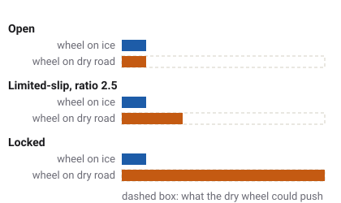

# Differentials and four-wheel drive

In a turn the outside wheels travel further than the inside ones, so a driven
axle cannot simply bolt its two wheels together. A differential lets them turn at different
speeds. The price is that a wheel with no grip can rob the other of its drive.

Which vehicles have this
Car
Truck
Tractor
Plane
Boat
Drone
Train

## Why wheels need to turn at different speeds

Walk round a corner with a friend, arm in arm: the one on the outside has to take longer steps.
Wheels are the same. In a turn the outside wheel runs round a bigger circle than the inside one,
so it must turn faster. Wheels that are not driven turn freely on their own. A driven pair needs
a [differential](glossary.md#differential), a set of gears in the middle of the axle that passes
the drive to both wheels while letting their speeds differ.

## The open differential

The simplest kind, the [open differential](glossary.md#open-differential), always gives the two
wheels the same torque. That is what lets their speeds differ: neither wheel can force the other
to keep up.

It has one weakness. The torque it can give each wheel is no more than the wheel with the
**least** grip can take. Put one wheel on ice, or lift it off the ground, and that wheel spins
freely while the other, on good grip, gets the same tiny torque and barely pushes. A vehicle
with an open diff can be stuck with one wheel spinning uselessly. Drivers call it one-wheel peel.

<!-- Differential: open = equal split; bias_capacity for ratio 2.5; locked = one speed; Surface.REF_GRIP Ice 0.12 -->

In the game most vehicles have open differentials: the saloons, the vans, the pickups, the rigid
trucks, the semis and the tractor (until its lock is engaged).
<!-- GroundDriveSpec diff_bias_front / diff_bias_rear 1.0 (open) by default; only the bodies below set more -->

## Limited-slip and Torsen-type differentials

A [limited-slip differential](glossary.md#limited-slip-differential) still lets the wheels turn at
different speeds, but it resists the difference. When one wheel starts to spin, it moves some of
the torque to the slower wheel, the one with grip.

The game describes these by a [bias ratio](glossary.md#bias-ratio): the slower wheel may take up to that many times the
faster wheel's torque. The `race` car's rear, the `race-future`'s rear and the `hatchback-sports`'
front have a ratio of 2.5. With one wheel on ice, the wheel on the dry road can then push two and
a half times what the ice wheel holds.
<!-- race_spec.tres diff_bias_rear 2.5; race-future_spec.tres diff_bias_rear 2.5; hatchback-sports_spec.tres diff_bias_front 2.5 -->

These diffs are torque-sensing, like the [Torsen](glossary.md#torsen) type: how much they can move
depends on how much torque goes through them. With one wheel off the ground there is almost no
torque through the diff, so even a limited-slip diff lets the lifted wheel spin.
<!-- Differential.bias_capacity: "0 ... with no torque through it, since a torque-sensing diff biases nothing when unloaded" -->

## Which wheels are driven

| Layout | Vehicles |
| --- | --- |
| Front-wheel drive | `sedan`, `taxi`, `hatchback-sports` |
| Rear-wheel drive | `sedan-sports`, `police`, `race`, the vans and pickups, `delivery`, `ambulance`, the rigid trucks, the semis, the tractors with front drive off |
| Four-wheel drive | `suv`, `suv-luxury`, `race-future`; the tractors with front drive on |
<!-- driven_front / driven_rear in each *_spec.tres (GroundDriveSpec defaults: rear only) -->

The layout changes how a car behaves at the limit. A front-driven car pulls itself round a corner
but its front tyres do both the steering and the driving, so they run out of grip first. A
rear-driven car can step its tail out under power. A four-wheel-drive car spreads the drive over
four tyres and puts power down best on loose ground.

### The centre differential

A four-wheel-drive car has three differentials: one on each axle and a
[centre differential](glossary.md#centre-differential) between the axles, because the front
axle runs a slightly different path from the rear in a turn too. The `suv`, `suv-luxury` and
`race-future` have a Torsen-type centre with a ratio of 3: if one axle starts to spin, up to three
times its torque can go to the other.
<!-- suv_spec.tres, suv-luxury_spec.tres, race-future_spec.tres centre_diff_bias 3.0 -->

## The tractor's diff lock and front-wheel drive

A tractor works where grip is poor, so it has two controls a car does not.

- **The rear [diff lock](glossary.md#diff-lock).** Engaged, it joins the two rear wheels into one
  solid shaft. Both turn at the same speed whatever the grip, so the wheel with grip does the
  pulling. A locked axle scrubs its tyres in a turn, because the wheels cannot turn at different
  speeds, so it is meant for straight work in the field. Key **K**, or sloppyCAN's `diff_lock`.
- **Front-wheel drive, [MFWD](glossary.md#mfwd).** Engaged, it gears the front axle to the rear
  through a clutch, with no centre differential. The front wheels really do become driven, and
  the drive spreads over four wheels. With no centre diff the two axles are tied together, so the
  driveline winds up in a tight turn. Key **M**, or sloppyCAN's `fwd_drive`.
<!-- tractor-kenney_spec.tres rear_diff_lockable, front_axle_engageable, centre_diff_rigid; GroundDriveSpec.centre_diff_rigid: "It winds the driveline up in tight turns" -->

The tractor's brakes sit on the rear axle. When the foot brake is pressed, the tractor engages
front-wheel drive by itself, so the drive shaft brakes the front wheels too.
<!-- contract fwd_drive_state: "Also true while the foot brake is down ... the pedal engages MFWD so the shaft brakes the fronts"; GroundDriveSpec.brake_engages_front_axle -->

## The LAB switch

The pause menu's LAB page has a DIFFERENTIALS switch for any car or truck, for the rest of the
session:

- **STOCK**: the vehicle's own differentials.
- **OPEN**: every driven axle open, even on a limited-slip car.
- **LOCKED**: every driven axle locked, like the tractor's lock. Because a locked axle confuses
  them, this also switches off stability control and traction control.

The tractors ignore the switch: they keep their own diff lock on its key.
<!-- WheelDrive.axle_diff_mode (STOCK on a body with rear_diff_lockable); pause_menu.gd AXLE_DIFF_HELP; docs/systems.md: "ABS off and LOCKED each set esc_off, so tcs_off" -->

## What the game leaves out

- **No four-wheel-drive switch on the cars**: the four-wheel-drive cars always drive all four.
- **No low range** on the four-wheel-drive cars.
- **No viscous or electronically controlled differentials**: each diff has one fixed bias ratio.

## What you see in sloppyCAN

| Signal | Direction | Unit | What it shows |
| --- | --- | --- | --- |
| `diff_lock` | in | flag | Tractor: asks for the rear diff lock. |
| `diff_lock_state` | out | flag | Tractor: the rear diff is actually locked, read from the driveline. |
| `fwd_drive` | in | flag | Tractor: asks for front-wheel drive. |
| `fwd_drive_state` | out | flag | Tractor: the front axle is actually driven. Also true while the foot brake is down. |
| `wheel_slip` | out | % | Tractor: how far the rear wheels run ahead of the ground. A locked rear and front drive bring it down in mud. |
| `slip` | out | ratio, two values | Car, truck, tractor: each axle's mean slip. One wheel spinning on an open diff raises its axle's figure. |
<!-- contract/carlito_contract.json: diff_lock, diff_lock_state, fwd_drive, fwd_drive_state, wheel_slip, slip -->

## Try it in the game

Try it in the game: one-wheel peel

1. Pick the `police` car (rear-wheel drive, open diff) and press **F3** with EXTENDED DEBUG
   LABELS on in SETTINGS. The `slip` line shows each wheel's slip.
2. Open SETTINGS and set TRACTION CONTROL off, so it does not catch the spin.
3. Turn tightly and floor the accelerator. The inside rear wheel, with the least load, spins far
   ahead of the outside one.
4. Pause, open LAB and set DIFFERENTIALS to LOCKED. Repeat: both rear wheels now show the same
   slip, and the tyres scrub through the turn.

## Related

- [The engine](engine.md) and [Gearbox and shifting](gearbox.md): what drives the diff.
- [Tyres and slip](tyres.md): why a spinning wheel grips less.
- [Glossary](glossary.md): every term on this page.
