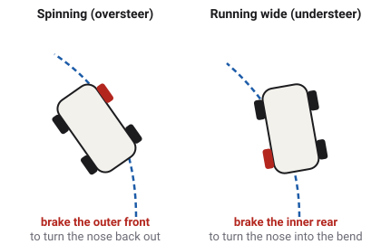

# ABS, traction and stability control

A tyre grips best just before it starts to slide, and a driver cannot hold four
tyres at that point by feel. Driver aids watch each wheel and do it for them: ABS while braking,
traction control while accelerating, and stability control when the whole vehicle starts to slide
or tip.

Which vehicles have this
Car
Truck
Tractor
Plane
Boat
Drone
Train

## All three aim at the same point

[Tyres and slip](tyres.md) shows the grip curve: grip rises with slip to a peak at a slip of
0.12, then falls away. A tyre held at the peak gives the most force it can. Past it, it slides,
grips less, and slides more. Each aid in the game holds the tyres at that peak and no further.

The game's aids are ideal. A real ABS has to guess the car's true speed from its wheels, and it
pulses the brakes on and off many times a second. The game's knows the true road speed exactly
and holds each wheel smoothly at the peak, with no pulsing. That makes them a little better than
real ones, and the game says so.
<!-- wheel.gd ABS_SLIP 0.12: "An honest model of an ideal ABS: it knows the true road speed and holds the slip without cycling"; TCS_SLIP 0.12 -->

## ABS

[ABS](glossary.md#abs), the anti-lock braking system, lets off a wheel's brake just enough to keep
the wheel turning when a hard brake would lock it. In the game it never lets a braked wheel's
slip go past 0.12. It also watches the truck retarder, so that cannot lock a wheel either.
<!-- GroundDriveSpec.abs_equipped: "the foot brake (and retarder) may not drive a wheel's braking slip past RayWheel.ABS_SLIP" -->

ABS buys two things: a shorter stop on most surfaces, because the tyre stays at its peak instead
of sliding at 0.8 of it; and steering, because a turning tyre can still push sideways while a
locked one cannot.

Every car, van and truck has ABS except the two racing cars, and so do the semi-trailers. The
tractors, the farm trailer and the plane do not.
<!-- abs_equipped = true in every car, van and truck spec but race and race-future; in box, flatbed, tanker and tipper; not in tractor-*, farm_tipper or plane_spec.tres -->

## Traction control

Traction control is ABS's twin for driving: it stops a driven wheel spinning when the driver asks
for more than the tyre can take. In the game it holds each driven wheel's drive slip at the same
peak, 0.12, by taking away just enough of the drive at that wheel. It only ever takes drive away;
it never brakes a wheel. On trucks this system is often called ASR.
<!-- wheel.gd TCS_SLIP; RayWheel.tcs_take: "TC removes drive, never brakes" -->

Every car and van has it except the `race-future`, and so do the trucks and the semis. On a
slippery road, traction control also stops engine braking from making the driven wheels slide
(see [the engine](engine.md#friction-and-engine-braking)).
<!-- tcs_equipped = true on every ABS body plus race; Drivetrain.drag_control -->

## Stability control

[Stability control](glossary.md#stability-control), or ESC, watches the whole vehicle rather than
one wheel. It works out how fast the vehicle should be turning from the steering and the speed,
compares that with how fast it really is turning, and steps in when the two differ by more than a
small margin.

- If the car turns **too much**, its tail swinging out (oversteer), ESC brakes the outer front
  wheel. That pulls the nose back out of the turn.
- If the car turns **too little**, running wide (understeer), ESC brakes the inner rear wheel. That
  pulls the nose into the turn.
- In both cases it also trims the engine's fuel.

Like a real unit, the game's ESC uses only what a car's sensors can measure: speed, the steering,
how fast the body turns and how hard it is pushed sideways. It works out the sideways slide from
those, rather than reading the game's true value. It does nothing below 20 km/h or in reverse.
Its idea of how the car should turn comes from that car's own steady handling, worked out in
advance for each vehicle, as a real system is calibrated on its car.
<!-- StabilityControl header; MIN_SPEED 20 km/h ("Not active below it, nor in reverse (R140 6.2)"); GroundDriveSpec.esc_reference_k -->

Every road vehicle with ABS has ESC. The racing cars and the tractors do not.
<!-- esc_equipped = true on the same specs as abs_equipped -->

### Roll stability on the semis

A truck can roll over before its tyres slide. The semis' stability control adds a second job,
[roll stability control](glossary.md#roll-stability-control). The game measured, for each rig and
load, the sideways acceleration at which a wheel first lifts. When the rig reaches 70 % of that,
or the steering asks for it, roll stability brakes every wheel, and the trailer, and cuts the
fuel. If that braking is firm, it lights the brake lamps.
<!-- StabilityControl ROLL_SHARE 0.7, LAMP_DECEL 0.7 m/s²; GroundDriveSpec.esc_roll_lift_g -->

The four semi-trailers carry their own roll control too, in their own brake system, as the law
requires in Europe. It reads the trailer's own sensors and brakes the trailer by itself, whatever
the truck in front is doing.
<!-- docs/handling.md Stability control, The semi-trailer's own: trailer_roll_equipped, StabilityControl.trailer_roll_step (not farm_tipper) -->

## Switching them off

| Switch | Where | What it does |
| --- | --- | --- |
| TRACTION CONTROL | SETTINGS | Off lets the cars' driven wheels spin. |
| STABILITY CONTROL | SETTINGS | Off switches ESC off, and traction control with it. |
| ANTI-LOCK BRAKES | pause menu, LAB | Off lets the wheels lock. It takes stability control, traction control, hill-start assist and auto hold with it. This session only. |
| DIFFERENTIALS: LOCKED | pause menu, LAB | Also switches stability and traction control off, because a locked axle cancels ESC's one-wheel braking. |
<!-- pause_menu.gd TCS_HELP, ESC_HELP, ABS_HELP; InputRouter.lab_esc_cause; docs/systems.md -->

The settings are saved; the LAB switches last for the session and are locked during a challenge.
sloppyCAN can switch traction control and stability control off with `tcs_off` and `esc_off`.

## The dashboard lamps

| Lamp | Means |
| --- | --- |
| ESC | Steady: stability control is switched off. Flashing: it is acting now. |
| TC | Traction control is switched off, by its own switch or with ESC or ABS. |
| ABS OFF | The LAB switch has turned ABS off. |
| ABS (on a semi) | The trailer's ABS is acting, reported back by the trailer. |
| VDC | The trailer's own roll control is acting. |
| TRLR ABS | The trailer's ABS warning lamp on the `semi-conventional`'s American trailer link, set by sloppyCAN. |
<!-- dashboard.gd LAMP labels: esc_off "ESC", tcs_off "TC", abs_off "ABS OFF", trailer_abs "ABS", trailer_vdc "VDC", trailer_abs_lamp "TRLR ABS"; ESC_FLASH_HZ -->

## What the game leaves out

- **No pulsing**: the aids are ideal, without the cycling of a real ABS or the brake judder you
  feel through a real pedal.
- **No brake assist** that adds pedal for a panicking driver.
- **No aid follows a fitted tyre's own peak**: all tyres share one curve, so the aids always aim
  at 0.12.

## What you see in sloppyCAN

| Signal | Direction | Unit | What it shows |
| --- | --- | --- | --- |
| `tcs_off` | in | flag | Car: switches traction control off. |
| `esc_off` | in | flag | Car and truck: switches stability control off, and traction control with it. |
| `status` | out | bitfield | Bit 7: stability control acting. Bit 8: its brake-lamp request. Bit 9: a fitted ESC switched off. Bit 10: yaw braking. Bit 11: roll stability braking. |
| `trailer_abs` | out | flag | Truck: the trailer's ABS is holding a wheel back, reported by the trailer. |
| `trailer_vdc` | out | flag | Truck: the trailer's roll control is braking it. |
| `slip` | out | ratio, two values | Car, truck, tractor: each axle's mean slip ratio. Under ABS or traction control it sits near 0.12. |
<!-- contract/carlito_contract.json: tcs_off, esc_off, status bits 7-11, trailer_abs, trailer_vdc, slip -->

## Try it in the game

Try it in the game: catch a spin

1. Pick the `police` car on **Flatland**. It is rear-wheel drive and quick.
2. Drive at about 80 km/h, steer hard one way and then the other. ESC's lamp flashes on the
   dashboard as it brakes single wheels, and the car stays pointing where you steer.
3. Open SETTINGS and set STABILITY CONTROL off. Repeat: the tail now swings out much further, and
   may spin the car round.
4. Turn it back on. In the LAB, switch ANTI-LOCK BRAKES off and stop hard while steering: the car
   ploughs straight on. The ESC and TC lamps light too, because ABS took them with it.

## Related

- [Tyres and slip](tyres.md): the grip peak all three aids aim at.
- [Brakes](brakes.md): the hardware they work through.
- [Glossary](glossary.md): every term on this page.
