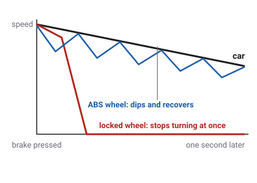
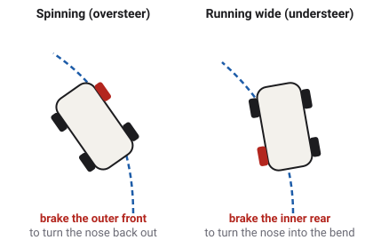

[AI-GENERATED CONTENT AWAITING HUMAN REVIEW]

# ABS, traction and stability control

This page explains how ABS, traction control and stability control watch each
wheel and keep the tyres from sliding.

Which vehicles have this
Car
Truck
Tractor

A tyre grips best just before it starts to slide. A driver braking hard on a wet road cannot feel
where that point is for each of four tyres, let alone hold them all there. How does a modern car
manage it?

## All three aim at the same point

[Slip and the grip curve](slip.md#the-grip-curve) shows the grip curve: grip rises with slip to a
peak, then falls away. A tyre held at the peak gives the most force it can. Past it, the tyre
slides, grips less, and slides more. The aids try to keep the tyres from going past that peak.

A person needs a good part of a second to notice a wheel locking and react, and by then the wheel
has long since gone past the peak. A computer that reads a sensor on every wheel can check them
many times a second and act long before a person could. The driver aids use that speed:
ABS while braking, traction control while accelerating, and stability control when the whole
vehicle starts to slide or tip.

One thing they cannot do is add grip: the road and the tyres decide how much there is, and the aids
only help the driver use it (see
[Sharing grip between braking and turning](slip.md#sharing-grip-between-braking-and-turning)).
A car with every aid still slides on ice if the driver asks for more than the ice can give.

## ABS

[ABS](glossary.md#abs) (anti-lock braking system) releases a wheel's brake just enough to keep the
wheel turning, when braking hard would lock it. How does it know? Each wheel has a sensor that
reports how fast it turns. A wheel about to lock slows down much faster than the car does, and
slower than the other wheels. When the computer sees that, it lets the brake go for a moment, so the
wheel speeds up again and its grip comes back, and then it applies the brake again. It repeats this
many times a second, and the driver feels it as a judder in the pedal.

ABS has two benefits:

- **A shorter stop on most surfaces**, because the tyre stays near its peak instead of sliding.
- **Steering while braking**, because a turning tyre can still push sideways while a locked one
  cannot ([see the forces](forces.md#example-emergency-stop)). This is the main benefit: a driver
  can brake as hard as possible and still steer round the obstacle.

The shorter stop is not always true. On loose gravel or deep snow, a locked wheel digs in and
pushes a wedge of material ahead of it, which helps to stop the car, so a car without ABS can stop
in a shorter distance (see [The grip curve](slip.md#the-grip-curve)). The car with ABS keeps its
steering, which is usually worth more.

What the driver feels, and what to do

When ABS acts, the pedal pulses under the foot and a noise comes from the brakes. This is normal,
and it means the system is working. The driver should keep pressing hard and steer, because
letting up or pumping the pedal (the old advice for cars without ABS) only takes the braking away.

## Traction control

Traction control does for driving what ABS does for braking: it stops a driven wheel from spinning
when the driver asks for more than the tyre can take
([see the forces](forces.md#example-pulling-away)). A spinning wheel has passed the peak of the grip
curve, so it pushes less and the car accelerates less, and on ice or mud it digs itself in. The
system sees it the same way ABS does: a driven wheel turning much faster than the car is moving
(compared with the other wheels) is spinning. Depending on the vehicle, it reduces the engine's
torque, brakes the spinning wheel, or both. On trucks, this system is often called ASR.

Braking one spinning wheel helps for a second reason. The ordinary
[differential](differentials.md) sends the same torque to both driven wheels, so a wheel on ice
can only take a tiny torque, and the wheel on grip gets no more than that. Putting a brake on the
spinning wheel makes it able to take more torque, and the other wheel gets the same extra. For
example, if the wheel on ice spins as soon as it gets 100 N·m (newton-metres), the wheel on dry
road also gets only 100 N·m, although it could use 1,000. Brake the spinning wheel with 400 N·m,
and it now takes 100 + 400 = 500 N·m before it spins, so the wheel on dry road gets 500 N·m too,
five times as much push.

Some systems also prevent engine braking from making the driven wheels slide on a slippery road
(see [the engine](engine.md#friction-and-engine-braking)).

## Stability control

[Stability control](glossary.md#stability-control) (ESC) watches the whole vehicle rather than one
wheel. From the steering and the speed, it works out how fast the vehicle should be turning. It
compares this with how fast it really is turning (measured by sensors), and steps in when the two
differ too much.

How can braking one wheel turn a whole car? A braked wheel pulls on its own side of the car, like
a rower who drags one oar in the water: the car swings towards the braked side. So the system picks the
wheel whose pull turns the car the way it needs.

- If the car turns **too much**, with its tail swinging out (oversteer), ESC brakes the outer
  front wheel. That pulls the nose back out of the turn.
- If the car turns **too little** and runs wide (understeer), ESC brakes the inner rear wheel.
  That pulls the nose into the turn.
- In both cases, it can also reduce the engine's torque, which slows the car and gives the tyres
  more grip to spare.

It is normally inactive at very low speed.

<!-- photo: a stability control warning lamp flashing on a dashboard -->

Stability control cannot do more than the tyres allow. It helps most when the car is only a little
past the limit, and a driver who is going far too fast for the road is still going to leave it
(see [Understeer and oversteer](understeer.md) for the slides it catches).

### Roll stability on trucks

A truck can roll over before its tyres slide, because its load sits high above the ground (see
[Weight transfer and rollover](weight-transfer.md#wheel-lift-and-rollover)). So the stability
control of a truck has a second job, called
[roll stability control](glossary.md#roll-stability-control). When the sideways acceleration gets
close to what would lift a wheel, it brakes the truck (and its trailer) and cuts the fuel.

Slowing down is the right answer because the sideways acceleration in a bend depends on the speed
squared. For example, a truck that takes a bend at half the speed needs only a quarter of the
sideways acceleration. The system has to act before a wheel lifts, because once a wheel is off the
ground the truck is already close to going over.

Semi-trailers can also have their own roll control, in their own brake system (European rules
require it on most large trailers with air suspension). It reads the trailer's own sensors and
brakes the trailer by itself, whatever the truck in front is doing. Why does the trailer need its
own? The truck in front cannot feel the trailer's wheels going light; only the trailer's own
sensors can.
<!-- docs/sources.md § Stability control, R13 5.2.2.23 [179]: "roll-over control on air-sprung O3/O4 trailers with up to 3 axles" (recorded there as sourced; not reopened for this page) -->
<!-- R13 Annex 21 2.2.2(a) [179], docs/sources.md: the trailer reads "the tyres' vertical force (or at least lateral acceleration and wheel speeds)" -->

## The dashboard lamps

Vehicles tell the driver what the aids are doing with warning lamps. The exact names vary.

| Lamp | Usually means |
| --- | --- |
| ESC | Flashing: stability control is acting. Steady: it is switched off or has a fault. |
| TC | Traction control is switched off or has a fault. |
| ABS | ABS has a fault. |
| Trailer ABS | The trailer's ABS has a fault. |

## What Carlito simulates

The parameters the simulator uses for this, and where each is set, are listed in
[How the simulation works](simulation.md#abs-traction-and-stability-control):

- **Simulation-wide**:
  - [Target slip](simulation.md#target-slip) (`ABS_SLIP`, `TCS_SLIP`)
  - [Stability control's limits](simulation.md#stability-controls-limits) (`MIN_SPEED`,
    `ROLL_SHARE`)
- **Per vehicle**:
  - [Which aids are fitted](simulation.md#which-aids-are-fitted) (`abs_equipped`, `tcs_equipped`,
    `esc_equipped`)
  - [Stability control's reference](simulation.md#stability-controls-reference)
    (`esc_reference_k`, `esc_laden_kg`, `esc_laden_k`)
  - [Roll stability](simulation.md#roll-stability) (`esc_roll_lift_g`, `trailer_roll_equipped`,
    `trailer_roll_lift_g`)

Simplification list

- **Ideal aids, no pulsing.** The simulated ABS knows the true road speed and holds each wheel
  smoothly at the peak (a slip of 0.12), so it does a little better than a real one. Traction
  control does the same.
  <!-- wheel.gd ABS_SLIP, TCS_SLIP 0.12: "An honest model of an ideal ABS: it knows the true road speed and holds the slip without cycling" -->
- **Traction control only takes drive away.** It never brakes a wheel.
  <!-- RayWheel.tcs_take: "TC removes drive, never brakes" -->
- **Calibrated in advance.** Like a real unit, ESC works from what sensors would see rather than
  from the true slide. How the car should turn comes from that car's own steady handling, worked
  out in advance. It does nothing below 20 km/h or in reverse, and roll stability steps in at 70 %
  of the lift point measured for each truck and load.
  <!-- StabilityControl header, MIN_SPEED, ROLL_SHARE 0.7; GroundDriveSpec.esc_reference_k, esc_roll_lift_g -->
- **Lamps without faults.** The aids never fail. The semi's ABS lamp shows that the trailer's ABS
  is acting, instead of a fault.
  <!-- dashboard.gd trailer_abs "ABS" -->
- **No brake assist** that adds pedal for a panicking driver.
- **No aid follows a fitted tyre's own peak**: all tyres share one curve, so the aids always aim
  at the same slip.

## What you see in sloppyCAN

| Signal | Direction | Unit | What it shows |
| --- | --- | --- | --- |
| `tcs_off` | in | flag | Switches traction control off (Car). |
| `esc_off` | in | flag | Switches stability control off, and traction control with it (Car and truck). |
| `status` | out | bitfield | Bit 7: stability control acting. Bit 8: its brake-lamp request. Bit 9: a fitted ESC switched off. Bit 10: yaw braking. Bit 11: roll stability braking. |
| `trailer_abs` | out | flag | The trailer's ABS is holding a wheel back, reported by the trailer (Truck). |
| `trailer_vdc` | out | flag | The trailer's roll control is braking it (Truck). |
| `slip` | out | ratio, two values | Each axle's mean slip, along the wheels and sideways together. Under ABS or traction control in a straight line it sits near 0.12 (Car, truck, tractor). |
<!-- contract/carlito_contract.json: tcs_off, esc_off, status bits 7-11, trailer_abs, trailer_vdc, slip -->

## Scenarios

- [Emergency stop](forces.md#example-emergency-stop) and [without ABS](forces.md#example-stop-without-abs): what ABS adds.
- [Pulling away](forces.md#example-pulling-away) and [on snow without traction control](forces.md#example-wheelspin): what traction control prevents.
- [Full truck turning too fast](forces.md#example-truck-lifts-wheel): what roll stability prevents.

## Related

- [Slip and the grip curve](slip.md): the grip peak all three aids aim at.
- [Brakes](brakes.md): the hardware they work through.
- [Understeer and oversteer](understeer.md): the slides stability control catches.
- [Glossary](glossary.md): every term on this page.
