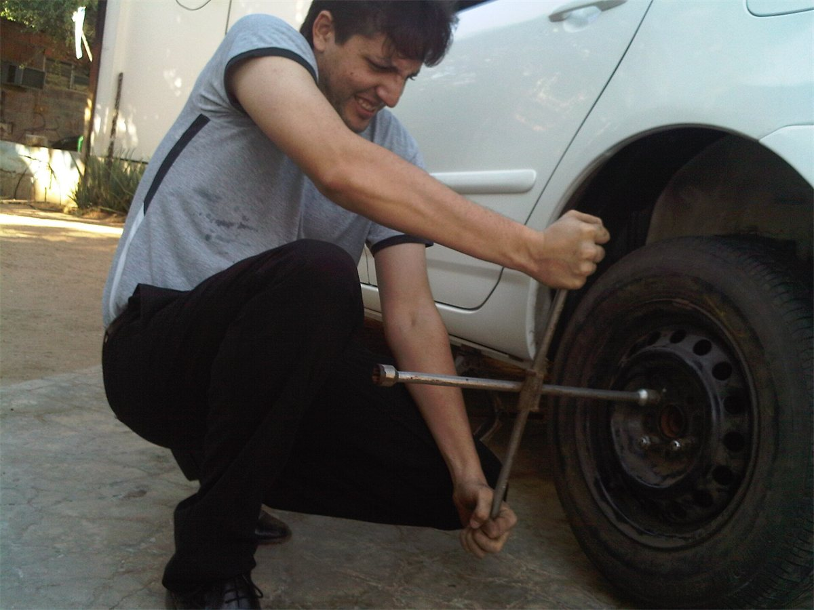
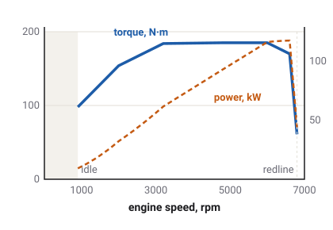

[AI-GENERATED CONTENT AWAITING HUMAN REVIEW]

# The engine

This page explains how an engine's twisting force changes with its speed, and
what keeps it between idle and its limit.

Which vehicles have this
Car
Truck
Tractor

A truck engine and a sports-car engine are both machines that burn fuel to turn a shaft, yet the
truck's cannot spin nearly as fast, and can still pull a load no sports car could move. What does
"strong" mean for an engine, and why does it change when the engine speeds up or slows down?

## Torque and rpm

<figure>

<figcaption>Loosening a wheel nut with a long bar. Photo: Wilfredor, CC BY-SA 3.0, <a href="https://commons.wikimedia.org/wiki/File:Cambiando_llanta.jpg">Wikimedia Commons</a>.</figcaption>
</figure>

Two numbers describe what an engine is doing at any moment.

- **[Rpm](glossary.md#rpm)**: how fast the crankshaft turns, in revolutions per minute. A car
  engine idles at about 900 rpm and can spin up to several thousand.
- **[Torque](glossary.md#torque)**: how hard it twists. A spanner on a stuck bolt applies torque:
  the force on the handle times the handle's length. It is measured in newton-metres (N·m). A
  long spanner gives a bigger twist from the same push, which is why a stuck wheel nut is
  loosened with a long bar.

Torque alone does not tell how much work an engine does each second, because that also depends
on how fast the shaft turns. That is [power](glossary.md#power): the torque multiplied by the rpm (and a
constant to fix the units). For example, an engine that gives 100 N·m at 3,000 rpm gives twice as
much power at 6,000 rpm if the torque is still 100 N·m, because it turns the same twist twice as
often. That is why an engine gives its most power near the top of its speed range, even where its
torque is already falling.

Which matters more, torque or power? The gearbox can trade one for the other (see
[Gearbox and shifting](gearbox.md)), turning a fast, weak twist into a slow, strong one. So, in
the right gear, how hard a vehicle can pull at a given road speed is set by the engine's power.
Torque still matters, because a gearbox has only so many gears: an engine that twists hard over a
wide range of speeds pulls well in whichever gear it is in.

## The torque curve

<!-- sedan_spec.tres torque_curve; power computed from it -->

A [torque curve](glossary.md#torque-curve) shows the most torque an engine can give at each engine
speed, with the throttle fully open. The torque is not the same at every speed because an engine
works by filling its cylinders with air and fuel, and how well it fills them depends on how fast
it turns. Slowly, its valves and pipes (shaped for a faster flow) fill the cylinders less well;
at the speeds the engine is built for, it fills best; and at very high speeds there is too little
time to fill, while friction inside takes more and more. So the curve rises, flattens and falls. Engines differ a lot. For example:

| Engine | Idle, rpm | Most torque, N·m | Redline, rpm |
| --- | --- | --- | --- |
| Saloon (petrol) | 900 | 185 | 6800 |
| Medium truck (diesel) | 700 | 1000 | 2900 |
| Semi truck (diesel) | 600 | 2300 | 2100 |
| Farm tractor (diesel) | 800 | 700 | 2350 |
<!-- torque_curve, idle_rpm, redline_rpm in sedan_spec.tres, garbage-truck_spec.tres (1017 N·m at 1800), semi_spec.tres (2308 at 1170, 2080 redline), tractor-kenney_spec.tres (700 at 1600) -->

A diesel turns slowly but twists hard, and gives its most torque at low rpm. In this example, the
semi's engine gives more than twelve times the saloon's torque, but cannot even reach a third of
its speed. Why? A diesel's parts are bigger and heavier, and burning its fuel takes longer, so it
cannot be spun fast without damage, but each push on its pistons is strong. That suits a heavy
vehicle, which needs a big twist at the wheels more than it needs speed.

How a diesel differs from a petrol engine

- **How the fuel lights.** A petrol engine squeezes a mixture of air and fuel and lights it with a
  spark. A diesel squeezes only air, so hard that it gets hot enough to light the fuel on its own
  when the fuel is sprayed in. There are no spark plugs.
- **Why it is built stronger.** Squeezing the air so hard needs a strong, heavy engine, which is
  one reason diesels spin slowly.
- **How its power is set.** A petrol engine controls its power by choking the air with a throttle
  flap. A diesel lets all the air in and controls its power only by the amount of fuel it sprays,
  and this wastes less energy at part load. It also matters for engine braking, below.

## The crank is a spinning mass

The crankshaft and its flywheel form a heavy spinning mass. Torque speeds it up, friction and load
slow it down, and it takes time to change speed. This is the same as a heavy wheel on a bicycle,
which is hard to start and hard to stop. A flywheel is there on purpose: an engine gives its push
in separate strokes, and the flywheel's momentum carries it through the gaps between them.

When the clutch is closed, the engine and the wheels are tied together, so accelerating the car
also means speeding up the heavy crank. In first gear the engine turns many times for every turn of
the wheels, so a small gain in the car's speed means a large gain in the engine's, and the crank
takes a big share of the push. This is why a car accelerates a little more slowly in first gear
than its weight alone would suggest. A truck's crank is much heavier than a car's.

## The throttle and the pedal map

In a modern vehicle, the accelerator pedal does not open the engine directly. It is not a tap on
the fuel: it tells a computer what the driver wants, and the computer turns the pedal's position
into a request, using a [pedal map](glossary.md#pedal-map), so that the engine can do it smoothly
and cleanly. There are several kinds:

- **The pedal asks for torque**, as in most modern petrol cars. The first part of the pedal's
  travel often asks for a large share of the torque.
- **The pedal sets the fuel**, as in simple diesel engines. Half the pedal gives half the fuel.
- **The pedal asks for an engine speed**, as in a tractor. [A governor](#the-tractors-governor)
  then holds that speed.

In each case, a fully pressed pedal asks for all the engine can give.

## Idle, and the key

When the engine is running with no pedal pressed, it idles. An engine cannot simply wait with its
shaft held still: it makes its push only while it turns, and each cylinder relies on the
flywheel's momentum to get through the strokes in which it does no work. So it has to be kept
turning, and a small controller gives it just enough fuel to beat its own friction and hold its
idle speed. If something loads the engine at idle (for example, the [torque converter](glossary.md#torque-converter) of an automatic car
stopped in gear), the controller gives it more.

The key controls the power supply. The engine only gets fuel at Ignition. When the key is turned
away from Ignition, the engine winds down on its own friction. To start again, a starter motor
has to turn it over.

## Friction and engine braking

An engine with no fuel still takes effort to turn. Its pistons rub, and a petrol engine also has
to suck air past a closed throttle. This friction grows with rpm.

When you lift off the accelerator while in gear, the wheels keep turning the engine, and the
engine's friction slows the vehicle. This is called [engine braking](glossary.md#engine-braking).
It is stronger in a low gear, because the engine spins faster for the same road speed, and
friction grows with rpm. It also happens whenever something else cuts the fuel (the rev limiter,
the speed governor, etc.).

A common belief is that rolling downhill in neutral saves fuel. It does the opposite: in neutral
the engine has to burn fuel to keep idling, while a modern engine in gear with the foot off the
pedal is turned by the wheels and burns none. Neutral also takes away the engine braking, so on a
long hill the brakes do all the work and can overheat. A diesel has no throttle flap to suck
against, so its engine braking is weaker than a petrol engine's, which is why heavy trucks add an
extra brake (a [retarder](glossary.md#retarder), see [Brakes](brakes.md)) for long descents.

On a slippery road, engine braking can be enough to make the driven wheels slide. Many cars can
detect this and give the engine a little fuel until the wheels roll again (this is called
drag-torque control).

## Limits: the rev limiter and the speed governor

- **The [rev limiter](glossary.md#rev-limiter)** cuts the fuel at the redline, so that the engine
  cannot over-speed. Past that speed the moving parts (pistons, valves) are pulled so hard that
  they can break. Many cars use a lower limit in neutral or park, where nothing loads the engine
  and it could run up to the redline in an instant.
- **The road-speed [governor](glossary.md#governor)** limits how fast the vehicle can go. Trucks
  and many vans have one, required by law or by their owners. It reduces the fuel as the vehicle
  nears its limit, so that it settles there smoothly instead of hitting a wall.

[Stability control](glossary.md#stability-control) can also reduce the fuel while it catches a
slide.

## The tractor's governor

A farm tractor's engine has to hold a steady speed while its load changes (for example, a mower
driven by the engine must spin at its rated speed whether the grass is thin or thick). In a car,
the driver does this by feel: when the car meets a hill, the driver presses harder. A tractor
cannot wait for that, so a tractor's diesel has an
[all-speed governor](glossary.md#all-speed-governor). The pedal and the
[hand throttle](glossary.md#hand-throttle) set an engine speed, and the governor adds or removes
fuel to hold it, like cruise control for the engine rather than for the road speed.

The governor is not perfectly stiff. It adds fuel according to how far the engine has slowed
below the speed it was set to, so a heavier load, which needs more fuel, leaves the engine
running a little slower: the speed drops by a few percent before the governor reaches full fuel.
This is called [droop](glossary.md#droop). For example, an engine set to 2,000 rpm might fall to
1,900 under a heavy load.

The tractor follows the higher of the pedal and the hand throttle. This allows the driver to keep
a steady engine speed with their foot off the pedal. A power take-off ([PTO](glossary.md#pto))
driving an [implement](implements.md) is a load like any other, and the governor answers it with
more fuel.

## What Carlito simulates

The parameters the simulator uses for this, and where each is set, are listed in
[How the simulation works](simulation.md#the-engine):

- **Simulation-wide**:
  - [Road-speed governor band](simulation.md#road-speed-governor-band) (`GOVERNOR_BAND`)
- **Per vehicle**:
  - [Torque curve, idle and redline](simulation.md#torque-curve) (`torque_curve`, `idle_rpm`,
    `redline_rpm`)
  - [Crank inertia](simulation.md#crank-inertia) (`engine_inertia`)
  - [Engine friction and engine braking](simulation.md#engine-friction-and-engine-braking)
    (`engine_friction_frac`, `engine_brake_frac`)
  - [Free-rev limit](simulation.md#free-rev-limit) (`free_rev_limit_rpm`)
  - [Pedal map](simulation.md#pedal-map) (`pedal_map`)
  - [Speed limit](simulation.md#speed-limit) (`speed_limit_kmh`)
  - [Governor droop](simulation.md#governor-droop) (`governor_droop`)

Simplification list

- **No stall, and no starter motor.** A real engine dragged below idle, by a clutch let out too
  fast in too high a gear, stops. The simulated clutch controller opens the clutch first, and the
  idle controller fuels any load a torque converter puts on it. Turning the key back to Ignition
  puts the engine back at idle at once.
  <!-- drivetrain.gd header: "Nothing stalls: the controller opens a clutch first, and the idle controller fuels a converter's load."; docs/drivetrain.md: "Ignition puts it back on idle" -->
- **One pedal map for all petrol engines.** It comes from measurements of one real 1.5-litre
  engine. The diesel vans, trucks and semis all use a straight line (half the pedal, half the fuel).
  <!-- PedalMap.Kind; docs/drivetrain.md The pedal map: EPA's map of a 2016 Honda L15B7 -->
- **The hand throttle cannot pull away.** It only keeps a moving tractor going; starting from a
  standstill takes the pedal.
  <!-- contract hand_throttle: "pulling away from rest still takes the accelerator" -->
- **No turbo lag.** The torque curve is available the moment the fuel arrives.
- **No engine temperature effect on power**, and no damage from over-revving or overheating.
- **No manual choke, no fuel type choice.**

## What you see in sloppyCAN

| Signal | Direction | Unit | What it shows |
| --- | --- | --- | --- |
| `accel` | in | % | The accelerator pedal, 0 to 100. |
| `key` | in | enum | The key: Lock, On or Ignition. Fuel only at Ignition. |
| `hand_throttle` | in | % | Sets an engine speed between idle (0) and the top of the range (100) (Tractor). |
| `rpm` | out | rev/min | Engine speed, read from the simulated crank. |
| `throttle` | out | % | The pedal as applied. The limiter and the governor cut the fuel after it, so it can read 100 while the engine gets no fuel. |
| `engine_load` | out | % | The torque the engine is giving, as a share of its best torque at any speed. A plough or PTO raises it (Truck and tractor). |
| `speed_limit` | out | km/h | The road-speed governor's setting; 0 means none. |
| `fuel_rate` | out | L/h | Fuel burned, read off the engine's torque and speed. |
<!-- contract/carlito_contract.json: accel, key, hand_throttle, rpm (warn 6800), throttle ("not the fuel the engine receives"; base_vehicle.gd telemetry.throttle = input.throttle), engine_load, speed_limit, fuel_rate -->

## Scenarios

- [Full throttle from a standstill](forces.md#example-pulling-away): the most drive, in first gear.
- [Full throttle at 150 km/h](forces.md#example-high-gear): much less drive at speed.
- [At the speed limiter](forces.md#example-truck-governed): full throttle, but no drive.

## Related

- [Tyres and grip](tyres.md): where the engine's torque finally meets the road.
- [Glossary](glossary.md): every term on this page.
