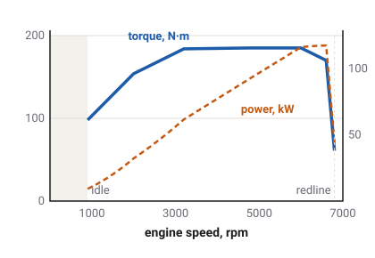

# The engine

An engine turns fuel into a twisting force on a spinning shaft. How much it can
give depends on how fast it spins. The game models each engine's speed, its twist at every speed,
the friction that slows it, and the controls that keep it between idle and its limit.

Which vehicles have this
Car
Truck
Tractor
Plane
Boat
Drone
Train

## Torque and rpm

Two numbers describe what an engine is doing at any moment.

- **[Rpm](glossary.md#rpm)**: how fast the crankshaft turns, in revolutions per minute. A car
  engine idles at about 900 rpm and can spin to about 6800.
- **[Torque](glossary.md#torque)**: how hard it twists. A spanner on a stuck bolt applies torque:
  the force on the handle times the handle's length. It is measured in newton-metres (N·m).

Power is the two multiplied together: a strong twist at a high speed. That is why an engine gives
its most power near the top of its speed range, even where its torque is already falling.
<!-- sedan_spec.tres: VehicleSpec idle_rpm 900, redline_rpm 6800 (defaults) -->

## The torque curve

<!-- sedan_spec.tres torque_curve; power computed from it -->

Every engine in the game has a [torque curve](glossary.md#torque-curve): a table of the most
torque it can give at each engine speed, with the throttle fully open. The `sedan`'s petrol
engine gives its best, about 185 N·m, from about 4800 to 6000 rpm. The engines differ a lot:

| Vehicle | Idle, rpm | Most torque, N·m | Redline, rpm |
| --- | --- | --- | --- |
| `sedan` (petrol) | 900 | 185 | 6800 |
| `garbage-truck` (diesel) | 700 | 1000 | 2900 |
| `semi` (heavy diesel) | 600 | 2300 | 2100 |
| `tractor-kenney` (diesel) | 800 | 700 | 2350 |

The figures are rounded. The diesels give their most torque low down, at 1200 to 1800 rpm.
<!-- torque_curve, idle_rpm, redline_rpm in sedan_spec.tres, garbage-truck_spec.tres (1017 N·m at 1800), semi_spec.tres (2308 at 1170, 2080 redline), tractor-kenney_spec.tres (700 at 1600) -->

A diesel turns slowly but twists hard. The semi's engine gives more than twelve times the
`sedan`'s torque, but cannot even reach a third of its speed.

## The crank is a spinning mass

In the game an engine is not a switch that hands out torque. Its crankshaft is a heavy spinning
mass, like a flywheel or a potter's wheel: torque speeds it up, friction and load slow it down,
and it takes time to change speed. Sixty times a second the game adds the engine's own torque, the
friction, and the pull of the wheels through the clutch, and works out the crank's new speed.

That is why the engine and the road are tied together. When the clutch is closed, the wheels
have to spin the heavy crank up with them, so a car accelerates a little more slowly in first gear
than its weight alone would suggest. A truck's crank is much heavier than a car's, and a semi's
heavier again.
<!-- docs/drivetrain.md Crank and coupling: engine_inertia 0.20 cars, 1.5 vans/trucks/tractor, 3.0 semis; "+41 % on the sedan's gear-1 mass factor" -->

## The throttle and the pedal map

The accelerator pedal does not open the engine directly. The game passes it through a
[pedal map](glossary.md#pedal-map) first, which turns the pedal's position into how much fuel the
engine gets. There are three kinds.

- **Petrol cars: the pedal asks for torque.** Like a modern car's engine computer, a petrol car
  in the game reads the pedal as a request for a certain twist. A third of the pedal asks for
  about two thirds of the engine's best torque in the middle of its range. The table comes from
  measurements of a real 1.5-litre petrol engine. The `van` and the pickups are petrol too, and
  work this way.
- **Heavy vans, trucks and semis: the pedal is the fuel.** Half the pedal gives half the fuel, as
  on a simple road diesel. The heavy vans are the `delivery`, `delivery-flat` and `ambulance`.
- **The tractor: the pedal asks for an engine speed.** See
  [the tractor's governor](#the-tractors-governor), below.
<!-- PedalMap.Kind: pedal_map 1 PETROL on every car-family spec but delivery, delivery-flat and ambulance (van, pickup, pickup-flat included; fuel_type default PETROL); the default LINEAR on those three (fuel_type 1 DIESEL), the Kenney trucks and the semis; 2 ALL_SPEED on the tractors; docs/drivetrain.md The pedal map: EPA's map of a 2016 Honda L15B7 -->

Whatever the map, a fully pressed pedal always means full fuel.

## Idle, and the key

With the key at Ignition and no pedal, the engine idles. A small controller gives it just enough
fuel to beat its own friction and hold idle speed. If something loads the engine at idle, such
as an automatic gearbox's [torque converter](glossary.md#torque-converter) pulling on it at a
standstill, the controller gives it more.

The key has three positions: Lock, On and Ignition. Only at Ignition does the engine get any fuel.
Turn the key away from Ignition and the engine winds down on its own friction; the `sedan`'s
stops in about a second and a half. Turn it back to Ignition and the engine is running at idle
again at once: the game has no starter motor to crank it over.
<!-- base_vehicle.gd: drivetrain.running = input.key == KEY_IGNITION; contract key "Throttle is forced 0 unless Ignition"; docs/drivetrain.md: "the sedan's from idle in about one and a half seconds; Ignition puts it back on idle" -->

### No stalling

In a real car, letting the clutch out too fast in too high a gear drags the engine below idle
until it stops: it stalls. The game's engines do not stall. Their clutch controller opens the
clutch before the engine can be dragged down, and the idle controller fuels any load a torque
converter puts on it.
<!-- drivetrain.gd header: "Nothing stalls: the controller opens a clutch first, and the idle controller fuels a converter's load." See open_questions.md 3 -->

## Friction and engine braking

An engine with no fuel still costs effort to turn. Its pistons rub, and a petrol engine also has
to suck air past a closed throttle. The game charges every engine a friction torque: small at
idle, larger at high rpm. On the `sedan` it is about a fourteenth of the engine's best torque at
idle and a quarter at the redline.
<!-- sedan engine_friction_frac 0.07, engine_brake_frac 0.25 (docs/drivetrain.md Motoring and friction, car petrol) -->

When you lift off the accelerator while in gear, the wheels keep turning the engine, and the
engine's friction slows the vehicle. This is [engine braking](glossary.md#engine-braking). It is
stronger in a low gear, where the engine spins faster for the same road speed. Every time the
fuel is cut, whether by a lifted pedal, the rev limiter or the speed governor, the engine brakes
in exactly this way.

On a vehicle with traction control, engine braking on a slippery road can be enough to make the
driven wheels slide. The game then gives the engine just enough fuel to cancel its own braking,
as real cars' drag-torque control does, so the wheels roll again.
<!-- Drivetrain.drag_control, drag_fuel: "the controller fuels the crank to zero net motoring torque" -->

## Limits: the rev limiter and the speed governor

- **The [rev limiter](glossary.md#rev-limiter)** cuts the fuel at the redline, so the engine
  cannot over-speed. With the gearbox in neutral or park, many cars cut lower: the `sedan` will
  not rev past about 4000 rpm standing still.
  <!-- Drivetrain.limiter_line; sedan_spec.tres free_rev_limit_rpm 4000 -->
- **The road-speed [governor](glossary.md#governor)** limits how fast the vehicle can go, as
  trucks and many vans are limited by law or by their owners. As the vehicle nears its limit the
  governor fades the fuel out over the last few km/h, so it settles a little under the limit
  instead of surging. The `semi` is governed to 90 km/h, the `semi-conventional` to 105, the
  garbage truck to 85, the fire truck to 110, the tractor to 40; the vans, pickups and ambulance have higher limits, and the cars none.
  <!-- VehicleSpec.speed_limit_kmh: semi 90, semi-conventional 105, garbage-truck 85, firetruck 110, ambulance 150, van/pickup/pickup-flat 180, tractors 40; Drivetrain.GOVERNOR_BAND 1.5 m/s -->

[Stability control](glossary.md#stability-control) can also trim the fuel while it catches a
slide.

## The tractor's governor

A farm tractor's engine has to hold a steady speed while its load changes: a mower driven from
the engine must spin at its rated speed whether the grass is thin or thick. So the tractor's
diesel has an [all-speed governor](glossary.md#all-speed-governor). The pedal, or the
[hand throttle](glossary.md#hand-throttle), does not set the fuel. It sets an engine speed,
anywhere from idle to the top of the range, and the governor adds or removes fuel to hold it.

The governor is not perfectly stiff. As the load grows, the engine speed sags a little, about
7 % from no load to full load, before the governor reaches full fuel. This sag is called
[droop](glossary.md#droop). A free engine settles exactly on its setting; a loaded one a little
under it.
<!-- tractor-kenney_spec.tres pedal_map 2 (ALL_SPEED); governor_droop 0.07 (docs/drivetrain.md, Deere 6R) -->

The tractor takes the higher of the pedal and the hand throttle. The hand throttle sets an
engine speed only: pulling away from a standstill still takes the pedal. Once moving, a set hand
throttle keeps the tractor driving in gear with the pedal released.
<!-- PedalMap.demand; contract hand_throttle: "pulling away from rest still takes the accelerator" -->

A power take-off ([PTO](glossary.md#pto)) that drives an implement is a load on the crank like
any other, and the governor answers it with fuel. [Implements and the PTO](implements.md) covers
it.

## The simpler engine on the boat and the plane

The boat's and the plane's engines do not drive wheels, so the game gives them a simpler model.
Their engine speed glides smoothly towards a point between idle and the limit set by the
throttle: half throttle, half way. The plane publishes that speed as its `rpm`.
<!-- Drivetrain rigid crank: target_rpm = lerp(idle_rpm, limiter_line, throttle), RPM_SMOOTH 8 /s; contract rpm vehicles car, truck, tractor, plane -->

## What the game leaves out

- **No stall, and no starter motor.**
- **No turbo lag.** The torque curve is available the moment the fuel arrives.
- **No engine temperature effect on power**, and no damage from over-revving or overheating.
- **No manual choke, no fuel type choice.**

## What you see in sloppyCAN

| Signal | Direction | Unit | What it shows |
| --- | --- | --- | --- |
| `accel` | in | % | The accelerator pedal, 0 to 100. |
| `key` | in | enum | The key: Lock, On or Ignition. Fuel only at Ignition. |
| `hand_throttle` | in | % | Tractor only: sets an engine speed between idle (0) and the top of the range (100). |
| `rpm` | out | rev/min | Engine speed, read from the simulated crank. Car, truck, tractor, plane. |
| `throttle` | out | % | The fuel actually delivered, after the limiter, the governor and any cut. It can be 0 with the pedal pressed. |
| `engine_load` | out | % | Truck and tractor: the torque the engine is giving, as a share of its best torque at any speed. A plough or PTO raises it. |
| `speed_limit` | out | km/h | The road-speed governor's setting; 0 means none. Car, truck, tractor. |
| `fuel_rate` | out | L/h | Fuel burned, read off the engine's torque and speed. Car, truck, tractor, boat. |
<!-- contract/carlito_contract.json: accel, key, hand_throttle, rpm (warn 6800), throttle, engine_load, speed_limit, fuel_rate -->

## Try it in the game

Try it in the game: the limiter and the governor

1. Pick the `semi` with no trailer on **Flatland**, and press **F2** for the dashboard if it is
   not showing. Hold the accelerator fully down. The speed creeps up to just under 90 km/h and
   stays there, the governor's limit, with the pedal still pressed.
2. Pick the `tractor-kenney`. Standing still, tap **=** a few times to raise the hand throttle:
   the rev counter rises and settles at each new setting.
3. Press the accelerator to pull away, then let it go. The tractor keeps driving at the speed the
   hand throttle holds. Press **-** to bring the hand throttle back down.

## Related

- [Tyres and slip](tyres.md): where the engine's torque finally meets the road.
- [Glossary](glossary.md): every term on this page.
