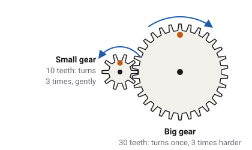
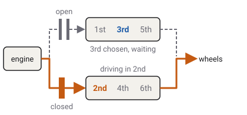
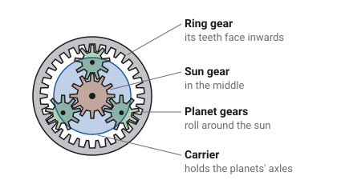
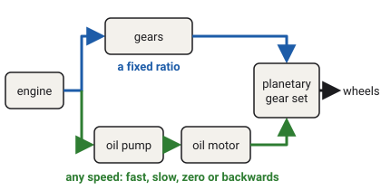

# Kinds of gearbox

Every gearbox lets one engine pull hard at walking pace and still run fast on a
motorway, by changing which gears join the engine to the wheels. The kinds differ in how they make
that change: by hand, by computer, by oil pressure, or with a belt that slides smoothly from one
size to another.

Which vehicles have this
Car
Truck
Tractor
Plane
Boat
Drone
Train

## Two gears: trading speed for strength

A [gear](glossary.md#gear) is a wheel with teeth around its edge. Put two gears side by side so
that their teeth fit between each other, and turning one turns the other: each tooth pushes the
next one along. Gears that fit together like this are said to mesh. Two meshed gears turn in
opposite directions.

When the two gears are different sizes, they turn at different speeds. Every tooth that passes on
one gear passes on the other, so a gear with 10 teeth has to turn three times to turn a gear with
30 teeth once. That is a [gear ratio](glossary.md#gear-ratio) of 3.

The big gear turns three times more slowly, but it twists three times harder. A twisting force
like this is called [torque](glossary.md#torque). A long spanner works the same way: your hand
travels a long way round for a small turn of the nut, and the nut gets a strong twist. So a gear
pair trades speed for twist, or twist for speed. Nothing comes free: what is gained in one is paid
for in the other, and a little is lost to friction on the way.

## Why one pair is not enough

An engine can only turn within a certain range of speeds, from [idle](glossary.md#idle) up to its
[redline](glossary.md#redline), and it is strong only in part of that range
([The engine](engine.md)). The wheels, though, must turn anywhere from not at all up to motorway
speed.

With only a big ratio, a vehicle would pull away easily, but its engine would reach the redline
at a low road speed. With only a small ratio, it could go fast, but it would struggle to pull
away, like starting a bicycle uphill in its hardest gear. So a gearbox holds several gear pairs:
a big ratio for pulling away, called first gear, a small one for cruising, called top gear, and
steps in between. It joins only one pair at a time. [Gearbox and shifting](gearbox.md) shows the
game's ratios and how the gear and the speed go together.

## Inside a gearbox: shafts, gears and collars

A shaft is a steel rod that turns. A simple gearbox has two: one turned by the engine and one
that turns the wheels. Each gear pair has one gear on each shaft, and every pair stays meshed all
the time.

The gears on the engine's shaft are fixed to it. The gears on the wheels' shaft are not: each sits
on a bearing and spins freely around the shaft, so on its own it does not turn the shaft at all.
Between two of these gears sits a collar. It turns with the shaft but can slide along it, and it
has stubby teeth on its sides, called dogs: together they make a
[dog clutch](glossary.md#dog-clutch). Slide the collar against a gear and its dogs lock into that
gear. Now that gear turns the shaft, and the drive goes through its pair. The other pairs keep
turning but carry nothing.

- **Neutral** means no collar touches a gear. The engine turns every gear pair, but none of them
  turns the wheels' shaft.
- **Reverse** uses a third small gear, the idler, between a pair. With three gears in a row, the
  last turns the same way as the first, so the wheels' shaft turns backwards.

Every kind of gearbox below is built from these ideas, or from a clever variation on them.

## The manual gearbox

In a [manual gearbox](glossary.md#manual-gearbox), the driver slides the collars by hand, with a
gear lever. To change gear, the driver:

1. presses the clutch pedal, which pulls the [clutch](glossary.md#clutch) apart and disconnects
   the engine from the gearbox;
2. moves the lever, which slides one collar away from the old gear and a collar against the new
   one;
3. lets the clutch pedal up again, smoothly, so the engine takes up the drive.

At that moment the collar and the new gear are turning at different speeds. Pushed straight
together, their dogs would crash into each other with a grinding crunch. So each collar has a
[synchroniser](glossary.md#synchroniser): a small cone that touches the gear first and rubs on
it, like a little brake, until both turn at the same speed. Only then can the dogs slip in.

While the clutch is open, the engine turns nothing, so a manual gearbox stops pushing the vehicle
for a moment at every change.

In the game no vehicle has a clutch pedal. Choosing MANUAL in the GARAGE lets you pick each gear
yourself, one step at a time, but the game works the clutch for you:
[Shifting by hand](gearbox.md#shifting-by-hand).

## The automated manual

An [automated manual](glossary.md#amt), or AMT, has the same insides as a manual gearbox: shafts,
gear pairs, collars and one clutch. Motors or air cylinders do the work of the driver's hand and
foot, and a computer decides when to change. Like a manual, it has to open its clutch to change
gear, so the drive stops for a moment each time.

In the game the two semis have a twelve-speed AMT. At each change the engine's fuel is cut, the
clutch opens, the gear changes, the clutch closes, and the fuel comes back gradually.
<!-- truck.md: semi and semi-conventional, 12-speed AMT; semi_spec.tres gear_ratios, 12 entries; VehicleSpec.shift_cut_s, shift_torque_ramp_s -->

## The sequential gearbox

A [sequential gearbox](glossary.md#sequential-gearbox) is a manual gearbox whose collars are
moved by a drum with curved grooves cut into it. Each click of the lever turns the drum one step,
and the grooves slide the right collars. The gears can only be taken in order, one up or one
down, never from second straight to fifth, but each change is very quick. Racing cars and
motorbikes use them.

In the game the two racing cars, `race` and `race-future`, have a six-speed sequential gearbox,
with an automated clutch and a short cut of the ignition at each change.
<!-- race_spec.tres, race-future_spec.tres: coupling CLUTCH, gear_ratios 6 entries, shift_cut_s -->

## The dual-clutch gearbox

A [dual-clutch gearbox](glossary.md#dual-clutch-gearbox) is two gearboxes in one case, each with
its own clutch. One half holds the odd gears (first, third, fifth), the other the even gears
(second, fourth, sixth). While the car drives in second through one clutch, the other half
already has third chosen, waiting. The change is then just one clutch letting go while the other
grips, so it is quick and the drive hardly stops.

No vehicle in the game has a dual-clutch gearbox. The `hatchback-sports` is modelled on a car that
has one; in the game it has an automatic instead, with a torque converter that does not multiply
torque. It stands in for the real car's clutch, which lets the car creep at walking pace
([Clutch and torque converter](coupling.md#the-torque-converter)).
<!-- hatchback-sports_spec.tres: coupling CONVERTER, converter_stall_ratio 1.0 (docs/drivetrain.md Converter, COMPROMISE) -->

## The automatic gearbox

An ordinary [automatic gearbox](glossary.md#automatic-gearbox) is built differently: instead of
gear pairs on shafts, it uses [planetary gear sets](glossary.md#planetary-gear-set). Each set is
named after the way it looks: a sun gear in the middle, three or four planet gears around it, a
ring gear around the outside with its teeth facing inwards, and a frame called the carrier that
holds the planets' axles.

The sun, the carrier and the ring can all turn. Hold one of them still, turn another with the
engine, and the third becomes the output, turning at a new speed:

- **Ring held, sun driven**: the carrier turns slowly, the same way as the sun. A low gear.
- **Two parts locked together**: the whole set turns as one block, a ratio of 1.
- **Carrier held, sun driven**: the ring turns the other way. Reverse.

So one small set gives several gears, and an automatic joins a few sets together to give all its
gears. What holds or locks each part is a clutch or a brake inside the gearbox, squeezed by oil
pressure. A gear change is one clutch letting go while the next one grips, at the same moment.
This is called clutch to clutch, and the drive keeps going right through the change. Between the
engine and the gearbox there is no clutch pedal but a
[torque converter](glossary.md#torque-converter): [Clutch and torque converter](coupling.md).

In the game every car except the two racing cars, every van, the garbage truck and the fire truck
has a six-speed automatic.
<!-- gear_ratios 6 entries and coupling CONVERTER (the default) on the Kenney car, van and truck specs; truck.md table -->

## The powershift

A [powershift](glossary.md#powershift) is a tractor gearbox. Like a manual, it is usually built
from gear pairs on shafts, but instead of collars it has wet clutches: packs of thin plates running in oil, which
oil pressure squeezes together. Like an automatic, it changes gear clutch to clutch, so the
tractor keeps pulling through each change. That matters when a tractor drags a plough through the
soil: in a gap in the drive, the plough would slow it down sharply. Tractors have many gears close
together, because farm work often needs one particular slow speed.

In the game the `tractor-kenney` has a sixteen-speed powershift. It does not cut the fuel during
a change, so you feel each gear take up with a small jolt.
<!-- tractor-kenney_spec.tres gear_ratios, 16 entries; docs/drivetrain.md The shift's handover: Powershift, no cut and no reduction -->

## The CVT: no steps at all

A [CVT](glossary.md#cvt), a continuously variable transmission, has no separate gears. Its ratio
slides smoothly, like a dimmer instead of a light switch, to any value between its lowest and its
highest.

### The belt CVT

The most common kind uses a belt and two pulleys. Each pulley is two cones facing each other,
with the belt running in the groove between them. Push the two cones together and the belt is
squeezed outwards, so it runs round a bigger circle. Pull them apart and it sinks to a smaller
circle. As one pulley grows, the other shrinks, so the belt stays tight.

Because every ratio in between is there too, the engine can stay at whatever speed suits it while
the vehicle speeds up. No vehicle in the game has a belt CVT.

### The tractor's power-split CVT

A tractor's CVT works another way. It splits the engine's power into two paths. One goes
through ordinary gears, which are efficient but fixed. The other drives an oil pump, and the oil
turns an oil motor: a [hydrostatic drive](glossary.md#hydrostatic-drive). Its speed can be set to
anything, fast, slow, zero or even backwards, by changing how much oil the pump sends. A
planetary gear set adds the two paths together, so changing the oil path's speed moves the
output's speed smoothly.

The oil path can cancel the gear path exactly, so the output can stand still while the engine
runs. That is how the tractor holds itself on a slope without its brakes: an
[active standstill](glossary.md#active-standstill). To cover every speed from a crawl to the
road, the gearbox also has a few mechanical ranges, and it changes between them as it drives,
with no gap in the pull.

In the game the `tractor-cvt` has a power-split CVT with four ranges. Its accelerator asks for a
road speed and the gearbox finds the ratio that gives it:
[The stepless gearbox](gearbox.md#the-stepless-gearbox).
<!-- docs/tractor.md The CVT tractor: four mechanical ranges, active standstill; Drivetrain.is_cvt, cvt_ratio_step, standstill_hold -->

## Vehicles without a gearbox

- **The train and the drone** run on electric motors. An electric motor is strong from a
  standstill and can spin very fast, so one fixed ratio covers every speed. The train's gear byte
  sets its [reverser](glossary.md#reverser): forward, neutral or reverse ([Trains](rail.md)).
- **The boat**'s outdrive has forward and reverse, but no gears to change.
- **The plane**'s propeller is turned directly by its engine. It reads the gear byte only for
  forward, neutral and reverse thrust.
<!-- gearbox.md and coupling.md badges; rail.md The reverser and the doors -->

## Which vehicle has which

| Vehicle | Gearbox | Forward gears | During a change |
| --- | --- | --- | --- |
| Cars, vans, `garbage-truck`, `firetruck` | Automatic, with a torque converter | 6 | Clutch to clutch: the drive never stops |
| `race`, `race-future` | Sequential | 6 | A short ignition cut |
| `semi`, `semi-conventional` | Automated manual | 12 | The clutch opens: the drive stops for a moment |
| `tractor-kenney` | Powershift | 16 | Clutch to clutch, with a small jolt |
| `tractor-cvt` | Power-split CVT | no steps, 4 ranges | No changes to feel |
| Train, drone, boat, plane | None | | |
<!-- gear_ratios lengths and coupling per *_spec.tres; truck.md table; tractor-cvt cvt_range_tops -->

## What the game leaves out

- **The gears themselves.** No tooth, shaft, collar, planet or belt is simulated. Each gearbox is
  a list of ratios, and each kind differs in how it hands the drive from one ratio to the next:
  [What happens during a change](gearbox.md#what-happens-during-a-change).
- **The CVT's two paths.** The game simulates the CVT's overall ratio, not the gears and the oil
  separately.
- **No clutch pedal, no grinding.** Even with MANUAL, the game works the clutch, and every change
  succeeds.
- **No dual-clutch gearbox and no belt CVT** on any vehicle.

## What you see in sloppyCAN

| Signal | Direction | Unit | What it shows |
| --- | --- | --- | --- |
| `gear` | out | enum | The gear engaged. On the CVT, the mechanical range in use, D1 to D4. |
| `gear_ratio` | out | ratio | Truck and tractor: the engaged gear's ratio, without the final drive. It steps on the AMT and the powershift, and moves smoothly on the CVT. 0 in N or P. |
| `rpm` | out | rev/min | Engine speed. On a stepped gearbox it drops at each upshift. |
<!-- contract/carlito_contract.json: gear (out), gear_ratio, rpm -->

## Try it in the game

Try it in the game: four gearboxes, one pedal

1. Pick the `sedan` on **Flatland**, with the dashboard showing (**F2**). Press the accelerator
   fully from a standstill. The revs climb, then drop at each change, while the car keeps
   pulling: the automatic hands over clutch to clutch.
2. Do the same in the `semi`. At each change the revs drop and, for a moment, the truck stops
   pulling: the AMT has opened its clutch.
3. Do the same in the `tractor-kenney`. The gears come in many small steps, each with a small jolt
   as it takes up.
4. Do the same in the `tractor-cvt`. There are no steps: the speed rises smoothly and the revs
   never drop suddenly.

## Related

- [Gearbox and shifting](gearbox.md): the gear byte, and how the game chooses a gear.
- [Clutch and torque converter](coupling.md): what slips while the vehicle pulls away.
- [The engine](engine.md): the torque the gears multiply.
- [Glossary](glossary.md): every term on this page.
