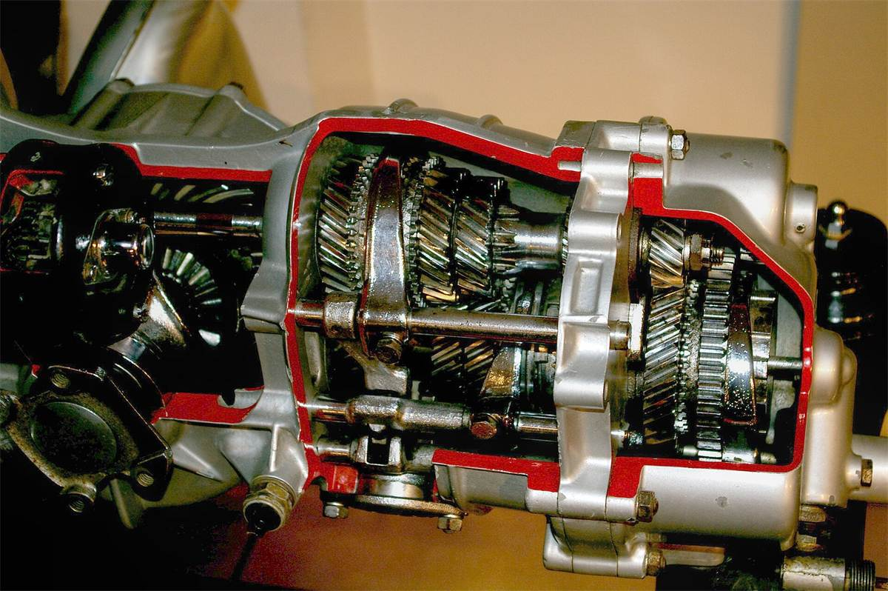
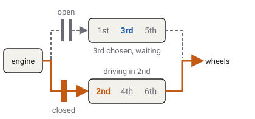
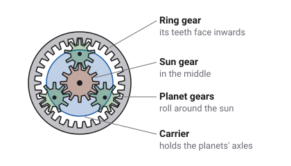
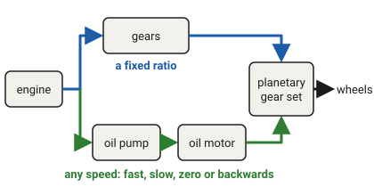

[AI-GENERATED CONTENT AWAITING HUMAN REVIEW]

# Kinds of gearbox

This page explains the kinds of gearbox and how each changes gear: by hand, by
computer, by oil pressure or with a belt.

Which vehicles have this
Car
Truck
Tractor

A gearbox holds several gear ratios (see [Gearbox and shifting](gearbox.md)): a big one for
pulling away, called first gear, a small one for cruising, called top gear, and steps in between,
and it uses only one at a time. The hard part is the change. The gears are turning, the engine is
pushing, and the old gear has to let go while the new one takes over. How is that done, and can
the push keep going while it happens?

## Inside a gearbox: shafts, gears and collars

<figure>

<figcaption>A manual gearbox cut open. Photo: BerndB, CC BY-SA 3.0, <a href="https://commons.wikimedia.org/wiki/File:Porsche-gearbox-cutaway.jpg">Wikimedia Commons</a>.</figcaption>
</figure>

A shaft is a steel rod that turns. A simple gearbox has two: one turned by the engine and one
that turns the wheels. Each gear pair has one gear on each shaft, and every pair stays meshed all
the time.

The gears on the engine's shaft are fixed to it. The gears on the wheels' shaft are not: each sits
on a bearing and spins freely around the shaft, so on its own it does not turn the shaft at all.
Between two of these gears sits a collar. It turns with the shaft but can slide along it, and it
has stubby teeth on its sides, called dogs: together they make a
[dog clutch](glossary.md#dog-clutch). Slide the collar against a gear and its dogs lock into that
gear. Now that gear turns the shaft, and the drive goes through its pair. The other pairs keep
turning but carry nothing.

- **Neutral** means no collar touches a gear. The engine turns every gear pair, but none of them
  turns the wheels' shaft.
- **Reverse** uses a third small gear, the idler, between a pair. Two meshed gears turn opposite
  ways, so with three gears in a row the last turns the same way as the first. That reverses the
  wheels' shaft compared with a forward gear.

## The manual gearbox

In a [manual gearbox](glossary.md#manual-gearbox), the driver slides the collars by hand, with a
gear lever. To change gear, the driver:

1. presses the clutch pedal, which pulls the [clutch](glossary.md#clutch) apart and disconnects
   the engine from the gearbox;
2. moves the lever, which slides one collar away from the old gear and a collar against the new
   one;
3. lets the clutch pedal up again, smoothly, so the engine takes up the drive.

At that moment the collar and the new gear are turning at different speeds. Pushed straight
together, their dogs would crash into each other with a grinding crunch. So each collar has a
[synchroniser](glossary.md#synchroniser): a small cone that touches the gear first and rubs on
it, like a little brake, until both turn at the same speed. Only then can the dogs slip in.

Double clutching, for gearboxes without synchronisers

Many old trucks' gearboxes have no synchronisers, so the driver has to match the speeds by feel.
On a change down, for example, the driver presses the clutch and moves the lever to neutral, lets
the clutch up and blips the accelerator, which spins the engine and the gears behind the clutch up
to the speed the lower gear needs, then presses the clutch again and moves the lever into the new
gear. The clutch is pressed twice, hence the name. Done well, the dogs slide in without a sound.

While the clutch is open, the engine turns nothing, so a manual gearbox stops pushing the vehicle
for a moment at every change. Why does this matter? A vehicle on a steep hill, or a tractor in
soil, can lose a lot of speed in that moment, which is the reason for the gearboxes below that
change without a gap.

## The automated manual

An [automated manual](glossary.md#amt), or AMT, has the same insides as a manual gearbox: shafts,
gear pairs, collars and one clutch. Motors or air cylinders do the work of the driver's hand and
foot, and a computer decides when to change. Like a manual, it has to open its clutch to change
gear, so the drive stops for a moment each time.

AMTs are common on semi trucks, often with twelve gears. At each change the engine's fuel is cut,
the clutch opens, the gear changes, the clutch closes, and the fuel comes back gradually.

## The sequential gearbox

A [sequential gearbox](glossary.md#sequential-gearbox) is a manual gearbox whose collars are
moved by a drum with curved grooves cut into it. Each click of the lever turns the drum one step,
and the grooves slide the right collars. The gears can only be taken in order, one up or one
down, never from second straight to fifth, but each change is very quick. Racing cars and
motorbikes use them. Racing gearboxes often cut the ignition briefly at each change, so that the
gears can move without lifting off the accelerator.

## The dual-clutch gearbox

A [dual-clutch gearbox](glossary.md#dual-clutch-gearbox) is two gearboxes in one case, each with
its own clutch. One half holds the odd gears (first, third, fifth), the other the even gears
(second, fourth, sixth). While the car drives in second through one clutch, the other half
already has third chosen, waiting. The change is then just one clutch letting go while the other
grips, so it is quick and the drive hardly stops.

## The automatic gearbox

An ordinary [automatic gearbox](glossary.md#automatic-gearbox) is built differently: instead of
gear pairs on shafts, it uses [planetary gear sets](glossary.md#planetary-gear-set). Each set is
named after the way it looks: a sun gear in the middle, three or four planet gears around it, a
ring gear around the outside with its teeth facing inwards, and a frame called the carrier that
holds the planets' axles.

The sun, the carrier and the ring can all turn. Hold one of them still, turn another with the
engine, and the third becomes the output, turning at a new speed:

- **Ring held, sun driven.** The carrier turns slowly, the same way as the sun, which makes a low
  gear.
- **Two parts locked together.** The whole set turns as one block, a ratio of 1.
- **Carrier held, sun driven.** The ring turns the other way, which makes reverse.

How low is the low gear? With the ring held, the ratio is 1 + the ring's teeth ÷ the sun's teeth.
For example, with a sun of 30 teeth and a ring of 90, the sun turns 1 + 90 ÷ 30 = 4 times for
each turn of the carrier. With the carrier held instead, the sun turns 90 ÷ 30 = 3 times for each
turn of the ring, backwards.

So one small set gives several gears, and an automatic joins a few sets together to give all its
gears. What holds or locks each part is a clutch or a brake inside the gearbox, squeezed by oil
pressure. So an automatic is not a gearbox without clutches: it has no clutch pedal, but many
clutches and brakes of its own, worked by oil instead of a foot. A gear change is one clutch
letting go while the next one grips, at the same moment.
This is called clutch to clutch, and the drive keeps going right through the change. Between the
engine and the gearbox there is no clutch pedal but a
[torque converter](glossary.md#torque-converter) (see
[Clutch and torque converter](coupling.md)).

## The powershift

A [powershift](glossary.md#powershift) is a tractor gearbox. Like a manual, it is usually built
from gear pairs on shafts, but instead of collars it has wet clutches: packs of thin plates
running in oil, which oil pressure squeezes together. Like an automatic, it changes gear clutch to clutch, so the
tractor keeps pulling through each change. That matters when a tractor drags a plough through the
soil: in a gap in the drive, the plough would slow it down sharply. Tractors have many gears close
together, because farm work often needs one particular slow speed (sixteen gears is not unusual).

## The CVT: no steps at all

A [CVT](glossary.md#cvt), a continuously variable transmission, has no separate gears. Its ratio
slides smoothly, like a dimmer instead of a light switch, to any value between its lowest and its
highest.

### The belt CVT

The most common kind uses a belt and two pulleys. Each pulley is two cones facing each other,
with the belt running in the groove between them. Push the two cones together and the belt is
squeezed outwards, so it runs round a bigger circle. Pull them apart and it sinks to a smaller
circle. As one pulley grows, the other shrinks, so the belt stays tight.

A small circle at the engine and a big one at the wheels is like a low gear; the other way round
is like a high gear. Because every ratio in between is there too, the engine can stay at whatever
speed suits it while the vehicle speeds up. A stepped gearbox cannot do this: its engine speed
rises and falls with every gear.

 and a high gear (right).")

### The tractor's power-split CVT

A tractor's CVT works another way. It splits the engine's power into two paths. One goes
through ordinary gears, which are efficient but fixed. The other drives an oil pump, and the oil
turns an oil motor: a [hydrostatic drive](glossary.md#hydrostatic-drive). Its speed can be set to
anything, fast, slow, zero or even backwards, by changing how much oil the pump sends. A
planetary gear set adds the two paths together, so changing the oil path's speed moves the
output's speed smoothly.

The oil path can cancel the gear path exactly, so the output can stand still while the engine
runs. That is how the tractor holds itself on a slope without its brakes: an
[active standstill](glossary.md#active-standstill). To cover every speed from a crawl to the
road, the gearbox also has a few mechanical ranges, and it changes between them as it drives,
with no gap in the pull (see [The stepless gearbox](gearbox.md#the-stepless-gearbox)).

## Comparison

| Gearbox | Often found on | During a change |
| --- | --- | --- |
| Manual | Cars, vans, older trucks and tractors | The driver opens the clutch: the drive stops for a moment |
| Automated manual | Semi trucks | The computer opens the clutch: the drive stops for a moment |
| Sequential | Racing cars, motorbikes | A very short break in the drive |
| Dual-clutch | Cars, especially sporty ones | One clutch takes over from the other: the drive hardly stops |
| Automatic | Cars, vans, refuse and fire trucks | Clutch to clutch: the drive never stops |
| Powershift | Tractors | Clutch to clutch, sometimes with a small jolt |
| CVT | Cars (belt), tractors (power-split) | No steps |

## What Carlito simulates

The parameters the simulator uses for this, and where each is set, are listed in
[How the simulation works](simulation.md#kinds-of-gearbox):

- **Per vehicle**:
  - [Which coupling](simulation.md#which-coupling) (`coupling`)
  - [The CVT](simulation.md#the-cvt) (`cvt_range_tops`, `cvt_accel_ms2`, `cvt_max_axle_torque`)

Simplification list

- **The gears themselves.** No tooth, shaft, collar, planet or belt is simulated. Each gearbox is
  a list of ratios, and each kind differs in how it hands the drive from one ratio to the next.
- **The CVT's two paths.** The simulation models the CVT's overall ratio, not the gears and the
  oil separately.
- **No clutch pedal, no grinding.** Even with a manual gearbox, the simulation works the clutch,
  and every change succeeds.
- **Five kinds only.** The cars, vans and rigid trucks have six-speed automatics (the two racing
  cars a six-speed sequential), the semis a twelve-speed AMT, and the tractors a sixteen-speed
  powershift or a power-split CVT with four ranges.
  <!-- gear_ratios lengths and coupling per *_spec.tres; truck.md table; tractor-cvt cvt_range_tops -->
- **No dual-clutch gearbox and no belt CVT** on any vehicle. The `hatchback-sports` is modelled on
  a car with a dual-clutch gearbox; in the simulation it has an automatic whose torque converter
  does not multiply torque, so it still creeps at walking pace as the real car does on its clutch.
  <!-- hatchback-sports_spec.tres: coupling CONVERTER, converter_stall_ratio 1.0 (docs/drivetrain.md Converter, COMPROMISE) -->

## What you see in sloppyCAN

| Signal | Direction | Unit | What it shows |
| --- | --- | --- | --- |
| `gear` | out | enum | The gear engaged. On the CVT, the mechanical range in use, D1 to D4. |
| `gear_ratio` | out | ratio | The engaged gear's ratio, without the final drive. It steps on the AMT and the powershift, and moves smoothly on the CVT. 0 in N or P (Truck and tractor). |
| `rpm` | out | rev/min | Engine speed. On a stepped gearbox it drops at each upshift. |
<!-- contract/carlito_contract.json: gear (out), gear_ratio, rpm -->

## Related

- [Gearbox and shifting](gearbox.md): how a gear is chosen, and what happens during a change.
- [Clutch and torque converter](coupling.md): what slips while the vehicle pulls away.
- [The engine](engine.md): the torque the gears multiply.
- [Glossary](glossary.md): every term on this page.
