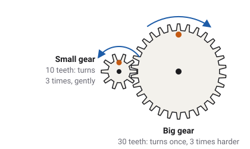
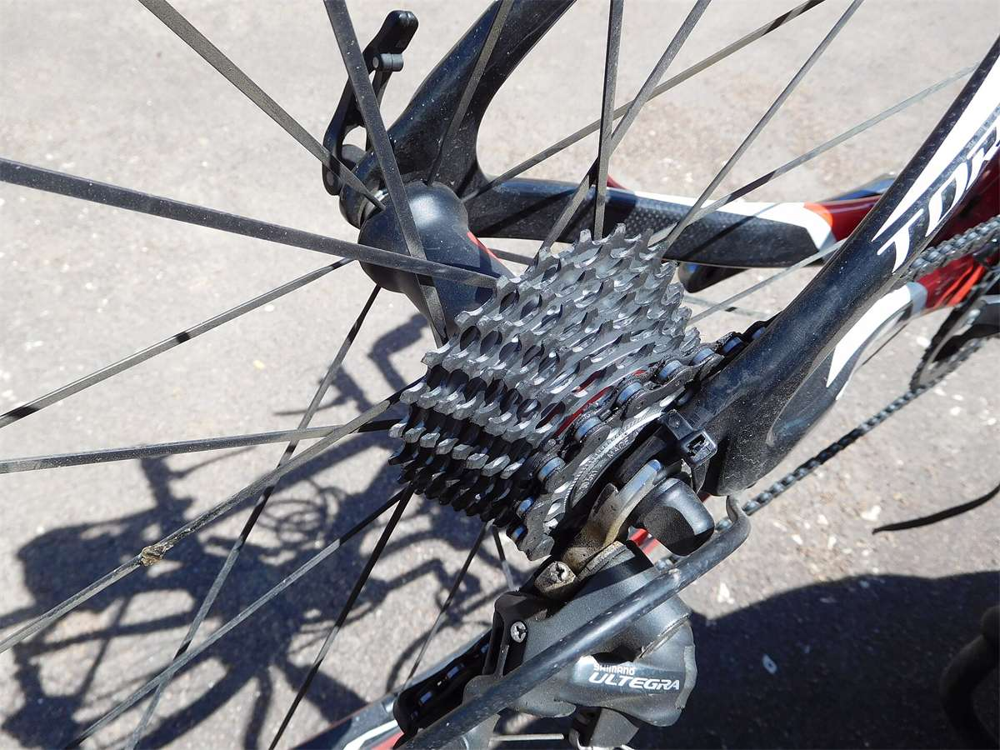
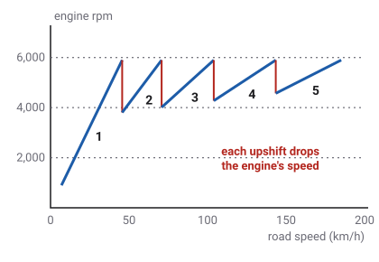

[AI-GENERATED CONTENT AWAITING HUMAN REVIEW]

# Gearbox and shifting

This page explains how a gearbox lets one engine both crawl up a hill and cruise
on a motorway, and how a gear is chosen.

Which vehicles have this
Car
Truck
Tractor

An engine gives its best push only within a band of speeds, and a car has to go from a crawl to
a motorway. If the engine were joined straight to the wheels, a car that could climb a steep hill
could not also drive fast, and the other way round. How can one engine do both?

## Two gears: trading speed for strength

A [gear](glossary.md#gear) is a wheel with teeth around its edge. Put two gears side by side so
that their teeth fit between each other, and turning one turns the other: each tooth pushes the
next one along. Gears that fit together like this are said to mesh. Two meshed gears turn in
opposite directions.

When the two gears are different sizes, they turn at different speeds. Every tooth that passes on
one gear passes on the other, so a gear with 10 teeth has to turn three times to turn a gear with
30 teeth once. That is a [gear ratio](glossary.md#gear-ratio) of 3.

The big gear turns three times more slowly, but it twists three times harder. A twisting force
like this is called [torque](glossary.md#torque). A long spanner works the same way: your hand
travels a long way round for a small turn of the nut, and the nut gets a strong twist. So a gear
pair trades speed for twist, or twist for speed. Nothing comes free: what is gained in one is paid
for in the other (and a little is lost to friction on the way). For example, if the small gear
turns at 3,000 rpm with a twist of 10 N·m, the big one turns at 1,000 rpm with a twist of about 30
N·m. The power (twist times speed) is the same on both sides.

## What a gear does

<figure>

<figcaption>A bicycle's rear sprockets. Photo: Cjp24, CC BY-SA 4.0, <a href="https://commons.wikimedia.org/wiki/File:Bicycle_cassette_-_10-speed.jpg">Wikimedia Commons</a>.</figcaption>
</figure>

On a bicycle, a small front sprocket and a big rear one make pedalling easy but slow (good for a
hill). A big front sprocket and a small rear one make it hard but fast. A gearbox does the same
for an engine.

Each gear has a gear ratio: how many times the engine turns for one
turn of the gearbox's output. After the gearbox, a second fixed set of gears (the
[final drive](glossary.md#final-drive)) turns the wheels. Multiply the two and you have how many
times the engine turns for each turn of the wheels. For example, this can be about 18 in a car's
first gear, and about 3.6 in its sixth. So a "higher" gear has a smaller ratio: the engine turns
fewer times for each turn of the wheels.
<!-- sedan_spec.tres gear_ratios 4.5 ... 0.925; final_drive 3.9 (CAR_BASE): 17.6 and 3.6 -->

The same ratio works on torque, the other way round, as with the two gears above. A low gear turns
the engine many times per wheel turn and multiplies its torque by as much, so the wheels push hard
but the vehicle moves slowly. For example, with a ratio of 18 an engine giving 150 N·m can give the
wheels about 2,700 N·m (a little less after friction in the gears), but the wheels turn 18 times
slower than the engine. In a high gear with a ratio of 3.6 the same engine gives only about
540 N·m, and the wheels turn five times faster. So a higher gear is not "more power": it gives a
lower push at a higher speed, for the same power from the engine.

Why not use the highest gear all the time, then? Because the push is too weak to pull away or
climb, and the engine would be turning slowly, where it is weakest. And why not the lowest? The
engine would hit its redline at a low road speed, burning fuel and making noise for very little
speed. A gearbox lets the driver (or the computer) keep the engine in the speeds where it works
well, whatever the road speed.

Each bar runs from idle to the redline in that gear. The push is the engine's full-throttle
torque at this speed through the gears, with the clutch locked and a tenth of the power lost in
the gears. It leaves out the torque converter, the tyres' grip and the air, and the governors that
stop the simulator's `semi` at 90 km/h and its tractor at 40.
<!-- widgets/gear-speed.js header; VehicleSpec.efficiency 0.9; semi_spec.tres speed_limit_kmh 90, tractors 40 -->

## Choosing a gear: P, R, N and D

The selector of an automatic usually has four positions:

- **P, park.** A steel tooth (the [park pawl](glossary.md#park-pawl)) locks the gearbox's output,
  so the wheels cannot turn. A brake could do the same, but a tooth in a notch holds with no
  force from the driver and cannot fade. Heavy trucks often have no P, and park on their spring
  brakes instead.
- **R, reverse.** A reverse gear turns the wheels backwards.
- **N, neutral.** No gear is joined, so the engine turns freely and the vehicle can roll.
- **D, drive.** The gearbox picks the forward gear itself.

With a manual gearbox, the driver picks each gear with a lever and a clutch pedal (see
[The manual gearbox](gearbox-kinds.md#the-manual-gearbox)).

## How the automatic chooses a gear

The rules that an automatic follows are called its [shift policy](glossary.md#shift-policy).

- **Light pedal, early shifts.** When driving gently, it changes up at low rpm, to keep the engine
  slow, quiet and thrifty. With the pedal fully down, it holds each gear until close to the
  redline, because the driver is asking for as much power as possible.
- **No hunting.** The rpm for changing up and down are kept apart. Otherwise a car cruising at
  just the rpm where the gearbox changes up would change up, find that the engine is now below
  the rpm for changing down, change down, and so on, flicking back and forth between two gears.
- **Kickdown.** Pressing the accelerator most of the way down makes the automatic drop one or more
  gears at once. A lower gear multiplies the torque more and lets the engine spin nearer its best
  speed, so the car pulls harder at once (for example, when overtaking).
- **Hills.** On a climb, it avoids changing up into a gear that could not hold the speed: the
  higher gear would push too weakly, the car would slow, and the gearbox would have to change
  straight back down. When braking down a long hill, it can change down so that the engine helps
  to brake ([engine braking](engine.md#friction-and-engine-braking)).
- **Starting gear.** Heavy trucks and tractors do not always start in first. First gear can push
  far harder than a light or flat start needs, and every gear skipped saves time, wear and fuel.
  They use the highest gear that can still pull away cleanly, which depends on the load and the
  slope.
- **Skipping gears.** Gearboxes with twelve or sixteen close gears often skip some when the load
  allows it (for example, going from sixth straight to eighth), because the engine's speed would
  hardly change from one to the next.

## What happens during a change

The wheels keep turning at the speed of the road, so a new gear means a new engine speed. For
example, at 100 km/h an engine might turn at 4,100 rpm in fourth gear and at 3,200 in fifth. When
the car changes up, the engine has to slow down from 4,100 to 3,200 as it joins the new gear
(and speed up again on a change down). How far it drops is set by the two gears' ratios:

new engine speed = old engine speed × new gear's ratio ÷ old gear's ratio

With ratios of 1.43 in fourth and 1.11 in fifth, that is 4,100 × 1.11 ÷ 1.43 = about 3,200 rpm.
<!-- sedan at 100 km/h: 27.8 m/s ÷ wheel_radius 0.36 × (1.431 or 1.109) × final_drive 3.9 × 60/2π ≈ 4,100 and 3,200 rpm -->
Gearboxes with many gears close together (a truck's twelve, a tractor's sixteen) make each drop
small, so the engine stays near its best speed. How the change is handled depends on the kind of
gearbox.
<!-- semi_spec.tres steps 1.21-1.24; tractor-kenney 7 → 6.275 is 1.12 -->

If the engine's speed does not match the new gear when the drive is joined, the coupling has to
drag the engine to the right speed, which jerks the car and heats the clutch. This is why, on an
upshift, the gearbox's computer cuts the engine's fuel so that it slows to the new speed more
quickly, and on a downshift gives it a burst of fuel to spin it up to the new speed first (a
skilled driver with a manual gearbox does the same with the accelerator).

- **Automatic.** Clutches inside the gearbox hand the drive from one gear to the next (one lets go
  as the other takes up), so the drive never stops. The engine is briefly given less fuel so that
  it can slow to its new speed.
- **Powershift** (tractors). This is also clutch to clutch, so the tractor keeps pulling through
  the change. You can feel a jolt as each gear takes up.
- **Automated manual** (semi trucks). A computer works a clutch and an ordinary gearbox. It cuts
  the fuel, opens the clutch, changes gear, closes the clutch, and brings the fuel back gradually.
  The drive stops for a moment on every change.
- **Sequential** (racing cars). The change is very quick, with a short ignition cut.

## The stepless gearbox

A [CVT](glossary.md#cvt) has no fixed gears. It changes its ratio smoothly, so the engine can
stay at the speed where it works best while the vehicle speeds up, with no steps to feel. (How it
does this is in [Kinds of gearbox](gearbox-kinds.md#the-cvt-no-steps-at-all).) On a tractor with a
CVT, the accelerator asks for a road speed: the gearbox sets the ratio that gives it, while the
engine's governor holds the engine speed. The ratio can go down to zero, which holds the wheels
still with the engine running, so the tractor can stand on a slope without its brakes.

## What Carlito simulates

The parameters the simulator uses for this, and where each is set, are listed in
[How the simulation works](simulation.md#gearbox-and-shifting):

- **Per vehicle**:
  - [Ratios and efficiency](simulation.md#ratios) (`gear_ratios`, `reverse_ratio`, `final_drive`,
    `efficiency`)
  - [Shift points](simulation.md#shift-points) (`shift_up_rpm`, `shift_down_rpm`,
    `shift_up_light_rpm`, `shift_down_light_rpm`)
  - [Kickdown](simulation.md#kickdown) (`kickdown_pedal`)
  - [Start gear](simulation.md#start-gear) (`start_gear_max`)
  - [Shift timing](simulation.md#shift-timing) (`shift_cut_s`, `shift_torque_ramp_s`,
    `shift_handover_s`)
  - [Least time in gear](simulation.md#least-time-in-gear) (`shift_dwell_s`)
  - [Skip shifts](simulation.md#skip-shifts) (`skip_shifts`)

Simplification list

- **No gear lever or paddles.** Shifting by hand moves one gear per press, and there is no P on
  the manual ladder (the parking brake holds instead).
- **No clutch pedal**, so no stalling or slipping the clutch by hand.
- **No crunching gears or missed shifts.**
- **No range or splitter buttons** on the semis' twelve gears. The automated gearbox chooses.
- **One shift map.** The automatics' rules follow measurements of one real car (a 2013 family car
  with a six-speed). The tractor and the racing cars have no kickdown.
  <!-- docs/drivetrain.md The shift policy: the Malibu map [34]; VehicleSpec.kickdown_pedal -->
- **A fixed loss.** Every gearbox loses a tenth of the power, in every gear.
  <!-- VehicleSpec.efficiency 0.9 on every shipped body -->

## What you see in sloppyCAN

| Signal | Direction | Unit | What it shows |
| --- | --- | --- | --- |
| `gear` | in | enum | The [gear byte](glossary.md#gear-byte): N, D1 to D24, R, or P. With an automatic it works as a lever; with a manual it is the exact gear. |
| `gear` | out | enum | The gear actually engaged. P only where a park pawl is fitted; on the CVT, the range in use. |
| `gear_ratio` | out | ratio | The engaged gear's ratio, without the final drive. On the CVT it moves smoothly. 0 in N or P (Truck and tractor). |
| `gear_top` | out | count | The highest drive gear this vehicle has: 6 on a car, 16 on the tractor, 4 ranges on the CVT. A higher `gear` byte selects this one, so sloppyCAN's Control panel stops here. |
| `rpm` | out | rev/min | Engine speed: watch it drop at each upshift. |
| `status` | out | bitfield | Bit 3 is reverse, bit 4 neutral. |
<!-- contract/carlito_contract.json: gear (in and out), gear_ratio, gear_top, rpm, status bits 3 and 4; gear_top = Drivetrain.top_gear: sedan_spec.tres 6 gear_ratios, tractor-kenney_spec.tres 16, tractor-cvt_spec.tres 4 cvt_range_tops -->

## Scenarios

- [Pulling away at full throttle](forces.md#example-pulling-away): first gear, and a strong push.
- [Full throttle at 150 km/h](forces.md#example-high-gear): a higher gear, and a weaker push.

## Related

- [Kinds of gearbox](gearbox-kinds.md): what is inside a manual, an automatic, a CVT and the
  others.
- [The engine](engine.md): the torque the gears multiply.
- [Clutch and torque converter](coupling.md): what slips while the gears change and the vehicle
  pulls away.
- [Glossary](glossary.md): every term on this page.
