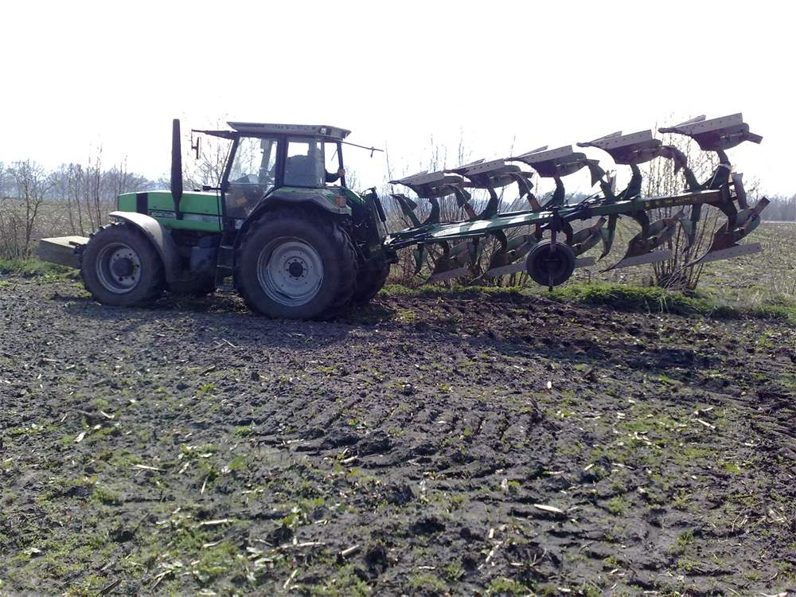
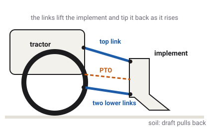
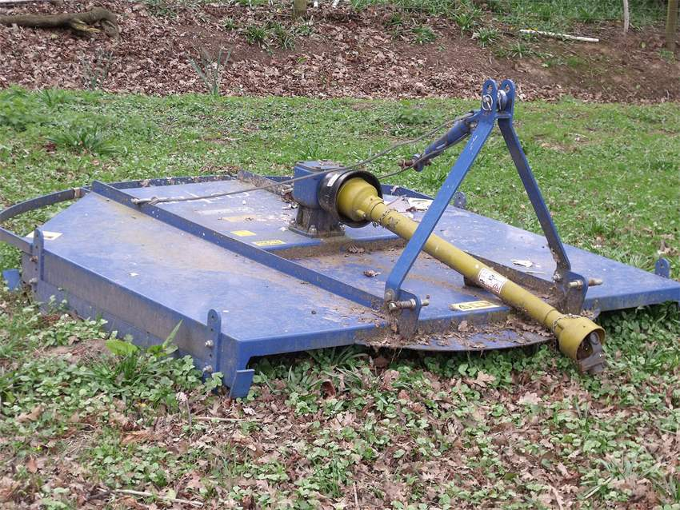

[AI-GENERATED CONTENT AWAITING HUMAN REVIEW]

# Implements and the PTO

This page explains the five ways a tractor carries, pulls and powers its tools,
and the forces each one brings.

Which vehicles have this
Car
Truck
Tractor

A tractor does not do the farm work by itself: it is a source of pull, power and oil pressure, and
the tool behind it does the work. How does a tool, which may weigh as much as a car, get its pull,
its power and its instructions from the tractor?

## Five connections

The tools a tractor works with are called [implements](glossary.md#implement). A tractor can carry
them, drag them through the soil, and power their moving parts with its engine. It connects to
them in five ways:

1. **The three-point hitch**, which carries a tool on the back.
2. **The drawbar**, which pulls a trailer (see [Towing](towing.md#two-bodies-and-a-joint) for how
   it works).
3. **The PTO**, a spinning shaft that drives the tool's moving parts.
4. **The hydraulic remote**, an oil supply that works a ram on the tool.
5. **The implement bus** (ISOBUS), a data link between the tool and the tractor.

Each tool uses some of them. For example, a plough only needs the hitch to work the soil, a mower
also needs the PTO to spin its blades, and a fertiliser spreader can use the hitch, the PTO and the
hydraulics.

<figure>

<figcaption>A tractor carrying a plough on its rear hitch. Photo: JohannesErwinEugen.R, CC BY-SA 3.0, <a href="https://commons.wikimedia.org/wiki/File:Agrostar_6.61_mit_pflug.jpg">Wikimedia Commons</a>.</figcaption>
</figure>

## The three-point hitch

The [three-point hitch](glossary.md#hitch) holds a tool on two lower arms and one top link. Arms in
the tractor lift the lower links. Because of the shape of the linkage, the tool tips back as it
rises. Why three points and not one? One pin would let the tool swing and twist about it. Two
lower links hold it at the sides, and the top link stops it from tipping over them, so the tool
sits firmly yet can still be raised and lowered. The three points also make attaching quick, since
tools made by different makers fit the same pattern.

### The tool's weight

A carried tool is heavy and hangs behind the rear axle. The rear axle then acts like the pivot of a
see-saw: a weight behind it pushes down on the rear tyres, and, like a child on one end of a
see-saw, it lifts weight off the front ones. For example, a tool of 1,000 kg hanging 1.5 m behind
the rear axle, on a tractor whose axles are 2.5 m apart, takes about 600 kg off the front axle
(1,000 kg × 1.5 m ÷ 2.5 m) and puts about 1,600 kg on the rear axle (its own weight plus that
amount). The farther behind the axle the tool hangs, the greater the effect.

On a steep climb, the extra weight on the rear tyres can stop the rear wheels from spinning
([see the forces](forces.md#example-tractor-wheels-spin)), because a tyre pressed harder grips
harder. But it can also lift the front
([see the forces](forces.md#example-tractor-front-lifts)), and a tractor whose front wheels are
light steers badly or not at all, because steering works through the weight on the front tyres.
This is why farmers often add weights at the front, which balance the see-saw. When the tool is
lowered to work, part of its weight rests on the ground instead.

## Draft: pulling through the soil

A plough cutting through the ground holds the tractor back hard, because the soil resists being
cut and turned over. That pull is called the [draft](glossary.md#draft). It depends on:

- **The tool and its width.** A wider plough turns over a wider strip of soil.
- **The depth.** A cut twice as deep moves twice as much soil, so it takes about twice the pull.
- **The soil.** Farmers call clay heavy: its fine particles stick together, so it is harder to cut
  than sand.
- **The speed.** Soil thrown aside faster takes more force to throw, so the draft rises as the
  tractor goes faster, and more so the faster it already goes.

For example, a plough that pulls back with 22,000 newtons at 25 cm deep pulls with about 11,000
newtons at 12.5 cm. If the same plough speeds up from 7 to 10 km/h, its draft rises by more than
a quarter, to some 29,000 newtons.
<!-- plough.gd RATED_DRAFT_N 22410 at 25 cm (SHARE_DEPTH_M) and 7 km/h; DRAFT_SHAPE (652, 0, 5.1): (652 + 5.1 × 100) / (652 + 5.1 × 49) = 1162 / 902 = 1.29, × 22.4 kN = 28.9 kN -->

Engineers estimate draft with a standard formula from tests of many tools in many soils: the pull
grows in step with the width and the depth, is multiplied by a factor for the soil, and rises with
the speed.
<!-- ASABE D497 draft = soil factor × (A + B S + C S²) × width × depth, as quoted in docs/sources.md [45] (Hefele and Oksanen, EcoTIM, arXiv 2604.17991; secondary, not reopened for this page) -->

Draft is a force that the tyres must answer, since the tractor can only pull as hard as its tyres
can push on the field. For example, a tractor pressing on the ground with 50,000 newtons (all four
wheels driven), on a
field where the tyres have a μ of 0.5, can pull at most about 25,000 newtons before its wheels spin.
A plough that needs more than that cannot be pulled, however strong the engine (see
[the coefficient of friction](tyres.md#the-coefficient-of-friction)).

Draft makes the engine work harder, so its speed drops a little on its governor, and it makes the
rear tyres slip more. With an open differential, one rear wheel can spin away while the other
barely turns, since the differential gives both wheels the same torque and a wheel on loose soil
can take little. The farmer can then lock the differential or engage front-wheel drive, so that
more wheels share the push.

## The PTO

<figure>

<figcaption>A PTO shaft on a field mower, inside its yellow guard. Photo: Elliott Brown, CC BY 2.0, <a href="https://commons.wikimedia.org/wiki/File:Port_Agric_Cutlet_Topper_at_Baddesley_Clinton.jpg">Wikimedia Commons</a>.</figcaption>
</figure>

The [PTO](glossary.md#pto) (power take-off) is a splined shaft at the back of the tractor, geared
to the engine. It drives a tool's own machinery (the tines of a power harrow, the blades of a
mower, the disc of a spreader, etc.).

The shaft has standard speeds (540 and 1000 rpm are common), which it reaches when the engine runs
at the PTO's rated speed. The speeds are standard so that a tool built by one maker can be worked
by a tractor built by another, and each tool is built to work best at its standard shaft speed.
The shaft is geared to the engine, so if the engine slows down, the shaft and the tool slow with
it. So the driver sets the engine to the rated speed with the hand throttle (a lever that holds
the engine speed without a foot on the pedal) before the tool starts work.

Why does the engine not slow down when the tool bites? A driven tool takes a lot of power from the
engine, and the tractor's [all-speed governor](glossary.md#all-speed-governor) answers with more
fuel to hold the speed that was set, which shows as a higher engine load. Power is the shaft's
torque times its speed:

power (watts) = torque (newton-metres) × speed (revolutions per minute) × 2π ÷ 60

For example, a tool that needs 500 N·m at 540 rpm takes 500 × 540 × 2π ÷ 60, about 28,000 watts
(28 kW) from the engine, before the tractor has pulled anything.

Why a PTO shaft is guarded

A turning shaft grips whatever touches it: a loose sleeve or a bootlace can wind round it and pull
the person in, and the engine does not stop. This is why a PTO shaft is covered with a guard (often
yellow, so that it is seen) that stays still while the shaft turns inside it, and why a tractor
should only be left with the PTO switched off.

## The hydraulic remote

The [hydraulic remote](glossary.md#hydraulic-remote), or SCV (selective control valve), sends
pressurised oil from the tractor's pump to a ram on the tool. It is used to open the gate of a
spreader's hopper, tip a trailer's body, etc. Oil is used because a liquid cannot be squashed, so
the pressure the pump makes passes along thin, bendable hoses to the ram, and the ram's wide
piston turns that pressure into a large push, with no shaft in between:

push = pressure × area of the piston

For example, oil at 200 bar presses with 20 newtons on every square millimetre. A piston 5 cm
across has an area of about 2,000 square millimetres, so it pushes with about 20 × 2,000 = 40,000
newtons, enough to lift four tonnes. The pump is driven by the engine, so there is no flow when
the engine is stopped.

## The implement bus

Tractors and tools can talk over [ISOBUS](glossary.md#isobus), a network standard for farm
machinery based on CAN. When a tool is plugged in, it claims an address and says what kind of
device it is, using a standard number (for example, 2 for tillage, 5 for fertiliser and 9 for
forage). Because the standard is shared, a tractor can recognise a tool it has never met, and show
its controls in the cab, whoever made either of them.

## On the trucks

Trucks can have a PTO too. On a garbage truck, it drives the pump of the refuse body (the
mechanism that lifts and empties bins). The truck needs a PTO because the body's pump must work
while the truck stands still with its wheels not turning. While the PTO works, the engine is held
at a set speed above idle, so that the pump turns fast enough. The body often has its own network,
separate from the truck's. A [tipper semi-trailer](towing.md#moving-loads) uses the truck's PTO to
raise its body.

## What Carlito simulates

The parameters the simulator uses for this, and where each is set, are listed in
[How the simulation works](simulation.md#implements-and-the-pto):

- **Simulation-wide**:
  - [PTO speed](simulation.md#pto-speed) (`PTO_RATED_RPM`)
- **Per implement**:
  - [Weight](simulation.md#weight) (`MASS_KG`, `MASS_CENTRE`)
  - [Working depth](simulation.md#working-depth) (`SHARE_DEPTH_M`, `TINE_DEPTH_M`)
  - [Draft](simulation.md#draft) (`RATED_DRAFT_N`, `DRAFT_SHAPE`)
  - [PTO power](simulation.md#pto-power) (`PTO_RATED_KW`, `PTO_SHAPE`, `CUT_KW`)
- **Per vehicle**:
  - [Hitch speed](simulation.md#hitch-speed) (`hitch_travel_time`)
  - [PTO mode speed](simulation.md#pto-mode-speed) (`pto_mode_rpm`)
- **Per level**:
  - [Soil](simulation.md#soil)

Simplification list

- **No draft control**: a real hitch can raise and lower itself to keep the draft steady. The
  simulated one stays where it is put.
- **Draft only in fields.** It acts only while the plough or the harrow is lowered into ploughable
  field, and follows a standard agricultural engineering formula.
  <!-- TractorVehicle._apply_draft: rating × working depth × soil × ASABE D497's speed factor; "In soil" is Surface.FIELD -->
- **Fixed connections.** The plough and the harrow work 25 and 10 cm deep. Every carried tool is on
  the implement bus, and the farm tipper is not.
  <!-- ImplementBase.tool_depth: plough 0.25 m, harrow 0.10 m; docs/tractor.md: drawbar trailer "0 none (no bus claim)" -->
- **No emptying spreader**: the hopper stays full, however long it spreads.
- **No crop, no yield**: the plough leaves no furrow and the mower cuts nothing.
- **No front weights.** With the plough or the harrow raised, the front axle carries only about a
  fifth of the weight, at the edge of what tractor makers recommend.
  <!-- docs/tractor.md Weight table: front share raised, plough 20.4 %, harrow 19.2 % -->
- **No cables or pins**: a carried tool is attached the moment it is chosen.
<!-- docs/tractor.md: "Not modelled: draft control (the Ferguson hitch), a spreader that empties, ... front ballast as an attachment"; CLAUDE.md non-goals: crop growth, yield -->

## What you see in sloppyCAN

| Signal | Direction | Unit | What it shows |
| --- | --- | --- | --- |
| `hitch_pos` | in | % | Where to put the hitch, 0 lowered, 100 raised (Tractor). |
| `hitch_pos_actual` | out | % | Where the hitch is, as it moves towards the request (Tractor). |
| `draft_force` | out | % | The draft, as a share of the plough's rated draft. A real force, reported (Tractor). |
| `pto` | in | flag | Engage the PTO (Tractor and truck). |
| `pto_state` | out | flag | The PTO is engaged and the engine is running (Tractor and truck). |
| `pto_mode` | in | enum | 540 or 1000 (Tractor). |
| `pto_rpm` | out | rev/min | The shaft's speed, following the engine's (Tractor). |
| `scv_flow` | in | % | How far the hydraulic remote is open (Tractor). |
| `implement_connected` | out | flag | A tool has claimed an address on the implement bus (Tractor). |
| `implement_type` | out | enum | The tool's device class (Tractor). |
| `engine_load` | out | % | Rises with draft and PTO load (Truck and tractor). |
| `axle_load` | out | kg | The rear axle's load, which a raised tool increases (Truck and tractor). |
<!-- contract/carlito_contract.json: hitch_pos, hitch_pos_actual, draft_force, pto, pto_state, pto_mode, pto_rpm, scv_flow, implement_connected, implement_type, engine_load, axle_load -->

## Scenarios

- [Carrying a raised implement](forces.md#example-tractor-implement): weight moves to the rear wheels.
- [Steep climb, no implement](forces.md#example-tractor-wheels-spin): the rear wheels spin.
- [Steep climb with an implement](forces.md#example-tractor-front-lifts): the front lifts.

## Related

- [Glossary](glossary.md): every term on this page.
- [The engine](engine.md): the governor that holds the PTO's speed.
- [Towing](towing.md): the drawbar and the trailer it pulls.
- [Differentials and four-wheel drive](differentials.md): the diff lock and front drive the
  plough needs.
