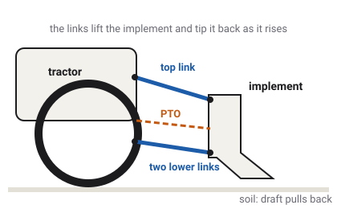

# Implements and the PTO

A farm tractor is a moving power source. It carries tools on its back, drags them
through the soil, and drives their moving parts from its own engine. The game models the five
ways a real tractor and its tools connect, and the forces each one brings.

Which vehicles have this
Car
Truck
Tractor
Plane
Boat
Drone
Train

## Five connections

A real tractor meets its tools in five ways, and each of the game's attachments uses a different
set of them:

1. **The three-point hitch**, which carries a tool on the back.
2. **The drawbar**, which pulls a trailer (see [Towing](towing.md)).
3. **The PTO**, a spinning shaft that drives the tool's moving parts.
4. **The hydraulic remote**, an oil supply that works a ram on the tool.
5. **The implement bus**, ISOBUS, a data link over which the tool tells the tractor what it is.
<!-- docs/tractor.md: "five real tractor-implement connections (three-point linkage, drawbar, PTO, SCV hydraulic remote, ISOBUS data)" -->

| Attachment | Hitch | PTO | Hydraulics | Bus | Works the soil |
| --- | --- | --- | --- | --- | --- |
| Plough | yes | | | yes | yes, 25 cm deep |
| Power harrow | yes | yes | | yes | yes, 10 cm deep |
| Rotary mower | yes | yes | | yes | no |
| Fertiliser spreader | yes | yes | yes | yes | no |
| Farm tipper trailer | drawbar | | yes | | no |
<!-- docs/tractor.md The four implements table; ImplementBase.tool_depth: plough 0.25 m, harrow 0.10 m -->

Press **E** to cycle through them, then none. A tool the tractor carries is attached the moment it
is chosen: no cables or pins are modelled.

## The three-point hitch

The [three-point hitch](glossary.md#hitch) holds a tool on two lower arms and one top link. Arms in
the tractor lift the lower links, and the three together raise or lower the tool. The game works
out the links' geometry as a real linkage, so a tool tips back as it rises, as a real one does.
Press **I** to raise or lower it; sloppyCAN's `hitch_pos` can set any position in between.
<!-- ThreePointHitch, HitchLinkage: "solves the side view as a four-bar — implement pitch and rockshaft arm angle fall out of a circle-circle intersection, why implements tip back as they lift" -->

### The tool's weight

A carried tool is heavy and hangs behind the rear axle. In the game its weight joins the
tractor's: raised, it presses the rear tyres down and lifts weight off the front ones, like a
child on one end of a see-saw. Lowered to work, part of it rests on the ground instead, on its
own wheel or roller. With the plough or the harrow raised, the front axle carries only about a
fifth of the tractor's weight, at the edge of what tractor makers recommend. Real farmers add
weights to the front to fix that; the game has no front weights.
<!-- TractorVehicle._apply_implement_mass; docs/tractor.md Weight table: front share raised, plough 20.4 %, harrow 19.2 %; "Raised, the harrow takes the front under John Deere's ballasting minimum, ≥ 20 %" -->

## Draft: pulling through the soil

A plough cutting through the ground holds the tractor back hard. That pull is the
[draft](glossary.md#draft). In the game it is a real force at the hitch, pulling backwards. It
acts only while a soil-working tool, the plough or the harrow, is lowered into ploughable field.
Its size depends on the tool, how deep it works, how heavy the soil is and how fast the tractor
goes, following the farm engineers' standard formula for it.
<!-- TractorVehicle._apply_draft: rating × working depth × soil × ASABE D497's speed factor; "In soil" is Surface.FIELD -->

Draft does what it would on a real farm. The engine works harder and its speed sags a little on
its governor. The rear tyres slip more. With the diff open, a heavily loaded plough can make the
lighter rear wheel spin away while the other barely turns; locking the diff or engaging
front-wheel drive is the answer, as a farmer would do. Level 1's field has lighter sandy bands
where the soil is half as heavy, so the load changes along a pass.
<!-- docs/tractor.md: the plough's open-diff peel; "two light sandy-loam bands at half soil so engine_load moves along a pass" -->

## The PTO

The [PTO](glossary.md#pto), power take-off, is a splined shaft sticking out of the tractor's
back, geared to the engine. Through it the tractor spins a tool's own machinery: the harrow's
tines, the mower's blades, the spreader's disc. Press **P** to engage it.

The shaft turns at one of two standard speeds, 540 or 1000 rpm, when the engine runs at the
PTO's rated speed, about 2040 rpm. Press **J** to choose the speed, and **0** to set the hand
throttle straight to the rated engine speed. The shaft's speed always follows the engine's: if the
engine sags, so does the shaft.
<!-- docs/tractor.md: "pto_mode is a gearbox selection ... PTO_RATED_RPM (2043)"; key 0 sets the PTO preset (TractorTelemetry.pto_hand_throttle) -->

A driven tool takes real power from the engine. The game puts each tool's shaft power on the
engine's crank as a load, and the tractor's [all-speed governor](glossary.md#all-speed-governor)
answers with more fuel. You can see it as engine load: parked with the harrow lowered, switching
the PTO in raises the engine load from about a tenth to about a quarter. Working the soil with
draft and PTO together, the engine settles a few percent under its setting, within its governor's
droop.
<!-- ImplementBase.pto_power_kw; Drivetrain.accessory_torque; docs/tractor.md: "parked lowered, engine_load 9 % rises to 24 % at idle"; "3.4 % under the 2043 setting" -->

The PTO works only with the engine running and a tool that declares a PTO connection. The plough
has none, so the PTO does nothing with it.

## The hydraulic remote

The [hydraulic remote](glossary.md#hydraulic-remote), or SCV (selective control valve), sends pressurised oil from the tractor's
pump to a ram on the tool. In the game it opens the spreader's hopper gate and tips the farm
trailer's body. The pump is driven by the engine, so with the engine stopped there is no flow.
Press **Q** to open or close it; sloppyCAN's `scv_flow` can open it part way.
<!-- docs/tractor.md: scv_flow reaches the spreader's hopper gate ram and the tipping trailer's ram; "engine-driven, so a stopped engine means no flow"; key Q, binary -->

## The implement bus

Real tractors and tools talk over [ISOBUS](glossary.md#isobus), a data network standard for farm
machinery. When a tool is plugged in, it claims an address and says what kind of device it is. In
the game, attaching a carried tool is that claim: the tractor then reports that a tool is
connected and its device class, using the real ISO numbers (2 tillage, 3 secondary tillage,
5 fertiliser, 9 forage). The farm tipper has no bus, so it reports nothing.
<!-- contract implement_connected, implement_type; docs/tractor.md: drawbar trailer "0 none (no bus claim)" -->

## On the trucks

The garbage truck has a PTO too. It drives the pump of its refuse body, the lifting arm that
empties bins, and the body is worked through a separate network with its own rules. The tipper
semi-trailer uses the semi's PTO to raise its body. The [Towing](towing.md) page covers the tipper;
the garbage truck's body is described on the truck's own page.
<!-- src/vehicles/truck/refuse_body.gd; docs/truck.md The refuse body; the tipping semi-trailer declares Consumer.PTO -->

## What the game leaves out

- **No draft control**: a real hitch can raise and lower itself to keep the draft steady. The
  game's stays where it is put.
- **No emptying spreader**: the hopper stays full, however long it spreads.
- **No crop, no yield**: the plough leaves no furrow and the mower cuts nothing.
- **No front weights** to balance a heavy implement.
<!-- docs/tractor.md: "Not modelled: draft control (the Ferguson hitch), a spreader that empties, ... front ballast as an attachment"; CLAUDE.md non-goals: crop growth, yield -->

## What you see in sloppyCAN

| Signal | Direction | Unit | What it shows |
| --- | --- | --- | --- |
| `hitch_pos` | in | % | Tractor: where to put the hitch, 0 lowered, 100 raised. |
| `hitch_pos_actual` | out | % | Tractor: where the hitch is, as it moves towards the request. |
| `draft_force` | out | % | Tractor: the draft, as a share of the plough's rated draft. A real force, reported. |
| `pto` | in | flag | Tractor and truck: engage the PTO. |
| `pto_state` | out | flag | Tractor and truck: the PTO is engaged and the engine is running. |
| `pto_mode` | in | enum | Tractor: 540 or 1000. |
| `pto_rpm` | out | rev/min | Tractor: the shaft's speed, following the engine's. |
| `scv_flow` | in | % | Tractor: how far the hydraulic remote is open. |
| `implement_connected` | out | flag | Tractor: a tool has claimed an address on the implement bus. |
| `implement_type` | out | enum | Tractor: the tool's device class. |
| `engine_load` | out | % | Truck and tractor: rises with draft and PTO load. |
| `axle_load` | out | kg | Truck and tractor: the rear axle's load, which a raised tool increases. |
<!-- contract/carlito_contract.json: hitch_pos, hitch_pos_actual, draft_force, pto, pto_state, pto_mode, pto_rpm, scv_flow, implement_connected, implement_type, engine_load, axle_load -->

## Try it in the game

Try it in the game: plough a field

1. Pick the `tractor-kenney` on **Level 1 - Island** and drive to the ploughable field in the
   middle of the island. Press **E** until the plough is on.
2. Press **F2** until the dashboard shows FULL, with its LOAD and SLIP bars. Press **I** to lower the plough and drive slowly across the field.
   The engine load climbs and the rear wheels' slip rises.
3. Press **K** to lock the rear diff and **M** for front-wheel drive. The slip falls and the
   tractor holds its speed.
4. Raise the plough, press **E** until the power harrow is on, lower it and press **P**: the
   engine load rises again, now from the PTO as well as the soil.

## Related

- [The engine](engine.md): the governor that holds the PTO's speed.
- [Differentials and four-wheel drive](differentials.md): the diff lock and front drive the
  plough needs.
- [Glossary](glossary.md): every term on this page.
