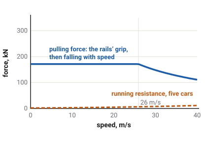

# Trains

A train cannot steer: its rails choose the way. What the game models is what
happens along the track: an electric locomotive pulling four heavy wagons, the springy couplings
between them, the slopes they climb and the brakes that stop them.

Which vehicles have this
Car
Truck
Tractor
Plane
Boat
Drone
Train

## A line of cars on a line

The train runs on the closed loop of track on **Level 5 - Railway**. The game treats it as five
weights on a string: the locomotive and four wagons, each a single mass at its own place along
the track. Each one moves only forwards or backwards along the rails, and the cars are drawn
following the curve of the track. The rails themselves do all the steering, so the train has no
steering at all.
<!-- TrainSim: "1D consist sim: each car is a point mass on a curve arc"; train.gd CAR_LENGTHS (5 cars); docs/rail.md: no steer (rail-guided); level_5_info allowed_vehicles train -->

The locomotive weighs about 50 t and each wagon about 34 t, so the whole train weighs about
186 t, as much as a hundred and fifty cars.
<!-- train.gd loco_mass 50000, wagon_mass 34000 -->

## Pulling: tractive effort

The locomotive's electric motors pull with a force called its
[tractive effort](glossary.md#tractive-effort). In the game it is the same at every speed up to
about 14 m/s, 50 km/h: a steady pull of 320 kN, enough to accelerate the whole train at almost
2 m/s². Above that speed the motors reach the most power they can deliver, and the pull falls as
the speed rises, so that pull times speed stays the same.
<!-- TrainSim max_tractive 320000 N, base_speed 14 m/s, max_power 4480000 W (= max_tractive x base_speed); 320000 / 186000 = 1.72 m/s² -->

<!-- img/tractive-effort.svg: TrainSim.tractive_effort and running resistance -->

Only the locomotive pulls; the wagons are pulled.

### Running resistance

Steel wheels on steel rails roll far more easily than tyres on a road. What holds a train back is
its [running resistance](glossary.md#running-resistance), which the game works out per car with the railway's standard
[Davis equation](glossary.md#davis-equation): a fixed part for the wheels rolling, a part that
grows with speed for the bearings and flanges, and a part that grows with the square of the
speed for the air.
<!-- TrainSim davis_a 400 N, davis_b 15 N·s/m, davis_c 0.8 N·s²/m² per car; "Davis running resistance (N), opposing motion: a + b|v| + c v^2" -->

### Slopes

Each car feels the slope under it on its own. On a climb, the slope pulls each car back by a
share of its weight; on a descent, it pulls it on. A long train can have its locomotive on a
climb while its last wagons are still on the flat.
<!-- TrainSim gravity along track per car; train.gd _grade_at per car -->

## Couplers and slack

The cars are joined by [couplers](glossary.md#coupler). In the game each coupler is a very stiff
spring with a damper, and a little free play, about 5 cm each way, before it starts to push or
pull. That free play is slack.
<!-- TrainSim coupler_k 3.0e6 N/m, coupler_damp 2.0e5, coupler_slack 0.05 m, max_coupler 500000 N -->

Slack makes the train move like a real one. When the locomotive pulls away, it takes up the slack
in its own coupler first, then the next, so the wagons start one after another, each with a small
jerk, and the springs swing back and forth for a moment before they settle. The coupler behind
the locomotive reports its force: positive when it is pulling, negative when it is being pushed.

## Brakes

A train's air brake works through a pipe that runs the length of the train. The pipe is kept
full of air at about 5 bar; letting air out of it applies the brakes on every car. In the game,
the brake lever brakes every car equally and at once, up to 90 kN each. The brake pipe's pressure
is a separate, labelled model that drops as the brake is applied and recharges as it is released,
so you can watch it; it does not delay the brakes.
<!-- TrainSim max_brake 90000 N per car; train.gd _sim.step(delta, throttle, input.brake, ...) applies input.brake directly; TrainTelemetry.brake_pipe_step: PIPE_APPLY_RANGE 3 bar, PIPE_DROP_RATE 6 bar/s, PIPE_CHARGE_RATE 1.5 bar/s, charged 5 bar -->

The parking brake holds the train on a slope, like a car's handbrake. It acts as friction: it
stops a slow train and keeps it still, so a parked train does not creep down a grade.
<!-- TrainSim brake as Coulomb friction: "holds the car at rest when the other forces (a grade) are within that, so a parked train does not creep" -->

## Power from the wires

The locomotive takes its power from an overhead wire, the [catenary](glossary.md#catenary),
through a sprung arm on its roof, the [pantograph](glossary.md#pantograph). Press **U** to raise
it. With the pantograph down, or the key not at Ignition, the motors get no power and the train
cannot pull.
<!-- train.gd: powered = key == KEY_IGNITION and input.pantograph; key pantograph U -->

The game models the electrical side simply, and labels it so: the motor current is in proportion
to the pull, and the line voltage starts at 25 000 V and sags as the current rises, by about
2000 V at 1000 A.
<!-- train.gd AMPS_PER_NEWTON 1/320 (320 kN -> ~1000 A), MAX_MOTOR_CURRENT 1500, CATENARY_SAG_PER_AMP 2; TrainTelemetry.NOMINAL_CATENARY; contract catenary_volts "nominal 25 kV minus sag" -->

## The reverser and the doors

A train has no gearbox, only a [reverser](glossary.md#reverser): forward, neutral or reverse. The
game sends it on the same gear byte as a car's gearbox, and the keyboard works it the same way:
the accelerator from a standstill selects forward, holding the brake at a standstill selects
reverse.
<!-- docs/rail.md: "Reverser (N/D/R) rides gear"; one gear ratio, never shifts -->

Press **O** to open the doors. They open only when the train is standing still.
<!-- train.gd DOOR_SPEED_EPS 0.3 m/s; key doors O -->

## What the game leaves out

- **No points or junctions**: the loop has no branches.
- **No signals, timetable or other trains.**
- **No wheel slip**: the locomotive's pull is never limited by the rails' grip.
- **No delay in the brakes**: a real air brake takes time to work along a long train.
- **No wind**: the train ignores it.
<!-- TrainSim has no adhesion term; WorldConditions.WIND_FAMILIES omits train; CLAUDE.md non-goals: traffic, spline-road junctions -->

## What you see in sloppyCAN

| Signal | Direction | Unit | What it shows |
| --- | --- | --- | --- |
| `accel` | in | % | The traction demand. |
| `brake` | in | % | The train brake. |
| `handbrake` | in | flag | The parking brake. |
| `gear` | in, out | enum | The reverser: N, D or R. |
| `pantograph`, `pantograph_state` | in, out | flag | Raise the pantograph; it is up and live. |
| `doors`, `doors_state` | in, out | flag | Open the doors; they are open. |
| `motor_current` | out | A | The traction motors' current, from the pull. Warns at 1200 A. |
| `catenary_volts` | out | V | The line voltage at the pantograph; 0 when lowered. |
| `brake_pipe` | out | bar | The brake pipe's pressure, about 5 when released. Warns below 2.5. |
| `grade` | out | % | The slope under the locomotive, + climbing. |
| `coupler_force` | out | kN | The coupler behind the locomotive: + pulling, − pushed. |
| `speed` | out | m/s | The train's speed along the track. |
<!-- contract/carlito_contract.json: accel, brake, handbrake, gear, pantograph, pantograph_state, doors, doors_state, motor_current (warn 1200), catenary_volts, brake_pipe (warn 2.5), grade, coupler_force, speed -->

## Try it in the game

Try it in the game: feel the slack

1. Pick the train on **Level 5 - Railway** and press **F2** for the dashboard. Press **U** to raise
   the pantograph.
2. Pull away with the accelerator. Watch the coupler force: it jumps up as the slack is taken up,
   swings, then settles as the train gathers speed.
3. At speed, brake hard. Watch the brake pipe pressure fall as you brake and climb again when you
   let go.
4. Lower the pantograph with **U** while pulling: the line voltage drops to 0 and the train
   coasts.

## Related

- [Glossary](glossary.md): every term on this page.
