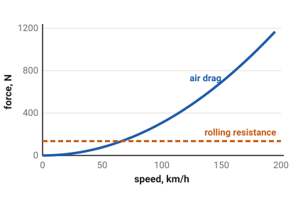
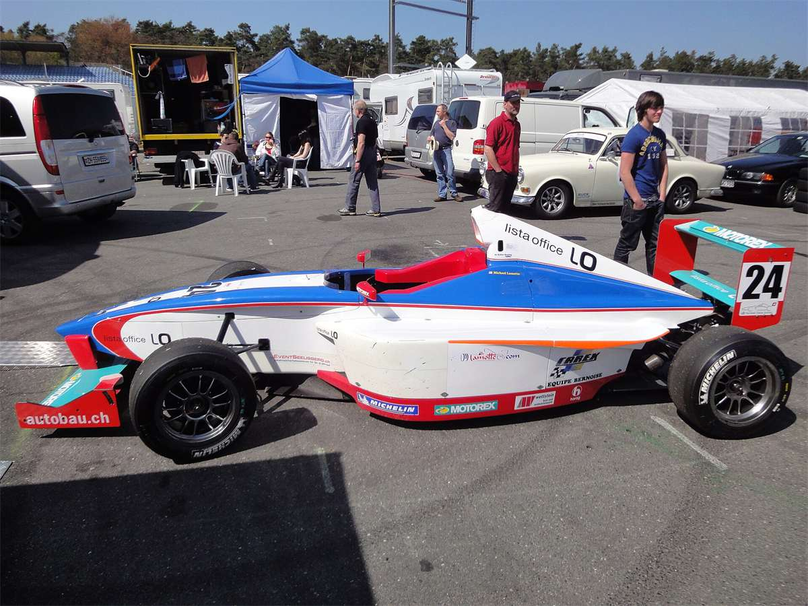

# Air and rolling resistance

This page explains the two forces that always hold a vehicle back (air drag and
rolling resistance), and when each one is the larger.

Which vehicles have this
Car
Truck
Tractor

On a flat, empty road, nothing seems to stand in a car's way, and yet the engine has to keep
working just to hold the same speed. What is the engine fighting? Two things that never go away:
the air the vehicle pushes through, and the tyres it rolls on. At town speeds the tyres cost
more, and on the motorway the air does.

## Air drag

When you hold your hand out of a moving car's window, you feel the air push it back. That push is
called [aerodynamic drag](glossary.md#aerodynamic-drag). A moving vehicle has to shove aside all
the air in its way, and the air, which has mass and so resists being set moving, pushes back.

Why does the push grow so fast with speed? Go twice as fast, and two things double at once. In
every second, the vehicle meets twice as much air, and it throws each bit of that air aside twice
as hard. Twice as much air, flung twice as hard, makes four times the force: the drag grows with
the square of the speed. For example, if the air pushes back with 100 newtons at 50 km/h, it pushes
with about 400 newtons at 100 km/h and about 900 at 150.

The engine feels it even more strongly. The power it has to give is the force times the speed, and
both rise, so doubling the speed against the air takes about eight times the power. This is why a
car that is happy at 100 km/h drinks fuel at 160, and why a top speed cannot be raised just by
fitting a stronger engine: doubling the power adds only about a quarter to the top speed.

Slower is not always cheaper, though. An engine burns some fuel just to keep itself turning,
however slowly the car goes ([see Fuel](auxiliary.md#how-much-is-burned)), and a slow car spreads
that cost over fewer kilometres. So each car has a middle speed, in its top gear, at which it
goes furthest on a litre: faster, the air costs more; slower, the engine's own upkeep does.

How big the push is depends on how big the front of the vehicle is, and how smoothly the air flows
round it. A vehicle with a blunt, square front throws the air aside harder than a rounded one,
even if the two are the same size. The size and the smoothness are often multiplied into one
number, the [drag area](glossary.md#drag-area). A truck's is several times larger than a
saloon's.

<!-- img/resistance.svg: sedan drag_area 0.65, rolling_resistance 0.012, mass 1150 -->

### Drag is measured against the air, not the road

What matters for drag is the speed through the **air**, rather than over the ground. A vehicle
driving into a headwind meets the air faster than the road shows. For example, a car doing 100
km/h into a 20 km/h headwind meets the air at 120 km/h, so the drag is not 20 % higher but about
44 % higher (because 1.2 × 1.2 = 1.44). With a 20 km/h tailwind the car meets the air at only 80
km/h, and the drag falls by more than a third. A headwind therefore costs more than a tailwind
gives back, which is why a wind lowers the top speed and raises the fuel consumption even on a
journey that goes out and back.

The drag acts as if it pushed at one point of the body, called the centre of pressure. If that
point is above the centre of mass, the backward push also has a turning effect, like pushing the
top of a tall box: it tips the nose up slightly.

Why racing cyclists and racing cars follow each other closely

- **A slipstream.** A moving vehicle drags a pocket of air along with it, and that air is already
  moving forward. A second vehicle driving close behind meets less air coming the other way, so
  its drag is lower. Racing cyclists take turns at the front for this reason.
- **The leader gains a little too.** Behind any moving vehicle there is a pocket of low pressure
  that sucks it back. A vehicle close behind fills part of that pocket, so the one in front is
  held back a little less.
- **It is not safe on the road.** The gap needed to gain much is far shorter than the distance
  needed to brake in time, so ordinary drivers should not do it.

## Side force and crosswind

Air blowing across a vehicle pushes it sideways, just as the air in front pushes it back. A
vehicle's side is much bigger than its front, so this push can be large, especially on a tall box
trailer, which catches the wind like a sail. A [crosswind](glossary.md#crosswind) pushes the
vehicle downwind. When it pushes ahead of the centre of mass, it also turns the nose away from the
wind, so the driver has to steer into it ([see the forces](forces.md#example-crosswind)).

The same happens in a slide: a car sliding sideways meets the air with its side, which pushes back
much harder than its nose would. This is one more reason a slide slows a car so quickly.

## Downforce on racing cars

<figure>

<figcaption>A racing car's front and rear wings. Photo: Lutz H, CC BY 2.0 DE, <a href="https://commons.wikimedia.org/wiki/File:Formula_Lista_junior_car_(side_view).JPG">Wikimedia Commons</a>.</figcaption>
</figure>

Racing cars can have wings that work like an aircraft's wings turned upside down. A plane's wing
is shaped so that the air is deflected downwards, and the air pushes the wing up in return. A
racing car's wing deflects the air upwards, so the air pushes the wing, and with it the car, down
onto the road. This is called [downforce](glossary.md#downforce), and it grows with the square of
the speed, like drag. At walking pace it is nothing, and at racing speed it can be a large
share of the car's own weight.

Why not simply make the car heavier to press the tyres down? Because a tyre's grip rises with how
hard it is pressed ([see Tyres](tyres.md#the-coefficient-of-friction)), but the car's mass is
also what the tyres must accelerate, brake and turn. A heavier car has more grip and needs more
of it. Downforce presses the tyres down without adding any mass, so the car brakes and corners
harder at speed. The price is more drag, and a little more rolling resistance because the tyres
are pressed harder.

The extra grip helps below the limit too, as a reserve for a sudden swerve or stop. But it comes
only at speed: at town speeds a wing gives almost nothing, and wherever it does give grip, it
adds drag too.

A [spoiler](glossary.md#spoiler) is a different part, although the two names are often mixed up:
a lip or small flap at the back of the body that spoils the airflow there. A road car's body
tends to lift slightly at speed, like a weak wing, and a spoiler cancels much of that lift, which
keeps the rear tyres pressed down and the car steady on the motorway. A wing pushes the car down;
a spoiler mostly stops the body from pulling itself up.

## Rolling resistance

Under the vehicle's weight, a tyre is flattened where it meets the road. As the wheel turns, each
bit of tread is squashed as it enters the contact patch and springs back as it leaves. Rubber does
not give back all the energy it took to squash it. Drop a rubber ball: it never bounces back to
the height it fell from, because part of the energy has turned into a little heat inside the
rubber. A tyre does the same thing, over and over, for every bit of tread on every turn of the
wheel (this is one reason tyres get warm on a long drive).

That lost energy has to come from somewhere, and it comes from the vehicle's motion. It feels like
a steady force holding the vehicle back, called
[rolling resistance](glossary.md#rolling-resistance). Seen from the side, the rubber at the front
of the patch is being squashed and pushes back harder than the rubber at the back, which is
springing back and pushes more weakly. So the ground pushes up on the tyre a little ahead of the
axle, and that off-centre push works against the wheel's turning.

Anything that makes the tyre squash more makes it worse: a heavier load, a tyre with too little
air in it (which is why riding a bicycle with soft tyres is harder work), or soft ground, where
the tyre sinks in and is always climbing out of its own dip. A tractor's deep lugs flex more than
a car tyre's tread, so they lose more too.

Rolling resistance is not a loss of grip: a tyre pays it even when it is only rolling along,
not pushing, braking or turning.

It is proportional to the load on the tyre: about 1 % of the load for a car tyre on a hard road,
less for a truck tyre, and more for a tractor's lugged tyre. For example, a car that weighs 10,000
newtons has about 100 newtons of rolling resistance. A vehicle that weighs twice as much on the same
tyres has twice as much. Soft ground adds much more (see [Ground and tyre types](surfaces.md)).

Unlike drag, it changes very little with speed. The tyre squashes and springs back the same
amount for every metre it rolls, whether it covers that metre slowly or quickly, so the force
stays about the same. This is why the two forces change places: rolling resistance is the bigger
at a walking pace, and air drag, which keeps growing with the square of the speed, soon becomes
the larger.

A train's steel wheels are the opposite case: they hardly squash, so they waste almost none of
this energy. A few metro lines use rubber tyres instead, to climb steeper slopes and stop more
quickly, and they pay for it in energy.

## Top speed

A vehicle reaches its top speed where everything holding it back equals what the engine can push,
unless a governor stops it first (see
[The engine](engine.md#limits-the-rev-limiter-and-the-speed-governor)). Below that speed, the
push is larger than the resistance and the vehicle speeds up; above it, the resistance is larger
and it slows down, so the speed settles at the point where the two are equal. In the example
above, at 100 km/h the drag is already more than twice the rolling resistance, and at 200 km/h
almost ten times ([see the forces](forces.md#example-cruising)). Up a hill, the slope's pull holds
the vehicle back as well ([see the forces](forces.md#example-truck-uphill)).

## What Carlito simulates

The parameters the simulator uses for this, and where each is set, are listed in
[How the simulation works](simulation.md#air-and-rolling-resistance):

- **Simulation-wide**:
  - [Air density](simulation.md#air-density) (`AIR_DENSITY`)
- **Per vehicle**:
  - [Drag area](simulation.md#drag-area) (`drag_area`)
  - [Side area](simulation.md#side-area) (`side_area`)
  - [Where the air pushes](simulation.md#where-the-air-pushes) (`aero_centre`)
  - [Downforce area](simulation.md#downforce-area) (`downforce_area`)
  - [Rolling resistance](simulation.md#rolling-resistance) (`rolling_resistance`)
- **Per tyre class**:
  - [Rolling resistance factor](simulation.md#rolling-resistance-factor) (`crr_factor`)
- **Per surface**:
  - [Added drag](simulation.md#ground-and-tyre-types), in the surface list (`DRAG`)

Simplification list

- **No slipstreaming** between vehicles; only a trailer behind its own truck is treated as in a
  wake.
- **No change of air with height or weather.** The air everywhere is sea-level air at one fixed
  density.
  <!-- VehicleMath.AIR_DENSITY 1.225 kg/m³, "sea level, no altitude/temperature term" -->
- **One drag area per vehicle.** On the racing cars it already includes the drag of the wings.
  Their downforce is a separate push through the springs.
  <!-- VehicleMath.aero_downforce; gen_kenney_vehicles.gd race `cd` 0.70: "exposed wheels + wing" -->
- **Rolling resistance does not change with speed**, nor with the tyre's heat or pressure.
- **No drag from open windows, roof loads or damage.**

## What you see in sloppyCAN

No signal reports the drag itself. It shows in:

| Signal | Direction | Unit | What it shows |
| --- | --- | --- | --- |
| `speed` | out | m/s | Top speed falls into a headwind and rises with a tailwind. |
| `engine_load` | out | % | At a steady speed it climbs with the drag (Truck and tractor). |
| `fuel_rate` | out | L/h | The fuel to beat the drag at a steady speed: much more at 120 km/h than at 80. |
| `throttle` | out | % | The pedal needed to hold a speed. |
<!-- contract/carlito_contract.json: speed, engine_load, fuel_rate, throttle ("The arbitrated pedal, not the fuel the engine receives") -->

## Scenarios

- [Cruising at 100 km/h](forces.md#example-cruising): the drive balances both resistances.
- [Coasting from 150 km/h](forces.md#example-coasting): only the resistances are left.
- [Cruising into a headwind](forces.md#example-headwind): more drag at the same road speed.
- [Crosswind](forces.md#example-crosswind): the air pushes sideways.

## Related

- [Ground and tyre types](surfaces.md): how much harder soft ground is to roll on.
- [The engine](engine.md): what has to beat these forces.
- [Glossary](glossary.md): every term on this page.
