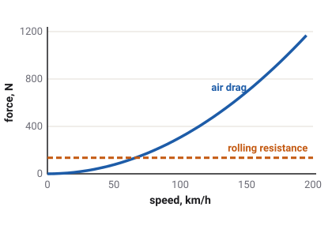

# Air and rolling resistance

A vehicle on a level road still needs its engine to keep moving, because two
forces are always holding it back: the air it pushes through, and the tyres flexing as they
roll. At town speeds the tyres cost more; on the motorway the air takes over.

Which vehicles have this
Car
Truck
Tractor
Plane
Boat
Drone
Train

## Air drag

Hold your hand out of a moving car's window and you feel the air push it back. That push is
[aerodynamic drag](glossary.md#aerodynamic-drag). It grows with the square of the speed: twice the
speed means four times the drag.

The game works it out from one number per vehicle, its [drag area](glossary.md#drag-area): how big the vehicle's front is
times how smoothly the air flows round it. A saloon's is about 0.65 m². A truck cab's is more than
three times that, and the tractor's, which is tall and square, more than eight times.
<!-- VehicleMath.aero_drag: 0.5 x rho x CdA x v²; drag_area: sedan_spec.tres 0.65, semi_spec.tres 2.18, tractor-kenney_spec.tres 5.47 -->

<!-- img/resistance.svg: sedan drag_area 0.65, rolling_resistance 0.012, mass 1150 -->

The air is the same everywhere in the game: sea-level air at one fixed density, with no change
for height or temperature.
<!-- VehicleMath.AIR_DENSITY 1.225 kg/m³, "sea level, no altitude/temperature term" -->

### Drag is measured against the air, not the road

The game works out the drag from how fast the vehicle moves through the **air**, not over the
ground. Driving into a headwind is like driving faster; a tailwind is like driving slower. A
headwind costs top speed, fuel and engine load; a tailwind gives them back.
<!-- VehicleMath.air_force: air = vel - wind; docs/handling.md Crosswind: "A headwind or tailwind moves engine_load, fuel and top speed" -->

The drag pushes at one point of the body, its centre of pressure, set for each vehicle from its
shape. Where that point sits above the centre of mass, the drag at speed tips the nose up
slightly.
<!-- GroundDriveSpec.aero_centre; docs/handling.md Aero balance: "Drag at aero_centre adds a pitch moment: above the COM it lifts the nose" -->

## Side force and crosswind

Air blowing across a vehicle pushes it sideways too. The game gives each vehicle a second
number, its side area, for that push, much bigger than its drag area because a vehicle's side is
much bigger than its front. A [crosswind](glossary.md#crosswind) pushes the vehicle downwind, and
because it pushes ahead of the centre of mass, it also turns the nose away from the wind. A tall
box trailer catches the most. The push works on a parked vehicle too; the tyres' grip at rest
holds it.
<!-- GroundDriveSpec.side_area: sedan 4.16, semi 9.01, tractor 10.77, box_spec.tres 14.2; docs/handling.md Crosswind -->

The same side area matters in a slide. A car sliding sideways meets the air with its flank, which
pushes back about seven times harder than its nose would.
<!-- docs/handling.md Crosswind: "In a slide the across-air part takes Cy*A instead of drag's Cd*A, about seven times more on a car" -->

A trailer runs in the truck's slipstream, so the game gives it only a small drag area of its own,
but its full side area.
<!-- box_spec.tres drag_area 0.6 against side_area 14.2; GroundDriveSpec.side_area: "A trailer's is its full side, unlike its in-wake drag_area" -->

## Downforce on the racing cars

The `race` and `race-future` carry wings that work like an aircraft's turned upside down: the air
pushes them down onto the road, more the faster they go. This is
[downforce](glossary.md#downforce). At 200 km/h the `race` car's wings press down with about half
its own weight.
<!-- race_spec.tres downforce_area 2.24, mass 900: 0.5 x 1.225 x 2.24 x 55.6² ≈ 4200 N, about 0.48 of 8800 N -->

The game does not turn downforce into extra grip directly. It pushes the body down through the
springs, exactly like extra weight that only the tyres feel. The tyres then grip more because
they are pressed harder, as any tyre does, and pay a little more rolling resistance too. The
downforce is placed so that a little more of it lands on the rear than the car's weight does, so
the car keeps running wide at the front, rather than spinning, at any speed.
<!-- VehicleMath.aero_downforce: "never a grip multiplier, so it is routed through the suspension"; race_spec.tres downforce_front 0.4 against front_weight 0.42 -->

## Rolling resistance

A tyre squashes a little where it meets the road, and as it rolls the rubber keeps flexing and
springing back. That costs energy, felt as a steady drag: the
[rolling resistance](glossary.md#rolling-resistance). Riding a bicycle with soft tyres is harder
work for the same reason.

The game charges each tyre a share of the load on it: about 1 % of the load for a car tyre on a
hard road, less for a truck tyre, about 2 % for the tractor's lugged tyres. It reads the load
from each wheel's spring, so a wheel in the air costs nothing, and a heavily loaded wheel costs
more. The tread changes it a little ([Ground and tyre types](surfaces.md) lists them) and soft
ground adds much more: mud adds ten times a car tyre's own figure.
<!-- GroundDriveSpec.rolling_resistance: sedan 0.012, semi 0.007, tractor 0.02; "N is read off the suspension each tick, not mass, so an airborne wheel resists nothing"; Surface.DRAG Mud 0.1 -->

Unlike drag, rolling resistance does not change with speed.

## Top speed

A vehicle reaches its top speed where everything holding it back equals what the engine can push,
or where its governor stops it first. On the flat, the `sedan`'s rolling resistance is about
135 N; at 100 km/h its drag is already more than twice that, and at 200 km/h almost ten times.
Up a hill, the slope's pull adds to both. The trucks and the tractor are governed well below the
speed their drag would allow ([The engine](engine.md#limits-the-rev-limiter-and-the-speed-governor)).
<!-- sedan: 0.012 x 1150 x 9.81 = 135 N; drag 0.5 x 1.225 x 0.65 x 27.8² = 307 N at 100 km/h, 1229 N at 200 km/h -->

## What the game leaves out

- **No slipstreaming** between vehicles; only a trailer behind its own truck is treated as in a
  wake.
- **No change of air with height or weather.**
- **No tyre heat or pressure effect** on rolling resistance.
- **No drag from open windows, roof loads or damage.**

## What you see in sloppyCAN

No signal reports the drag itself. It shows in:

| Signal | Direction | Unit | What it shows |
| --- | --- | --- | --- |
| `speed` | out | m/s | Top speed falls into a headwind and rises with a tailwind. |
| `engine_load` | out | % | Truck and tractor: at a steady speed it climbs with the drag. |
| `fuel_rate` | out | L/h | The fuel to beat the drag at a steady speed: much more at 120 km/h than at 80. |
| `throttle` | out | % | The fuel delivered to hold a speed. |
<!-- contract/carlito_contract.json: speed, engine_load, fuel_rate, throttle -->

## Try it in the game

Try it in the game: coast down

1. Pick the `sedan` on **Flatland** with the dashboard showing (**F2**). Get up to about 150 km/h.
2. Lift right off and let the car coast. It slows quickly at first, while the air is pushing hard,
   then more and more gently as the speed falls and only the tyres and the engine are left
   holding it back.
3. Pause, open CONDITIONS and set the wind to STRONG. Drive into it and then away from it at a
   steady pedal: the speed you settle at differs a lot between the two directions.

## Related

- [Ground and tyre types](surfaces.md): how much harder soft ground is to roll on.
- [The engine](engine.md): what has to beat these forces.
- [Glossary](glossary.md): every term on this page.
