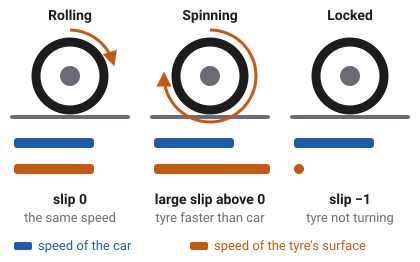
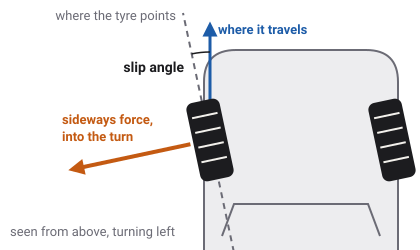
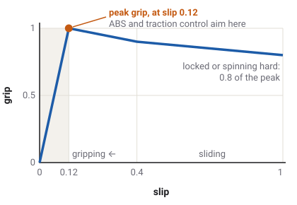
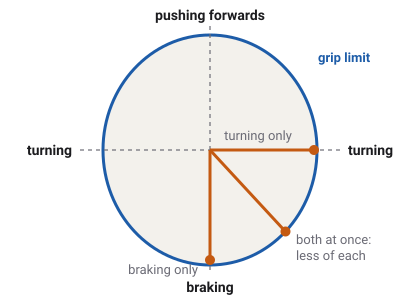
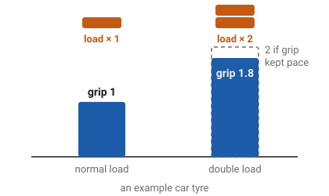

# Slip and the grip curve

This page explains slip, the grip curve, how a tyre shares its grip between braking and turning, and how load changes it.

Which vehicles have this
Car
Truck
Tractor

A tyre can push only so hard before it slides: its [grip](tyres.md#the-coefficient-of-friction).
But how does it make that push in the first place, and what happens when the driver asks for more
than it has?

## A tyre needs slip to grip

Push a rubber eraser sideways along a desk with a finger. Before it slides, the eraser bends a
little, and the more you push the more it bends. A tyre does the same. When it pushes the car
forwards, brakes it or turns it, the rubber in the patch stretches, and that stretch is what
carries the force.

A tyre that only rolls freely (not pushing, braking or turning) has nothing to stretch, and its
surface moves over the road exactly as fast as the car. As soon as it has to push, brake or turn,
the stretching rubber makes the tyre move slightly differently from how it turns: a little slower
than the car when braking, a little faster when pushing, a little sideways when cornering. That
difference is called [slip](glossary.md#slip).

So slip does not mean the tyre is skidding. Every tyre that pushes, brakes or turns slips a
little, and that small slip is how it grips. Only a large slip means the tyre is sliding.

Slip is measured in two directions (along the wheel and across it).

### Slip ratio: along the wheel

The [slip ratio](glossary.md#slip-ratio) compares how fast the tyre's surface is turning with how
fast the car is moving over the road. In words:

slip ratio = (speed of the tyre's surface − speed of the car) ÷ speed of the car

- **0**: rolling freely. The two speeds match.
- **Above 0**: the tyre turns faster than the car moves. Every tyre the engine turns does this a
  little, even at a steady speed. A lot, and the tyre is spinning, as when you floor the
  accelerator on ice. At 1, it turns twice as fast as the car moves.
- **Below 0**: the tyre turns slower than the car moves. Every braking tyre does this a little.
  At **−1** the wheel has stopped while the car still moves: it is locked and skidding.

For example, a car moves at 20 m/s while it brakes, and its tyre surface turns at 18 m/s. The
slip ratio is (18 − 20) ÷ 20 = −0.1.

Why does the tyre turn at a different speed from the car at all? In the patch, the tread sticks
to the road and does not move over it. The tyre's body, which the tread hangs from, carries on
turning a little slower than the road goes by (when braking) or a little faster (when
pushing). So each bit of tread is stretched more and more as it travels through the patch,
as the eraser was, and that stretch is the force. The harder the tyre pushes, the more stretch it
needs and the bigger the difference in speed.

What does the driver notice? A wheel that spins too much makes a lot of engine noise and very
little acceleration. The tyre is turning much faster than the car moves, which puts it past the
peak of the grip curve below, where it pushes less than it could.

### Slip angle: across the wheel

When you steer, the front tyres point into the turn, but the car does not follow them exactly.
Each tyre travels a little wide of where it points. The angle between the two is the
[slip angle](glossary.md#slip-angle).

Why would a tyre travel anywhere but where it points? Because a tyre can only push sideways by
bending sideways, like the eraser. Each bit of tread lands on the road in line with the wheel and
sticks where it lands. If the wheel travels at a slight angle to where it points, it drifts a
little sideways while that bit of tread stays put, so the rubber is bent sideways more and more as
it passes through the patch. That bending is the sideways push. If the tyre travelled exactly
where it pointed, nothing would bend, and there would be no sideways push.
<!-- photo: a cornering tyre seen from the side, its tread and sidewall bent sideways -->

A shopping trolley shows the opposite case: its caster wheels swing round until they point
exactly where they travel, so their slip angle is zero and they push no sideways force at all.
That is why a trolley drifts sideways so easily on a slope.

The two directions are separate. A tyre can keep turning forwards at a healthy speed and still
slide sideways, which is what a car does in a drift. Sliding is not the same as locking: a locked
wheel slides, but a wheel that slides sideways is usually still rolling.

What happens in a drift

In a drift, the rear tyres slide sideways on purpose, so the car points further into the turn
than it travels. The driver keeps it there with two controls:

- **The steering points the front wheels out of the turn**, towards where the car is going, so
  the front tyres keep gripping and steer the slide.
- **The accelerator sets the angle.** It spins the rear wheels, and a tyre spending its grip on
  spinning has little left for holding sideways (see
  [Sharing grip](#sharing-grip-between-braking-and-turning)). More throttle lets the rear swing
  out further; less lets it grip again.

That is why drifting is usually done in a car driven by its rear wheels. It looks fast but is
slower than gripping: the sliding rear tyres are past the peak of the grip curve below, so they
push less than they could, and they wear out quickly in clouds of smoke.

## The grip curve

<!-- GroundDriveSpec.grip_curve (0,0) (0.12,1) (0.4,0.9) (1,0.8) -->

How much force a tyre makes depends on how much it slips, shown here as a share of its grip. The
curve above is an example. Its shape is similar from one tyre to another, but the height of the
peak changes with the tyre and the ground.

- **Rising.** With little slip, the force climbs almost in a straight line: the more the rubber
  stretches, the harder it pushes. A tyre usually works here when it pushes the car along, brakes
  or corners.
- **The peak.** At a small slip (0.12 in this example), the tyre gives the most force it can. This
  is the best place to brake or accelerate. Past it the rubber starts to let go of the road.
- **Sliding.** Past the peak, more slip gives less force (down to 0.8 of the peak in this example,
  when the wheel is locked or spinning hard).

Why is there a peak? The rubber can only stretch so far before it starts to slip over the road,
beginning at the back of the patch. As the slip grows, a larger part of the patch is sliding
instead of gripping, until the whole patch slides.

Why does it not fall further? Sliding rubber still has most of its friction: dragged over the
road's bumps, it keeps pressing against their slopes. What it loses comes largely from heat: the
faster rubber slides, the hotter its surface gets, and rubber that gets too hot grips less.
<!-- Persson, "Rubber friction: role of the flash temperature", J. Phys.: Condens. Matter 18, 7789 (2006), arXiv:cond-mat/0605273 abstract: local heating "results in a decrease in rubber friction with increasing sliding velocity for v > 0.01 m/s", important "for the tire-road friction, and in particular for ABS-breaking systems". -->

The fall after the peak is small, but it matters. A tyre that starts to slide grips less, so it
slides more, so it grips even less. That is why a locked wheel stays locked until the brake is
released, and why a spinning wheel keeps spinning. For example, a tyre pressed down with 2,500
newtons on dry asphalt (μ of 1) brakes with about 2,500 newtons at the peak, but with the curve
above it brakes with only about 2,000 newtons when locked. So braking so hard that the wheels lock
does not stop the car sooner: it makes the stop longer than braking just short of locking.
[ABS](glossary.md#abs) and [traction control](glossary.md#traction-control) exist to prevent
this, by keeping each wheel near the peak ([see the forces](forces.md#example-emergency-stop)).

ABS does not add grip. The tyre has the same grip as before, and the system only keeps it at its
best part of the curve instead of letting it fall off the peak. It also keeps the wheels turning,
which keeps the steering working. (There is one exception: on loose gravel or deep snow, a locked
wheel piles a wedge of material in front of it, and it can sometimes stop the car in a shorter
distance than a wheel held at the peak.)
<!-- photo: a flat-spotted tyre, worn flat in one place by a locked-wheel skid -->

In newtons, the peak is the tyre's grip:
[μ × the force pressing the tyre down](tyres.md#the-coefficient-of-friction). On ice μ is small,
so the whole curve shrinks with it.

The force is for one tyre of the simulator's `sedan` on its stock all-season tyres, carrying its
share of the car's weight at rest. The same curve serves braking and pushing forwards: the slip
here is its size, whichever way the tyre slips.
<!-- widgets/slip-grip.js: sedan_spec.tres mass 1150 / 4, mu_long 1.05 -->

## Sharing grip between braking and turning

A tyre has only one budget of grip, because it has only one patch of rubber and that rubber can
only hold so hard, whichever way it is asked to. It can spend all of it on braking, all on
turning, or part on each. Doing both at once is called [combined slip](glossary.md#combined-slip).

Take a simple case, in which the tyre can pass 2,500 newtons in any direction. If 1,500 newtons
are already used for braking, what is left for turning? The two forces add up at right angles,
like the two short sides of a triangle, and the total cannot pass 2,500. So the turning force is
at most √(2,500² − 1,500²) = √(6,250,000 − 2,250,000) = √4,000,000 = 2,000 newtons. Braking at
1,500 newtons (60 % of the budget) takes only 500 newtons from the turning (20 %), but the more
you brake, the faster the rest shrinks, and at 2,500 newtons of braking nothing is left to turn
with.

In this simple case the limit is a circle. A real tyre rarely grips exactly as hard sideways as
along the wheel, so the limit is drawn as an oval, with the road direction on one axis and
sideways on the other. It is called the [friction ellipse](glossary.md#friction-ellipse).

This has two consequences:

- **Braking in a corner leaves less grip for turning.** The car can run wide, or its rear can
  step out if the rear tyres run out first ([see the forces](forces.md#example-braking-in-a-turn)).
- **A locked wheel cannot steer.** Almost all of its force points backwards against the slide, so
  turning the steering wheel does next to nothing. A driver whose front wheels lock feels the
  steering go light, and the car keeps going straight on. This is a reason to have ABS: by keeping
  the wheels turning, it keeps the steering working. It is also why the handbrake can make a car
  spin: it locks the rear wheels, they lose their sideways grip, and the back of the car swings
  out.

## A tyre pressed harder grips more, but not in proportion

Pressing a tyre harder onto the road gives it more grip (that is the
[μ × force rule](tyres.md#the-coefficient-of-friction)), but twice the load does not give twice
the grip. For example, a tyre could grip 1.8 times as hard (instead of 2) at double load. This is
called [load sensitivity](glossary.md#load-sensitivity).

Is that rule wrong, then? Not quite: it says that the largest push grows with the load, and it
does. What changes is μ, which falls a little as the load grows. A common explanation is that
rubber pressed harder is already wrapped deep around the road's bumps, so each extra newton of
load adds a little less grip than the one before, although recent research points mainly to heat:
a tyre pressed harder heats the rubber in its patch more as it slips, and rubber that gets too
hot grips less.
<!-- Fortunato, Ciaravola, Furno, Scaraggi, Lorenz, Persson, arXiv:1512.01359: "in most cases the non-linearity in the μ(p) relation is mainly due to process (e) (frictional heating)", "most important in tire applications". -->

It matters because a vehicle's weight moves around. In a corner, weight moves onto the outside
tyres. Suppose, for example, that two tyres carry 2,500 newtons each, so together they carry 5,000
and grip 5,000. Move 1,250 newtons across: the outer tyre now carries 3,750 and the inner 1,250. If
grip kept pace with load, the outer tyre would gain exactly what the inner one lost. Because of
load sensitivity, the outer tyre gains a little less than the inner one loses, so the pair ends
up with less grip than before. The end of the car with the most uneven load tends to lose
grip first. Designers use this to tune whether a car runs wide at the front or swings out at the
back (see [Weight transfer and rollover](weight-transfer.md)).

## What Carlito simulates

The parameters the simulator uses for this, and where each is set, are listed in
[How the simulation works](simulation.md#slip-and-the-grip-curve):

- **Simulation-wide**:
  - [Low-speed floor](simulation.md#low-speed-floor) (`LOW_SPEED_FLOOR`)
- **Per vehicle**:
  - [Grip curve](simulation.md#grip-curve) (`grip_curve`)
  - [Rear side grip](simulation.md#rear-side-grip) (`rear_lat_grip`)
  - [Load sensitivity](simulation.md#load-sensitivity) (`load_sensitivity`)
  - [Where the sideways peak sits](simulation.md#where-the-sideways-peak-sits)
    (`cornering_peak_load`)
  - [Twin rear tyres](simulation.md#twin-rear-tyres) (`rear_twin_tyres`)
  - [The rear tyres' rated load](simulation.md#the-rear-tyres-rated-load) (`rear_tyre_rating`)

Simplification list

- **One shape of curve.** Every tyre and every ground uses the curve shown above (peak at a slip
  of 0.12, then down to 0.8 of it); only the height of the peak changes.
  <!-- GroundDriveSpec.grip_curve, the same on every shipped spec -->
- **Fixed load sensitivity.** A tyre's μ falls by a fixed share each time its load doubles: a
  tenth on cars, a little less on trucks and trailers, a little more on tractors.
  <!-- GroundDriveSpec.load_sensitivity: car 0.10, truck/van/trailers 0.08, tractor 0.12 (its field comment) -->
- **Slip near a standstill.** Below about 5 km/h the slip ratio is divided by 5 km/h instead of
  the road speed, so it does not jump to huge numbers as the car stops.
  <!-- wheel.gd LOW_SPEED_FLOOR 1.5 m/s (5.4 km/h); a body's own floor can be higher (RayWheel.slip_floor_for) -->
- **Sideways slip as a ratio.** The simulation measures it as the tyre's sideways speed over its
  forward speed, which for small angles is almost exactly the slip angle.
- **Where the sideways peak sits.** A heavily loaded tyre reaches its sideways peak at a larger
  slip angle. The simulation models this on the cars, the vans, the rigid trucks and the tractor,
  not on the semis and their trailers. The heavy vans' (`delivery`, `delivery-flat`, `ambulance`)
  twin rear tyres each take half the corner's load in that sum.
  <!-- RayWheel.lateral_peak_slip, GroundDriveSpec.cornering_peak_load (0 on semi_spec.tres); GroundDriveSpec.rear_twin_tyres -->

## What you see in sloppyCAN

| Signal | Direction | Unit | What it shows |
| --- | --- | --- | --- |
| `slip` | out | ratio, two values | How much the tyres slip, along and across together, averaged per axle (front first, then rear). Spinning, braking and sliding wide all read above 0, so a front washing wide raises the first value and a rear stepping out the second (Car, truck, tractor). |
| `wheel_speed` | out | km/h | The rear wheels' spin times their radius (Tractor). |
| `ground_speed` | out | km/h | The true speed over the ground (Tractor). |
| `wheel_slip` | out | % | How far `wheel_speed` runs ahead of `ground_speed`, as a share of `wheel_speed`. Braking slip reads 0. The dashboard warns from 60 % (Tractor). |
| `tcs_off` | in | flag | Switches traction control off, so the drive can spin the tyres past the peak (Car). |
<!-- contract/carlito_contract.json: slip (count 2), wheel_speed, ground_speed, wheel_slip (warn 60), tcs_off; WheelDrive.fill_slip averages RayWheel.slip_size = |(slip ratio, side slip)| per axle -->

## Scenarios

- [Emergency stop](forces.md#example-emergency-stop): the tyres held at the peak of the curve.
- [Emergency stop without ABS](forces.md#example-stop-without-abs): the tyres sliding past the peak.
- [Emergency stop on snow](forces.md#example-stop-snow): the same stop, with a lower peak.
- [Braking in a turn](forces.md#example-braking-in-a-turn): one budget of grip for two jobs.

## Related

- [Glossary](glossary.md): every term on this page.
- [Tyres and grip](tyres.md): where grip comes from, and how much a tyre has.
- [Steering and Ackermann](steering.md): how the front wheels are angled to make the slip angles
  a turn needs.
- [Ground and tyre types](surfaces.md): how the ground and the tread scale the grip.
- [ABS, traction and stability control](driver-aids.md): the aids that hold the tyres at the peak.
