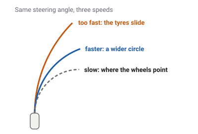
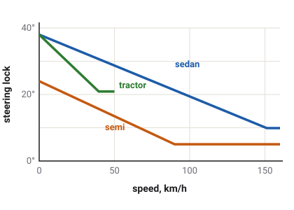

# Steering and Ackermann

This page follows a steering request from the driver's hands to each front
wheel, and explains how that turns the vehicle.

Which vehicles have this
Car
Truck
Tractor

How does turning a wheel in your hands turn a car weighing a tonne? Steering does not push the car
sideways. It angles the front tyres so that they slip a little (see
[Slip and the grip curve](slip.md#slip-angle-across-the-wheel)), and that slip makes the sideways force
that turns the car ([see the forces](forces.md#example-turning)).

## From the steering wheel to the road wheels

The steering wheel is connected to the front wheels through gears and rods, usually with power
assistance (electric or hydraulic), because turning the tyres against the road takes a lot of
force, especially when the car is slow or standing still. Older cars without it took real effort
to steer, above all when parking.

- **The two front wheels get different angles.** This is explained in
  [Ackermann steering](#two-wheels-two-circles-ackermann-steering).
- **Turning takes time.** The wheels cannot snap to a new angle: the driver's hands, the gears
  and the assistance all take a moment to move them. A car's steering is quick, and a truck's is
  slower (its gears need more turns of the steering wheel for the same wheel angle). A tractor's is
  slower too: it is worked by oil pressure, and the wheels turn only as fast as the pump can push
  oil into the steering cylinder.
- **Let go, and the wheels straighten.** Each front wheel turns on a hinge, and designers tilt
  that hinge back at the top on purpose, so the tyre touches the road a little behind it. Like a
  shopping trolley's wheel, the tyre then trails behind as the car rolls forwards, and swings
  back to straight. This is called caster, and it keeps the car running straight on its own.
  Without it, the steering would not come back by itself, and every bump would nudge the wheels
  off line, so the driver would have to keep correcting. Caster also lets the driver feel the
  road through the steering wheel, and leans the outside wheel into a turn for a little more grip.
- **The angle has a limit,** called [lock](glossary.md#lock), but at speed only a small part of
  it is needed. Without grip, a car would go straight on, so in a turn the tyres keep pulling it
  back onto its curve. At twice the speed, the car drifts four times as far off the curve in the
  same moment (see the picture), so the tyres must pull four times as hard. At 100 km/h, just
  2 degrees of steering uses about all the grip of a
  [dry road](tyres.md#the-coefficient-of-friction): any more, and the car slides wide.

<!-- 2 degrees at 100 km/h: bicycle model, 2.5 m wheelbase (the example below): radius 2.5 / tan 2° = 72 m; 27.8² / 72 = 10.7 m/s², about 1.1 g, against μ ≈ 1 on dry asphalt (tyres.md). Real cars understeer, so they need a little more angle. -->

## One angle: the bicycle model

Imagine the car squashed into a bicycle: one front wheel in the middle of the front axle, one
rear wheel in the middle of the rear axle. A wheel at a slow speed rolls in the direction it
points, and it cannot roll sideways. The rear wheel points straight ahead, so the bicycle can
only be turning round some point on the line of the rear axle. The front wheel is angled, so the
bicycle can only be turning round some point on the line at right angles to the front wheel.
Both must be true, so the bicycle rolls round a circle whose centre, the turn centre, is where
the two lines meet. Each tyre pushes sideways, at right angles to itself, so both pushes point
towards the turn centre: they are what bend the car's path into that circle.

That single angle is called the [bicycle angle](glossary.md#bicycle-angle). It sets the size of
the turn: the radius at the rear axle is the [wheelbase](glossary.md#wheelbase) divided by the
tangent of the angle. A longer wheelbase, or a smaller angle, gives a wider circle. For example,
a car with a wheelbase of 2.5 m and its front wheel angled 10 degrees circles at about
2.5 ÷ 0.18 = 14 m radius at the rear axle, and at 20 degrees at about 2.5 ÷ 0.36 = 7 m.

The rear wheels run round a smaller circle than the front ones, so they cut inside the path the
front wheels took. That is why a long truck has to swing wide at a corner so that its rear
wheels do not climb the kerb.
<!-- photo: a long vehicle turning a tight corner, the rear wheels' track inside the front wheels' -->

The picture shows a slow car, whose wheels roll exactly where they point. A faster car needs a
much bigger sideways push to go round the same circle (see "The angle has a limit" above). A tyre
pushes sideways only when it rolls slightly crooked, a little off from where it points (its
[slip angle](slip.md#slip-angle-across-the-wheel)), and the harder it pushes, the more crooked it
rolls. So at speed, a road car goes round a slightly wider circle than its wheels point at,
because its front tyres roll more crooked than its rear ones (the engineers' second meaning of
[understeer](understeer.md#which-end-lets-go-first)). And a tyre can
push only so hard: if the turn asks for more, the tyres slide and the car runs wide, even with no
braking or accelerating ([see the forces](forces.md#example-too-fast)).

## Two wheels, two circles: Ackermann steering

The drawing turns right; a left turn is its mirror image. Steering here is the bicycle angle, up
to the vehicle's lock. Ackermann 1 is what every vehicle in the simulator uses. Nothing moves: no
slip angles, no body roll, no roll or compliance steer.

A real car has two front wheels, and in a turn they do not follow the same circle. The inside
wheel is nearer the turn centre, so it runs round a smaller circle and needs to be turned more
sharply. The outside wheel runs round a bigger circle and needs to be turned less.

If both wheels pointed the same way, the inside wheel would be turned too little for its tight
circle, and the outside wheel too much for its wide one. Each would roll a little crooked, one
pushing outwards and the other inwards, so the two tyres would fight each other and scrub across
the road. You can hear this as a squeal when a car turns slowly on a smooth floor (for example,
in a car park).

The fix is a steering layout named after Rudolph Ackermann, who patented it for horse carriages:
link the wheels so the inside one turns more. When it is exactly right, a line at right angles
to each front wheel passes through one shared turn centre on the rear-axle line, and neither
tyre scrubs. This is **full** [Ackermann steering](glossary.md#ackermann-steering). Turning both
wheels to the same angle is **parallel** steering, and anything in between is partial
Ackermann.

How does one rod manage this? The small arms that the rod pushes on are angled slightly inwards,
so that lines drawn along them meet near the middle of the rear axle. When the rod slides across,
the inside wheel's arm swings round more than the outside one, so the inside wheel turns more.

<!-- photo: a car's steering linkage seen from below, the angled steering arms and the track rod -->

Real road cars often use partial Ackermann. At cornering speed the tyres are no
longer rolling along their own direction: each runs at a slip angle, and the outside tyre, which
carries more of the weight (see [Weight transfer and rollover](weight-transfer.md)), needs a
larger one to give its share of the sideways force. So the perfect slow-speed geometry is not
the best at speed, and the designer compromises. Trucks stay closer to full Ackermann to save
their steering tyres.

## The suspension steers a little too

Two more things change a wheel's angle by small amounts, without the driver doing anything.

- **Roll steer.** When the body leans in a corner, the suspension links move, and their shape
  turns the wheels slightly. On road cars, it is usually designed to steady the car.
- **Compliance steer.** The rubber bushes that hold the suspension bend a little under sideways
  force, which also turns the wheels slightly. (The bushes are soft on purpose, to keep road
  noise out of the car, so they give a little under load.)

Designers can use both to tune [understeer](glossary.md#understeer): a car that turns a little
less than asked is easier to control than one that turns more, because the driver's natural
reaction (slowing down) cures it (see [Understeer and oversteer](understeer.md)).

## Auto-steer on the tractor

A tractor can be steered by a guidance computer, to drive straight lines across a field. The
computer sends a curvature to the steering: a number for how tightly to turn. The bigger the
number, the tighter the turn:

| Curvature | Turn radius | |
| --- | --- | --- |
| 0 | none | dead straight |
| 10 | 100 m | a gentle curve |
| 100 | 10 m | a tight turn, as at the end of a field |

It is 1,000 divided by the turn radius in metres, so its unit is written 1/km ("per kilometre").

The steering then works out the wheel angle that drives that curve, which depends on the tractor's
wheelbase, and turns the wheels to it. The driver still works the speed. Why send a curvature and
not an angle? The same curvature makes any tractor follow the same path, whatever its wheelbase,
while the same angle would give a different circle for each. For example, a curvature of 100 asks
for a circle of 10 m radius, and a tractor with a 2.5 m wheelbase needs about 14 degrees of angle for it
(the tangent is 2.5 ÷ 10 = 0.25) but one with a 3 m wheelbase needs about 17.

## What Carlito simulates

The parameters the simulator uses for this, and where each is set, are listed in
[How the simulation works](simulation.md#steering-and-ackermann):

- **Per vehicle**:
  - [Steering lock](simulation.md#steering-lock) (`max_steer_deg`)
  - [Steering rate](simulation.md#steering-rate) (`steer_speed`)
  - [Steering taper](simulation.md#steering-taper) (`min_steer_frac`, `steer_falloff_speed`)
  - [Ackermann](simulation.md#ackermann) (`ackermann`)
  - [Wheel positions](simulation.md#wheel-positions) (`wheel_positions`)
  - [Roll steer](simulation.md#roll-steer) (`roll_steer_front`, `roll_steer_rear`)
  - [Compliance steer](simulation.md#compliance-steer) (`compliance_steer_rear`)

Simplification list

- **Less lock at speed.** A steering request is a share of a lock that narrows as speed rises
  (the [steering taper](glossary.md#steering-taper)), so that full steering on a motorway does not
  throw the car off the road. A real steering wheel has no such limit. Auto-steer is not tapered.

  
  <!-- WheelDrive.steer_lock_deg; sedan_spec.tres max_steer_deg 38, min_steer_frac 0.26, steer_falloff_speed 42 m/s; semi_spec.tres 24, 0.21, 25 m/s; tractor-kenney_spec.tres 38, 0.55, 11 m/s -->
- **No articulated steering.** Some big tractors and loaders steer by bending in the middle. In
  the simulation, every wheeled vehicle steers its front wheels. A truck and its trailer do bend at
  the coupling, but that is towing, not steering.
- **No rear-wheel steering**, and the trailers' wheels are never steered.
- **No feel through the wheel.** The wheels go where they are asked, at the steering rate. No
  force from the tyres pushes back on the steering, as it would through a real steering wheel,
  so the wheels do not straighten by themselves: they return only when the steering request does.
- **Full Ackermann everywhere, an estimate.** At road speed the two wheels differ by a fraction of
  a degree, so the choice barely shows.
  <!-- GroundDriveSpec.ackermann 1.0 on CAR_BASE, TRUCK_BASE, VAN_BASE, TRACTOR_BASE and both semis; docs/handling.md Steering geometry -->
- **Short wheelbases.** The simulated vehicles are short for their weight: the `sedan`'s wheelbase
  is about 1.6 m, where a real saloon's is nearer 2.7 m, so at full lock it circles only about 2 m
  in radius at its rear axle.
  <!-- sedan_spec.tres wheel_positions: z -0.822 and 0.762, wheelbase 1.584 m; 1.584 / tan 38 deg = 2.03 m. docs/handling.md Pitch: the Kenney wheelbases are toy-scale -->
- **Simple roll and compliance steer.** Both are fixed rates, added to each wheel after the
  Ackermann split. The racing cars and the tractor have no roll steer, and only the front-drive
  saloons' rear axle has compliance steer. Auto-steer and the published `steer` read the bicycle
  angle without them.
  <!-- RayWheel.roll_steer, RayWheel.compliance_steer; 0 on race, race-future and the tractor (docs/handling.md Balance); compliance_steer_rear on CAR_BASE only -->

## What you see in sloppyCAN

| Signal | Direction | Unit | What it shows |
| --- | --- | --- | --- |
| `steer` | in | % | The steering request, −100 (full left) to +100 (full right). |
| `steer` | out | % | The steering as applied, after the steering rate: the share of the lock now in use. It is the bicycle angle's share, not either wheel's own angle. |
| `guidance_curvature` | in | 1/km | Auto-steer: one over the turn radius, −127 to +127, negative curving left. While present it replaces `steer` (Tractor). |
| `yaw` | out | rad/s | How fast the vehicle is turning, seen from above. |
| `accLat` | out | m/s² | How hard it is being pushed sideways: speed times yaw rate in a steady turn. |
| `heading` | out | deg | The compass direction the nose points, 0 to 360. |
<!-- contract/carlito_contract.json: steer (in and out), guidance_curvature, yaw, accLat, heading; base_vehicle.gd sets telemetry.steer from the slewed _steer -->

## Scenarios

- [Full lock at walking pace](forces.md#example-full-lock): the inner wheel turned more than the outer one.
- [Turning, well within grip](forces.md#example-turning): the side forces that turn the car.
- [Too fast for the turn](forces.md#example-too-fast): a wider circle than the wheels point along.

## Related

- [Slip and the grip curve](slip.md): how an angled tyre makes its sideways force.
- [Understeer and oversteer](understeer.md): when the front or the rear tyres let go first.
- [Weight transfer and rollover](weight-transfer.md): where the weight goes as the body leans.
- [Glossary](glossary.md): every term on this page.
