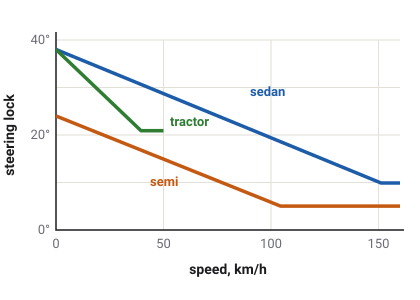
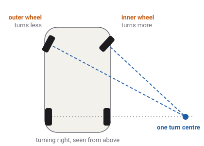

# Steering and Ackermann

Steering does not push a car sideways. It angles the front tyres so they slip a
little, and that slip makes the sideways force that turns the car. This page follows a steering
request from the driver's hands to each front wheel.

Which vehicles have this
Car
Truck
Tractor
Plane
Boat
Drone
Train

## From the request to the wheels

Steering starts as a single number, the steering request: from full left to full right, written
as −100 % to +100 %. It can come from the keyboard, a gamepad, the touch screen or sloppyCAN's
`steer` signal. Whatever the source, the game then does the same three things with it.

**1. It moves at a limited rate.** The wheels cannot snap to a new angle. Each vehicle has a
steering rate: how fast it can turn the wheels from straight ahead to full lock. A car does it in
about a seventh of a second, the trucks in about half a second, and the tractor, whose steering
is worked by oil pressure, in more than a second.
<!-- VehicleSpec.steer_speed in lock fractions per second: CAR_BASE 7.0, TRUCK_BASE 2.0 (garbage-truck and firetruck 1.6), semi_spec.tres 1.8, TRACTOR_BASE 0.75 (gen_kenney_vehicles.gd) -->

The keyboard adds one more step before that. A key is either pressed or not, so the game eases
it in like a hand turning a wheel: the faster the car goes, the more slowly a held key turns
the wheels, and letting go brings them back quicker than they went out. The SETTINGS option KEY
RESPONSE sets how much easing there is, from RAW (none) to REALISTIC. A gamepad stick, the touch
stick and sloppyCAN already give in-between values, so they are not eased.
<!-- src/input/key_shaper.gd steer_out_rate, steer_return_rate, SOFTENING_LABELS -->

**2. It is turned into an angle, which shrinks with speed.** Full request means full
[lock](glossary.md#lock): 38° on a car standing still. But full lock at motorway speed would
throw the car off the road, so the lock narrows as speed rises, in a straight line, down to a
quarter of it by about 150 km/h. This is the [steering taper](glossary.md#steering-taper). It
applies to every way of steering, not only the keyboard.

<!-- WheelDrive.steer_lock_deg; sedan_spec.tres max_steer_deg 38, min_steer_frac 0.26, steer_falloff_speed 42 m/s; semi_spec.tres 24, 0.21, 29 m/s; tractor-kenney_spec.tres 38, 0.55, 11 m/s -->

**3. It is split between the two front wheels.** The game first works with one angle for the
whole front axle, then gives the left and right wheels slightly different angles of their own.
The rest of this page explains why.

## One angle: the bicycle model

Imagine the car squashed into a bicycle: one front wheel in the middle of the front axle, one
rear wheel in the middle of the rear axle. When the front wheel is angled, the bicycle rolls
round a circle. Its centre, the turn centre, is where a line at right angles to the front wheel
meets a line through the rear axle.

The game calls that single angle the [bicycle angle](glossary.md#bicycle-angle). It sets the
size of the turn: the radius at the rear axle is the [wheelbase](glossary.md#wheelbase) divided
by the tangent of the angle. A longer wheelbase, or a smaller angle, gives a wider circle. The
game's vehicles are short for their weight (the `sedan`'s wheelbase is about 1.6 m, where a real
saloon's is nearer 2.7 m), so at full lock the `sedan` turns round a circle only about 2 m in
radius at its rear axle.
<!-- sedan_spec.tres wheel_positions: z -0.822 and 0.762, wheelbase 1.584 m; 1.584 / tan 38 deg = 2.03 m. docs/handling.md Pitch: the Kenney wheelbases are toy-scale -->

## Two wheels, two circles: Ackermann steering

A real car has two front wheels, one on each side, and in a turn they do not follow the same
circle. The inside wheel is nearer the turn centre, so it runs round a smaller circle and needs
to be turned more sharply. The outside wheel runs round a bigger circle and needs to be turned
less.

<!-- WheelDrive.ackermann_angle at fraction 1 on the sedan's geometry: bicycle 34 deg gives inner 42.7, outer 28.0 -->

If both wheels pointed the same way, the inner one would be travelling at an angle to where it
points, and so would the outer one, in the opposite sense. The two tyres would push against each
other and scrub across the road. You can hear this as a squeal when a car turns slowly on a
smooth floor, such as a car park.

The fix is a steering layout named after Rudolph Ackermann, who patented it for horse carriages:
link the wheels so the inside one turns more. When it is exactly right, a line at right angles
to each front wheel passes through one shared turn centre on the rear-axle line, and neither
tyre scrubs. That is **full** [Ackermann steering](glossary.md#ackermann-steering). Turning both
wheels to the same angle is **parallel** steering, and anything in between is partial
Ackermann.

### How the game does it

The game takes the bicycle angle and works out each front wheel's own angle from where that
wheel sits: how far it is to the left or right of the middle, and the wheelbase. The two angles
are chosen so that, together, they ask for the same turn centre the bicycle angle asked for.

Every wheeled vehicle in the game uses full Ackermann. That choice is an estimate. Real road cars
usually use only part of it, because at high cornering speed the heavily loaded outside tyre
works better a little more turned; trucks are set close to full to save their steering tyres
from wear. In the game the point is the slow-speed case, where full Ackermann is what makes the
two wheels agree. At road speed the two wheels' angles differ by only a fraction of a degree, so
the choice barely shows.
<!-- GroundDriveSpec.ackermann 1.0 on CAR_BASE, TRUCK_BASE, VAN_BASE, TRACTOR_BASE and both semis; docs/handling.md Steering geometry -->

The lock limits the bicycle angle, not the inner wheel. At full lock the inner wheel turns past
the lock figure: on the `sedan`, whose lock is 38°, the inner wheel turns to about 49° and the
outer to about 31°.
<!-- WheelDrive.ackermann_angle(38 deg, x = -0.63, L = 1.584, f = 1) = 48.6 deg; x = +0.63 gives 30.8 deg -->

### Parallel steering, for comparison

The pause menu's LAB page has a STEERING switch. Set to PARALLEL, it turns both front wheels to
the bicycle angle on any car, truck or tractor, for the rest of the session. The difference is
easiest to see at full lock and walking pace: the two front tyres now fight, each slipping
sideways against the other, and the vehicle drives a wider circle. The `sedan`, for example,
circles at about 2.4 m at its rear axle with parallel steering, against about 2.1 m with
Ackermann.
<!-- docs/handling.md Steering geometry, the circle table: sedan 2.39 -> 2.13 m (parallel -> f = 1), measured at crawl speed -->

## The suspension steers a little too

Two more things change a wheel's angle by small amounts, without the driver doing anything.

- **Roll steer.** When the body leans in a corner, the suspension links move, and their shape
  turns the wheels slightly. Most of the game's road vehicles have it: up to about a tenth of a
  degree of steer for each degree the body leans, in the direction that steadies the car. The
  racing cars and the tractor have none.
- **Compliance steer.** The rubber bushes that hold the suspension bend a little under sideways
  force. Only the front-drive saloons' rear axle has this in the game, and it too turns the
  wheels the steadying way.

Both are added to each wheel's own angle after the Ackermann split. Neither changes the bicycle
angle that the steering request asked for; auto-steer and the published steering read that
angle without them.
<!-- RayWheel.roll_steer, RayWheel.compliance_steer; roll_steer_front 0.10 on the car family, rear 0.036-0.10, 0 on race, race-future and the tractor (docs/handling.md Balance); compliance_steer_rear on CAR_BASE only -->

These steers are one way designers tune [understeer](glossary.md#understeer): a car that turns a
little less than asked is easier to hold than one that turns more.

## Auto-steer on the tractor

The tractor can be steered by a guidance computer, as real tractors are when they drive straight
lines across a field. sloppyCAN sends the signal `guidance_curvature`: how tightly to turn,
written as one over the turn radius, in 1/km. 0 means dead straight; 100 1/km means a circle of
10 m radius.

While that signal is present it takes the place of the steering request. The game works out the
bicycle angle that drives that curve on the tractor's own wheelbase, then steers to it at the
tractor's usual steering rate. This angle is not narrowed by the speed taper, so the tractor
drives the curve it was asked for at any speed. The tightest command the signal can carry,
127 1/km, is a circle of about 8 m radius.
<!-- WheelDrive.steer_angle_from_curvature: atan(wheelbase x curvature), clamped to max_steer_deg; contract guidance_curvature range [-127, 127] 1/km -->

## What the game leaves out

- **No articulated steering.** Some big tractors and loaders steer by bending in the middle. In
  the game every wheeled vehicle steers its front wheels. A truck and its trailer do bend at the
  coupling, but that is towing, not steering.
- **No rear-wheel steering**, and the trailers' wheels are never steered.
- **No feel through the wheel.** The wheels go where they are asked, at the steering rate. No
  force from the tyres pushes back on the steering, as it would through a real steering wheel.

## What you see in sloppyCAN

| Signal | Direction | Unit | What it shows |
| --- | --- | --- | --- |
| `steer` | in | % | The steering request, −100 (full left) to +100 (full right). Car, truck, tractor, boat, plane, drone. |
| `steer` | out | % | The steering as the game applied it, after the steering rate: the share of the lock now in use. It is the bicycle angle's share, not either wheel's own angle. |
| `guidance_curvature` | in | 1/km | Tractor auto-steer: one over the turn radius, −127 to +127, negative curving left. While present it replaces `steer`. |
| `yaw` | out | rad/s | How fast the vehicle is turning, seen from above. |
| `accLat` | out | m/s² | How hard it is being pushed sideways: speed times yaw rate in a steady turn. |
| `heading` | out | deg | The compass direction the nose points, 0 to 360. |
<!-- contract/carlito_contract.json: steer (in and out), guidance_curvature, yaw, accLat, heading; base_vehicle.gd sets telemetry.steer from the slewed _steer -->

## Try it in the game

Try it in the game: watch the inner wheel

1. Open SETTINGS and set EXTENDED DEBUG LABELS to ON, then press **F3**. The overlay's `steer`
   line shows each wheel's angle in degrees (positive is left).
2. Pick the `sedan` in the GARAGE and drive it on **Flatland**. At walking pace, hold full left
   lock. The front-left
   (inner) wheel reads about 49° and the front-right (outer) about 31°.
3. Pause, open LAB and set STEERING to PARALLEL. Hold full lock again: both front wheels read the
   same angle, and the circle you drive is wider.
4. Set STEERING back, drive at about 100 km/h on a straight, and press full left for a moment.
   The `steer` numbers are far smaller than at walking pace: that is the speed taper.

## Related

- [Tyres and slip](tyres.md): how an angled tyre makes its sideways force.
- [Glossary](glossary.md): every term on this page.
