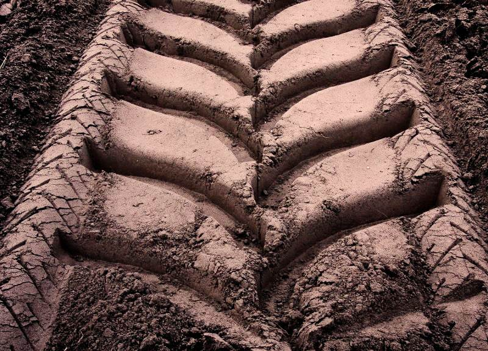
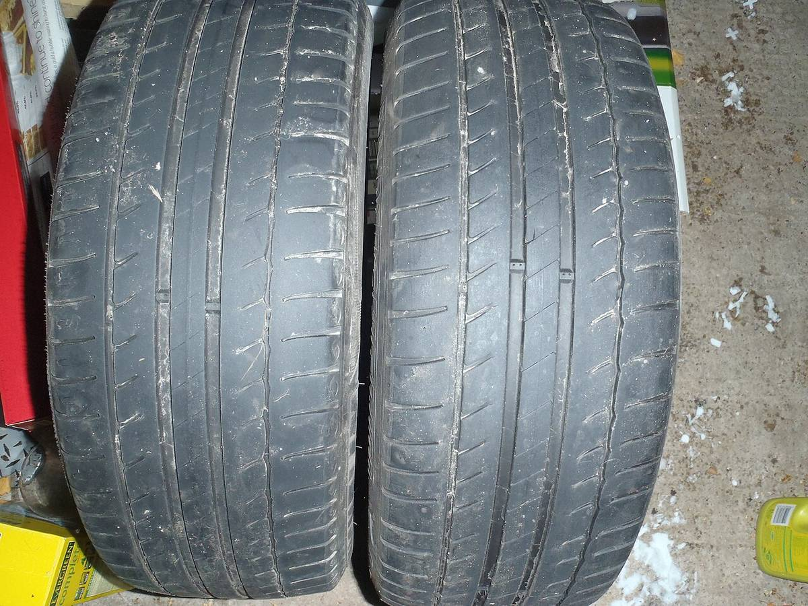
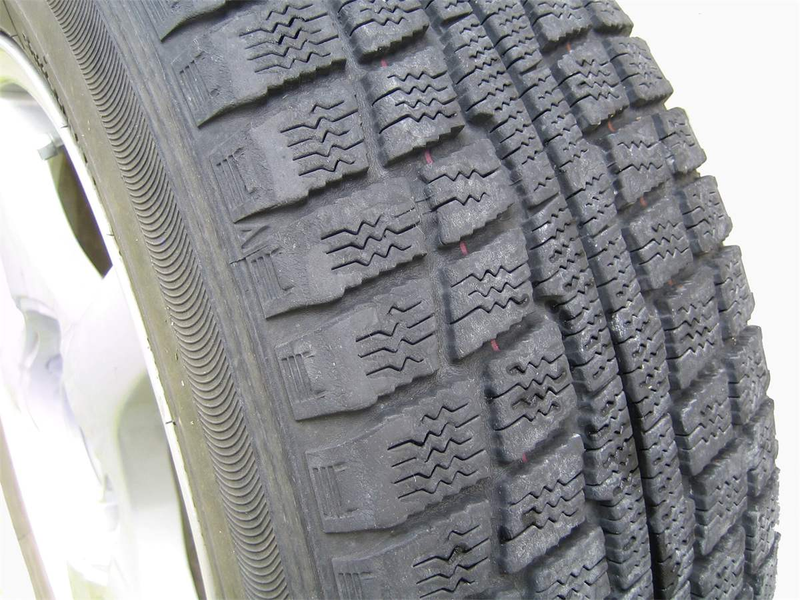
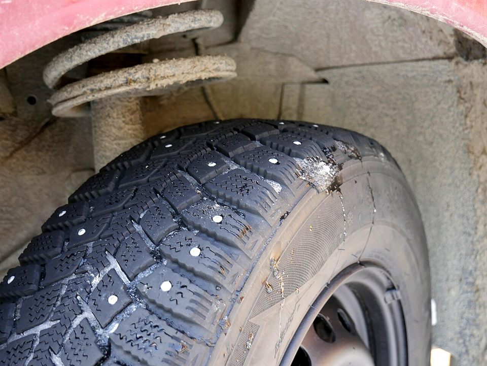
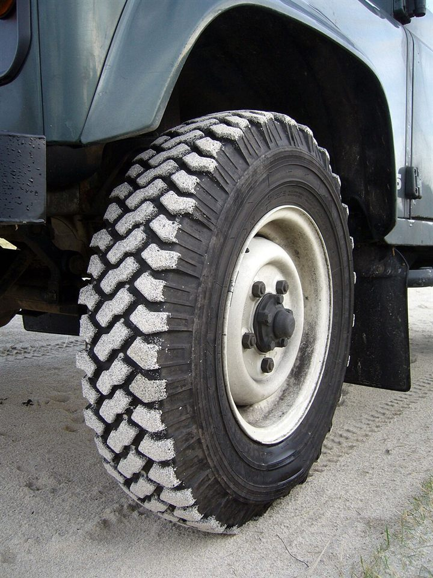
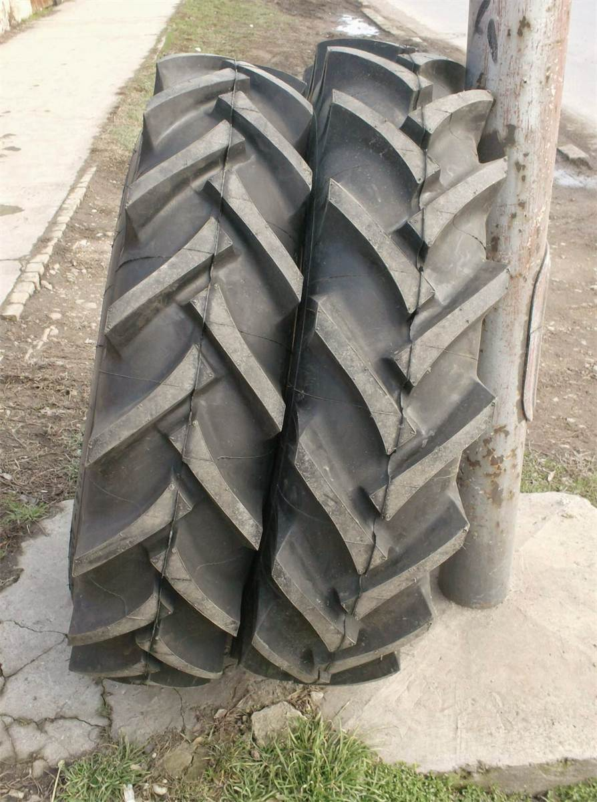
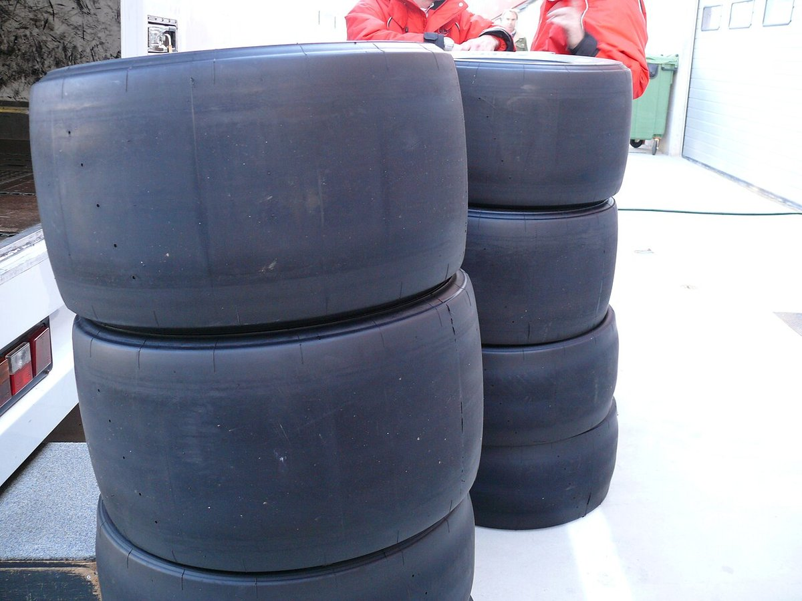

# Ground and tyre types

This page explains how grip depends on both the ground and the tyre.

Which vehicles have this
Car
Truck
Tractor

A tyre grips dry asphalt far better than ice. How much better depends on the tyre (for example, a
winter tyre grips snow much better than a summer tyre). So why does the ground matter so much,
and why is no single tyre best everywhere?

## What the ground changes

The ground (also called the [surface](glossary.md#surface)) has two effects on a tyre.

- **Grip.** Dry asphalt gives the most grip to an ordinary tyre. Wet asphalt gives less, because
  water keeps the rubber from sticking (see
  [Grip comes from friction](tyres.md#grip-comes-from-friction)). Loose ground (gravel, grass,
  mud, sand) gives less again in most cases, because the tyre can only push against grains that
  can shift or roll under it. Snow and ice give the least. On snow, the tyre can push only as hard
  as the snow under it holds together before it shears off. Ice is smooth, and a thin film of
  water on its surface (thickest near 0 °C) lets the rubber slide over it.
- **Drag.** Hard ground is easy to roll on. Soft ground is harder, because the tyre sinks in and
  has to climb out of its own rut all the time. This adds to the tyre's
  [rolling resistance](glossary.md#rolling-resistance), which
  [Air and rolling resistance](resistance.md#rolling-resistance) explains. In deep mud, keeping a car moving can
  feel like driving up a hill.

Each ground changes the coefficient of friction μ that
[Tyres and grip](tyres.md#the-coefficient-of-friction) explains, and so the height of the peak of
the [grip curve](glossary.md#grip-curve). A tyre on wet asphalt, for
example, can give about half the push of the same tyre on dry asphalt.

Does a wider tyre grip better on soft ground? It helps there, but not because its rubber grips
harder: the same weight is spread over a bigger patch, so the tyre presses less hard on each bit
of soil and sinks less. That is why farm vehicles on soft fields are fitted with wide tyres.

<figure>

<figcaption>A wide tractor tyre's track in soft soil. Photo: Divi-ded, CC BY 2.0 DE, <a href="https://commons.wikimedia.org/wiki/File:Reifenspur_Traktor.jpg">Wikimedia Commons</a>.</figcaption>
</figure>

## Tyre classes

Why does the best tyre depend on the ground? Because the tread and the rubber that suit one ground
do not suit another, as already explained in
[Tyres and grip](tyres.md#the-coefficient-of-friction). In short:

- **On a dry road**, the grip comes from the rubber touching the road, so every groove cut into
  the tread takes some away. A racing slick has no grooves at all.
- **On a wet road**, the tread needs grooves to carry the water out of the contact patch, or the
  tyre rides up on a film of water (aquaplaning). A road tyre has them, and gives up a little dry
  grip for them.
- **On snow and ice**, a winter tyre uses softer rubber that stays flexible in the cold, and many
  thin cuts in its tread give it extra edges to bite into the snow. Studs and chains go further
  (see below).
- **On soft ground**, deep lugs with wide gaps between them dig into the soil and push against
  it, more like a paddle than like friction on a road.

Studs, chains, mud tyres and the sidewall markings

- **Studs dig into the ice.** A stud is a small, very hard pin (often tungsten carbide, a ceramic)
  held in the rubber by a softer jacket, and it sticks out of the tread by a millimetre or so. On
  ice the pins push against the ice instead of relying on friction. On a dry road they cannot dig
  in and hold part of the tread off the road, so the tyre grips a little less there.
- **Studs wear the road.** On bare asphalt they grind ruts into the wheel tracks and raise dust,
  so many countries allow them only in winter, and some, such as Germany and the Netherlands, ban
  them. They make a skid on ice much less likely, not impossible.
- **Chains** are steel links fitted over the tyres. On snow, the links sink in and push against the
  packed snow around them, as a lug does in mud, instead of the rubber sliding over the top; on
  ice they bite into the surface like studs. They give the most grip in the worst conditions, but
  they limit a car to about 50 km/h, and on a dry road they wear quickly and can make the car
  slide when braking. Some places require them when the conditions or the signs say so; others
  ban them to protect the road.
- **Mud tyres dig in.** Wet mud is slippery and weak, so rubber finds little friction on top of
  it. A mud tyre does not try: its deep, wide grooves let the tread sink in, and each big block
  pushes against the mud in front of it, as a paddle pushes against water or the cleats of a
  sports shoe against turf. The grip then comes from how much mud the blocks can shove before it
  gives way, which is more than friction alone could give. Some are made to run with less air on
  difficult ground, so the softer tyre bends to follow the shape of the ground.
- **Mud tyres are poor on the road.** Fewer blocks touch the asphalt, so the patch is smaller and
  grips less than a road tyre's. They are also loud and uncomfortable, use more fuel and wear
  quickly. All-terrain tyres sit between the two, giving up some grip off the road for a ride and
  grip closer to a road tyre's.

<!-- Wikipedia "Snow tire": a hard pin "often made of tungsten carbide" in a softer jacket that "anchors the stud in the rubber", to "protrude at least 1 millimetre"; studs "do not eliminate skidding on ice and snow, but they greatly reduce risks"; "Studs abrade dry pavement, causing dust and creating wear in the wheel path"; Europe as of 2024: seasonally restricted in Austria, the Nordic and Baltic countries and others, banned in Germany, the Netherlands and others. M+S: tread "performs better in "Mud and Snow" conditions than regular "non-M+S" street tires", USTMA requires tread recesses of set size; 3PMSF: "10 to 12% better in straight-line "traction test" than a Standard Reference Test Tire", on "a medium packed snow surface". Wikipedia "Snow chains": "approximately 50 km/h (30 mph)"; on dry roads they "rapidly wear" and "can cause a vehicle to slide when braking"; "chains generally give the best traction in severe conditions"; some regions require chains, others "prohibit the use of chains, as they can damage road surfaces". Wikipedia "Off-road tire": "deeper and wider grooves meant to help the tread sink into mud or gravel surfaces"; "the exposed edges of the tread dig into soft ground to give more traction than rolling friction alone" (compared there with cleated shoes); "Some off-road tires are designed to be used with low inflation pressure on difficult terrain, reducing their rigidity"; "on paved surfaces the smaller contact patch affords less traction as compared to street tires"; mud-terrain tyres "uncomfortable, loud, dangerous and inefficient (high fuel use and tyre wear)" on paved roads; all-terrain tyres "compromise between grip on loose terrain and safety or comfort on paved roads". -->

Tyres are therefore grouped in [tyre classes](glossary.md#tyre-class), one per kind of use.

| Class | Usually fitted to | What it is good at |
| --- | --- | --- |
| All-season | cars, vans, pickups, SUVs | A compromise that works in most conditions. |
| Summer | cars, vans | More grip on dry roads; poor on snow and ice. |
| Winter | cars, vans, trucks | A little less grip on dry roads; more on snow and ice. |
| Studded winter | cars, vans | Metal studs give much more grip on ice, and a little less on dry roads. |
| Mud | vans, pickups, SUVs, trucks | Deep open lugs: better in mud, fields, grass and sand; worse on roads, snow and ice; harder to roll. |
| M+S drive | trucks | Mud-and-snow tyres for the driven axles: a little better on snow and soft ground. |
| R-1W lug | tractors | Deep farm lugs for mud and fields. |
| Slick | racing cars | No tread at all: for dry tracks, and very poor in the wet. |

<!-- photo: an all-season car tyre's tread -->

<figure>

<figcaption>A road car's tyres, with grooves. Photo: Trubble, CC BY-SA 2.0, <a href="https://commons.wikimedia.org/wiki/File:Michelin_Pilot_Primacy_HP_(5285287620).jpg">Wikimedia Commons</a>.</figcaption>
</figure>

<figure>

<figcaption>A winter tyre's thin cuts. Photo: Lombroso, public domain, <a href="https://commons.wikimedia.org/wiki/File:Studless_tire_2.jpg">Wikimedia Commons</a>.</figcaption>
</figure>

<figure>

<figcaption>A studded winter tyre. Photo: Santeri Viinamäki, CC BY-SA 4.0, <a href="https://commons.wikimedia.org/wiki/File:Studded_snow_tire_20171027.jpg">Wikimedia Commons</a>.</figcaption>
</figure>

<figure>

<figcaption>A mud tyre on an off-road car. Photo: Dontpanic, public domain, <a href="https://commons.wikimedia.org/wiki/File:Mt_tyre.jpg">Wikimedia Commons</a>.</figcaption>
</figure>

<!-- photo: a truck's M+S drive tyre -->

<figure>

<figcaption>A tractor tyre's lugs. Photo: Momčilo Stokanovic, CC BY-SA 4.0, <a href="https://commons.wikimedia.org/wiki/File:Traktorske_gume.jpg">Wikimedia Commons</a>.</figcaption>
</figure>

<figure>

<figcaption>Racing slicks, with no grooves. Photo: vtornet, CC BY 2.0, <a href="https://commons.wikimedia.org/wiki/File:F1_Slick_Tires.jpg">Wikimedia Commons</a>.</figcaption>
</figure>

## How the class changes grip and drag

The class also changes how hard the tyre is to roll on a road: a summer tyre usually rolls more
easily than a mud tyre, because the mud tyre's deep lugs bend more with every turn of the wheel
and so waste more energy.

.")
<!-- TyreClass.grip_response = REF_GRIP x (dry / stock dry) x surface_grip; the four PASSENGER classes -->

## What Carlito simulates

The parameters the simulator uses for this, and where each is set, are listed in
[How the simulation works](simulation.md#ground-and-tyre-types):

- **Simulation-wide**:
  - [Paint reach](simulation.md#paint-reach) (`SURFACE_GRIP_REACH`)
- **Per surface**:
  - [Grip and added drag](simulation.md#ground-and-tyre-types), in the surface list (`REF_GRIP`,
    `DRAG`)
- **Per vehicle**:
  - [Stock tyre class and size](simulation.md#stock-tyre-class-and-size) (`tyre`, `tyre_fit`)
- **Per tyre class**:
  - [Grip per surface](simulation.md#grip-per-surface) (`surface_grip`)
  - [Rolling resistance factor](simulation.md#rolling-resistance-factor) (`crr_factor`)
  - [Sizes](simulation.md#sizes) (`fits`)
- **Per level**:
  - [Where each surface is](simulation.md#where-each-surface-is)

Simplification list

- **Twelve kinds of ground, two numbers each.** Every ground is a grip factor and a drag. The grip
  changes only the height of the curve's peak, never its shape.
  <!-- surface.gd REF_GRIP: Asphalt 1, Wet 0.75, Pad 0.95, Gravel 0.71, Dirt 0.8, Grass 0.5, Sand 0.6, Rock 0.7, Mud 0.45, Field 0.5, Snow 0.34, Ice 0.12; DRAG -->
- **Nine tyre classes.** A class is only a grip factor per ground and a rolling resistance. The
  tractors, the trailers and the racing cars have one class each.
  <!-- src/vehicles/tyres/*.tres: fits, dry, surface_grip, crr_factor; docs/vehicles.md Tyres and surfaces, the Fit table -->
- **No rain.** Wet asphalt is a painted surface, always in the same places. No weather makes the
  road wet or dry, and no surface changes during a drive.
- **No tyre wear, temperature or pressure.** A tyre grips the same on the first lap and the
  hundredth.
- **One drag per surface.** A wide tractor tyre pays the same soil drag as a narrow car tyre,
  although a real wide tyre sinks in less.
- **No sinking.** Mud and sand slow a vehicle and lower its grip, but the wheels do not dig in
  and the vehicle cannot get bogged down to its axles.
- **Paint reaches only so high.** A bridge more than about a metre above a painted patch reads
  dry asphalt, not the paint below it.
  <!-- wheel.gd SURFACE_GRIP_REACH 1.0 m -->

## What you see in sloppyCAN

No signal names the surface under a wheel. Its effects show in the signals that come from the
tyres:

| Signal | Direction | Unit | What it shows |
| --- | --- | --- | --- |
| `slip` | out | ratio, two values | The front and rear axles' slip, along the wheels and sideways together. On low grip the same pedal makes much more slip (Car, truck, tractor). |
| `accLong` | out | m/s² | Acceleration along the vehicle. In a full ABS stop it falls in step with the surface's grip. |
| `wheel_slip` | out | % | How far the rear wheels run ahead of the ground. In mud or a field it climbs (Tractor). |
| `engine_load` | out | % | How much of the engine's torque is in use. Soft ground's drag raises it at a steady speed (Truck and tractor). |
<!-- contract/carlito_contract.json: slip, accLong, wheel_slip, engine_load -->

## Scenarios

- [Emergency stop](forces.md#example-emergency-stop): on dry asphalt.
- [Emergency stop on a wet road](forces.md#example-stop-wet): the same stop, with less grip.
- [Emergency stop on snow](forces.md#example-stop-snow): the same stop, with much less grip.
- [Pulling away on snow](forces.md#example-wheelspin): the driven wheels spin.

## Related

- [Slip and the grip curve](slip.md): the grip curve that each surface scales.
- [Glossary](glossary.md): every term on this page.
