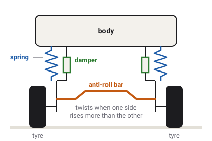

# Suspension

The suspension holds the body up on its wheels. It lets each wheel follow the
bumps without throwing the body around, and it keeps every tyre pressed onto the road, because a
tyre that is not pressed down cannot grip.

Which vehicles have this
Car
Truck
Tractor
Plane
Boat
Drone
Train

## A spring and a damper at each corner

Each wheel hangs from the body on two parts that work side by side.

- **The spring** carries the weight. The further it is squeezed, the harder it pushes back, like
  the spring in a kitchen scale. In the game the push is the spring's stiffness times how far it
  is squeezed.
- **The [damper](glossary.md#damper)** stops the bouncing. A spring on its own would keep the
  body bobbing up and down after every bump, like a ball on an elastic band. A damper pushes
  against movement, not against position: the faster the wheel moves up or down, the harder it
  resists, and when the wheel is still it does nothing.

The game adds the two forces and pushes the body up with the total at that corner. Two limits
apply. A suspension can only push, never pull: when a wheel hangs in the air it carries nothing.
And the push is capped, so a wheel that lands deep inside the ground after a big jump cannot fire
the vehicle into the sky.
<!-- RayWheel.tick: suspension_force = clamp(spring_rate x compression + damper_force + bar + links, 0, max_suspension_force) -->

Every wheel has a fixed length of travel, from fully hanging to fully squeezed. On a car it is
about 28 cm.
<!-- CAR_BASE rest_length 0.28 m (gen_kenney_vehicles.gd) -->

### How stiff, and how soft

A car's springs are chosen by how fast the body bounces on them, its
[ride frequency](glossary.md#ride-frequency). A family
saloon bounces about 1.4 times a second, a big van about 1.3, the racing cars about 1.6. Each
car's front and rear springs are sized from that figure and the weight on that axle, so every
car and van, heavy or light, stands with its springs squeezed by the same share of their travel:
a little under half.
<!-- CAR_BASE ride_hz 1.39, VAN_BASE 1.28, race 1.6; `_derive_springs`: "every body stands at the same 0.128 m sag (46 % of rest_length)" -->

The dampers are set the same way, as a share of the damping that would stop a bounce dead
without any overshoot. A car's are set to about a third of that when the wheel moves up (bump)
and about half when it moves down (rebound). The firmer rebound keeps the wheel from springing
back too fast after a bump, which would throw the body upwards.
<!-- CAR_BASE zeta_bump 0.36, zeta_rebound 0.48; sedan 1800 / 2400 N·s/m -->

The trucks and their trailers have springs chosen by hand for their loads, many times stiffer
than a car's. A semi's front springs are about ten times as stiff as a saloon's.
<!-- semi_spec.tres spring_rate 240000 N/m against the sedan's 22 kN/m -->

## The anti-roll bar

In a corner, the body leans outwards: it [rolls](glossary.md#roll). Softer springs give a
gentler ride but more roll. An [anti-roll bar](glossary.md#anti-roll-bar) fixes that without
stiffening the ride. It is a steel bar across the car, joining the two wheels of one axle. When
both wheels rise together, over a bump in the middle of the road, the bar just turns and does
nothing. When one wheel rises more than the other, as the body leans, the bar twists, and its
twist pushes the low side up and the high side down.

The game models it this way: each axle's bar pushes with a force set by the difference between
its left and right springs' squeeze. Most of the road vehicles have bars on both axles, and every
trailer axle has one. A saloon's front bar is about four times as stiff as its rear one, so the
front carries about two thirds of the car's resistance to roll.
<!-- RayWheel.bar_force; CAR_BASE anti_roll_rate 16000, anti_roll_rate_rear 4000: "the front carries ~65-70 % of the roll stiffness" -->

That split matters for more than comfort. The axle with the stiffer bar moves more weight from
its inside tyre to its outside tyre in a corner, and because of
[load sensitivity](glossary.md#load-sensitivity) that axle loses grip first. A stiff front bar
makes a car run wide at the front rather than swing out at the back, which is easier to control.
[Weight transfer and rollover](weight-transfer.md) explains this in full.

## Links that resist dive and squat

When a car brakes, its nose dips: it dives. When it accelerates, its tail drops: it squats. Both
come from weight moving between the axles. The shape of the links that hold the wheels can resist
this. As the brakes pull back on the front wheels, angled links turn part of that pull into a
push that holds the nose up. That is [anti-dive](glossary.md#anti-dive). At the rear, the same
trick under acceleration is [anti-squat](glossary.md#anti-squat).

The game's cars and vans have both, set to resist about 40 % of the dive and 50 % of the squat.
The rigid trucks have anti-squat only, and the semis neither. The links change only how far the
body pitches. The weight still moves between the axles exactly as much as before, so the tyres'
grip and the brakes' balance do not change.
<!-- CAR_BASE and VAN_BASE anti_dive 0.4, anti_squat 0.5; TRUCK_BASE anti_dive 0, anti_squat 0.5; semi_spec.tres declares neither; docs/handling.md Pitch: "the tyre still carries the whole transfer" -->

## The tractor: tyres as springs, and a swinging axle

A farm tractor has no springs on its axles. Its big soft tyres are its suspension, and the game
gives each corner a stiff spring and damper that stand for the tyre itself. The rear tyres are
stiffer still, so they can carry an implement hung on the back.
<!-- TRACTOR_BASE spring_rate 330000, spring_rate_rear 420000 ("this models the whole axle, not just the rubber"), rest_length 0.12 -->

What the tractor does have is a
[swinging front axle](glossary.md#swinging-front-axle). The whole front axle is one beam, fixed to
the tractor at a single pivot in the middle. When one front wheel climbs a bump, the beam tilts
and the other wheel drops, so both keep touching the ground and share the load evenly. The body
does not lean until the beam reaches its stop, 10° either way. This is why a tractor can cross a
rutted field with all four wheels down.
<!-- TRACTOR_BASE front_axle_swing_deg 10.0; RayWheel.swing_step -->

The tractor has no anti-roll bars and no anti-dive or anti-squat links.

## What the game leaves out

- **No separate unsprung mass.** A real wheel, brake and axle have their own weight, which
  bounces on the tyre. In the game the wheel has a spinning mass but no up-and-down mass of its
  own: only the body moves on the springs.
- **No tyre spring on road vehicles.** A car's tyre is treated as rigid up and down; only its
  suspension spring gives.
- **No adjustable suspension, air suspension or ride height.**
- **No suspension wear or breakage.**

## What you see in sloppyCAN

No signal reports a spring's squeeze. Two signals read the suspension's forces:

| Signal | Direction | Unit | What it shows |
| --- | --- | --- | --- |
| `axle_load` | out | kg | Truck and tractor: the weight on the rear axle, read off its springs. It rises as a load is added and swings as the vehicle brakes, accelerates or crosses bumps. |
| `trailer_axle_load` | out | kg | Truck: the same for the trailer's axles. |
| `pitch`, `roll` | out | deg | Boat, plane and drone only: the body's tilt. The wheeled vehicles show theirs on the F3 overlay, not on the bus. |
<!-- contract/carlito_contract.json: axle_load (tractor, truck; "the summed RayWheel suspension force on the rear axle"), trailer_axle_load (truck), pitch and roll (boat, plane, drone); debug_overlay.gd _attitude_line reads telemetry.pitch / roll on every vehicle -->

## Try it in the game

Try it in the game: watch the body pitch and roll

1. The debug overlay in the top right (**F3** shows or hides it) has a `pitch` and `roll` line,
   in degrees, for any vehicle.
   <!-- debug_overlay.gd _refresh: _attitude_line -->
2. Pick the `sedan` on **Flatland**. Accelerate hard from a standstill: `pitch` goes positive as
   the nose rises. Brake hard: it goes negative as the nose dips, then settles back with a small
   overshoot as the dampers stop the bounce.
3. Drive in a steady circle at about 40 km/h. `roll` settles at a steady lean of a few degrees.
4. Now take the `tractor-kenney` across the farm fields of **Level 1 - Island** and watch its
   front wheels on uneven ground: the axle tilts on its pivot while the body stays nearly level.

## Related

- [Weight transfer and rollover](weight-transfer.md): what the suspension does in a turn.
- [Tyres and slip](tyres.md): why the load on each tyre matters.
- [Glossary](glossary.md): every term on this page.
