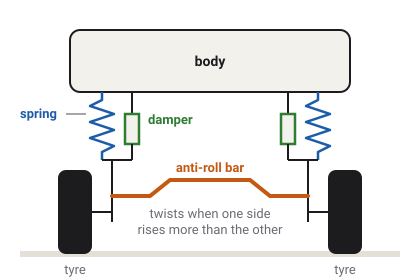
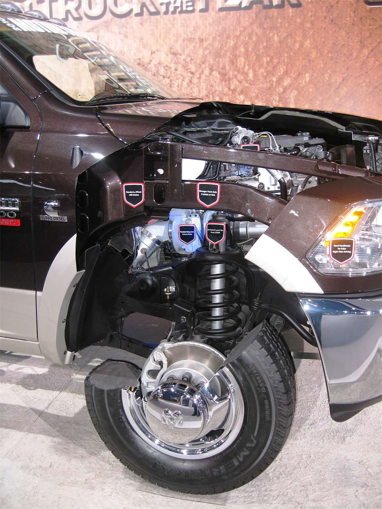
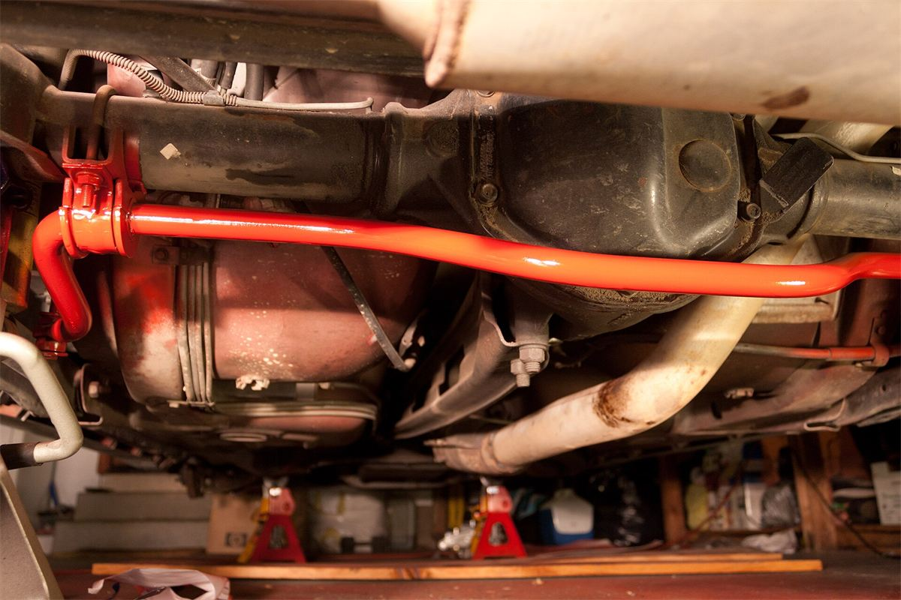

# Suspension

This page explains how the suspension holds the body up and keeps every tyre
pressed onto the road, so it can grip.

Which vehicles have this
Car
Truck
Tractor

## A spring and a damper at each corner

Why does a car need a suspension at all? A road is never perfectly smooth. If the wheels were
bolted straight to the body, every bump would throw the whole car upwards, the passengers would be
shaken, and a wheel that left the ground for a moment would have no grip at all. The suspension
lets the wheel move up and down over the bump while the body stays much steadier.

Each wheel hangs from the body on two parts that work side by side.

- **The spring** carries the weight. The further it is squeezed, the harder it pushes back, like
  the spring in a kitchen scale. Its push is its stiffness times how far it is squeezed. For
  example, a spring with a stiffness of 20,000 newtons per metre, squeezed by 5 cm (0.05 m),
  pushes with 1,000 newtons.
- **The [damper](glossary.md#damper)** stops the bouncing. A spring on its own would keep the
  body bobbing up and down after every bump, like a ball on an elastic band. A damper pushes
  against movement instead of position: the faster the wheel moves up or down, the harder it
  resists (inside, a piston forces oil through small holes, and the faster it moves, the harder
  the oil is to push through). When the wheel is still, it does nothing.

A common mistake is to think that the damper holds the car up. It does not: when the car stands
still, the springs alone carry its weight. The damper only slows the movement.

Together they decide how much each tyre is pressed onto the road. A wheel hanging in the air
carries nothing, so it cannot grip. This is also why a softer suspension often grips better on a
bumpy road: its wheel follows the bump and stays in contact, while a stiff one is thrown off the
ground. A stiff suspension suits a smooth track instead, where there are few bumps to throw a
wheel off. There, the body leans less in corners and dips less under braking, so the tyres stay
flat on the road with their whole tread touching it. The car also answers the steering and the
brakes at once, instead of waiting for the body to finish leaning. On a race car with wings, it
keeps the body at the height the wings were designed for.

How far a wheel can move up and down is its travel. A longer travel lets the wheel follow bigger
bumps and holes. At the top of its travel the wheel meets a rubber stop, and the rest of the bump
goes straight into the body.

<figure>

<figcaption>A cutaway front suspension, the damper inside the coil spring. Photo: Aaron &amp; Alli, CC BY 2.0, <a href="https://commons.wikimedia.org/wiki/File:Chicago_Auto_Show_2010_(70)_(4357056503).jpg">Wikimedia Commons</a>.</figcaption>
</figure>

### How stiff, and how soft

How stiff a suspension is can be described by how fast the body bounces on it, called the
[ride frequency](glossary.md#ride-frequency). A comfortable car bounces slowly, and a racing car
faster. A stiffer spring bounces faster and a heavier body bounces slower, so to give the same
ride frequency a heavier vehicle needs stiffer springs, which is why a truck's springs are many
times stiffer than a car's. For example, a body twice as heavy needs springs twice as stiff to
bounce at the same rate.

Dampers are usually firmer when the wheel moves down (rebound) than when it moves up (bump). On a
bump, a soft damper lets the wheel move up easily, which keeps the shock away from the body. On
rebound the squeezed spring is pushing out, and a firm damper keeps the wheel from springing back
too fast, which would throw the body upwards.

How a damper can be firmer one way than the other

Inside a damper, a piston moves through a tube full of oil. The oil can only get past the piston
through small holes, and forcing it through them is what resists the movement. Each hole is
covered on its far side by a stack of thin steel discs, which bend open when the oil pushes from
the near side and press shut when it pushes from the far side. So some holes let oil through only
on bump, and others only on rebound. The rebound holes are narrower and their discs stiffer, so
the same speed meets more resistance on the way down.

Many road-car dampers have a second valve at the bottom of the tube that does most of the bump
work, but the idea is the same: one path for each direction.

## The anti-roll bar

<figure>

<figcaption>An anti-roll bar (red) across a car's rear axle. Photo: Nick Ares, CC BY-SA 2.0, <a href="https://commons.wikimedia.org/wiki/File:88_IROC_Painted_Rear_Sway_Bar.jpg">Wikimedia Commons</a>.</figcaption>
</figure>

In a corner, the body leans outwards: it [rolls](glossary.md#roll). Softer springs give a
gentler ride but more roll. An [anti-roll bar](glossary.md#anti-roll-bar) reduces roll without
stiffening the ride. It is a steel bar across the car, joining the two wheels of one axle. Its
middle is held to the body by two rubber mounts that let it rotate, and each end bends into an
arm, joined by a short link to one wheel's suspension, so that the arm's end moves up and down with
the wheel. When both wheels rise together (for example, over a speed bump), the bar just rotates in
its mounts and does nothing. When one wheel rises more than the other, as the body leans, the bar
twists, and its twist pushes the low side up and the high side down.

The bar is a spring that is twisted instead of squeezed (a torsion spring), made of the same kind
of spring steel as the coil springs, solid or hollow. Unlike them, it ignores how far the wheels
move and feels only the difference between the two sides.

The wheels move up and down relative to the body. The red arrows grow with the difference between
the two wheels, as the simulator's bar force does; the sizes of the parts are only a drawing. The
small marks along the bar turn twice as far as the real bar would, so that the twist shows.
<!-- widgets/anti-roll-bar.js: VehicleMath.anti_roll_force, rate x (left - right compression) -->

The bar has a price: because it links the two sides, a bump under one wheel also pushes on the
other, so a very stiff bar makes the ride on a rough road less comfortable.

The bars also affect the balance of the car. The axle with the stiffer bar moves more weight from
its inside tyre to its outside tyre in a corner, and because of
[load sensitivity](glossary.md#load-sensitivity) (the tyre that gains load gains less grip than
the other one loses), that axle tends to lose grip first. A stiff front bar makes a car run wide at
the front rather than swing out at the back, which is easier to control (see
[Understeer and oversteer](understeer.md)).

## Links that resist dive and squat

When a car brakes, its nose dips (it dives). When it accelerates, its tail drops (it squats). Both
come from weight moving between the axles (see [Weight transfer and rollover](weight-transfer.md)).

Each wheel is held to the body by links: solid bars, not springs. When the car brakes, the road
drags the front wheels backwards, and the links pass that drag on to the body. A flat link just
pushes the body backwards. A link that slopes up from the wheel to the body pushes along its slope:
backwards, and a little upwards. That upward push helps hold the nose up, so the springs have less
to carry and the nose dips less. This is [anti-dive](glossary.md#anti-dive); the steeper the link,
the stronger it is. At the rear, sloping links do the same when the car accelerates, and hold the
tail up: [anti-squat](glossary.md#anti-squat).

The share is the simulator's: a link angle holds off the dive or squat in proportion to its slope,
all of it at the slope of the `sedan`'s centre-of-mass height over its wheelbase (about 17°). The
widget starts at the sedan's own links: 40 % of the dive and 50 % of the squat. The blue and orange
arrows split the axle's extra load in that share. The link is drawn steeper than it is, and the
body's pitch and the sizes of the parts are only a drawing.
<!-- widgets/anti-dive.js: sedan_spec.tres anti_dive_slope 0.121, anti_squat_slope 0.152; GroundDriveSpec: h / wheelbase = 100 % -->

The links only change how far the body pitches. The weight still moves between the axles just as
much, so they do not add any grip.

## The tractor: tyres as springs, and a swinging axle

Many farm tractors have no springs on their axles. Their big soft tyres are their suspension.
A tractor works slowly on soft ground, so the bumps are gentle, and tall, low-pressure tyres can
give enough to take them.

Tractors do have a [swinging front axle](glossary.md#swinging-front-axle). The whole front axle is
one beam, fixed to the tractor at a single pivot in the middle. When one front wheel climbs a
bump, the beam tilts and the other wheel drops, so both keep touching the ground and share the
load evenly. The bump does not tilt the body until the beam reaches its stop. This is why a tractor can
cross a rutted field with all four wheels down. (A stiff axle fixed at both ends would be like a
four-legged table on uneven ground: it rocks on three legs while the fourth hangs in the air.)

The stop at 10° each way is the simulator's tractor's. The axle's width and the sizes of the parts
are only a drawing; the body is shown held level by the rear axle, and the tyres do not squash.
<!-- widgets/swing-axle.js: TRACTOR_BASE front_axle_swing_deg 10.0 (tools/gen_kenney_vehicles.gd) -->

<!-- photo: a tractor's front axle with its central pivot, seen from the front -->

## What Carlito simulates

The parameters the simulator uses for this, and where each is set, are listed in
[How the simulation works](simulation.md#suspension):

- **Per vehicle**:
  - [Travel](simulation.md#travel) (`rest_length`)
  - [Springs](simulation.md#springs) (`spring_rate`, `spring_rate_rear`)
  - [Dampers](simulation.md#dampers) (`damper_bump`, `damper_rebound`, and their `_rear` versions)
  - [Anti-roll bars](simulation.md#anti-roll-bars) (`anti_roll_rate`, `anti_roll_rate_rear`)
  - [Anti-dive and anti-squat](simulation.md#anti-dive-and-anti-squat) (`anti_dive_slope`,
    `anti_squat_slope`)
  - [Swinging front axle](simulation.md#swinging-front-axle) (`front_axle_swing_deg`)
  - [Push ceiling](simulation.md#push-ceiling) (`max_suspension_force`), a simulation limitation

Simplification list

- **No separate unsprung mass.** A real wheel, brake and axle have their own weight, which
  bounces on the tyre. In the simulation the wheel has a spinning mass but no up-and-down mass of
  its own: only the body moves on the springs.
- **No tyre spring on road vehicles.** A car's tyre is treated as rigid up and down; only its
  suspension spring gives.
- **A tractor's tyres are springs and dampers.** Each corner has a stiff spring and damper that
  stand for the tyre. The front axle swings up to 10° each way.
  <!-- TRACTOR_BASE spring_rate 330000, spring_rate_rear 420000; front_axle_swing_deg 10.0; RayWheel.swing_step -->
- **Simple link geometry.** Anti-dive and anti-squat are fixed shares. The cars and vans have
  both, the rigid trucks only anti-squat, and the semis neither.
  <!-- CAR_BASE and VAN_BASE anti_dive 0.4, anti_squat 0.5; TRUCK_BASE anti_dive 0, anti_squat 0.5; semi_spec.tres declares neither -->
- **A push ceiling.** Each corner's push is capped, so a wheel that lands deep inside the
  ground after a big jump cannot fire the vehicle into the sky.
- **No adjustable suspension, air suspension or ride height.**
- **No suspension wear or breakage.**

## What you see in sloppyCAN

| Signal | Direction | Unit | What it shows |
| --- | --- | --- | --- |
| `axle_load` | out | kg | The weight on the rear axle, read off its springs. It rises as a load is added and swings as the vehicle brakes, accelerates or crosses bumps (Truck and tractor). |
| `trailer_axle_load` | out | kg | The same for the trailer's axles (Truck). |
<!-- contract/carlito_contract.json: axle_load (tractor, truck; "the summed RayWheel suspension force on the rear axle"), trailer_axle_load (truck) -->

The car, the truck and the tractor do not send the body's pitch or roll.
<!-- contract pitch and roll: not car, truck or tractor -->

## Scenarios

- [Pulling away](forces.md#example-pulling-away): the weight that the rear springs take on when the car squats.
- [Emergency stop](forces.md#example-emergency-stop): the weight that the front springs take on when the car dives.
- [Turning](forces.md#example-turning): the weight that the outer springs take on when the body rolls.

## Related

- [Weight transfer and rollover](weight-transfer.md): what the suspension does in a turn.
- [Slip and the grip curve](slip.md): why the load on each tyre matters.
- [Glossary](glossary.md): every term on this page.
