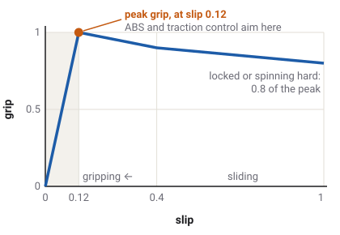

[AI-GENERATED CONTENT AWAITING HUMAN REVIEW]

# The page template

<p class="lead">This page describes the pattern every idea page follows, so a reader always knows
where to look, and the markup for each part.</p>

The two worked examples are [Slip and the grip curve](slip.md) and [Steering and Ackermann](steering.md).

## The parts, in order

1. **Title**: the idea in a few plain words, as a level-1 heading.
2. **Lead**: one sentence, starting "This page ...", saying which ideas the page covers, in a
   `<p class="lead">` paragraph. It is an abstract for a teacher looking for the page a student
   needs, not the opener. Every page has one. It fits on two lines at full width (about 125
   characters; three lines at most). The opener (a hook, a question, a "why it matters") is free
   and goes in plain paragraphs after the badges.
3. **Which vehicles have this**: one badge per family, all three, always in the same order: Car,
   Truck, Tractor. Each badge's hover text says which members and how.
4. **The explanation**, in `##` sections, one idea per section, about the real mechanics only
   (not how the simulator computes them). Where it fits (never forced), a section can go from what
   the driver notices, to why it happens, to what engineers do about it. A figure sits at the
   start or the end of its section, whichever is nearer the text it shows, not between two of
   its paragraphs. Its caption is one short sentence naming what it shows (the text does the
   explaining), plus the credit for a photo. An interactive widget, where there is one, sits right
   after the section it illustrates.
5. **What Carlito simulates**: one sentence linking to the page's own section of
   [How the simulation works](simulation.md), then the parameters behind the idea, grouped by
   where they are set (simulation-wide, per vehicle, per tyre class, per surface, per level): each
   one a link to its entry there, with its setting names. Their explanations and values are given
   only there. Then the **simplification list**, hidden by
   default: the simulation specifics a reader needs to understand its limits. A new page adds its
   section to How the simulation works.
6. **What you see in sloppyCAN**: a table of the signals that show the idea.
7. **Scenarios**: links to the examples of [Forces on a vehicle](forces.md) that show the idea.
   Left out when the diagram cannot show it.
8. **Related**: links to the glossary and to the pages next to this one.

## Skeleton

Copy this into a new file and fill it in. HTML blocks need the blank lines shown, so the Markdown
inside them is still read as Markdown.

```markdown
# The idea in a few plain words

<p class="lead">This page explains ..., in one sentence of two lines at most.</p>

<div class="badges"><span class="label">Which vehicles have this</span>
<span class="badge yes" title="Which ones, and how">Car</span>
<span class="badge yes" title="...">Truck</span>
<span class="badge some" title="Only some of them, or only partly: say which">Tractor</span>
</div>

## The first idea

Plain sentences. A term the first time: [slip ratio](glossary.md#slip-ratio).
A figure, rounded, given as an example, with where it comes from:
for example, about 1 along the wheel.
<!-- sedan_spec.tres mu_long 1.05 -->



<div class="widget" data-widget="slip-grip"></div>

## What Carlito simulates

The parameters the simulator uses for this, and where each is set, are listed in
[How the simulation works](simulation.md#slip-and-the-grip-curve):

- **Simulation-wide**:
  - [Low-speed floor](simulation.md#low-speed-floor) (`LOW_SPEED_FLOOR`)
- **Per vehicle**:
  - [Grip curve](simulation.md#grip-curve) (`grip_curve`)

<details><summary>Simplification list</summary>

- **The short name.** What the simulation does instead, briefly.

</details>

## What you see in sloppyCAN

| Signal | Direction | Unit | What it shows |
| --- | --- | --- | --- |
| `slip` | out | ratio, two values | ... (Car and truck). |

## Scenarios

- [Emergency stop](forces.md#example-emergency-stop): what it shows about this idea.

## Related

- [Glossary](glossary.md): every term on this page.
```

## Writing

- **Correct and educative.** Write for a curious 12-year-old: the page teaches, it is not a list
  of correct statements. Show the reasoning, not only the result. Rhetorical questions are
  welcome ("Why does a locked wheel stop steering?"); "Think about it" and the like only where the
  context earns it.
- **Correct the usual misconceptions.** Where readers commonly get an idea wrong, say so and say
  why (for example, "mu is not a property of the tyre alone: it belongs to the tyre and the
  ground together", or "ABS does not add grip").
- **Easy worked math.** Where a formula helps, give it with one small worked example in round
  numbers, marked as an example (for example, "a tyre pressed down with 2,500 N, with a mu of 1,
  can push with about 2,500 N; on ice, with a mu of 0.1, only about 250 N").
- **Plain language.** Short sentences, one idea at a time. Every technical word is explained the
  first time it appears and linked to the glossary. A comparison from everyday life (a bicycle, a
  shopping trolley, a kitchen scale) when it helps, never as decoration.
- **No talking down.** No "imagine your favourite toy", no exclamation marks, no "fun fact", no
  emoji. Aim for a good museum panel or encyclopedia entry.
- **Newcomer first.** The reader is learning, not auditing the model. The main text carries what
  a newcomer needs to understand the idea; the limits of the simulation go to "What Carlito
  simulates" (or a widget's limits box), never in the way of the explanation. Name what the
  simulation simplifies there, briefly.
- **Mechanics, not simulation.** A teaching page (tyres, brakes, etc.) is about real vehicles. How
  the simulator computes something, its settings and its vehicle ids go to the pages of "Inside
  the project", for example [How the simulation works](simulation.md).
- **Simulator, not game.** Carlito is a "simulator", and what it computes is the "simulation".
- **No shortcuts.** No keyboard or gamepad shortcuts, for now.
- **Human wording.** Say it plainly, in full sentences, without slogans. Put asides in parentheses
  ("(for example, ...)", "(Truck and tractor)") rather than in fragments after a colon or a full
  stop.
- **Cut what does not teach.** No section that explains how to use a widget (a widget explains
  itself), no navigation lines ("New here? ...": the sidebar and the pager do that), no sentence
  that restates a table or a heading, no fluff ("All three."). A sentence that heads off a
  misconception, or a worked example, teaches: keep it.
- **Present tense, what is true now.** Never what the code should do, never its history. Future
  work goes to [Open questions and ideas](open_questions.md).

## Accuracy

- **Describe the code.** Read the code that implements the idea, not only the developer docs.
  `inventory.md` lists where each system lives.
- **Few number facts, rounded, sourced.** This is about facts that go stale (a vehicle's mass, a
  tyre's mu), not worked examples in round illustrative numbers, which are welcome. Use a number
  fact only where it helps a reader picture the idea.
  A simulator figure is its own setting or code value, never a real vehicle's brochure. In a
  teaching page it is given as an example, never as a fact about every real vehicle. Every
  simulator figure gets an HTML comment right after it naming the spec or code value it comes
  from, for example `<!-- semi_spec.tres mass -->`. The comment is invisible on the page.
- **Disputed science says so.** Where researchers disagree, or recent research overturns a
  common explanation, the page gives both ("X is often said, although recent research finds
  Y"), with a comment naming the source opened for each side.
- **Disagreements go to the open questions.** If the code and a doc or the contract disagree, or
  the code looks wrong, do not guess and do not explain the disputed part: add an entry to
  [the open questions](open_questions.md) (what the code says, what the doc says, what the guide
  says meanwhile) and write around it.

## Markup

### Badges

`badge yes` (has it), `badge some` (some members, or only partly) and `badge no`. The `title`
attribute is the hover text: say which members have it, or why not. Families are always listed
in the order Car, Truck, Tractor; the guide covers these three (the boat, plane, drone and train
pages wait in `docs/guide-drafts/`).

### Figures

- A figure is a Markdown image on its own line. The alt text describes the drawing for a reader
  who cannot see it; the title (in quotes) becomes the caption.
- Drawings are SVG files in `img/`, drawn by hand or computed from the simulator's numbers, with a
  comment inside naming those numbers. Photos and screenshots are JPEG or PNG; the screenshots in
  the repository's `docs/img/` may be copied into `img/` where one helps.
- A real photo is welcome where it shows something a drawing cannot (a tractor tyre's lugs, a
  winter tyre's sipes). It must be freely licensed, with its author, licence and source page in
  the caption. The guide prints an image title as plain text, so a credited photo is a
  `<figure>` block with an `` and a `<figcaption>` holding the credit's link
  (`Photo: Author, CC BY-SA 4.0, <a href="...">Wikimedia Commons</a>.`). Until one is found,
  leave an invisible note where it goes:
  `<!-- photo: a tractor tyre's lugs -->`. A drawing still to make gets
  `<!-- figure: what it shows -->`.
- The guide inlines SVG figures into the page so they follow the light or dark theme. That means
  every SVG's `<style>` applies to the whole page, so:
  - give every class in a file its own short prefix (`gc-` for the grip curve, `ak-` for
    Ackermann), and every marker or gradient id too;
  - colour with the page tokens and a fallback: `fill: var(--fig-ink, #1c1c1f)`, and repeat the
    rules under `@media (prefers-color-scheme: dark)` with the dark fallbacks, so the file still
    reads when opened on its own. The tokens are `--fig-ink`, `--fig-muted`, `--fig-grid`,
    `--fig-fill`, `--fig-blue`, `--fig-orange`, `--fig-green` and `--fig-red`.
- Draw on a viewBox about 420 units wide with 13 to 14 unit text, so labels stay readable at
  phone width.

### Widgets

- A widget is one file, `widgets/<name>.js`, embedded with
  `<div class="widget" data-widget="<name>"></div>`. The file registers one function,
  `window.GuideWidgets[name] = function (element) { ... }`; the guide loads the file once and
  calls that function with each matching element.
- Plain JavaScript and SVG, no libraries and no network. The file's header comment names every
  simulator value it uses.
- No title line above a widget: the text around the widget already says what it shows. Keep
  a widget to what it teaches.
- Use the shared classes: `w-controls` for a grid of label, control and `output`, `w-readout` for
  the live result. No small print under a widget. Colour with the `--fig-*` tokens.
- A choice of vehicle, body or hull is a row of small icons, never a drop-down:
  `GuideKit.vehiclePicker` in `widget-kit.js`. A missing icon is added to its `ICONS`.
- Examples (ready-made settings) list only those of the vehicle on show, so choosing one never
  changes the vehicle behind the reader's back.
- An explanation of an example sits behind a `?` button (`GuideKit.helpButton`): a pop-up that
  a click elsewhere or Esc closes, not text printed in the widget.
- More detail on a part of a drawing opens on a click (or Enter), never on hover alone.
- What a widget simplifies goes in a `<div class="widget-limits" hidden>` (blank lines inside, so
  its Markdown still reads) right after the widget; the guide shows it behind a warning button at
  the widget's bottom right, not as text on the page.
- A widget's explanations are for a newcomer: the name, one short plain sentence, and a link to
  the page that says more. No figures, model details or caveats there; the page carries those.
  The additions: a vehicle part's or control's explanation names its sloppyCAN signals, links its
  English Wikipedia article, shows a freely licensed photo credited to its Commons page
  (`GuideKit.card`). Where the simulator differs from the real control goes to the widget's
  limits.
- Label every control, and give the readout `aria-live="polite"`.

### Signals table

Four columns: Signal, Direction (in or out, as sloppyCAN sees it from the simulator), Unit, and What
it shows. Take each name, direction and unit from `contract/carlito_contract.json`; write the
unit as the contract does or as its everyday symbol (`m/s^2` as m/s²). Say which families publish
it when not all do. A vehicle page lists only its family's own signals, then links
[All sloppyCAN signals](signals.md), which `tools/gen_guide_signals.mjs` generates.

### Boxes

`<div class="box note">` for a side note that must not be missed.
`<details><summary>Car list</summary>` (blank line, the content, blank line,
`</details>`) for a table a reader opens only when wanted, and for "learn more" knowledge that
is nice to have but not needed to follow the page (for example, how racing teams deal with wet
tracks). Its summary says what is inside.

### Links

- To another page: `[Steering and Ackermann](steering.md)`. To a term:
  `[slip ratio](glossary.md#slip-ratio)`. The guide turns these into its own page addresses. A
  glossary link shows with a dotted underline, and its entry pops up on hover.
- To a Forces on a vehicle example, opened with it chosen:
  `([see the forces](forces.md#example-emergency-stop))`, beside the sentence it illustrates. The ids are the `id`s of `PRESETS` in `widgets/forces.js`;
  a page that needs a case none of them draws adds a preset there, its values checked with
  `compute`.
- A heading's address is its text in lower case, punctuation removed and spaces turned into
  hyphens: "Slip ratio: along the wheel" is `#slip-ratio-along-the-wheel`. A list item that
  opens with a bold name gets an address from that name the same way (`#steering-lock`), unless
  something earlier on the page already has it.
- Link only to pages that exist. `node tools/check_docs.mjs` fails on a link to a missing file,
  so mention a planned page by name, without a link, until it is written.

## Adding a page

1. Write the `.md` file in `docs/guide/` from the skeleton above.
2. Append one entry to `pages.json`: `{ "file": "...", "title": "...", "group": "..." }`. A new
   group also goes into `groups`, in sidebar order.
3. Point the page's row in `inventory.md` at the new file, and add any new terms to
   `glossary.md`.
4. Run `node tools/check_docs.mjs`; it must pass.
5. Serve the guide (`npx serve docs/guide`) and look at the page at desktop and phone width, in
   light and dark.
