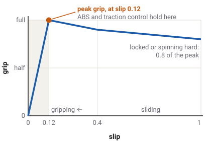

# The page template

<p class="lead">Every idea page in this guide follows the same pattern, so a reader always knows
where to look. This page describes the pattern and the markup for each part. The two worked
examples are <a href="tyres.md">Tyres and slip</a> and <a href="steering.md">Steering and
Ackermann</a>.</p>

## The parts, in order

1. **Title**: the idea in a few plain words, as a level-1 heading.
2. **Lead**: one or two sentences saying what the idea is and why it matters, in a
   `<p class="lead">` paragraph.
3. **Which vehicles have this**: one badge per family, all seven, always in the same order: Car,
   Truck, Tractor, Plane, Boat, Drone, Train. Each badge's hover text says which members and how.
4. **The explanation**, in `##` sections, one idea per section, the real-world idea first and
   then how the game does it. Drawn figures sit next to the paragraph they explain. An interactive
   widget, where there is one, sits right after the section it illustrates.
5. **What the game leaves out**, when a reader could reasonably expect something that is not
   there.
6. **What you see in sloppyCAN**: a table of the signals that show the idea.
7. **Try it in the game**: one boxed experiment, numbered steps, ending with what to look for.
8. **Related**: links to the glossary and to the pages next to this one.

## Skeleton

Copy this into a new file and fill it in. HTML blocks need the blank lines shown, so the Markdown
inside them is still read as Markdown.

```markdown
# The idea in a few plain words

<p class="lead">One or two sentences: what this is and why it matters.</p>

<div class="badges"><span class="label">Which vehicles have this</span>
<span class="badge yes" title="Which ones, and how">Car</span>
<span class="badge yes" title="...">Truck</span>
<span class="badge yes" title="...">Tractor</span>
<span class="badge some" title="Only some of them, or only partly: say which">Plane</span>
<span class="badge no" title="Why not">Boat</span>
<span class="badge no" title="...">Drone</span>
<span class="badge no" title="...">Train</span>
</div>

## The first idea

Plain sentences. A term the first time: [slip ratio](glossary.md#slip-ratio).
A game figure, rounded, with where it comes from:
about 1 along the wheel.
<!-- sedan_spec.tres mu_long 1.05 -->



<div class="widget" data-widget="slip-grip"></div>

## What you see in sloppyCAN

| Signal | Direction | Unit | What it shows |
| --- | --- | --- | --- |
| `slip` | out | ratio, two values | ... |

## Try it in the game

<div class="box try">
<p class="box-title">Try it in the game: a short name for the experiment</p>

1. Where to go and which vehicle.
2. What to switch on (F3, a SANDBOX switch or WORLD preset).
3. What to do.
4. What to look for, and what it shows.

</div>

## Related

- [Glossary](glossary.md): every term on this page.
```

## Writing

- **Plain language.** Short sentences, one idea at a time. Every technical word is explained the
  first time it appears and linked to the glossary. A comparison from everyday life (a bicycle, a
  shopping trolley, a kitchen scale) when it helps, never as decoration.
- **No talking down.** No "imagine your favourite toy", no exclamation marks, no "fun fact", no
  emoji. Aim for a good museum panel or encyclopedia entry.
- **Exhaustive.** Every part of the idea that the game models gets explained, including the
  awkward parts. Name what the game simplifies or leaves out.
- **Present tense, what the code does.** Never what it should do, never its history.

## Accuracy

- **Describe the code.** Read the code that implements the idea, not only the developer docs.
  `inventory.md` lists where each system lives.
- **Few numbers, rounded, sourced.** Use a number only where it helps a reader picture the idea.
  Every game figure gets an HTML comment right after it naming the spec or code value it comes
  from, for example `<!-- semi_spec.tres mass -->`. The comment is invisible on the page.
- **Disagreements go to the open questions.** If the code and a doc or the contract disagree, or
  the code looks wrong, do not guess and do not explain the disputed part: add an entry to
  [the open questions](open_questions.md) (what the code says, what the doc says, what the guide
  says meanwhile) and write around it.

## Markup

### Badges

`badge yes` (has it), `badge some` (some members, or only partly) and `badge no`. The `title`
attribute is the hover text: say which members have it, or why not. Families are always listed
in the order Car, Truck, Tractor, Plane, Boat, Drone, Train.

### Figures

- A figure is a Markdown image on its own line. The alt text describes the drawing for a reader
  who cannot see it; the title (in quotes) becomes the caption.
- Drawings are SVG files in `img/`, drawn by hand or computed from the game's numbers, with a
  comment inside naming those numbers. Photos and screenshots are JPEG or PNG; the screenshots in
  the repository's `docs/img/` may be copied into `img/` where one helps.
- The guide inlines SVG figures into the page so they follow the light or dark theme. That means
  every SVG's `<style>` applies to the whole page, so:
  - give every class in a file its own short prefix (`gc-` for the grip curve, `ak-` for
    Ackermann), and every marker or gradient id too;
  - colour with the page tokens and a fallback: `fill: var(--fig-ink, #1c1c1f)`, and repeat the
    rules under `@media (prefers-color-scheme: dark)` with the dark fallbacks, so the file still
    reads when opened on its own. The tokens are `--fig-ink`, `--fig-muted`, `--fig-grid`,
    `--fig-fill`, `--fig-blue`, `--fig-orange`, `--fig-green` and `--fig-red`.
- Draw on a viewBox about 420 units wide with 13 to 14 unit text, so labels stay readable at
  phone width.

### Widgets

- A widget is one file, `widgets/<name>.js`, embedded with
  `<div class="widget" data-widget="<name>"></div>`. The file registers one function,
  `window.GuideWidgets[name] = function (element) { ... }`; the guide loads the file once and
  calls that function with each matching element.
- Plain JavaScript and SVG, no libraries and no network. The file's header comment names every
  game value it uses.
- Use the shared classes: `w-title` for the heading line, `w-controls` for a grid of label,
  control and `output`, `w-readout` for the live result, `w-note` for the small print. Colour with
  the `--fig-*` tokens.
- Label every control, and give the readout `aria-live="polite"`.

### Signals table

Four columns: Signal, Direction (in or out, as sloppyCAN sees it from the game), Unit, and What
it shows. Take each name, direction and unit from `contract/carlito_contract.json`; write the
unit as the contract does or as its everyday symbol (`m/s^2` as m/s²). Say which families publish
it when not all do.

### Boxes

`<div class="box try">` for the experiment, with a `box-title` paragraph first.
`<div class="box note">` for a side note that must not be missed.

### Links

- To another page: `[Steering and Ackermann](steering.md)`. To a term:
  `[slip ratio](glossary.md#slip-ratio)`. The guide turns these into its own page addresses.
- A heading's address is its text in lower case, punctuation removed and spaces turned into
  hyphens: "Slip ratio: along the wheel" is `#slip-ratio-along-the-wheel`.
- Link only to pages that exist. `node tools/check_docs.mjs` fails on a link to a missing file,
  so mention a planned page by name, without a link, until it is written.

## Adding a page

1. Write the `.md` file in `docs/guide/` from the skeleton above.
2. Append one entry to `pages.json`: `{ "file": "...", "title": "...", "group": "..." }`. A new
   group also goes into `groups`, in sidebar order.
3. Point the page's row in `inventory.md` at the new file, and add any new terms to
   `glossary.md`.
4. Run `node tools/check_docs.mjs`; it must pass.
5. Serve the guide (`npx serve docs/guide`) and look at the page at desktop and phone width, in
   light and dark.
