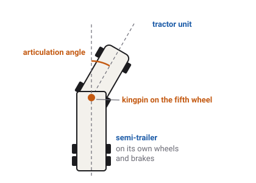
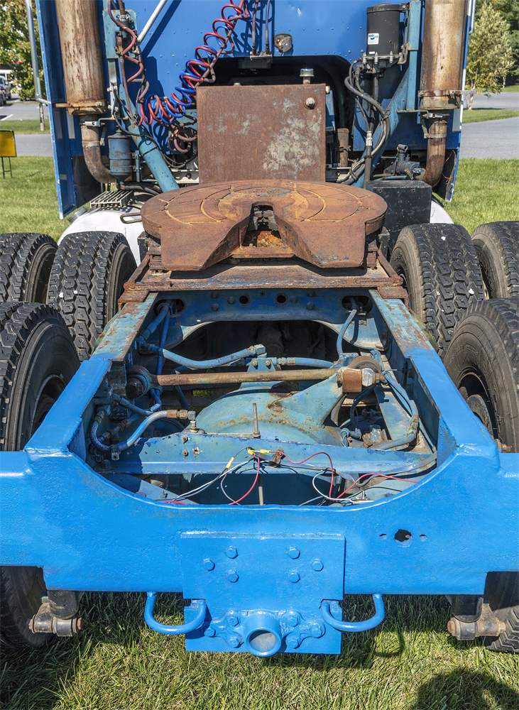
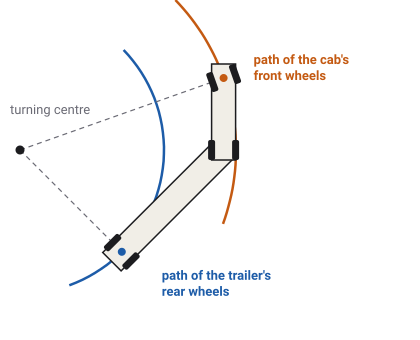

[AI-GENERATED CONTENT AWAITING HUMAN REVIEW]

# Towing

This page explains how a trailer and the vehicle pulling it move as two bodies
joined by one pivot, and how it brakes.

Which vehicles have this
Car
Truck
Tractor

## Two bodies and a joint

<figure>

<figcaption>A fifth wheel plate on a tractor unit. Photo: Acroterion, CC BY-SA 4.0, <a href="https://commons.wikimedia.org/wiki/File:Fifth_wheel_IHC_truck_MD1.jpg">Wikimedia Commons</a>.</figcaption>
</figure>

<!-- photo: a farm trailer's drawbar eye over the tractor's pin -->

Why does a truck with a long trailer drive so differently from the same truck alone? Because it is
no longer one vehicle. A trailer does not move as one block with the vehicle pulling it. It has its
own weight, its own [suspension](suspension.md), its own tyres and its own brakes. The two bodies
meet at one point: a joint that lets the trailer swing from side to side, tip up and down over a
crest, and lean a little. Whatever the truck does, the trailer answers a moment later and in its
own way.

Two common kinds of joint are:

- **The [fifth wheel](glossary.md#fifth-wheel)**, on semi trucks. A heavy greased plate on the back
  of the truck takes a steel pin (the [kingpin](glossary.md#kingpin)) under the front of the
  trailer. The front of the trailer rests on the plate, so the truck carries a large part of the
  trailer's weight. The trailer can swing far to each side, but can barely lean compared to the
  truck.
- **The [drawbar](glossary.md#drawbar)**, on tractors. A bar on the trailer ends in an eye that
  drops over a pin low on the tractor's back. It carries much less of the trailer's weight, and it
  lets the trailer tip and lean more, which suits rough farm tracks.

The weight on the fifth wheel is useful rather than only a burden. It presses on the truck's
driven rear wheels, and a driven wheel that is pressed harder can push harder before it slips (see
[Slip and the grip curve](slip.md#a-tyre-pressed-harder-grips-more-but-not-in-proportion)). This is why a truck
running with no trailer can have poor traction: its driven axle carries little.

The angle between the truck and the trailer is called the
[articulation](glossary.md#articulation) angle. In a turn, the trailer cuts inside the path of the
truck, for the same reason that a car's rear wheels cut inside the path of its front wheels (see
[Steering and Ackermann](steering.md#one-angle-the-bicycle-model)). A trailer is like the rear
wheels of a very long car, so in a tight corner its wheels run well inside the path of the cab,
and a driver must swing wide so that the trailer does not climb the kerb.

## The trailers

Common semi-trailers include boxes, tippers, tankers and flatbeds. A loaded trailer can weigh
several times as much as the truck pulling it. A semi with no trailer is called a
[bobtail](glossary.md#bobtail).

### Moving loads

Some loads move while driving, which moves the centre of mass:

- **Tankers.** The liquid keeps moving forward when the rig brakes, as water in a bucket keeps
  going when the bucket stops. It surges forward when the rig brakes and back when it accelerates,
  a little behind the change. A big mass sloshing about shoves the whole rig, so the driver has to
  brake and corner gently.
- **Tippers.** When the body tips up, the load rises and moves back. This puts a heavy mass high
  above the ground, which makes the rig top-heavy (see
  [Weight transfer and rollover](weight-transfer.md#wheel-lift-and-rollover)), so a tipper should
  only be raised when stopped, and only driven very slowly while raised.

Why tankers have walls inside

A tank that is part full surges badly, because the liquid has room to build up speed. So many
tankers are split into several smaller compartments, or have plates with holes (baffles) inside,
which break up the sloshing. A tank that is completely full does not surge, because the liquid has
nowhere to go.

## Coupling and uncoupling

To couple a semi-trailer, the truck reverses until the kingpin locks into the fifth wheel. The
driver then connects the air lines and the electrical cables, and raises the trailer's landing
legs (the trailer's own props, which hold its front up while it is not on a truck). A drawbar
trailer is coupled by dropping its eye over the pin. Both are done with the vehicle stopped.

## Trailer brakes

A trailer must brake itself. Why? When a rig brakes, everything in it wants to carry on forward. A
trailer that weighs twice as much as the truck has twice as much to stop. If only the truck
braked, the trailer would shove it forward from behind through the joint, and on a slippery road
it could fold the rig in two.

- The truck sends the trailer a brake demand when the driver brakes (or when its roll stability
  control does). The trailer's brakes are matched to the truck's, so that neither end pushes the
  other.
- Air brakes take a moment to react (a fraction of a second), because the air has to travel along
  the hose to the trailer and fill the brake chambers.
- Semi-trailers can have their own ABS and roll control
  (see [ABS, traction and stability control](driver-aids.md#roll-stability-on-trucks)).
- When the truck's parking brake goes on, or its air runs low, the trailer's spring brakes apply
  too.

The truck's retarder is an exception: it brakes only the truck, and asks nothing of the trailer
(see [Brakes](brakes.md#the-retarder)). When it is used with a heavy trailer, the trailer pushes on
the truck, and on a slippery road that push can be enough to start a jackknife.

### Jackknife

A [jackknife](glossary.md#jackknife) is a rig folding up, like a pocket knife. The truck's rear
wheels lose grip (often while braking on ice or snow), and a truck whose rear wheels have lost
their sideways grip starts to swing round. The trailer keeps moving straight on with all its
weight and pushes the back of the truck sideways, which swings the truck further, and so on, until
the truck meets the trailer. Once it has begun, it is very hard to stop, so the aim is to keep it
from beginning: gentle braking, and trailer brakes that do their share.

A related slide is the trailer swinging out on its own. It happens when the trailer's wheels lock
and lose their sideways grip, so that the trailer slews round behind the truck.

<!-- photo: a jackknifed truck and trailer seen from above (a road-safety training photograph) -->

## The trailer link

European trucks talk to their trailers over a data link on the trailer's electrical connector
(ISO 11992). The trailer reports its axle load, ABS, roll control, etc. back to the truck. This
lets the truck know what it is pulling: a trailer's weight changes the braking a lot, and only the
trailer's own sensors know it.

In North America, the connector carries only power. The trailer can still report one thing, an ABS
warning lamp, which is sent along the power line.

## What Carlito simulates

The parameters the simulator uses for this, and where each is set, are listed in
[How the simulation works](simulation.md#towing):

- **Simulation-wide**:
  - [Fifth wheel](simulation.md#fifth-wheel) (`JACKKNIFE_MAX_DEG`)
  - [Drawbar](simulation.md#drawbar) (`SWING_MAX_DEG`, `PITCH_LIMIT_DEG`, `ROLL_LIMIT_DEG`)
  - [Trailer brakes](simulation.md#trailer-brakes) (`BRAKE_APPLY_S`, `BRAKE_RELEASE_S`)
  - [Raised body](simulation.md#raised-body) (`BODY_UP_CAP_KMH`)
- **Per vehicle**:
  - [Trailer link](simulation.md#trailer-link) (`trailer_bus_equipped`)
  - [Each trailer's own settings](simulation.md#each-trailers-own-settings)

Simplification list

- **No reversing aids**, no steered trailer axles.
- **No coupling by hand**: no landing legs, no air lines or cables to connect. A trailer is
  coupled the moment it is chosen, if the vehicle is stopped and has room behind it.
- **No trailers for the cars**, and no drawbar trailers on the trucks.
- **No real liquid** in the tanker: its surge is a moving centre of mass.
- **A speed limit for a raised body.** The truck is held to 5 km/h while a tipper's body is up, and
  the body only rises with the rig stopped and its parking brake on.
  <!-- TowHost.BODY_UP_CAP_KMH 5; TowedBody.body_raise_allowed -->
- **No cab to hit.** The fifth wheel's 75° stop stands for the trailer's front corner meeting the
  back of the cab; real articulated trucks fold to between 70° and 90° before they touch. The
  drawbar stops at 57°.
  <!-- Articulation.JACKKNIFE_MAX_DEG: "a labelled model of trailer-against-cab contact (real artics fold at 70-90)"; drawbar.gd SWING_MAX_DEG 57 -->
- **A trailer link on one truck.** The `semi` has the European link. The `semi-conventional` has
  none, so its trailer signals read zero.
  <!-- VehicleSpec.trailer_bus_equipped -->
- **Five trailers only**, each with a fixed load:

| Trailer | Towed by | Weight, about | What is special |
| --- | --- | --- | --- |
| Box | the semis | 24 t | A full load in a tall box: the most side area for a crosswind. |
| Tipper | the semis | 19 t | A body that tips up to empty, worked by the truck's PTO. |
| Tanker | the semis | 21 t | Its liquid surges forward and back as the rig brakes and accelerates. |
| Flatbed | the semis | 14 t | The lightest: an open deck. |
| Farm tipper | the tractors | 10 t | A tipping farm trailer on a drawbar, worked by the tractor's hydraulics. |
<!-- docs/truck.md Four trailers: box 24 000, tipper 19 000, tanker 21 000, flatbed 14 000 kg; docs/tractor.md: farm_tipper "a 10 t towed body" -->

## What you see in sloppyCAN

| Signal | Direction | Unit | What it shows |
| --- | --- | --- | --- |
| `trailer_connected` | out | flag | A trailer is coupled and has answered on the trailer link. False on the `semi-conventional`, which has no link, even with a trailer on (Truck). |
| `trailer_axle_load` | out | kg | The weight on the trailer's axles, from its own springs (Truck). |
| `trailer_brake_demand` | out | % | The brake demand sent to the trailer. Not the retarder (Truck). |
| `trailer_brake_applied` | out | % | How hard the trailer's brakes have actually applied. It trails the demand (Truck). |
| `trailer_abs` | out | flag | The trailer's ABS is holding a wheel (Truck). |
| `trailer_vdc` | out | flag | The trailer's roll control is braking it (Truck). |
| `trailer_ebs_fault` | in | flag | A trailer brake fault set by sloppyCAN, for the dashboard (Truck). |
| `trailer_abs_lamp` | in | flag | The American trailer ABS lamp, set by sloppyCAN (Truck). |
| `air_primary`, `air_secondary` | out | bar | The brake tanks, which a coupled trailer draws on too (Truck). |
<!-- contract/carlito_contract.json: trailer_connected, trailer_axle_load, trailer_brake_demand, trailer_brake_applied, trailer_abs, trailer_vdc, trailer_ebs_fault, trailer_abs_lamp, air_primary, air_secondary -->

The farm tipper on the tractor has no trailer link of its own.

## Related

- [Brakes](brakes.md): the air and spring brakes the trailer shares.
- [ABS, traction and stability control](driver-aids.md): the semis' and trailers' roll control.
- [Glossary](glossary.md): every term on this page.
