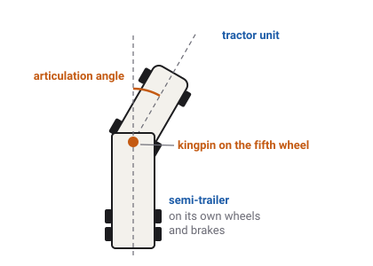

# Towing

A semi-trailer or a farm trailer is a second vehicle with its own wheels and
brakes, joined to the one in front by a single pivot. The game models both halves and the joint
between them, so a trailer pushes, sways and brakes as a real one does.

Which vehicles have this
Car
Truck
Tractor
Plane
Boat
Drone
Train

## Two bodies and a joint

The game does not glue a trailer to the back of the truck. The trailer is its own body, with its
own weight, its own [suspension](suspension.md), its own tyres and its own brakes. The two bodies
meet at one point, a joint that lets the trailer swing from side to side behind the truck, tip
up and down over a crest, and lean a little.

There are two kinds of joint in the game:

- **The [fifth wheel](glossary.md#fifth-wheel)**, on the semis. A heavy greased plate on the back
  of the truck takes a steel pin, the [kingpin](glossary.md#kingpin), under the front of the
  trailer. The trailer's front rests on the plate, so the truck carries a large part of the
  trailer's weight, about a quarter. The joint lets the trailer swing up to 75° each way, tip
  15° over a crest or a dip, and lean only a degree or two.
  <!-- fifth_wheel.gd PITCH_LIMIT_DEG 15, ROLL_LIMIT_DEG 1.5, YAW_LIMIT_DEG = Articulation.JACKKNIFE_MAX_DEG 75; docs/tractor.md: "12% against the fifth wheel's 27%" -->
- **The [drawbar](glossary.md#drawbar)**, on the tractor. A bar on the trailer ends in an eye
  that drops over a pin low on the tractor's back. It carries much less of the trailer's weight,
  about an eighth, and it lets the trailer swing about 57° each way, tip 20° and lean 25°, enough
  for rough farm tracks.
  <!-- drawbar.gd SWING_MAX_DEG 57, PITCH_LIMIT_DEG 20, ROLL_LIMIT_DEG 25; docs/tractor.md: "A drawbar carries a nose weight, not a share: 12%" -->

The angle between the truck and the trailer is the [articulation](glossary.md#articulation)
angle. The fifth wheel's 75° stop stands for the trailer's front corner meeting the back of the
cab: real articulated trucks fold to between 70° and 90° before they touch.
<!-- Articulation.JACKKNIFE_MAX_DEG: "a labelled model of trailer-against-cab contact (real artics fold at 70-90)" -->

## The trailers

| Trailer | Towed by | Weight, about | What is special |
| --- | --- | --- | --- |
| Box | the semis | 24 t | A full load in a tall box: the most side area for a crosswind. |
| Tipper | the semis | 19 t | A body that tips up to empty, worked by the truck's PTO. |
| Tanker | the semis | 21 t | Its liquid surges forward and back as the rig brakes and accelerates. |
| Flatbed | the semis | 14 t | The lightest. |
| Farm tipper | the tractors | 10 t | A tipping farm trailer on a drawbar, worked by the tractor's hydraulics. |
<!-- docs/truck.md Four trailers: box 24 000, tipper 19 000, tanker 21 000, flatbed 14 000 kg; docs/tractor.md: farm_tipper "a 10 t towed body" -->

A semi with no trailer is called a [bobtail](glossary.md#bobtail). Unladen, the semi weighs about 8 t, so a full box
trailer triples the rig's weight.
<!-- semi_spec.tres mass 8000; docs/truck.md: "Mass ratio: 8 t : 24 t shipped (3:1, the box)" -->

### Moving loads

Two of the trailers move their own centre of mass, and nothing else, to stand for a load that
shifts:

- **The tanker's surge.** The game moves the tank's centre of mass forward when the rig brakes and
  back when it accelerates, a little behind the change, as liquid sloshing against baffles would.
  It is a simple labelled model, not a simulation of the liquid.
- **The tipper's body.** As the body tips up, its load rises and moves back. A raised body makes
  the rig top-heavy, so the game limits the truck to 5 km/h while it is up, and refuses to raise it
  at all unless the rig is stopped with its parking brake on.
<!-- docs/truck.md: "Tanker's surge: a labelled model chasing longitudinal acceleration with a lag"; TowHost.BODY_UP_CAP_KMH 5; TowedBody.body_raise_allowed: parking brake and RAISE_SPEED_MS -->

The farm tipper tips the same way, worked by the tractor's hydraulic remote instead of a PTO, with
the same interlock. Without the handbrake, the game says SET THE HANDBRAKE FIRST.
<!-- drawbar.gd TIP_INTERLOCK_NOTICE; docs/tractor.md Tipping: "Tip runs off the SCV, not a PTO" -->

## Coupling and uncoupling

Press **E** to cycle what is on the back: on a semi, box, tipper, tanker, flatbed, then none; on
the tractor, its implements and the farm tipper. The game couples only while the vehicle is
stopped, and only if there is room behind it: otherwise it asks you to stop, or to pull forward.
<!-- docs/truck.md: E cycles box -> tipper -> tanker -> flatbed -> bobtail; fifth_wheel.gd HITCH_SPEED_NOTICE, NO_ROOM_NOTICE; "Coupling refuses on one thing, the rig moving" -->

## Trailer brakes

A trailer must brake itself. If only the truck braked, the heavy trailer would push it from
behind, and on a slippery road it could fold the rig in two. So in the game:

- The truck sends the trailer a brake demand whenever its foot brake is pressed, or when its roll
  stability control brakes. Each trailer's brakes are sized so that a given demand slows the
  trailer exactly as hard as the truck slows itself, so neither end pushes the other.
- The trailer's brakes take a moment to react, as air brakes do: about a third of a second to
  apply and half a second to release.
- Each semi-trailer has its own ABS on its own wheels, and its own roll control
  ([ABS, traction and stability control](driver-aids.md#roll-stability-on-the-semis)).
- When the truck's parking brake goes on, or its air runs low, the trailer's spring brakes apply
  too.
<!-- docs/vehicles.md Brake hardware: "Every trailer's service brake is apportioned to its tractor ... so neither end pushes the other"; TowedBody.BRAKE_APPLY_S 0.35, BRAKE_RELEASE_S 0.5; docs/truck.md: TowHost.tick_towing hands the trailer its parking brake -->

The truck's retarder is the exception. It brakes only the truck, and asks nothing of the trailer,
as the rules for real trucks require. Holding the retarder on with a heavy trailer behind means
the trailer pushes.
<!-- docs/truck.md: "The trailer is asked for nothing (TruckTelemetry.ebs11_demand): an endurance brake operates no trailer service brake" -->

### Jackknife

A [jackknife](glossary.md#jackknife) is a rig folding up: the truck's rear wheels lose grip under
braking, the trailer pushes the back of the truck sideways, and the truck swings round until it
meets the trailer. In the game, even a rig braked by the retarder alone, with the trailer
pushing, stays straight on snow. On ice a hard stop can fold it, on the retarder or the foot brake
alike, until the fifth wheel's stop is reached.
<!-- docs/truck.md: "The pushed rig holds straight on snow; ice jackknifes it on the foot brake alike" -->

## The trailer link

Real European trucks talk to their trailers over a data link on the trailer's electrical
connector, ISO 11992. The trailer reports its axle load, its ABS and its roll control back to the
truck. The cab-over `semi` has this link. The American-style `semi-conventional` has none: in
North America the connector carries only power, and the one thing it reports is a trailer ABS
warning lamp, sent along the power line.
<!-- docs/truck.md ISO 11992 and SAE J2497; VehicleSpec.trailer_bus_equipped -->

So with the same trailer coupled, the `semi` publishes the trailer's signals, and the
`semi-conventional` publishes none of them: it still tows and brakes the trailer, but the
data stays dark.

## What the game leaves out

- **No reversing aids**, no steered trailer axles.
- **No coupling by hand**: no landing legs, no air lines or cables to connect.
- **No trailers for the cars**, and no drawbar trailers on the trucks.
- **No real liquid** in the tanker: its surge is a moving centre of mass.

## What you see in sloppyCAN

| Signal | Direction | Unit | What it shows |
| --- | --- | --- | --- |
| `trailer_connected` | out | flag | Truck: a trailer is coupled and has answered on the trailer link. False on the `semi-conventional`, which has no link, even with a trailer on. |
| `trailer_axle_load` | out | kg | Truck: the weight on the trailer's axles, from its own springs. |
| `trailer_brake_demand` | out | % | Truck: the brake demand sent to the trailer. Not the retarder. |
| `trailer_brake_applied` | out | % | Truck: how hard the trailer's brakes have actually applied. It trails the demand. |
| `trailer_abs` | out | flag | Truck: the trailer's ABS is holding a wheel. |
| `trailer_vdc` | out | flag | Truck: the trailer's roll control is braking it. |
| `trailer_ebs_fault` | in | flag | Truck: a trailer brake fault set by sloppyCAN, for the dashboard. |
| `trailer_abs_lamp` | in | flag | Truck: the American trailer ABS lamp, set by sloppyCAN. |
| `air_primary`, `air_secondary` | out | bar | Truck: the brake tanks, which a coupled trailer draws on too. |
<!-- contract/carlito_contract.json: trailer_connected, trailer_axle_load, trailer_brake_demand, trailer_brake_applied, trailer_abs, trailer_vdc, trailer_ebs_fault, trailer_abs_lamp, air_primary, air_secondary -->

The farm tipper on the tractor has no trailer link of its own.

## Try it in the game

Try it in the game: watch the trailer follow

1. Pick the `semi` and press **E** until the box trailer is on. Open SETTINGS and set EXTENDED
   DEBUG LABELS to ON: the overlay's `artic` line shows the articulation angle in degrees.
2. Drive a tight circle at walking pace. The angle grows as the trailer cuts inside the truck's
   path.
3. On a straight at 60 km/h, steer quickly left and right. The trailer follows a moment later,
   and the angle swings past zero each time.
4. Stop. Press **E** until the tipper is on. Set the handbrake (**Space**), press **P** for the PTO
   and **I** to raise the body. Release the handbrake and drive off: the game holds the rig to
   5 km/h until the body is down again.

## Related

- [Brakes](brakes.md): the air and spring brakes the trailer shares.
- [ABS, traction and stability control](driver-aids.md): the semis' and trailers' roll control.
- [Glossary](glossary.md): every term on this page.
