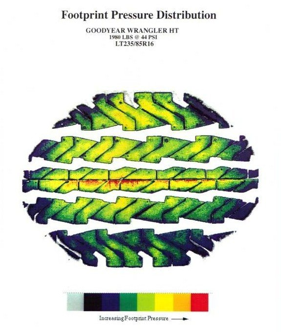
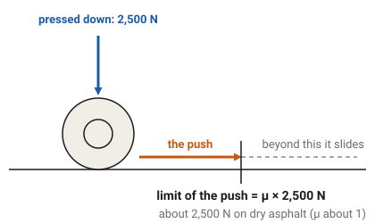
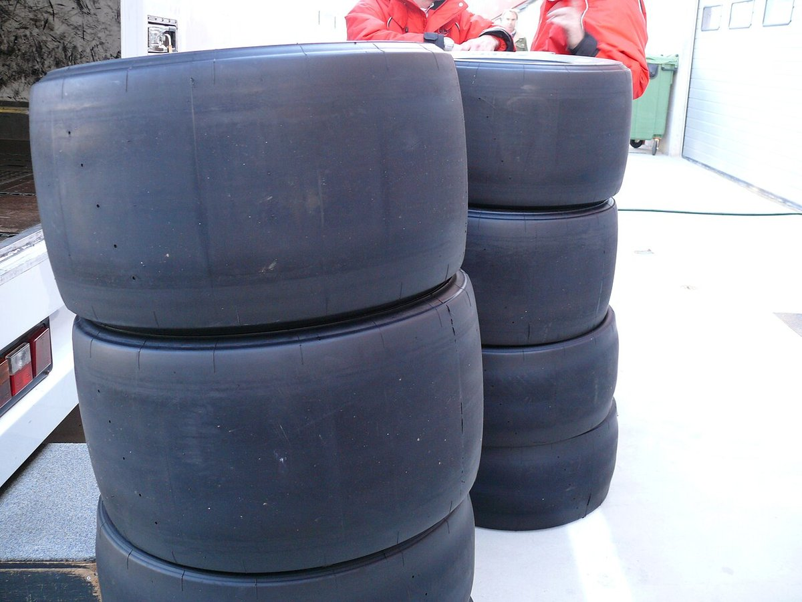
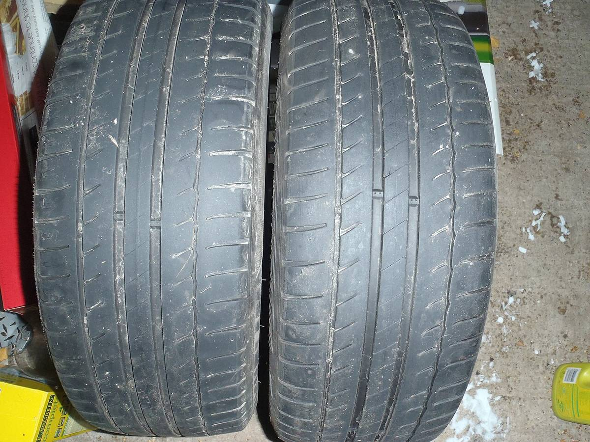
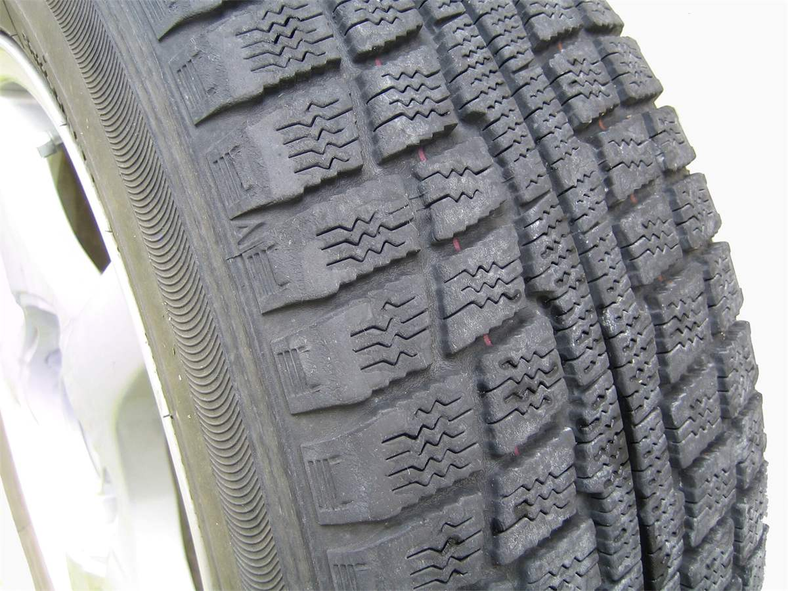
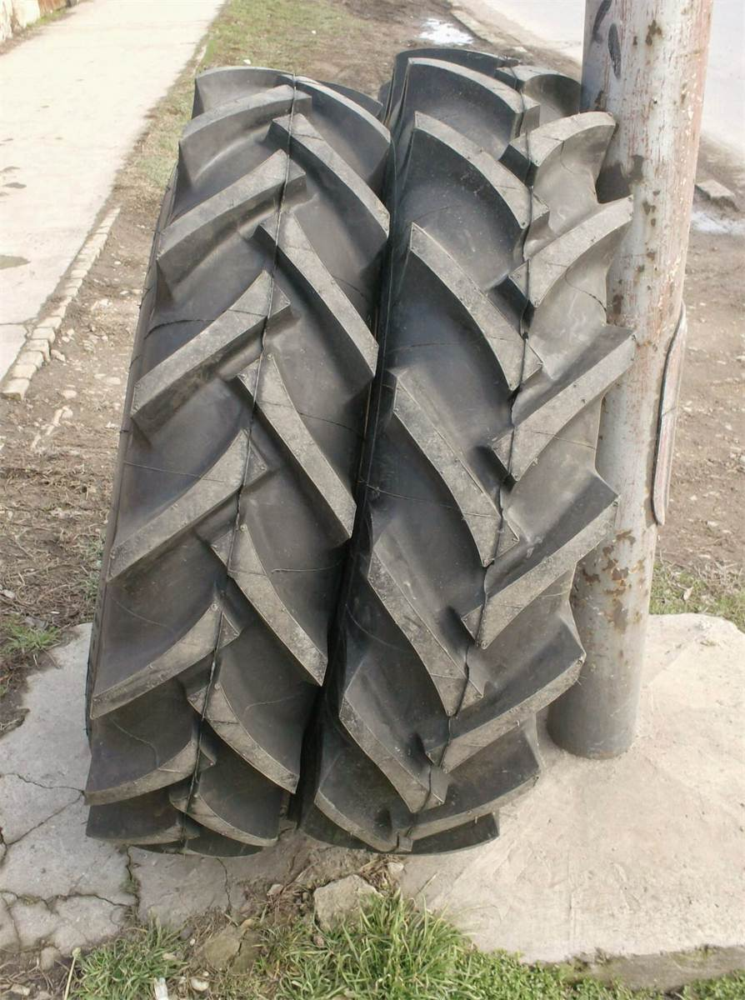

# Tyres and grip

This page explains the contact patch, where grip comes from, the coefficient of friction, tyre types and the air in a tyre.

Which vehicles have this
Car
Truck
Tractor

A car weighs more than a tonne, and it touches the road with four patches of rubber. Every push
that speeds it up, every pull that slows it down and every nudge that turns it has to pass through
those patches. So how much can these patches of rubber actually hold?

## The contact patch

A tyre touches the road over an area about the size of a hand, called the
[contact patch](glossary.md#contact-patch).

The force that a patch can pass depends mostly on how hard the tyre is pressed onto the ground,
the tyre itself (its rubber and its [tread](glossary.md#tread), the patterned outer layer that
touches the road), what the ground is made of, and how much the tyre slips on it.

<figure>

<figcaption>A light-truck tyre's contact patch, measured from below. Image: CapriRacer, public domain, <a href="https://commons.wikimedia.org/wiki/File:Tirefootprint.jpg">Wikimedia Commons</a>.</figcaption>
</figure>

## Grip comes from friction

[Grip](glossary.md#grip) is a tyre's ability to push on the ground without sliding away. It comes
from friction between the rubber and the road.

Rubber is good at this because it is soft, and that softness helps in two ways.

- **It wraps around the bumps.** Seen up close, a road is full of tiny bumps and hollows. Pressed
  onto it, the rubber flows around those bumps, a bit like dough pressed onto a grater. When the
  tyre pushes sideways or along the road, the rubber presses against the sides of the bumps (harder on
  their front than their back), and the bumps push back on it.
- **It sticks.** Two molecules very close together pull on each other a little (van der Waals
  forces). Soft rubber squashes right into the road's surface, so a huge number of its molecules
  get that close to the road's, and their tiny pulls add up (a gecko climbs a window with the same
  forces). Sliding means breaking these links, which takes force. As the tyre rolls, each bit of
  tread sticks for a moment, then peels off as it leaves the patch.

How much each effect gives changes with the road, the rubber, its temperature and the speed.
Sticking is often said to give most of the grip on a dry road, although research on real road
surfaces finds that the bumps give the larger share. A racing slick, with soft
rubber and as much of it as possible against the road, gets the most from both, which is why it
grips so well on a dry track.

On a wet road, a thin film of water stays between much of the rubber and the road, so that
rubber cannot stick, and the water left in the road's hollows smooths the surface the rubber
wraps around. That is why a wet road grips less than a dry one, and why a rough road surface grips
far better in the rain than a polished one. Dust, sand or spilled oil do the same thing.
<!-- Persson, Tartaglino, Albohr, Tosatti, Phys. Rev. B 71, 035428 (2005), abstract: water "effectively smoothens the substrate". Lorenz et al., J. Chem. Phys. 142 (2015), per the AIP press release: on wet roads a thin water film separates most of the rubber from the road and "the adhesive contribution to rubber friction may be negligible"; on clean dry surfaces the data support adhesive friction, with no share given. The 2005 abstract calls the bumps' deformation "the major friction contribution", hence "the bumps give the larger share"; the opposite, often-said view has no source opened here (Grosch 1963, Proc. R. Soc. A, refused access). -->

How racing teams deal with wet, dirty and slippery tracks

- **Rain rarely stops a race.** The teams change to grooved rain tyres (see the tyre types below).
  The race is stopped only when there is so much standing water that the tyres cannot clear it,
  or the drivers can no longer see through the spray.
- **A clean track gets faster.** At the start of a race weekend the track is dusty and grips
  poorly. As the cars lap, they sweep the dust away and leave a thin layer of their own rubber on
  the best line round the track, and lap times drop.
- **Off the line it is slippery.** Worn tyres shed small balls of rubber, called marbles, which
  collect beside the racing line. Driving onto them is a little like driving on tiny ball
  bearings.
- **Spills are covered at once.** When a car leaks oil, marshals spread an absorbent powder over
  it, and a yellow flag with red stripes warns the drivers that the surface is slippery.
- **Warm rubber sticks better.** Racing tyres grip best when hot, so in many series they are kept
  under heated blankets before the start, and drivers weave from side to side behind the safety
  car to keep them warm.

A hard material such as steel can do neither: it cannot wrap around the bumps, and it touches
the surface only at a few tiny points. This is why a steel wheel on a steel rail slides so much
more easily than a tyre on a road (why trains use them anyway is under
[Rolling resistance](resistance.md#rolling-resistance)).

### The coefficient of friction

How hard a tyre can push along the ground before it slides depends on two things: how hard it is
pressed onto the ground, and its
[coefficient of friction](glossary.md#coefficient-of-friction), written μ (the Greek letter mu):

grip = μ × the force pressing the tyre down

Grip is a force, in newtons: the largest push the tyre can make before it slides.

On dry asphalt, a car tyre has a μ of about 1. For example, each tyre of a 1,000 kg car is
pressed down with about 2,500 newtons (a quarter of the car's weight), so it can push with about
2,500 newtons before it slides. Truck tyres have less, and racing slicks have more.

A μ of 1 is often thought to be a limit, but it is not. Hard materials such as wood or metal
sliding on a flat surface stay below it, but rubber that sticks, or a stud that digs into ice,
can push sideways harder than it is pressed down. Racing slicks on a warm, dry track reach above 1.

Two ways to picture μ:

- **The steepest slope a braked car could stand on.** The slope rises μ metres for every metre
  along the flat: about 6 degrees with a μ of 0.1 (ice), 17 with 0.3 (snow), 27 with 0.5 (wet
  asphalt) and 45 with 1 (dry asphalt). Each degree costs more than the last: a μ of 2 reaches
  only 63 degrees, and no μ is enough for a vertical wall, because there the car's weight no
  longer presses the tyres onto it at all (see [Holding still](holding.md#the-tyre-holds-first)).
- **The hardest a car can brake or turn**, which is μ × 1 g (and the hardest it can speed up, if
  all four wheels are driven). One g (9.8 m/s²) is how
  fast a falling object speeds up; a car braking at 1 g loses about 35 km/h every second. The
  car's mass does not matter, because its weight is both what presses the tyres down and what
  they have to move. Racing cars beat this limit with wings, which press the tyres down harder
  without adding any mass (see [Downforce](resistance.md#downforce-on-racing-cars)).

Is μ a property of the tyre? Not on its own. It describes how two surfaces get on together: here,
the tyre and the ground it touches. The same tyre, pressed down with the same 2,500 newtons, can
push with very different amounts:

| Ground (for example) | μ | Largest push, pressed down with 2,500 N |
| --- | --- | --- |
| Dry asphalt | 1 | about 2,500 N |
| Wet asphalt | 0.5 | about 1,250 N |
| Snow | 0.3 | about 750 N |
| Ice | 0.1 | about 250 N |

These values are round numbers for the sake of the example, and real ones vary a lot.

The tyre matters as well, which is why tyres look so different from one another. Each is shaped
for the ground it works on:

- **A racing slick** has no grooves at all. On a dry track, every bit of its tread is rubber
  touching the road, so as much rubber as possible grips. On a wet track that smooth tread cannot
  push the water out of the way, and the tyre rides up on a film of water (this is called
  aquaplaning), so racing cars change to grooved tyres in the rain.
- **A road car's tyre** has grooves to carry water out of the contact patch, giving up a little
  dry grip so it still grips in the rain.
- **A winter tyre** uses softer rubber that stays flexible in the cold, and many thin cuts in the
  tread that give it extra edges to bite into snow. On the same snow, it has a higher μ than a
  summer tyre.
- **A tractor tyre** has deep lugs that dig into soft soil and push against it, more like a
  paddle than like friction on a road.

See [Ground and tyre types](surfaces.md) for the grounds and tyres the simulator has.

<figure>

<figcaption>Racing slicks, with no grooves. Photo: vtornet, CC BY 2.0, <a href="https://commons.wikimedia.org/wiki/File:F1_Slick_Tires.jpg">Wikimedia Commons</a>.</figcaption>
</figure>

<figure>

<figcaption>A road car's tyres, with grooves. Photo: Trubble, CC BY-SA 2.0, <a href="https://commons.wikimedia.org/wiki/File:Michelin_Pilot_Primacy_HP_(5285287620).jpg">Wikimedia Commons</a>.</figcaption>
</figure>

<figure>

<figcaption>A winter tyre's thin cuts. Photo: Lombroso, public domain, <a href="https://commons.wikimedia.org/wiki/File:Studless_tire_2.jpg">Wikimedia Commons</a>.</figcaption>
</figure>

<figure>

<figcaption>A tractor tyre's lugs. Photo: Momčilo Stokanovic, CC BY-SA 4.0, <a href="https://commons.wikimedia.org/wiki/File:Traktorske_gume.jpg">Wikimedia Commons</a>.</figcaption>
</figure>

## Air pressure

A tyre holds the car up with the air inside it. The tyre flattens until the air pressure, acting
over the patch, balances the force pressing the tyre down, so as a rough estimate:

patch area ≈ the force pressing the tyre down ÷ the air pressure

For example, 2,500 newtons on a tyre at 2.5 bar (250,000 newtons per square metre) gives a patch
of about 0.01 m², or 10 × 10 cm.

A bigger patch does not mean much more grip: the largest push is still μ × the force pressing the
tyre down, only spread over more rubber. What a wrong pressure mostly changes is the tyre's heat
and wear, which is why the vehicle's maker gives a pressure for its tyres:

- **Too little air** lets the tyre flex too much. It runs warmer, wastes more energy (see
  [Rolling resistance](resistance.md#rolling-resistance)), and the edges of its tread wear first.
- **Too much air** gives a smaller patch whose middle carries most of the load, so the middle of
  the tread wears first.

A tractor in a field runs its tyres soft on purpose. The larger patch spreads its weight over more
soil, so it presses on it less hard and packs it down less. On the road, harder tyres are better.
<!-- Wikipedia "Contact patch": "the size of the contact patch cannot be simply calculated as load divided by inflation pressure", larger load larger patch, larger pressure smaller patch. The 2.5 bar is an example value, not a sourced typical one. "Not much more grip" is the page's μ × load rule; load sensitivity (slip.md) gives a little more μ at lower contact pressure. Michelin AU tyre-wear: underinflated tyre "tends to over flex and run warmer", increases rolling resistance, wear "on both edges"; over-inflation wears "the central part", which "supports most of the load". Continental AU mileage factors: over-inflation raises ground pressure around the centre of the patch. Aarhus University agro news, low-inflation tyres: low pressure, larger contact surface, pressure "distributed over a larger area"; low pressure in the field, higher on the road. -->

## What Carlito simulates

The parameters the simulator uses for this, and where each is set, are listed in
[How the simulation works](simulation.md#tyres-and-grip):

- **Per surface**:
  - [Grip](simulation.md#grip)
- **Per vehicle**:
  - [Peak grip along and across the wheel](simulation.md#peak-grip-along-and-across-the-wheel)
    (`mu_long`, `mu_lat`)
  - [Wheel radius and tread width](simulation.md#wheel-radius-and-tread-width) (`wheel_radius`,
    `tyre_half_width`, and their `_rear` versions)
- **Per tyre class**:
  - [Dry grip](simulation.md#dry-grip) (`dry`)

Simplification list

- **No air pressure.** The simulated tyres have no pressure, so their grip and rolling resistance
  never change with it.

## What you see in sloppyCAN

| Signal | Direction | Unit | What it shows |
| --- | --- | --- | --- |
| `accLong` | out | m/s² | Acceleration along the vehicle. In a full ABS stop it shows how hard the tyres are braking. |
| `accLat` | out | m/s² | Sideways acceleration. Its highest value in a steady corner shows how much sideways grip the tyres had. |
<!-- contract/carlito_contract.json: accLong, accLat -->

## Related

- [Glossary](glossary.md): every term on this page.
- [Slip and the grip curve](slip.md): how a tyre makes its push, and what happens past its grip.
- [Ground and tyre types](surfaces.md): how the ground and the tread scale the grip.
- [Air and rolling resistance](resistance.md): rolling resistance beside the air's drag.
- [Holding still](holding.md): how much slope the grip can hold.
