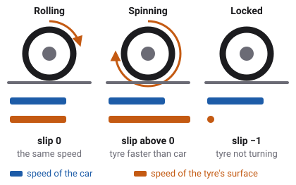
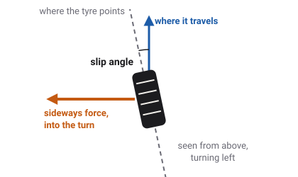
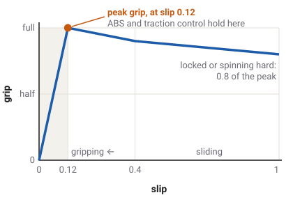
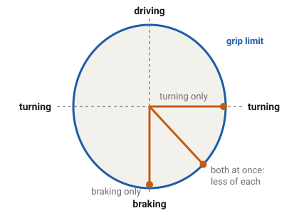
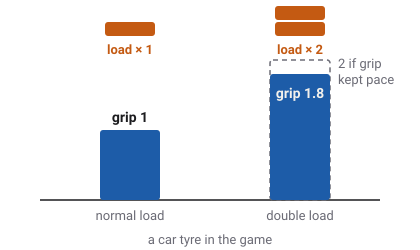

# Tyres and slip

Every push, every stop and every turn a wheeled vehicle makes passes through four
small patches of rubber. How much force a tyre can pass, and what it does when it is asked for
more, decides almost everything about how a vehicle drives.

Which vehicles have this
Car
Truck
Tractor
Plane
Boat
Drone
Train

## The contact patch

A tyre touches the road over an area about the size of a hand: its
[contact patch](glossary.md#contact-patch). Everything the road does to the vehicle, it does
there. The engine's push, the brakes' pull and the sideways force that turns a corner all have to
pass through those four patches.

In the game, each wheel finds the ground by sweeping the shape of its tyre down through its
suspension travel, sixty times a second. Where the tyre touches, the game works out three things:
how hard the tyre is pressed onto the ground, how fast the ground passes under it, and how fast
the tyre itself is turning. The rest of this page is what it does with those three things.

## A tyre needs slip to grip

A rolling tyre that makes no force at all moves exactly as fast as its surface turns. The moment
it has to push, brake or corner, the rubber in the patch stretches a little, and the tyre starts
to move slightly differently from how it turns. That difference is called
[slip](glossary.md#slip). It sounds like a fault, but it is how every tyre works: no slip, no
force.

The game measures slip in two directions, along the wheel and across it.

### Slip ratio: along the wheel

The [slip ratio](glossary.md#slip-ratio) compares how fast the tyre's surface is turning with how
fast the car is moving over the road. The game takes the difference and divides it by the road
speed:

- **0**: rolling freely. The two speeds match.
- **Above 0**: the tyre turns faster than the car moves. It is spinning, as when you floor the
  accelerator on a slippery road. A slip ratio of 1 means the surface turns twice as fast as the
  car moves.
- **Below 0**: the tyre turns slower than the car moves. It is braking. At **−1** the wheel has
  stopped turning while the car still moves: it is locked and skidding.

Dividing by the road speed would give huge numbers when the car is barely moving, so below about
5 km/h the game divides by 5 km/h instead.
<!-- wheel.gd LOW_SPEED_FLOOR 1.5 m/s (5.4 km/h); a body's own floor can be higher (RayWheel.slip_floor_for) -->

### Slip angle: across the wheel

When you steer, the front tyres point into the turn, but the car does not follow them exactly.
Each tyre travels a little wide of where it points. The angle between the two is the
[slip angle](glossary.md#slip-angle). A shopping trolley shows the opposite case: its caster
wheels swing round until they point exactly where they travel, so their slip angle is zero and
they push no sideways force at all. That is why a trolley drifts sideways so easily on a slope.

The game measures this sideways slip the same way as the slip ratio: the tyre's sideways speed
divided by its forward speed. For small angles that is almost exactly the angle itself.

## The grip curve

How much force a tyre makes depends on how much it slips. The game gives every tyre the same
shape of curve.

<!-- GroundDriveSpec.grip_curve (0,0) (0.12,1) (0.4,0.9) (1,0.8); the same on every shipped spec -->

- **Rising.** From no slip up to a slip of 0.12, grip climbs almost in a straight line. A tyre
  driving, braking or cornering normally lives here.
- **The peak.** At 0.12 the tyre gives the most force it can. This is the best place to brake or
  accelerate.
- **Sliding.** Past the peak, more slip gives a little less grip. A wheel that is locked or
  spinning hard grips at 0.8 of the peak.

The fall after the peak is small, but it matters. A tyre that starts to slide grips less, so it
slides more, so it grips less again. That is why a locked wheel stays locked until the brake is
let off, and why a spinning wheel keeps spinning. [ABS](glossary.md#abs) and
[traction control](glossary.md#traction-control) exist to stop that from happening: in the game,
both hold each wheel at the peak, slip 0.12, and no further.
<!-- wheel.gd ABS_SLIP 0.12, TCS_SLIP 0.12 -->

### How high is the peak?

The curve gives a share of the tyre's best grip. The best grip itself is the tyre's
[coefficient of friction](glossary.md#coefficient-of-friction), called mu, times how hard the tyre
is pressed onto the ground. On dry asphalt the game's cars have a mu of about 1 along the wheel
and a little under 1 sideways: a car tyre pressed down with 3000 newtons can push with about
3000 newtons before it slides. The semis' truck tyres have about 0.8, and the racing cars' slicks
about 1.3.
<!-- sedan_spec.tres mu_long 1.05 (GroundDriveSpec default), mu_lat 0.97; semi_spec.tres mu_long 0.8, mu_lat 0.75; race mu_long 1.35, race-future 1.25 (gen_kenney_vehicles.gd) -->

The ground and the tyre's tread change this number. Ice gives an ordinary all-season tyre only
about a tenth of its dry grip; wet asphalt about half; snow a little under half. A winter tyre
grips snow and ice better than an all-season tyre, a summer tyre grips dry roads better. The game
has twelve kinds of ground and nine kinds of tyre; [Ground and tyre types](surfaces.md) covers
them. Every one of them
changes only how high the peak is, never the shape of the curve.
<!-- surface.gd REF_GRIP Wet 0.55, Snow 0.45, Ice 0.12, Surface.COUNT 12; src/vehicles/tyres/ holds nine TyreClass files -->

## Sharing grip between braking and turning

A tyre has one budget of grip, not two. It can spend it all on braking, or all on turning, or
part on each. Drawn as a picture, the limit is an oval, called the
[friction ellipse](glossary.md#friction-ellipse): along the road on one axis, sideways on the
other. The game's tyres work this way. It adds the slip along the wheel and the slip across it
into one combined slip, reads the grip curve once for that, and points the force along the
direction the patch is sliding. This is called [combined slip](glossary.md#combined-slip).

Two things follow, and you can feel both in the game:

- **Braking hard in a corner pushes the car wide.** The more grip the brakes use, the less is
  left for turning.
- **A locked wheel cannot steer.** A locked wheel's slip is almost all along the wheel, so almost
  all its force points backwards against the slide. Turning the steering wheel then does next to
  nothing. That is the reason for ABS: by keeping the wheels turning, it keeps the steering
  working. It is also why the handbrake makes a car spin round: it locks the rear wheels, they
  lose their sideways grip, and the back of the car swings out.

## Heavier tyres grip more, but not in proportion

Pressing a tyre harder onto the road gives it more grip. But it does not give it twice the grip
for twice the load. A car tyre in the game loses a tenth of its grip per kilogram each time its
load doubles, so at double load it grips 1.8 times as hard, not 2. This is called
[load sensitivity](glossary.md#load-sensitivity). Truck and trailer tyres lose a little less, the
tractor's soft tyres a little more, and the plane's tyres none.
<!-- GroundDriveSpec.load_sensitivity: car 0.10, truck/van/trailers 0.08, tractor 0.12, plane 0 (its field comment) -->

It matters because a vehicle's weight moves around. In a corner, weight moves onto the outside
tyres. The outside tyre gains grip, the inside tyre loses grip, and because of load sensitivity
the pair together ends up with less than before. The end of the car whose tyres carry the most
uneven load loses grip first. That is how designers tune whether a car runs wide at the front or
swings out at the back, and it is a topic of its own,
[weight transfer](glossary.md#weight-transfer).

A heavily loaded tyre also reaches its sideways peak at a larger slip angle than a lightly
loaded one. The game models this on the cars, the vans, the rigid trucks and the tractor, but not
on the semis and their trailers. The heavy vans (`delivery`, `delivery-flat`, `ambulance`) have
twin tyres on each rear corner; the game gives each of the pair half the corner's load when it
works out their sideways grip.
<!-- RayWheel.lateral_peak_slip, GroundDriveSpec.cornering_peak_load (0 on semi_spec.tres); GroundDriveSpec.rear_twin_tyres -->

## Standing still on a slope

Slip explains a moving tyre, but not a parked one. A braked car on a hill is not sliding at all,
so by the slip rule its tyres would make no force, and it would creep slowly downhill.

Real tyres hold a parked car because the rubber in the contact patch can bend a little before it
slides, like a stiff spring. The game models that too. Below a slow walking pace, a springy give
of about 2 cm in each patch fades in. A wheel held by its brake or by the parking pawl winds that
spring up and holds the car still. A wheel that is free to roll does not: an unbraked car still
rolls down a hill, as it should.
<!-- wheel.gd STICK_DEFLECTION 0.02 m, STICK_SPEED 0.5 m/s -->

## The wheel's own spin

Each wheel in the game spins on its own. Sixty times a second, the game adds up the turning forces
on it: the engine's drive, the brake, and the road pushing back at the contact patch. From those it
works out the wheel's new speed. The slip ratio then comes from that speed and the car's.

This is why the engine and the tyres are tied together. A spinning wheel drags the engine's speed
up with it, and an engine pushing too hard makes the wheel spin past the peak of the curve.

## Rolling resistance

Even a tyre that grips perfectly costs a little force to roll, because the rubber flexes as it
turns. The game charges each tyre a small force, a fixed share of the load on it: about 1 % of the
load for a car tyre on a hard road, less for a truck tyre, about 2 % for the tractor's lugged
tyres. Soft ground such as mud, sand or grass adds much more. This force acts at the patch but
does not use any of the tyre's grip.
<!-- GroundDriveSpec.rolling_resistance: sedan 0.012, semi 0.007, tractor 0.02; surface.gd DRAG adds per surface -->

## What you see in sloppyCAN

| Signal | Direction | Unit | What it shows |
| --- | --- | --- | --- |
| `slip` | out | ratio, two values | The size of the slip ratio along the wheels, averaged over each axle: the first value is the front axle, the second the rear. It ignores the direction (spinning and braking both read above 0) and it does not include the sideways slip angle. Car, truck, tractor. |
| `accLong` | out | m/s² | Acceleration along the vehicle. In a full ABS stop it shows how hard the tyres are braking. |
| `accLat` | out | m/s² | Sideways acceleration. Its highest value in a steady corner shows how much sideways grip the tyres had. |
| `wheel_speed` | out | km/h | Tractor only: the rear wheels' spin times their radius. |
| `ground_speed` | out | km/h | Tractor only: the true speed over the ground. |
| `wheel_slip` | out | % | Tractor only: how far `wheel_speed` runs ahead of `ground_speed`, as a share of `wheel_speed`. Braking slip reads 0. The dashboard warns from 60 %. |
| `tcs_off` | in | flag | Switches traction control off on the cars, so the drive can spin the tyres past the peak. |
<!-- contract/carlito_contract.json: slip (count 2), accLong, accLat, wheel_speed, ground_speed, wheel_slip (warn 60), tcs_off; WheelDrive.fill_slip averages RayWheel.slip = |slip ratio| per axle -->

## Try it in the game

Try it in the game: find the peak

You need a car with ABS, such as the `sedan`.

1. Open SETTINGS and set EXTENDED DEBUG LABELS to ON, then press **F3**. The overlay now shows
   a `slip` line: one number per wheel, the slip ratio in percent, with a star when ABS is
   holding that wheel.
2. Open LEVEL and pick **Car Arena**. Pause, open SPAWN POINT and pick one of the tyre pad's
   strips. The pad has strips of dry asphalt, wet road and snow side by side.
3. Drive onto the dry strip at about 50 km/h and brake as hard as you can. Watch the `slip` line:
   each wheel settles near −12, with a star. That is the peak of the grip curve.
4. Pause, open LAB and switch ANTI-LOCK BRAKES off. Do the same stop. The wheels go to −100, the
   car stops in a longer distance, and turning the steering does almost nothing until you let the
   brake off.
5. Repeat both stops on the snow strip. The slip numbers look the same; the stopping distance is
   far longer, because the peak is lower.

## Related

- [Glossary](glossary.md): every term on this page.
- [Steering and Ackermann](steering.md): how the front wheels are angled to make the slip angles
  a turn needs.
