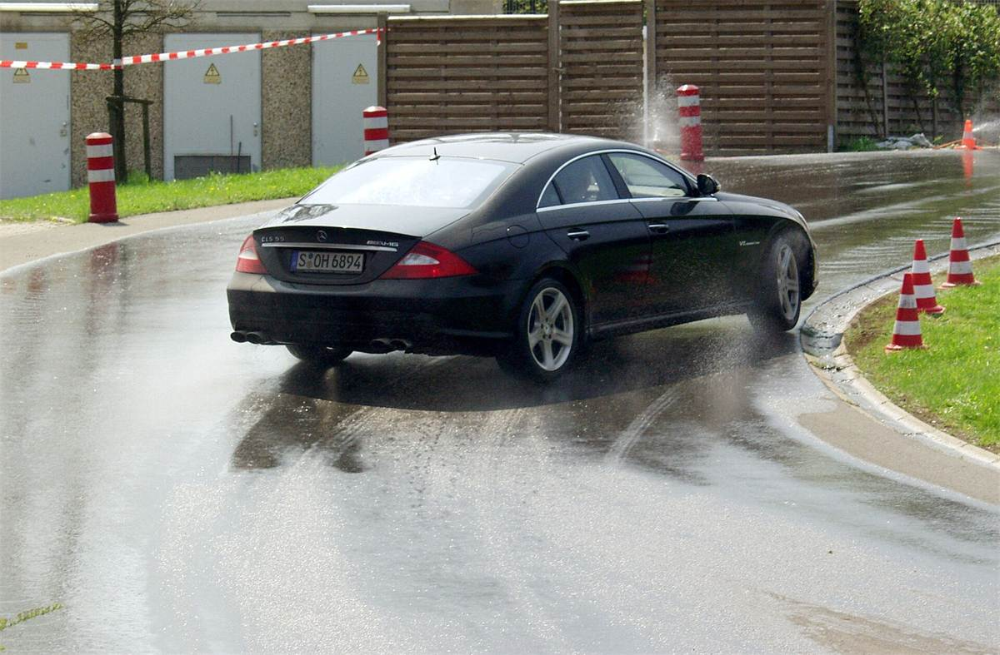

# Understeer and oversteer

This page explains why a vehicle pushed too hard in a turn either runs wide or
swings its tail out, and what decides which.

Which vehicles have this
Car
Truck
Tractor

## Which end lets go first

A car cannot be pushed round a bend by anything except its tyres, and a tyre can push only so
hard. So what happens when the bend asks for more than they have, and does the car slide at the
front or at the back?

In a turn, the front and rear tyres all push sideways on the road, toward the inside of the turn.
Each tyre does this by running at a small angle to the way it is pointing, called the
[slip angle](slip.md#slip-angle-across-the-wheel). When the turn is tighter or the speed higher,
the tyres must push harder, because the sideways push needed grows with the square of the speed
and shrinks as the radius grows. At some point, one pair reaches its grip limit before the other.

- **Understeer: the front lets go first.** The front tyres cannot push any harder, so the car
  turns less than the driver asked and runs wide. Steering more does not help, because the front
  tyres are already at their limit. Slowing down does
  ([see the forces](forces.md#example-understeer)).
- **Oversteer: the rear lets go first.** The back of the car swings out, and the car turns more
  than asked. It can spin if nothing is done. The driver catches it by steering the other way
  (into the slide), which points the front wheels back along the way the car is actually
  travelling. The front tyres then stop pulling the nose further into the turn, and the rear
  tyres can catch up and grip again.
- **Neutral:** both ends let go together, and the whole car slides wide.

Understeer is considered safer, because the natural reaction (slowing down) cures it. Slowing
down works because of that square: a car that halves its speed in the same bend needs only a
quarter of the sideways push.
That is why road cars are usually built to understeer. Oversteer is harder: slowing down
suddenly can make it worse (see below), and the right reaction, steering into the slide, is not
the natural one.

<figure>

<figcaption>Oversteer on a wet road, tail out. Photo: Raimond Spekking, CC BY-SA 4.0, <a href="https://commons.wikimedia.org/wiki/File:Mercedes_AMG_CLS_55_-_Demonstration_of_drifting_1b.jpg">Wikimedia Commons</a>.</figcaption>
</figure>

Learn more: the engineers' second meaning of "understeer"

Engineers also use "understeer" and "oversteer" for something different, which happens long
before any tyre slides: how the steering a car needs changes as it goes faster round the same
bend.

- If it needs a little more steering, engineers say it understeers.
- If it needs a little less, they say it oversteers.

This comes from the tyres: at speed, each one rolls a little off from where it points, so the car
no longer goes exactly where its front wheels point (see
[Steering and Ackermann](steering.md#one-angle-the-bicycle-model)). If the front tyres roll
further off than the rear ones, the car runs a touch wide, and the driver steers a bit more.
Nothing slides, and the driver hardly notices. Road cars are built to need a little more steering
as they speed up, because a car that needs less and less becomes twitchy at high speed.

The car turns right on one bend, 50 m in radius, with a 2.5 m wheelbase. Its tyres roll off as
far as a typical road car's, not a Carlito car's: the simulated cars need far less extra steering
(see the Simplification list below). How far they roll off grows in step with the sideways push,
which holds only well below the grip limit. Steering here is the angle of the front wheels, not of the steering
wheel.

## What decides the balance

- **Where the weight goes.** In a turn, load moves across each axle, from its inside tyre to its
  outside one ([weight transfer](weight-transfer.md)). The total stays the same, so whatever the
  outside tyre gains, the inside one loses. You might expect the axle where more load crosses to
  grip better, since its outside tyre is pressed down harder. It is the other way round: a tyre's
  grip does not keep pace with its load
  ([load sensitivity](slip.md#a-tyre-pressed-harder-grips-more-but-not-in-proportion)), so the
  outside tyre gains less grip than the inside one loses. For example, if a tyre at double load
  grips 1.8 times as hard, an axle that moves all its load onto its outside tyre grips 1.8 instead
  of 1 + 1 = 2, a tenth less. So the axle whose two tyres are loaded more unevenly has less grip
  in total, and it lets go first. The [anti-roll bars](glossary.md#anti-roll-bar) decide how much
  crosses at each end: a stiffer front bar makes more of it cross at the front, and the car
  understeers.
- **The suspension's own steering.** As the body leans, the links turn the wheels slightly
  ([roll steer](steering.md#the-suspension-steers-a-little-too)).
- **The driven wheels.** A tyre has one grip to share between driving and turning
  ([friction ellipse](slip.md#sharing-grip-between-braking-and-turning)). When accelerating hard
  in a turn, the driven tyres have less left for turning: a front-drive car runs wide, and a
  rear-drive car's tail steps out.
- **Wings.** The wings of a racing car press it onto the road. The harder an axle is pressed, the
  more it can grip, so where that push lands (more on the front or more on the rear) changes the
  balance, and more so as the speed rises, because the push grows with speed.

## How the driver tips the balance

- **Lifting off** the accelerator in a fast corner moves weight forward, off the rear tyres. They
  lose grip and the tail can swing out (this is called lift-off oversteer). A gentle lift is a
  fair way to cure understeer, because it puts weight on the front tyres, but a sudden one in an
  already tight corner is a common cause of a spin.
- **Braking in a turn** does the same, more strongly, and the rear tyres also spend grip on
  braking ([see the forces](forces.md#example-braking-in-a-turn)).
- **The handbrake** can lock the rear wheels. A locked tyre has almost no side grip (see
  [Slip and the grip curve](slip.md#sharing-grip-between-braking-and-turning)), so the tail
  swings out at once. Rally drivers use this on purpose to swing the car round a hairpin, and
  drifters to start a slide, which they then hold with the accelerator and opposite steering.
- **Too much accelerator**, as above, pushes a front-drive car wide or a rear-drive car's tail
  out.
- **Slowing down** before the turn keeps every tyre inside its grip.

## Stability control

[Stability control](driver-aids.md#stability-control) compares how fast the car is turning with
how fast the steering asks it to turn. If the car turns too much (oversteer), it brakes the outer
front wheel to pull the nose out. If it turns too little (understeer), it brakes the inner rear
wheel to tuck the nose in.

## What Carlito simulates

The parameters the simulator uses for this, and where each is set, are listed in
[How the simulation works](simulation.md#understeer-and-oversteer):

- **Per vehicle**:
  - [Front and rear side grip](simulation.md#the-front-and-rear-side-grip) (`mu_lat`,
    `rear_lat_grip`)
  - [Load sensitivity](simulation.md#load-sensitivity) (`load_sensitivity`)
  - [The anti-roll bars' split](simulation.md#anti-roll-bars) (`anti_roll_rate`,
    `anti_roll_rate_rear`)
  - [Roll steer](simulation.md#roll-steer) (`roll_steer_front`, `roll_steer_rear`)
  - [Compliance steer](simulation.md#compliance-steer) (`compliance_steer_rear`)
  - [Downforce balance](simulation.md#downforce-balance) (`downforce_front`)

Simplification list

- **Tyres that lean with the body.** Real tyres tilt as the body rolls, which adds to the
  extra steering a real car needs as it speeds up through a bend (the engineers' second meaning
  of understeer, above). The simulated tyres stay square to the body, so the cars need far less
  of this extra steering than real ones. At the limit, the front still goes first.
  <!-- docs/handling.md Balance "Stated shortfall: linear K": 0.16-0.31 deg/g against a real car's 2-4 -->
- **No oversteering setups.** Every car, van and rigid truck loses grip at the front first in a
  steady turn. The racing cars' downforce is placed so that this holds at any speed. (A semi with no
  trailer tips before either end slides.)
  <!-- docs/handling.md Balance; Aero balance: "the limit stays front-first", test_a_winged_body_stays_front_first_at_any_speed -->
- **Steering feel.** A real steering wheel goes light as the front tyres reach their limit. The
  simulation sends no force back through the controls.

## What you see in sloppyCAN

| Signal | Direction | Unit | What it shows |
| --- | --- | --- | --- |
| `steer` | out | % | How far the steering is turned. |
| `yaw` | out | rad/s | How fast the vehicle turns. Turning slower than the steering asks is understeer; faster is oversteer. |
| `accLat` | out | m/s² | How hard the vehicle corners. |
| `slip` | out | ratio, two values | Each axle's slip. The axle whose slip climbs first is the one letting go (Car, truck, tractor). |
| `status` | out | bitfield | Bit 10: stability control is braking a wheel to correct the turn. |
| `esc_off` | in | flag | Switches stability control off (Car and truck). |
<!-- contract/carlito_contract.json: steer, yaw, accLat, slip, status bit 10 (yaw braking), esc_off -->

## Scenarios

- [Turning at the grip limit](forces.md#example-understeer): understeer.
- [Braking in a turn](forces.md#example-braking-in-a-turn): oversteer, caused by the brakes.
- [Full throttle in a wet turn](forces.md#example-power-oversteer): oversteer, caused by the engine.

## Related

- [Glossary](glossary.md): [understeer](glossary.md#understeer),
  [oversteer](glossary.md#oversteer), [slip angle](glossary.md#slip-angle).
- [Weight transfer and rollover](weight-transfer.md): where the weight goes in a turn.
- [Slip and the grip curve](slip.md): slip angles and the grip limit.
- [Steering and Ackermann](steering.md): from the steering wheel to the front tyres.
- [ABS, traction and stability control](driver-aids.md): how stability control catches a slide.
