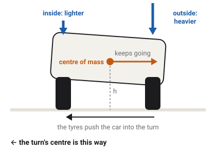

# Weight transfer and rollover

A vehicle's weight does not stay spread evenly over its wheels. Braking pushes it
onto the front, accelerating onto the back, cornering onto the outside. Where the weight goes,
the grip goes, and if enough of it moves to one side, the vehicle tips over.

Which vehicles have this
Car
Truck
Tractor
Plane
Boat
Drone
Train

## Why weight moves

Stand on a bus that brakes suddenly and you lurch forward. Your feet are slowed by the floor, but
the rest of you carries on. A vehicle does the same. Its tyres slow it at road level, but most of
its mass sits higher up, at its [centre of mass](glossary.md#centre-of-mass). That mass carries
on forward, and it presses the front of the vehicle down onto its front tyres while lifting the
rear. This is [weight transfer](glossary.md#weight-transfer).

It happens in every direction:

- **Braking** moves weight onto the front wheels.
- **Accelerating** moves it onto the rear wheels.
- **Cornering** moves it onto the wheels on the outside of the turn.

How much moves depends on three things: how hard the vehicle brakes, accelerates or turns; how
high the centre of mass is; and how far apart the wheels are. A higher centre of mass moves more
weight. A longer [wheelbase](glossary.md#wheelbase) moves less from front to back, and a wider
[track](glossary.md#track) moves less from side to side. A sports car is low and wide for this
reason; a van is tall and moves a lot of weight.

## How the game does it

The game does not calculate weight transfer as a separate step. It comes out of the physics on
its own. Each wheel's spring pushes the body up at its corner. When the body pitches forward
under braking, the front springs squeeze more and push harder, the rear springs push less, and
that is the weight moving. Every tyre's grip then follows the load its spring puts on it.

Because the spring sets the load, how much weight moves at each end depends on the
[suspension](suspension.md) too. In a corner, the axle with the stiffer
[anti-roll bar](glossary.md#anti-roll-bar) takes more of the side-to-side transfer.

### Where the body pivots

A body's resistance to being turned is its [inertia](glossary.md#inertia). For turning to the
left and right (its [yaw](glossary.md#yaw)), each road vehicle uses a figure taken from
measurements of real cars, SUVs, vans and pickups, because the game's simple box-shaped bodies
would otherwise turn too sluggishly. For leaning and pitching, the game works out the inertia
from the body's shape. Nothing else slows the body's spinning: the game removes the physics
engine's built-in rotation damping, so only the tyres and dampers bring a spin to rest.
<!-- docs/handling.md Inertia: yaw declared through yaw_dynamic_index (cars 1.03, vans 0.91, pickups 0.94), roll and pitch from the shapes; Balance: VehicleSpec.angular_damping 0 on every wheeled body and trailer -->

## Understeer and oversteer

When a car corners too fast for its tyres, one end slides first.

- If the **front** slides first, the car runs wide of the turn: it turns less than the driver
  asked. This is [understeer](glossary.md#understeer). Easing off brings it back into line, so
  road cars are designed to do this.
- If the **rear** slides first, the back swings out and the car turns more than asked. This is
  [oversteer](glossary.md#oversteer). It is harder to catch.

Weight transfer decides which end goes first. Because of
[load sensitivity](glossary.md#load-sensitivity), an axle whose weight is shared very unevenly
between its two tyres grips less in total than one whose weight is shared evenly. The end that
carries more of the side-to-side transfer loses grip first.

The game's road vehicles are set up to understeer. Their front anti-roll bars are stiffer than
their rear ones, their suspension steers the wheels a little towards stability as the body leans
(roll steer, on the [steering page](steering.md#the-suspension-steers-a-little-too)), and every
car, van and rigid truck loses grip at the front first in a steady turn. The two racing cars push
down on the road with wings; the game places that downforce so that they too stay
front-first at any speed.
<!-- docs/handling.md Balance: "Its leading axle is the pass's first on every Kenney body"; Aero balance: "the limit stays front-first", test_a_winged_body_stays_front_first_at_any_speed -->

The driver can still upset that balance. Lifting off the accelerator in the middle of a fast
corner moves weight forward, off the rear tyres, and can swing the back out. Braking hard in a
turn does the same, and the handbrake locks the rear wheels outright.
[Stability control](glossary.md#stability-control) is there to catch it.

## Wheel lift and rollover

If a vehicle corners hard enough, the inside wheels carry no weight at all and lift off the road.
A little more and it rolls over. Whether a vehicle slides or tips first depends on how its grip
compares with its shape: a low, wide car runs out of grip and slides long before it could tip,
but a tall, narrow vehicle can reach its tipping point while its tyres still grip. That tipping
point is its [rollover threshold](glossary.md#rollover-threshold).

In the game, rollover is not a scripted event. A vehicle tips because the forces on it tip it. In
a steady turn, the cars, vans, rigid trucks and tractors all slide before they tip. A semi
tractor unit with no trailer (a bobtail) tips first: it is tall and short. A loaded semi with a
high trailer is the vehicle most likely to roll, and it carries
[roll stability control](glossary.md#roll-stability-control) for that reason.
<!-- docs/handling.md Balance: "past tip_g no turn is steady (the bobtail semis tip first)"; GroundDriveSpec.esc_roll_lift_g on semi_spec.tres -->

### When the game says you have overturned

When a vehicle stays tipped past 70° from upright for one and a half seconds, and has almost
stopped moving, the game shows the notice OVERTURNED - PRESS BACKSPACE TO RESPAWN. It does not
put the vehicle back on its wheels by itself: a jump or a steep bank should not count as a
rollover. The notice goes when the vehicle is upright again or is respawned. No sloppyCAN signal
reports it.
<!-- base_vehicle.gd OVERTURNED_DEG 70, OVERTURNED_S 1.5, OVERTURNED_MAX_SPEED 2 m/s, OVERTURNED_NOTICE; "Deliberately NOT a telemetry field" -->

## What the game leaves out

- **No roll camber.** In a real car the tyres tilt as the body leans, which changes their grip.
  The game's tyres stay upright to the body. This is one reason the game's cars understeer a
  little less than real ones.
- **No damage.** A rollover dents nothing and breaks nothing.
<!-- docs/handling.md Balance, "Stated shortfall: linear K": roll camber not modelled -->

## What you see in sloppyCAN

| Signal | Direction | Unit | What it shows |
| --- | --- | --- | --- |
| `accLong` | out | m/s² | Acceleration along the vehicle: what moves weight between the axles. |
| `accLat` | out | m/s² | Sideways acceleration: what moves weight from the inside wheels to the outside. |
| `yaw` | out | rad/s | How fast the vehicle turns. A rate that runs ahead of the steering is oversteer. |
| `axle_load` | out | kg | Truck and tractor: the weight on the rear axle. It rises under acceleration and falls under braking. |
| `status` | out | bitfield | Bit 1, "on the ground", clears the moment any wheel leaves the road, so it shows a wheel lift. Bit 11 lights while roll stability control is braking. |
<!-- contract/carlito_contract.json: accLong, accLat, yaw, axle_load, status (bit 1 "all wheels in contact for a wheeled chassis", bit 11 roll stability braking) -->

## Try it in the game

Try it in the game: lift a wheel

1. In the GARAGE pick the `semi` tractor unit and choose NONE for its trailer. Open SETTINGS and
   set STABILITY CONTROL off, so roll stability control does not step in. Drive on **Flatland**
   and press **F3**.
2. Get up to about 50 km/h and turn the steering hard, then hold it. Watch the `roll` number on the
   overlay grow, and watch the inside wheels: they leave the ground before the tyres slide.
3. Now do the same in the `sedan` at the same speed. `roll` stays small, and the car slides wide
   instead of lifting a wheel.
4. Brake hard in a straight line in the `sedan` and watch `pitch` go negative: the nose dips as
   weight moves forward.

## Related

- [Suspension](suspension.md): the springs and bars that carry the moving weight.
- [Tyres and slip](tyres.md): load sensitivity, and why uneven load costs grip.
- [Glossary](glossary.md): every term on this page.
