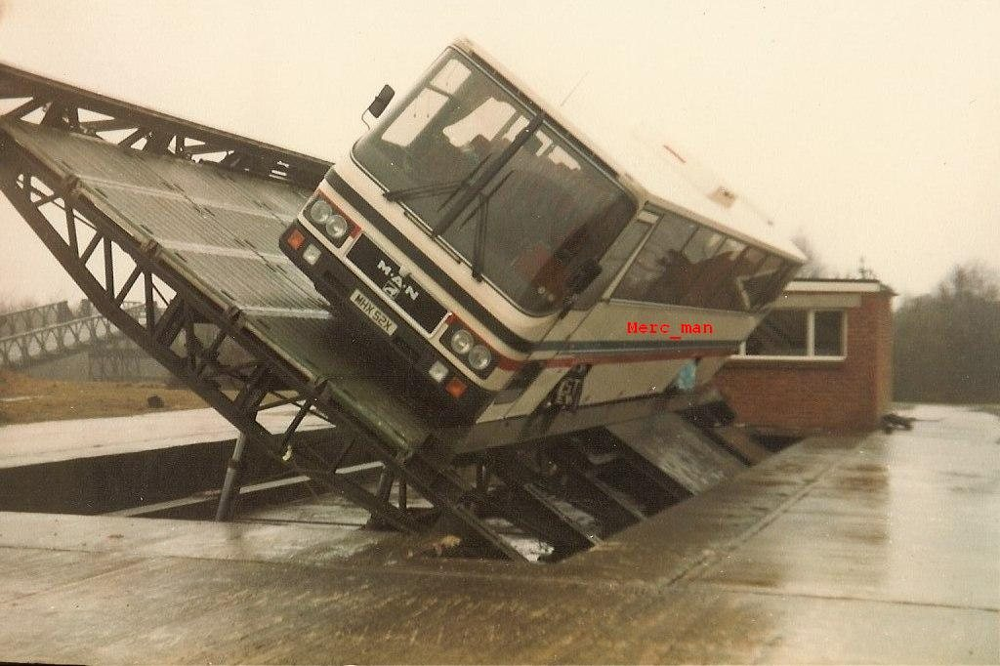

# Weight transfer and rollover

This page explains how braking, accelerating and cornering move a vehicle's
weight between its wheels, and when it tips.

Which vehicles have this
Car
Truck
Tractor

A car standing still puts a steady share of its weight on each wheel, but in a car that is
braking, speeding up or turning, those shares change. Why do the loads change, and what happens
when they change a lot? Each tyre's load decides how much it can grip, and if too much weight
moves to one side, the vehicle tips over.

## Why weight moves

If you stand on a bus that brakes suddenly, you lurch forward: your feet are slowed by the floor,
but the rest of you carries on. The same happens to a vehicle. Its tyres slow it at road level, but
most of its mass sits higher up, at its [centre of mass](glossary.md#centre-of-mass). That mass
carries on forward, so it presses the front tyres down and lifts weight off the rear ones. This is
called [weight transfer](glossary.md#weight-transfer). A tall box standing on a trolley does the
same when the trolley stops suddenly: it tips forward.

It is worth saying what weight transfer is not: the car does not get heavier or lighter. The
total weight the tyres carry stays the same, and only its share between the wheels changes.

It happens in every direction:

- **Braking** moves weight onto the front wheels
  ([see the forces](forces.md#example-emergency-stop)).
- **Accelerating** moves it onto the rear wheels
  ([see the forces](forces.md#example-pulling-away)).
- **Cornering** moves it onto the wheels on the outside of the turn
  ([see the forces](forces.md#example-turning)).

How much moves depends on three things: how hard the vehicle brakes, accelerates or turns, how
high the centre of mass is, and how far apart the wheels are. A higher centre of mass moves more
weight. A longer [wheelbase](glossary.md#wheelbase) moves less from front to back, and a wider
[track](glossary.md#track) moves less from side to side. This is why sports cars are low and wide
(a tall van moves much more weight).

Put together, the load that moves is:

<math display="block"><mi>ΔF</mi><mo>=</mo><mfrac><mrow><mi>m</mi><mo>×</mo><mi>a</mi><mo>×</mo><mi>h</mi></mrow><mi>L</mi></mfrac></math>

Here *m* is the vehicle's mass (in kilograms), *a* its acceleration (in metres per second per
second, and braking and cornering are accelerations too), *h* the height of its centre of mass and
*L* the distance between the wheels (the wheelbase for braking and accelerating, the track for
cornering, both in metres). *ΔF* is the load, in [newtons](glossary.md#newton), added to the
wheels at one end and taken off the other.

For example, a 1,000 kg car brakes at 8 m/s² (about 0.8 g) with its centre of mass 0.5 m high and
a wheelbase of 2.5 m: 1,000 × 8 × 0.5 ÷ 2.5 = 1,600 newtons. That is about the weight of 160 kg
moved from the rear tyres to the front ones, out of a total weight of about 9,800 newtons. Raise
the centre of mass to 1 m, as in a tall van, and the same braking moves twice as much.

The drawing puts the centre of mass midway between the wheels, so both ends carry the same load at
rest (most cars carry more on the front), and the vehicle stays rigid: it does not lean on its
springs. The force and load arrows share one scale; the body's height and the wheels' size are
only a drawing.

The mass changes how many newtons move, but not what share of the weight moves: a vehicle twice as
heavy moves twice the load, and it also weighs twice as much.

### Where the formula comes from

Newton's laws of motion in brief

1. **First law.** A body stays still, or keeps moving at the same speed in the same direction,
   unless a force acts on it. Its resistance to a change is its [inertia](glossary.md#inertia).
2. **Second law.** A force gives a body an acceleration: force = mass × acceleration. The same push
   speeds up a body twice as heavy half as fast. It holds for turning too: a
   [torque](glossary.md#torque) sets a body turning, and a body that is not starting to turn has
   all its torques cancelling out.
3. **Third law.** When one body pushes on another, the other pushes back just as hard, the opposite
   way. A braking tyre pushes the road forward, and the road pushes the tyre back.

Two of Newton's laws of motion are at work. A body keeps moving as it was unless a force changes
that (the first law; this resistance is the body's [inertia](glossary.md#inertia)), and the force
it takes is the body's mass × its acceleration (the second law). To slow the 1,000 kg car above at
8 m/s², the road has to push back on its tyres with 1,000 × 8 = 8,000 newtons.

That push acts at the road, but the mass it slows sits higher up, at the centre of mass. A push
that is not in line with the mass does more than slow it: it also tries to turn it. That is why the
tall box on a stopping trolley tips forward: its foot is slowed while its top carries on. The
road's push slows the car from 0.5 m below its centre of mass, so it tries to tip the car
nose-down. The size of a turning effect is its [torque](glossary.md#torque): the force × the
distance from where it acts, here 8,000 × 0.5 = 4,000 newton-metres.

The car does not tip over, because the road answers with a turning effect of its own: it pushes up
harder on the front tyres and less on the rear ones. A change of *ΔF* at each end, a wheelbase
apart, makes a torque of *ΔF* × *L*. The car settles where the two balance (a body that is not
starting to turn has its torques cancel, which is the second law again, applied to turning):

<math display="block"><mi>ΔF</mi><mo>×</mo><mi>L</mi><mo>=</mo><mi>m</mi><mo>×</mo><mi>a</mi><mo>×</mo><mi>h</mi></math>

That is the formula above, written another way: 1,600 × 2.5 = 4,000. The car's resistance to being
turned (its inertia in pitch) is not in it. That inertia only decides how quickly the nose dips when
the brakes come on, not how much load has moved once it has.

## The suspension's part

The weight reaches the wheels through the [suspension](suspension.md). When the body pitches
forward under braking, the front springs squeeze more and push harder, and the rear springs push
less.

The suspension cannot change how much weight moves in total, but it decides how it is shared. In
a corner, the axle with the stiffer [anti-roll bar](glossary.md#anti-roll-bar) takes more of the
side-to-side transfer: more load crosses from its inside tyre to its outside one. Because a tyre's
grip does not keep pace with its load ([load sensitivity](glossary.md#load-sensitivity)), that
axle ends up with less grip in total. So the share helps decide which end of a car slides first
when it corners too fast (see
[Understeer and oversteer](understeer.md#what-decides-the-balance)).

## Wheel lift and rollover

If a vehicle corners hard enough, the inside wheels carry no weight and lift off the road. A
little more and it rolls over.

Whether a vehicle slides or tips first depends on how its grip compares with its shape. A low,
wide car runs out of grip and slides long before it could tip, but a tall, narrow vehicle can
reach its tipping point while its tyres still grip. That tipping point is called the
[rollover threshold](glossary.md#rollover-threshold).

The inside wheels lift when the load moved sideways equals half the total weight (*ΔF* = *m* ×
*g* ÷ 2, with *g* = 9.8 m/s², the acceleration of gravity), which happens at a sideways
acceleration of:

<math display="block"><msub><mi>a</mi><mtext>lift</mtext></msub><mo>=</mo><mfrac><mrow><mi>g</mi><mo>×</mo><mi>L</mi></mrow><mrow><mn>2</mn><mo>×</mo><mi>h</mi></mrow></mfrac></math>

with *L* the track. For example, a car with a track of 1.6 m and a centre of mass 0.5 m high
reaches it at 9.8 × 1.6 ÷ (2 × 0.5) = about 16 m/s², more than its tyres can give on a dry road
(about 10 m/s²), so it slides first. A loaded truck with a track of 2 m and a centre of mass 2 m
high reaches it at 9.8 × 2 ÷ (2 × 2) = 4.9 m/s², about half a g, and its tyres can easily give
that much. It tips first. (Real vehicles
lean on their springs, which moves the centre of mass outwards and lowers the figure a little.)

The same threshold can be seen another way. The weight pulls the centre of mass down, and the body
carrying on pushes it outwards. Added together, they make one push that leans outwards, more the
harder the vehicle corners. While the line of that push reaches the road between the wheels, the
vehicle stands. Once it lands outside the outside wheels, nothing holds the vehicle up and it tips.

The vehicle is rigid: it does not lean on its springs, so its inside wheels lift and it tips at the
same moment, and the tipped pose is only a drawing. The tyres' grip is one μ for the whole
vehicle. The two examples are the worked ones above; the body's height and the wheels' size are
only a drawing.

Heavy does not mean stable: what matters is how high the load sits and how narrow the vehicle
is, which is why a truck loaded high with light goods can roll more easily than one carrying a
heavy load low down. A vehicle that is sliding sideways can also be tipped over by the
ground: if its tyres hit a kerb or dig into soft ground, the sudden grip pushes the wheels
while the mass carries on, and the vehicle rolls.

A semi with a high, loaded trailer is especially likely to roll. This is why trucks carry
[roll stability control](glossary.md#roll-stability-control): it brakes the truck when it senses
it getting close to its tipping point, to slow it before it tips.

A liquid load makes it worse. In a corner the liquid in a tank sloshes towards the outside of the
turn, which moves the load's weight outwards, so a tanker rolls more easily than a truck with a
solid load of the same weight.

<figure>

<figcaption>A coach on a tilt table, a rollover test. Photo: Rich Webb, CC BY 2.0, <a href="https://commons.wikimedia.org/wiki/File:Wahl_Coaches_coach_(MAN_SR_280)_on_the_MoD_Hurn_tilt_table%2C_31_March_1982.jpg">Wikimedia Commons</a>.</figcaption>
</figure>

## What Carlito simulates

The parameters the simulator uses for this, and where each is set, are listed in
[How the simulation works](simulation.md#weight-transfer-and-rollover):

- **Per vehicle**:
  - [Mass and centre of mass](simulation.md#mass-and-centre-of-mass) (`mass`, `center_of_mass`)
  - [Turning inertia](simulation.md#turning-inertia) (`yaw_dynamic_index`)
  - [Track and wheelbase](simulation.md#wheel-positions) (`wheel_positions`)
  - [Springs](simulation.md#springs) (`spring_rate`, `spring_rate_rear`)
  - [Anti-roll bars](simulation.md#anti-roll-bars) (`anti_roll_rate`, `anti_roll_rate_rear`)

Simplification list

- **No roll camber.** In a real car the tyres tilt as the body leans, which changes their grip.
  The simulated tyres stay upright to the body. This is one reason the simulated cars understeer
  much less than real ones in a gentle turn.
  <!-- docs/handling.md Balance, "Stated shortfall: linear K": roll camber not modelled -->
- **No damage.** A rollover dents nothing and breaks nothing.
- **Turning inertia from measurements.** A body's resistance to being turned is its
  [inertia](glossary.md#inertia). For turning left and right ([yaw](glossary.md#yaw)), each road
  vehicle uses a figure measured on real cars, SUVs, vans and pickups, because the simple
  box-shaped bodies of the simulation would turn too sluggishly; for leaning and pitching it comes
  from the body's shape.
  <!-- docs/handling.md Inertia: yaw declared through yaw_dynamic_index (cars 1.03, vans 0.91, pickups 0.94), roll and pitch from the shapes -->

## What you see in sloppyCAN

| Signal | Direction | Unit | What it shows |
| --- | --- | --- | --- |
| `accLong` | out | m/s² | Acceleration along the vehicle: what moves weight between the axles. |
| `accLat` | out | m/s² | Sideways acceleration: what moves weight from the inside wheels to the outside. |
| `yaw` | out | rad/s | How fast the vehicle turns. A rate that runs ahead of the steering is oversteer. |
| `axle_load` | out | kg | The weight on the rear axle. It rises under acceleration and falls under braking (Truck and tractor). |
| `status` | out | bitfield | Bit 1, "on the ground", clears the moment any wheel leaves the road, so it shows a wheel lift. Bit 11 lights while roll stability control is braking. |
<!-- contract/carlito_contract.json: accLong, accLat, yaw, axle_load, status (bit 1 "all wheels in contact for a wheeled chassis", bit 11 roll stability braking) -->

## Scenarios

- [Full truck turning too fast](forces.md#example-truck-lifts-wheel): the inner wheels lift.
- [Emergency stop](forces.md#example-emergency-stop): weight moves to the front.
- [Pulling away](forces.md#example-pulling-away): weight moves to the rear.
- [Turning](forces.md#example-turning): weight moves to the outside.

## Related

- [Understeer and oversteer](understeer.md): which end of a cornering car lets go first.
- [Suspension](suspension.md): the springs and bars that carry the moving weight.
- [Slip and the grip curve](slip.md): load sensitivity, and why uneven load costs grip.
- [Glossary](glossary.md): every term on this page.
